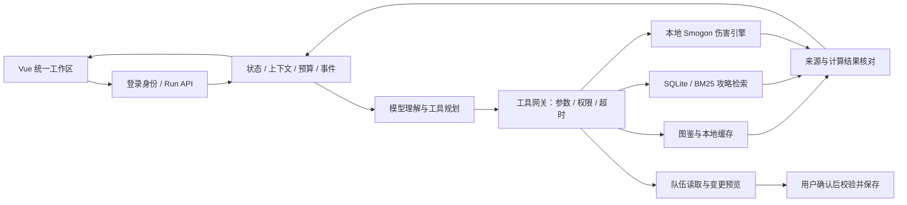

# VIO 宝可梦智能体

一个可在个人电脑运行的网页端 AI 应用：在统一工作区完成宝可梦问答、资料查询、队伍配置和伤害计算。基于 **Java 21 / Spring Boot / Spring AI / Vue 3**，当前模型入口支持 DeepSeek。

模型负责理解问题与选择工具，程序负责权限、确定性计算、来源绑定和保存确认。项目面向 AI 应用开发实践与秋招展示，不需要购买云服务器；模型 API 和首次下载依赖、资料仍需要网络。

## 主要功能

| 功能 | 当前实现 |
| --- | --- |
| 对话工作区 | 正文增量显示、会话历史、消息复制与用户消息编辑、显式会话偏好 |
| 本机账号 | 登录、注册、资料设置；BCrypt 密码哈希，Session/CSRF 与账号归属检查 |
| 资料查询 | PokéAPI Java 适配、本地缓存与摘要校验、中文名称、图鉴卡片 |
| 攻略检索 | 项目原创笔记、SQLite 持久化倒排索引与 BM25、片段及来源展示 |
| 队伍配置 | 招式、特性、道具、性格、等级、EV/IV；缺项与原配置保护 |
| 伤害计算 | Java 调用本地 `@smogon/calc`，保留实际输入、范围、HP、百分比和假设 |
| 受控修改 | 读取 → 变更预览 → 用户确认 → 保存回读；并发冲突不覆盖旧数据 |
| 运行治理 | Run 状态、事件游标、JSON/SSE 快照、取消/超时、幂等、工具白名单和执行预算 |
| 可观测性 | 模型调用与供应商 usage、预算估算、阶段耗时、脱敏失败类别及可读取的 HTTP 状态 |

## 怎样工作



私有规划文字不直接作为公开回答。普通最终回答支持模型正文流；来源节选、已核对的计算与部分固定回复由程序分段发布，不把它们算作模型自主生成或供应商逐 Token 流。

## 本地启动

### 环境

- JDK 21，`JAVA_HOME` 指向 JDK 目录，不能指向 `bin` 或 `java.exe`。
- Node.js 与 npm。本轮使用 Node.js 24.19.0；Vite 声明也支持 20.19+、22.12+ 的相应版本，未逐一实装验证。
- Git、个人 DeepSeek API Key。Maven 使用仓库 Wrapper。

默认本地模式使用 SQLite，不需要另装 PostgreSQL、Redis、Docker 或云服务器。

### 1. 获取代码与依赖

```powershell
git clone https://github.com/vioabio/AI-Agent.git
cd AI-Agent
npm --prefix tools/pokemon-engine ci
npm --prefix vio-ai-agent-frontend ci
if (!(Test-Path src/main/resources/application-local.yml)) {
    Copy-Item src/main/resources/application-local.example.yml src/main/resources/application-local.yml
}
```

已有项目时直接进入项目根目录，不要覆盖自己的本地配置。以下后端命令均在包含 `mvnw.cmd` 的目录执行。

### 2. 启动后端

```powershell
java -version
if ([string]::IsNullOrWhiteSpace($env:DEEPSEEK_API_KEY)) {
    $secret = Read-Host 'DeepSeek API Key（仅本机输入）' -AsSecureString
    $env:DEEPSEEK_API_KEY = [System.Net.NetworkCredential]::new('', $secret).Password
    Remove-Variable secret
}
.\mvnw.cmd '-Dspring-boot.run.profiles=local,deepseek' spring-boot:run
```

后端默认 `http://localhost:8123/api`。Key 只应放在本机环境或被忽略的运行配置中，不发送到聊天、截图或 Git。

使用 IDEA 时：Active profiles 填 `local,deepseek`，Environment variables 中配置 `DEEPSEEK_API_KEY`；不要把 Key 填入 Active profiles。`.run/`、`.idea/` 和私有 `application-local.yml` 均不入库。实际可用模型以账户权限和配置为准，默认模型见公开的 `application-deepseek.yml`。

### 3. 启动前端

另开一个终端：

```powershell
npm --prefix vio-ai-agent-frontend run dev
```

打开 `http://localhost:3000`，注册本机账号并进入助手。Vite 将 `/api` 代理至本机 8123；不要重复启动占用同一端口的后端实例。

### 4. 基础操作

- 查询“杰尼龟的属性和种族值”，核对图鉴资料。
- 在队伍配置填写成员及培养条件，再发起伤害计算。
- 请求修改已保存队伍时先查看预览，真正点击确认后才保存。
- 检索攻略时查看具体片段与来源；资料不足时保留缺项，不要求模型补造。

首次图鉴查询需要 PokéAPI 网络或已校验缓存；模型 Key 不等于搜索服务 Key，也不能修复资料网络。预热、代理和缓存导入见[资料使用说明](document/秋招升级/S2/资料预热与离线包_2026-10-26.md)。

## 数据与配置

本地数据默认位于 `.local-data/`，包含账号、对话、队伍、攻略索引和图鉴缓存。它们保存在当前电脑，不提供跨设备同步；正在执行的 Run 不承诺跨重启自动续跑。具体可配置路径见公开模板，用户私有配置不应提交。

- 默认关闭高风险终端、文件写入、下载和抓取能力；不能把代码中存在的工具当作已授权功能。
- 默认攻略检索不需要 embedding 服务。PGVector、混合检索、OIDC、MCP 及生产适配属于独立可选范围，不是当前本地链默认已验收能力。
- 模型用量、代理 Token 估算、参考费用和供应商账单分别处理。上下文估算未充分校准，参考价格功能默认关闭。
- PokéAPI 是参考资料，不是当前赛事合法性或热门程度证明。逐招记录匹配不证明四招可共同取得；单次伤害不等于实战胜率或整队强度。

## 质量验收

本轮收尾限定为“回答质量验收”和“最终材料整理”；演示视频、另一台机器安装不作为必做门槛。

固定题集有 **36 题、20 组，14 道开发题与 22 道保留题**。工程检查、逐项内容复核、程序固定回复与模型生成分别统计；AI 辅助意见不会标成人工通过。最新完整结果、失败和复核方法统一见：

上一批冻结候选：开发集28/28工程通过，保留集21/22工程通过；保留集逐项AI辅助满足19/22，人工审核0。当时发现的机制建议、变更预览与赛事追问3项缺口已完成[定向修复](document/秋招升级/最终交付/三项质量缺口修复与回归_2026-10-30.md)：65项测试与12/12已知问题及相邻题工程回归通过。原保留集成绩不改分，不宣称新的盲测或全领域质量达标。

2026-10-31 进一步执行整体回归和分批冻结的新输入验证，保留首次偏题、错误策略及初始化失败记录，修复后再单独记为回归。详见[整体回归与新题验证](document/秋招升级/最终交付/整体回归与新题验证_2026-10-31.md)。新题由同一开发助手编写，是未用于当批调试的新输入，不是第三方盲审；AI 辅助意见与正式人工验收分开。默认伤害桥接升级为[版本化 v2 入口](tools/pokemon-engine/README.md)，修复零伤害描述抛错，旧入口与冻结来源保留。

最终后端全量 **1372 项、0 失败/错误、3 跳过**，工具 **307/307**，前端 lint/typecheck、安全契约、**181 项契约测试**和 build 通过。真实问答广泛复测 69 条时发现 1 条内容遗漏/扩写（判据辅助满足 68/69）；最后仅修改比较分类后，按影响范围进行 8/8 定向验证（6 条回归、2 个未用于调试的输入），没有把旧 69 条算成最终版本已全部重跑。分批首次新输入合计 34 个，原始问题与更正过的意见保留，不合并不同候选计算准确率。

- [回答质量验收报告](document/秋招升级/最终交付/回答质量验收报告.md)
- [当前收尾范围与状态](document/秋招升级/剩余任务与最终验收计划_2026-10-30.md)
- [历史开发记录](document/秋招升级/最终交付/历史README_2026-10-30.md)

### 本地检查命令

```powershell
.\mvnw.cmd test
npm --prefix vio-ai-agent-frontend run lint
npm --prefix vio-ai-agent-frontend run typecheck
npm --prefix vio-ai-agent-frontend run test:contract
npm --prefix vio-ai-agent-frontend run security:contract
npm --prefix vio-ai-agent-frontend run build
node tools/campus/s2-evaluate.mjs validate
```

真实模型采集需要隔离账号、资料和运行版本；不要直接把评测命令指向正在使用的个人数据。完整协议及证据入口见验收报告。历史某批测试数或少量重复样本不代表当前全量准确率。

## 面试与代码入口

- [项目讲解、简历描述与常见追问](document/秋招升级/最终交付/面试与项目讲解.md)
- [架构、数据流与设计取舍](document/秋招升级/最终交付/架构与设计取舍.md)
- [后端 Run 生命周期](src/main/java/com/vio/vioaiagent/run/PokemonAgentRunService.java)
- [模型规划与回答发布](src/main/java/com/vio/vioaiagent/agent/ToolCallAgent.java)
- [工具注册与治理](src/main/java/com/vio/vioaiagent/tools/ToolRegistration.java)
- [本地知识检索](src/main/java/com/vio/vioaiagent/pokemon/guides/SqliteGuideKnowledgeRetriever.java)
- [失败脱敏诊断](src/main/java/com/vio/vioaiagent/observability/ModelFailureDiagnostics.java)
- [前端工作区](vio-ai-agent-frontend/src)

## 来源与许可

第三方计算引擎说明见 [THIRD_PARTY_NOTICES](tools/pokemon-engine/THIRD_PARTY_NOTICES.md)，插图来源见 [SOURCES](vio-ai-agent-frontend/public/pokemon/SOURCES.md)。项目原创攻略与外部接口/机制参考分别标注，不把链接存在当作逐条事实核验。

当前仓库没有完整项目 `LICENSE` 文件，`pom.xml` 的许可证元数据为空，本次不擅自指定或改变项目授权；第三方依赖和宝可梦素材有各自使用范围，不能统一宣称均可商用。
