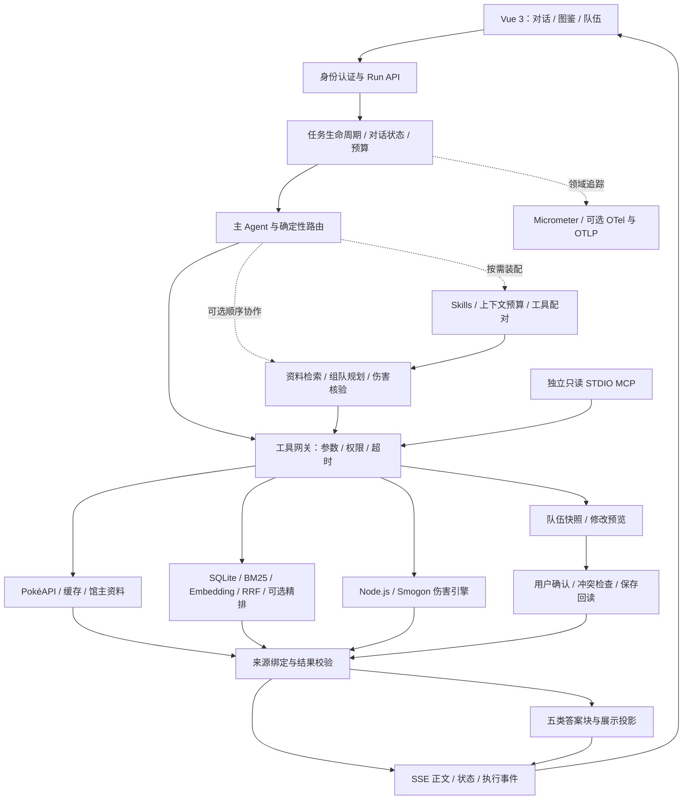

<div align="center">

# VIO 宝可梦智能体

**正式版 v1.1.0** · 2026-11-17 · [发布记录](document/发布记录/v1.1.0.md) · [版本标签](https://github.com/vioabio/AI-Agent/tree/v1.1.0)

**让资料查询、道馆应对、队伍搭配与伤害核验，在一个工作区完成。**

Java 21 · Spring Boot · Spring AI · DeepSeek · Vue 3 · SSE · Tool Calling · RAG · MCP

[快速启动](#quick-start) · [系统架构](#architecture) · [功能配置](#configuration) · [测试验证](#quality) · [学习与面试](#documents)

</div>

主线包含 U0～U6 的能力实现、问答修复、网页适配及学习资料。本次按用户发布指令交付v1.1.0，补充简短回答、已声明版本承接与故障提示修复。回答质量按AI辅助复核登记，人工领域审核持续待办。构建身份、运行包及验证范围见[发布记录](document/发布记录/v1.1.0.md)，上一版见[v1.0.0记录](document/发布记录/v1.0.0.md)。

[GitHub Release](https://github.com/vioabio/AI-Agent/releases/tag/v1.1.0)提供运行包与SHA-256文件。旧`Release candidate`严格镜像发布流程仍缺评测签收及关联证据，详见发布记录的流水线核对章节。

## 项目简介

VIO 是一个面向宝可梦玩家的全栈 AI 应用：通过自然语言查询图鉴、分析已保存队伍、规划道馆挑战，并调用本地引擎核验伤害。用户可以在同一网页中完成对话、资料查看、队伍配置和确认修改。

项目采用 **ReAct 风格的工具调用循环**，将大语言模型的理解与规划能力，与结构化事实、知识检索、确定性计算及操作授权结合。默认运行在个人电脑，使用 SQLite 保存本机数据；聊天模型通过 API 调用。

> 核心流程：**理解需求 → 读取资料与队伍 → 执行工具 → 核对证据 → 展示结果 → 确认后保存**。

## 功能一览

| 能力 | 可以做什么 |
| --- | --- |
| 流式问答 | SSE 输出正文与执行事件，支持历史会话、消息复制与编辑、取消和游标重连 |
| 图鉴查询 | 中英文名称、编号检索，查看属性与种族值，回答卡片联动图鉴，侧栏按网页高度自适应 |
| 道馆应对 | 查询朱／紫馆主初战、重赛配置，结合已保存队伍讨论培养与出招 |
| 队伍配置 | 编辑等级、四招、特性、道具、性格、EV/IV、太晶属性，JSON 导出及多格式导入草稿 |
| 伤害计算 | Java 调用本地 Node.js `@smogon/calc`，保留输入、伤害区间及计算假设 |
| 攻略检索 | SQLite / BM25，可选 Embedding、RRF 混合检索与精排，记录候选、来源和降级状态 |
| 竞技参考 | 分别查询月度使用率与完整六人样例，展示来源、时间及适用范围 |
| 受控修改 | 先读取快照与预览变更，用户确认后校验、保存并回读，冲突时拒绝覆盖 |

导入支持项目 JSON、Showdown TXT/粘贴、CSV，以及包含相同配置文本的 DOCX、文本 PDF。解析后先预览草稿，再确认载入与保存。格式、缺省值和字段范围见[多格式导入说明](document/队伍多格式导入解析方案_2026-11-08.md)。

### v1.1 升级内容

| 专题 | 已实现内容 | 阅读入口 |
| --- | --- | --- |
| 检索精排 | BM25 与语义候选融合，可选精排、输入预算、结果校验、回退与最终来源记录 | [真实精排对照与开发收尾](document/升级计划/v1.1开发收尾与真实精排对照_2026-11-16.md) |
| 结构化答案 | 图鉴、伤害、证据、队伍建议、培养计划五类答案块，联动资料与确认流程 | [卡片与真实模型验收](document/升级计划/U2真实模型卡片验收与伤害路由来源修复_2026-11-15.md) |
| Skills 与上下文 | 六份内置任务知识、角色工具权限交集、完整历史轮次装配与工具调用配对 | [上下文对照与事件校验](document/升级计划/U3上下文完整开发集对照与U6事件证据校验_2026-11-14.md) |
| 领域追踪 | Run、模型、工具调度、审批恢复等领域 Span，可选 OTLP / Jaeger 查询 | [采样与开销对照](document/升级计划/U4采样诊断与开销对照及U6重复验收_2026-11-15.md) |
| 只读 MCP | 独立 STDIO 入口开放三项公开工具，复用网关与权限，支持取消传播 | [服务配置与工具目录](document/升级计划/U5只读STDIO服务与构建核对_2026-11-13.md) |
| 回答与网页 | 馆主序号和阶段承接、属性算式、严格伤害输入、公开样例路由及侧栏视口适配 | [统一修复复测](document/测试文档/测试报告_2026-11-17_统一测试修复与复测.md) |

### 可以这样使用

- **认识宝可梦：**“查一下杰尼龟的属性和种族值。”
- **连续追问：**“朱紫有哪些馆主？”→“按刚才表格第四位的队伍是什么？”→“我的 test1 能应对吗？”
- **培养与计算：**先在队伍中配置成员，再让助手分析搭配；伤害计算条件不足时会询问缺项。
- **查看竞技样例：**“朱紫 OU 单打有哪些完整队伍样例？展示详细配置和来源。”
- **修改队伍：**提出调整要求，检查变更预览，确认后保存。

## 实现重点

### 结构化多轮状态与 Agent 分工

用结构化状态关联馆主目标、挑战阶段与队伍，配合真实快照读取处理连续追问。主 Agent 负责最终回答与确认流程，可选启用**资料检索、组队规划、伤害核验**三个专用角色。

角色使用独立提示词、工具白名单和私有工作记录，在同一后端进程内顺序协作，共享模型、身份、工具网关和请求预算；角色之间交接实际工具证据。

### 资料与计算共同约束回答

通过 PokéAPI 适配、本地缓存、摘要校验和版本绑定获取事实；攻略检索保留原文与来源。属性倍率由程序计算，伤害由固定版本引擎计算，回答区分事实、策略建议和信息缺失。

### 操作授权与执行可靠性

队伍修改采用 Human-in-the-Loop（人工确认），结合账号归属与并发冲突校验。Run 提供超时、取消、调用预算及执行记录；上游断流时保留部分正文并明确失败，浏览器重连通过事件游标补读。

<a id="architecture"></a>
## 系统架构



部分明确的资料与规则查询由程序直接处理；普通回答支持模型正文流。程序分段发布的核验结果与供应商逐 Token 生成分别处理。

## 技术栈

| 层次 | 技术 |
| --- | --- |
| 前端 | Vue 3、TypeScript / JavaScript、Vite、Vue Router、Axios |
| 后端 | Java 21、Spring Boot 3.5、Spring Security、Spring JDBC、Bean Validation |
| AI 应用 | Spring AI、DeepSeek、Tool Calling / Function Calling、Prompt Engineering、RAG |
| 资料与检索 | PokéAPI、SQLite、BM25、可选 Embedding、余弦相似度、RRF 与候选精排 |
| 确定性计算 | Node.js、`@smogon/calc` 0.12.0、本地进程桥接 |
| 可观测性 | REST / SSE、Run ID / Trace ID、Actuator、Micrometer、可选 OpenTelemetry / OTLP、模型用量与阶段耗时 |
| 协议与编排 | 内置任务 Skills、上下文装配、MCP Client、只读 STDIO MCP Server |
| 测试与交付 | JUnit、Spring Boot Test、Node Test Runner、Playwright、GitHub Actions |
| 可选适配 | PostgreSQL / Flyway、Redis、PGVector、OIDC、MCP，分别配置与验证 |

<a id="quick-start"></a>
<a id="本地启动"></a>
## 快速启动

### 1. 准备环境

- **JDK 21**：`JAVA_HOME` 指向 JDK 根目录。
- **Node.js 与 npm**：前端声明支持 `^20.19.0 || >=22.12.0`，实际约束以 `package.json` 为准。
- **Git、DeepSeek API Key**：Maven 使用仓库 Wrapper。

默认本地模式无需安装 PostgreSQL、Redis 或 Docker。首次下载依赖、访问模型和获取在线资料需要网络。

### 2. 获取代码与安装依赖

以下使用 Windows PowerShell，在项目根目录执行：

```powershell
git clone https://github.com/vioabio/AI-Agent.git
cd AI-Agent
npm --prefix tools/pokemon-engine ci
npm --prefix vio-ai-agent-frontend ci

if (!(Test-Path src/main/resources/application-local.yml)) {
    Copy-Item src/main/resources/application-local.example.yml src/main/resources/application-local.yml
}
```

### 3. 启动后端

```powershell
java -version

if ([string]::IsNullOrWhiteSpace($env:DEEPSEEK_API_KEY)) {
    $secret = Read-Host 'DeepSeek API Key（仅本机输入）' -AsSecureString
    $env:DEEPSEEK_API_KEY = [System.Net.NetworkCredential]::new('', $secret).Password
    Remove-Variable secret
}

.\mvnw.cmd '-Dspring-boot.run.profiles=local,deepseek' spring-boot:run
```

后端地址：`http://localhost:8123/api`。使用 IDEA 时，Active profiles 填 `local,deepseek`，Key 填入 Environment variables。默认模型见公开配置 [application-deepseek.yml](src/main/resources/application-deepseek.yml)，实际使用取决于账户权限。

### 4. 启动前端

另开终端，进入项目根目录：

```powershell
npm --prefix vio-ai-agent-frontend run dev
```

访问 **[http://localhost:3000](http://localhost:3000)**，注册本机账号后进入助手。项目没有通用默认账号密码；前端通过 `/api` 代理访问 8123 后端。

<a id="configuration"></a>
<a id="数据与配置"></a>
## 功能配置与数据

| 功能 | 配置方式 | 说明 |
| --- | --- | --- |
| 聊天模型 | `local,deepseek` Profile 与 `DEEPSEEK_API_KEY` | 本地问答入口 |
| v1.1 展示与任务装配 | 增加 `v11-preview` Profile | 启用答案块、Skills 与上下文装配 |
| 三角色分工 | `VIO_AGENT_SPECIALISTS_ENABLED=true` | 默认关闭，开启后重启后端，复用聊天模型与 Key |
| 语义检索 | `VIO_GUIDE_SEMANTIC_ENABLED=true`，另配 Embedding 服务、模型、Key 与维度 | 显式构建索引；未启用时使用 BM25 |
| 候选精排 | `VIO_GUIDE_RERANK_ENABLED=true`，配套服务地址、模型与 Key | 默认关闭，预算与异常回退状态随检索事件记录 |
| 本地领域追踪 | `VIO_TRACING_ENABLED=true`，配置回环 `VIO_TRACING_OTLP_ENDPOINT` 与采样率 | 仅本地 profile 生效，按需启动收集端 |
| 只读 MCP Server | `./ops/local/build-mcp.ps1` | 独立 STDIO 进程，生成本机客户端配置 |
| 通用网页搜索 | `SEARCH_API_KEY`，可选 `SEARCH_API_ENGINE` | 独立的 SearchAPI 凭据，聊天 Key 不能替代 |
| 本地伤害计算 | 安装 `tools/pokemon-engine` 依赖，后端可找到 `node` | 本机进程，无需额外启动 Node HTTP 服务 |

体验 v1.1 展示与任务装配时，用下面的命令启动后端，IDEA 的 Active profiles 填 `local,deepseek,v11-preview`。

```powershell
.\mvnw.cmd '-Dspring-boot.run.profiles=local,deepseek,v11-preview' spring-boot:run
```

三个专用角色、Embedding、精排和追踪分别按上表启用。运行后通过诊断与实际事件核对所选角色、索引就绪状态和 `rerankObservation`。配置字段完整名称见 [application.yml](src/main/resources/application.yml)，本地追踪步骤见 [OTel 配置](document/升级计划/U4本地OTel导出与重启复测_2026-11-13.md)。

精排服务使用 `VIO_GUIDE_RERANK_ENDPOINT`、`VIO_GUIDE_RERANK_MODEL`、`VIO_GUIDE_RERANK_API_KEY`，超时与候选预算可按同一配置文件调整。

完整步骤见[三类专用 Agent 与 Embedding 配置清单](document/三类专用Agent开发与配置清单_2026-11-09.md)。语义索引使用 [构建脚本](ops/local/build-guide-semantic-index.ps1)显式创建；开关为 true 不等于索引已就绪，也不证明当前请求实际使用语义检索。

本机账号、会话、队伍、攻略索引和资料缓存默认存放于 `.local-data/`，不提供跨设备自动同步。Key 和私有运行配置仅存本机，不提交 `.run/`、`.idea/` 或私有 `application-local.yml`。

<details>
<summary>常见启动与数据问题</summary>

- **找不到 mvnw.cmd**：先进入包含 Wrapper 的项目根目录。
- **JAVA_HOME 错误**：检查 `$env:JAVA_HOME` 与 `Test-Path "$env:JAVA_HOME\bin\java.exe"`，路径不能以 `bin` 或 `java.exe` 结尾。
- **8123 被占用**：核对已运行的后端，避免重复启动；仅刷新网页不会更新后端代码或环境变量。
- **图鉴读取失败**：检查 PokéAPI 网络与缓存，模型 Key 不能修复资料连接。参见[资料预热与离线包](document/秋招升级/S2/资料预热与离线包_2026-10-26.md)。
- **开启 Embedding 后仍是 BM25**：依次检查当前进程配置、索引构建、模型／维度／资料指纹和实际查询结果。
- **查询热门队伍只拿到部分资料**：单只月度使用率与完整队表是不同来源；完整样例读取失败时会提供原始链接，不能将使用率前六名拼成队伍。

</details>

<a id="quality"></a>
<a id="测试与质量"></a>
## 测试验证

### 最新验收记录

以下为2026-11-17正式发布构建的工程回归与问答检查。68项业务用例保留同日此前的回归记录，本次发布重新执行45轮质量问答和下列工程检查。

| 范围 | 结果 | 统计与配置范围 |
| --- | --- | --- |
| 后端整体回归 | 1,913 项，0 失败、0 错误、8 项条件跳过 | 条件跳过及运行时摘要见发布工程记录 |
| 前端契约 | 231 项通过 | 同轮通过 lint、类型与安全契约检查及构建 |
| Chrome 网页回归 | 131 项通过 | 123 项基础上新增 8 项图鉴布局检查，使用前端 fixture |
| Node 工具链 | 497 项通过 | 本地脚本与协议检查 |
| 计算桥接 | 13 项通过 | Java / Node 伤害桥接检查 |
| 业务用例 | 68 项通过、0 失败、0 阻塞 | 隔离账号与数据，另有 9 轮长历史背景填充 |
| 质量问答 | 修复后 24 组、45 轮通过 AI 辅助复核 | 首答 11 组通过、13 组失败，原始记录保留，同题回归登记 |

发布问答使用隔离实例、DeepSeek Flash、三个专用角色、Skills、上下文装配和答案块。Embedding为text-embedding-v4、1024维、30片段，精排按默认关闭配置执行。此前开启精排的45轮记录包含3次RRF回退，仍按原报告保留。人工领域质量审核与后续独立题持续验收。[发布复测报告](document/测试文档/测试报告_2026-11-17_v1.1.0发布复测.md) · [发布工程摘要](evaluation/upgrade-v1.1/release/v1.1.0-20261117.json) · [此前统一复测](document/测试文档/测试报告_2026-11-17_统一测试修复与复测.md) · [原首答质量报告](document/测试文档/测试报告_2026-11-17_回答质量首轮验收.md) · [侧栏布局检查](vio-ai-agent-frontend/e2e/workspace-layout.spec.js)

### 检索与协议专项

- 8 题开发检索集含 6 道正例和 2 道无答案题，混合检索与 BM25 的 MRR@5 分别为 0.7500、0.6389，正例文档召回均为 5/6。两批共 144 次检索包含重复采样，精排与混合检索质量持平，精排默认关闭。具体来源失分和延迟波动见[对照记录](document/升级计划/v1.1开发收尾与真实精排对照_2026-11-16.md)。
- STDIO 入口完成一小时有界频率持续验证，包含 7,102 次 ping、60 次图鉴读取与 60 次伤害计算，无效帧和重复响应均为 0。执行条件与取消验证见[夜间验收记录](document/升级计划/U6夜间开发与验收记录_2026-11-15.md)。
- 2026-11-16 本地候选包封存记录包含 294 项文件完整性校验、JAR 私有资源检查与摘要，源码身份按该包 manifest 核对。[本地候选记录](document/发布记录/v1.1.0-rc.1-local.md) · [候选技术摘要](evaluation/upgrade-v1.1/release/local-candidate-20261116.json)

<details>
<summary>历史批次与验证范围</summary>

2026-11-15升级分支完成后端1,873项整体检查（3项条件跳过）、Node工具链492项、计算桥接13项、前端契约230项及Chrome浏览器113项检查。新候选集20题24轮首答为15通过5失败，修复后的同题20题、前批12题及原已知失败12题共44题64轮通过AI辅助复核。完整范围见[夜间交付记录](document/升级计划/U6夜间开发与验收记录_2026-11-15.md)。

以下保留截至 **2026-11-11** 的历史批次结果。

| 范围 | 结果 | 验证内容 |
| --- | --- | --- |
| 后端整体回归 | 1,562 项，0 失败、0 错误、3 跳过 | 最近修复轮 Maven 全量检查 |
| 工具与契约 | 402 / 402 通过 | Node 工具与契约检查集合 |
| 测试文档业务回归 | 68 / 68 通过，0 失败、0 阻塞 | 回答、工具事件、计算、多轮、Embedding、授权与页面操作 |
| 断流与重连 | 2 / 2 通过 | 最新业务验收轮额外执行的 HTTP 与浏览器检查 |

[2026-11-11验收报告](document/测试文档/测试报告_2026-11-11_未知物种修复后重建全量验收.md) · [测试文档与执行计划](document/测试文档/测试文档_总览与执行计划.md)

上述计数不合并为模型准确率。68 项属于已知用例回归，独立新题与更广泛回答质量仍需验证；报告保留了检索排序、答案长度和旧语料说明等观察。

</details>

<details>
<summary>本地检查命令</summary>

```powershell
# 后端运行时，隔离编译产物，避免覆盖正在加载的 target/classes
.\ops\local\test-isolated.ps1
npm --prefix tools/pokemon-engine test
npm --prefix vio-ai-agent-frontend run lint
npm --prefix vio-ai-agent-frontend run typecheck
npm --prefix vio-ai-agent-frontend run test:contract
npm --prefix vio-ai-agent-frontend run security:contract
npm --prefix vio-ai-agent-frontend run build
```

真实模型与故障测试按测试文档使用隔离账号、合成队伍和独立配置，避免修改个人数据。原始运行日志位于本机忽略的 `artifacts/`，克隆后需自行复现，历史报告不代表当前 CI 状态。

</details>

## 目录与源码入口

```text
AI-Agent/
├── src/main/java/com/vio/vioaiagent/
│   ├── agent/               # 主 Agent、专用角色、对话路由与回答校验
│   ├── run/                 # Run 生命周期、上下文、事件与仓储
│   ├── tools/               # 工具注册与执行治理
│   ├── pokemon/             # 图鉴、攻略、道馆、队伍与计算适配
│   ├── security/            # 账号、安全与权限
│   └── observability/       # 用量、预算与诊断
├── vio-ai-agent-frontend/   # Vue 工作区
├── tools/pokemon-engine/   # 本地 Smogon 计算桥接
├── evaluation/             # 评测资料与协议
├── document/               # 学习、设计、开发与验收记录
└── ops/                    # 本地配置脚本与部署模板
```

推荐从 [Run 服务](src/main/java/com/vio/vioaiagent/run/PokemonAgentRunService.java) → [执行器](src/main/java/com/vio/vioaiagent/run/DefaultRunExecutor.java) → [ToolCallAgent](src/main/java/com/vio/vioaiagent/agent/ToolCallAgent.java) → [工具注册](src/main/java/com/vio/vioaiagent/tools/ToolRegistration.java)阅读，再按场景跟踪检索、计算或保存分支。

<a id="documents"></a>
## 文档导航

| 主题 | 入口 |
| --- | --- |
| 统一测试文档 | [68项业务用例、24组质量问答、预期要点与首次回答](document/测试文档/测试文档_统一验收总册.md) |
| PDF下载 | [完整学习路线](output/pdf/项目系统学习路线_2026-11-17.pdf) · [460题面试全书](output/pdf/秋招双岗位面试全书_460题_2026-11-17.pdf) |
| 学习资料总览 | [阅读顺序与每日记录](document/学习与面试/README.md) |
| 系统学习路线 | [基础教程、十四周主线、最新版十天安排与修复案例](document/学习与面试/项目系统学习路线_2026-11-05.md) |
| 面试准备 | [460 题全栈与 AI 应用开发面试全书](document/学习与面试/秋招双岗位全栈与AI应用开发面试全书_2026-11-05.md) |
| 项目表达 | [简历写法与面试展开要点](document/学习与面试/项目简历介绍_2026-11-11.md) |
| v1.1升级计划 | [六项新能力、U0～U6任务与验收回退方案](document/升级计划/v1.1智能体能力升级开发方案_2026-11-12.md) |
| 最新验收 | [2026-11-17统一修复复测](document/测试文档/测试报告_2026-11-17_统一测试修复与复测.md) · [v1.1技术收尾与精排对照](document/升级计划/v1.1开发收尾与真实精排对照_2026-11-16.md) |
| 正式发布 | [v1.1.0运行包、体验修复与验收范围](document/发布记录/v1.1.0.md) · [可复用打包脚本](ops/local/package-release.ps1) |
| 设计说明 | [架构与设计取舍](document/秋招升级/最终交付/架构与设计取舍.md) |
| 公网部署 | [阿里云单机部署手册](ops/aliyun/README.md)：Ubuntu、Nginx HTTPS、systemd与验收 |
| 历史演进 | [历史 README 与交付记录](document/秋招升级/最终交付/历史README_2026-10-30.md) |

## 当前边界与后续方向

- 当前定位是可本地使用、可用于学习与作品展示的领域 AI 应用；公网容量、生产高可用及 Docker / PostgreSQL 环境需分别验证。
- 历史与队伍持久化不代表正在执行的 Run 可跨重启自动续跑。租约隔离、不可变产物与加密 codec 按具体仓储和配置启用。
- PokéAPI 与社区资料不构成赛事合法性认证；单次伤害不等于胜率，完整样例也不等于实时最强阵容。
- 后续优先完善独立质量题集、检索排序与语料更新，扩展资源获取和合法性核对，再推进生产环境验证。

## 来源与许可

计算引擎说明见 [THIRD_PARTY_NOTICES](tools/pokemon-engine/THIRD_PARTY_NOTICES.md)，插图来源见 [SOURCES](vio-ai-agent-frontend/public/pokemon/SOURCES.md)。项目资料、第三方接口、计算依赖与宝可梦素材分别遵循其来源和使用范围。

仓库目前未提供完整项目 `LICENSE`，不能据此推定任意商业使用授权。

<details>
<summary>v1.1 阶段开发归档，按各文档日期阅读</summary>

以下记录对应当时构建、测试计数和后续事项，当前能力与验收入口见上文。

最新开发：[伤害来源证据与回归推进](document/升级计划/U2伤害证据块与U6回归推进_2026-11-14.md)。伤害卡片支持展开双方资料来源和计算引擎版本；来源不全时明确提示，默认开关保持关闭。

后续开发：[队伍参考成员卡片与只读验收](document/升级计划/U2队伍参考卡片与U6只读验收_2026-11-14.md)。完整工具成员可显示为图标卡片并联动图鉴；它不是完整培养配置或已保存队伍，修改继续走现有审批流程。

培养配置展示：[已保存快照与重连验收](document/升级计划/U2培养配置快照与U6重连验收_2026-11-14.md)。新增中文性格、EV/IV、太晶等保存值卡片，覆盖程序快捷读取与Agent工具回调，仍不执行修改或宣称最优培养方案。

配置卡片可复制为新队伍草稿，遇到未保存内容先确认，原队伍不变：[导入草稿与交互回归](document/升级计划/U2配置卡片导入草稿与U6交互回归_2026-11-14.md)。本轮只修改前端与验收脚本，未重跑后端全量。

已保存队伍可显式请求分步骤培养核对，复用受治理的整队检查并区分学习记录与资源缺项：[培养路线与证据核对](document/升级计划/U2保存队伍培养路线与U6证据核对_2026-11-14.md)。完整资源获取和目标约束规划仍待扩展。

培养路线已接入有来源的学习器编号、社区配方及共同获取区域，来源差异和未收录分别标注；运行构建核对新增两个培养组件：[资源接线与构建核对](document/升级计划/U2培养资源目录接线与U6构建核对_2026-11-14.md)。

培养路线新增显式条件复用、冲突确认及新会话隔离，修复馆主目标与条件更新的路由抢占：[条件复用与多轮验收](document/升级计划/U2培养条件复用与U6多轮隔离验收_2026-11-14.md)。条件是用户声明，不会改动版本或保存配置。

培养路线已补目标馆主等级参考、显式目标等级差距和禁止/上限冲突检查；修复目标等级更新被误判成修改队伍：[目标资料与等级核对](document/升级计划/U2目标资料与等级差距核对_2026-11-14.md)。对手等级不是推荐等级，用户声明不会写入保存配置。

培养路线逐招联动升级学习等级、禁止练级、练级上限与声明目标；其他学习途径不自动视作可用：[学习条件联动与验收](document/升级计划/U2招式学习条件联动与U6验收_2026-11-14.md)。

培养路线新增整队学习器条件式预算，累计已知配方的LP与材料、保留争议和缺项，并联动禁止制作与声明上限：[整队资源预算与14轮验收](document/升级计划/U2整队资源预算与U6条件更新验收_2026-11-14.md)。估算不代表实际库存缺口或可执行制作方案。

培养路线步骤五已通过受治理工具核验明确馆主目标的已保存招式覆盖，校验队伍修订号与完整配置；不把覆盖倍率当成伤害或必胜结论：[目标覆盖接线与快照绑定验收](document/升级计划/U2培养目标覆盖接线与U6快照绑定验收_2026-11-14.md)。

培养路线新增保存参数的六项静态能力值及受条件限制的目标等级假设；与锁定的Node库交叉核验250组配置、1,500个数值：[静态能力值对照与数值验收](document/升级计划/U2静态能力值对照与U6数值交叉验收_2026-11-14.md)。不代表游戏内实际面板或最优配置。

培养路线支持明确的徽章、馆主、主线/视察和学习器声明，区分条件缺失、跨字段矛盾、奖励前提与声明持有：[进度与奖励前提核对及18轮验收](document/升级计划/U2进度与奖励前提核对及U6多轮验收_2026-11-14.md)。不代表已读取或核验游戏存档/实际库存。

真实服务开发集完成20题/24轮AI辅助复核（19通过、1范围说明问题），并通过6轮临时队伍培养联调。本轮已补工具范围说明、历史修订适用性与确认拒绝，并新增`v11-preview`配置；补丁实际服务复测须重建重启后进行：[真实服务复核与U3预览配置](document/升级计划/U6真实服务复核与U3预览配置_2026-11-14.md)。

后续已补通用资料合法性单次检索与馆主王牌聚焦追问，后端1,738项整体回归及21轮固定模型页面流程通过；实际模型补丁复测仍需重建重启。见[回答相关性修复](document/升级计划/U6回答相关性修复与聚焦追问验收_2026-11-14.md)。

本地MCP验证客户端已补有界回复窗口和待请求上限，持续连接5,069个请求、五轮慢消费者恢复和自然退出验证通过；MCP联合测试12项、Node测试13项通过。此结果不代表小时级压力或整体版本验收：[持续连接验证与剩余事项](document/升级计划/U5持续连接边界与U6构建阻塞复核_2026-11-14.md)。

U6构建核对现严格检查版本化的23组件清单，并以退出码区分一致、旧构建和环境阻塞；旧记录复核不代表当前版本加载验证。相关14项、相邻22项脚本测试通过：[构建证据门禁](document/升级计划/U6构建证据清单与验收门禁修复_2026-11-14.md)。

培养条件现支持有限的第一人称自然语言声明，例如“我玩的是朱版、刚拿到两枚徽章、我不想练级”；冲突仍需明确纠正，不把声明当作存档或操作许可。最新整体后端1,746项（3跳过）、25轮固定模型页面流程及22项脚本测试通过：[培养声明开发记录](document/升级计划/U2自然语言培养声明与U6多轮验收_2026-11-14.md)。

培养重赛别名已接通等级资料、前提与覆盖核对；明确切换游戏会清除旧培养条件，支持单独发送“清空培养条件”，不删除聊天或修改队伍。该次后端1,753项（3跳过）、29轮固定模型页面、14项脚本测试通过：[培养状态失效与重赛接线](document/升级计划/U3培养状态失效与重赛别名接线_2026-11-14.md)。

官方Java SDK传输层已补显式协议取消与恢复验证，联合MCP测试13项通过；不等同于Future.cancel自动发出取消通知：[SDK取消验证记录](document/升级计划/U5官方SDK取消验证与Git进度快照_2026-11-14.md)。

U4新增工具调度Span并关联冻结的排队/授权/执行耗时，保留回调父子链和重试/缓存边界；构建清单升级为26组件。整体后端1,758项（3跳过）、29轮固定模型页面及14项脚本测试通过，真实Jaeger环境尚待启动：[调度观测开发记录](document/升级计划/U4工具调度Span与耗时关联_2026-11-14.md)。

最新业务回归记录见[U6阶段2业务回归与版本范围修复](document/升级计划/U6阶段2业务回归与版本范围修复_2026-11-15.md)，含可重复执行的采集命令、隔离队伍快照校验、实际Trace关联及剩余来源阻塞。

最新阶段记录见[U6阶段3伤害协作回归与完整队伍来源恢复](document/升级计划/U6阶段3伤害协作回归与完整队伍来源恢复_2026-11-15.md)，包括直接引擎对照、10项常规伤害用例及剩余4项受控专题。

最新测试入口见[阶段3专题收尾与阶段4多轮状态验收](document/升级计划/U6阶段3专题收尾与阶段4多轮状态验收_2026-11-15.md)，提供取消重连浏览器、故障实例、低预算和25轮多会话采集命令。新增脚本89项通过；阶段4覆盖结构化状态与程序校验路径。

最新检索记录见[阶段5混合检索验收与保存状态召回修复](document/升级计划/U6阶段5混合检索验收与保存状态召回修复_2026-11-15.md)。真实v4使用1024维、30片段，另以2维合成向量验证故障边界；97项脚本通过，8题种子属于开发回归集。

</details>
