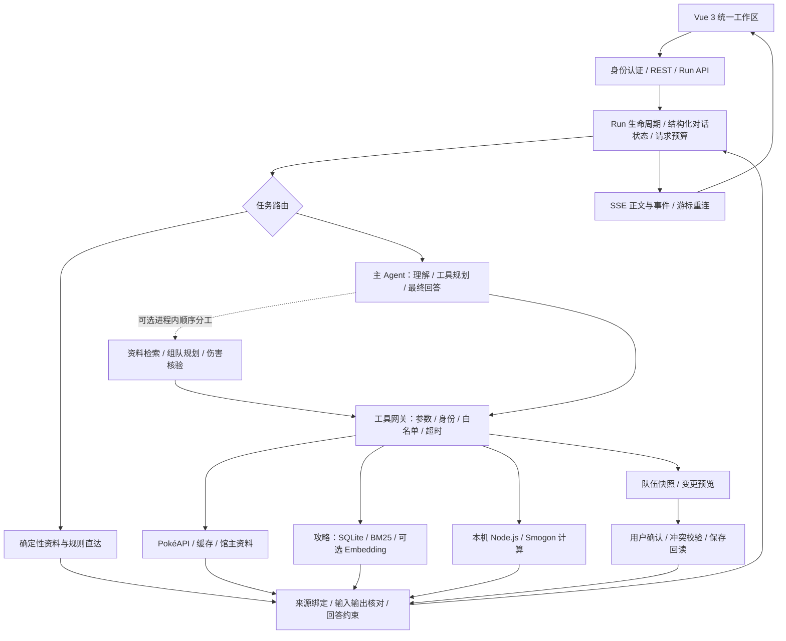

# VIO 宝可梦智能体

面向宝可梦资料查询、培养建议、道馆挑战与队伍搭配的全栈 AI 应用。在统一网页工作区内，通过自然语言完成**查资料 → 分析队伍 → 核验伤害 → 预览修改 → 确认保存**。

基于 Java 21、Spring Boot、Spring AI 和 Vue 3，支持 DeepSeek 流式问答、结构化多轮状态、可选专用 Agent 协作与 BM25 / Embedding 混合检索。默认本地运行，无需云服务器；模型调用与首次在线资料读取需要网络。

[快速启动](#本地启动) · [系统架构](#系统架构) · [测试与质量](#测试与质量) · [配置说明](#数据与配置) · [简历写法](document/学习与面试/项目简历介绍_2026-11-11.md)

## 项目解决什么问题

通用模型可以给出培养建议，但容易混淆游戏版本、沿用旧队伍配置，或在没有计算的情况下生成伤害数值。本项目将模型理解、业务状态、资料证据与实际操作分开处理：

- **资料有来源：**通过 PokéAPI、项目攻略与明确标注的社区资料获取事实，绑定游戏、规则和数据版本；资料不足时展示缺项。
- **数值可复核：**属性倍率由本地规则计算，伤害交给 `@smogon/calc`，回答保留输入条件、伤害范围和计算假设。
- **追问有上下文：**保存馆主目标、挑战阶段与队伍关联等结构化状态，支持“第四位馆主”“这支队伍”“换成重赛”等连续提问。
- **修改需确认：**建议不会直接覆盖队伍，变更必须经过预览、确认、保存与回读，旧快照发生冲突时拒绝覆盖。

## 核心功能

| 场景 | 已实现能力 |
| --- | --- |
| 流式对话 | SSE 正文与执行事件、历史会话、复制和编辑、事件游标重连；上游不完整结束明确失败，不把部分答案标成完整 |
| 图鉴与配置 | 中英文名称／编号索引、对话与右侧图鉴联动、特性／招式／道具候选、中文性格展示 |
| 道馆应对 | 朱／紫馆主初战与重赛资料、馆主切换与连续追问、读取已保存队伍并提供受资料约束的应对建议 |
| 队伍管理 | 1–6 位成员，配置等级、招式、特性、道具、性格、EV/IV、太晶属性；保存、JSON 导入导出及字段校验 |
| 伤害核验 | Java 调用本机 Node.js 引擎，核对真实输入和数值输出；缺失条件先澄清，覆盖零伤害及非法参数 |
| 攻略检索 | SQLite / BM25；可选 Embedding 与混合检索，支持索引指纹、向量缓存、版本过滤和失败降级 |
| 在线竞技参考 | 区分月度单只使用率与完整六人样例；保留来源、时间及非官方边界，读取失败时提供原始链接 |
| Agent 分工 | 主 Agent 统一调度；资料检索、组队规划、伤害核验三个角色使用独立提示词、工具白名单和私有工作上下文 |
| 账号与操作安全 | 本机注册登录、BCrypt、Session/CSRF、账号归属校验；队伍变更预览与人工确认、乐观并发冲突检查 |
| 执行治理 | Run 生命周期、超时与取消、模型／工具预算、工具网关、租约提交隔离；可选持久化适配提供不可变步骤输出 |
| 诊断追踪 | Run ID / Trace ID、步骤事件、模型 usage、阶段耗时、失败类别与脱敏诊断；开发详情按需展开 |

## 技术栈

| 层次 | 技术与职责 |
| --- | --- |
| 前端 | Vue 3、TypeScript / JavaScript、Vite、Vue Router、Axios；统一工作区与响应式布局 |
| 后端 | Java 21、Spring Boot 3.5、Spring Security、Spring JDBC、Bean Validation |
| 模型与编排 | Spring AI、DeepSeek、Tool Calling / Function Calling、ReAct 风格工具循环、Prompt Engineering |
| 知识与资料 | PokéAPI、本地缓存、SQLite、BM25、可选 Embedding 混合检索、来源与版本绑定 |
| 计算 | Node.js、固定版本 `@smogon/calc` 0.12.0、本地进程桥接、参数与结果校验 |
| 通信与观测 | REST、SSE、Run / Trace、Actuator、Micrometer |
| 测试与交付 | JUnit、Spring Boot Test、Node Test Runner、Playwright、GitHub Actions；Nginx / systemd 部署模板 |
| 可选适配 | PostgreSQL / Flyway、Redis、PGVector、OIDC、MCP；与默认本地模式分别配置及验收 |

## 系统架构



专用 Agent 是**同一后端进程内的顺序协作**，共享当前模型、身份、工具网关和请求预算，并非独立部署的三个服务。角色间交接实际工具结果，主 Agent 负责最终回答；私有规划文字不作为公开证据。

普通回答支持模型正文流；部分固定事实、规则与核验结果由程序生成并分段发布。SSE 推送不代表所有内容都是供应商逐 Token 生成。

## 本地启动

### 环境

- JDK 21，`JAVA_HOME` 指向 JDK 目录，不能指向 `bin` 或 `java.exe`。
- Node.js 与 npm。本轮使用 Node.js 24.19.0；Vite 声明也支持 20.19+、22.12+ 的相应版本，未逐一实装验证。
- Git、个人 DeepSeek API Key。Maven 使用仓库 Wrapper。

默认本地模式使用 SQLite，不需要另装 PostgreSQL、Redis、Docker 或云服务器。

### 1. 获取代码与依赖

```powershell
git clone https://github.com/vioabio/AI-Agent.git
cd AI-Agent
npm --prefix tools/pokemon-engine ci
npm --prefix vio-ai-agent-frontend ci
if (!(Test-Path src/main/resources/application-local.yml)) {
    Copy-Item src/main/resources/application-local.example.yml src/main/resources/application-local.yml
}
```

已有项目时直接进入项目根目录，不要覆盖自己的本地配置。以下后端命令均在包含 `mvnw.cmd` 的目录执行。

### 2. 启动后端

```powershell
java -version
if ([string]::IsNullOrWhiteSpace($env:DEEPSEEK_API_KEY)) {
    $secret = Read-Host 'DeepSeek API Key（仅本机输入）' -AsSecureString
    $env:DEEPSEEK_API_KEY = [System.Net.NetworkCredential]::new('', $secret).Password
    Remove-Variable secret
}
.\mvnw.cmd '-Dspring-boot.run.profiles=local,deepseek' spring-boot:run
```

后端默认 `http://localhost:8123/api`。Key 只应放在本机环境或被忽略的运行配置中，不发送到聊天、截图或 Git。

使用 IDEA 时：Active profiles 填 `local,deepseek`，Environment variables 中配置 `DEEPSEEK_API_KEY`；不要把 Key 填入 Active profiles。`.run/`、`.idea/` 和私有 `application-local.yml` 均不入库。实际可用模型以账户权限和配置为准，默认模型见公开的 `application-deepseek.yml`。

### 3. 启动前端

另开一个终端：

```powershell
npm --prefix vio-ai-agent-frontend run dev
```

打开 `http://localhost:3000`，注册本机账号并进入助手。Vite 将 `/api` 代理至本机 8123；不要重复启动占用同一端口的后端实例。

### 4. 基础操作

- 查询“杰尼龟的属性和种族值”，核对图鉴资料。
- 在队伍配置填写成员及培养条件，再发起伤害计算。
- 请求修改已保存队伍时先查看预览，真正点击确认后才保存。
- 检索攻略时查看具体片段与来源；资料不足时保留缺项，不要求模型补造。

首次图鉴查询需要 PokéAPI 网络或已校验缓存；模型 Key 不等于搜索服务 Key，也不能修复资料网络。预热、代理和缓存导入见[资料使用说明](document/秋招升级/S2/资料预热与离线包_2026-10-26.md)。

### 5. 在线竞技资料

- 问“朱紫 OU 最新使用率”，读取 Smogon 最新已发布月度统计，默认无需额外 Key，缓存最长 15 分钟。使用率不代表胜率或完整队伍。
- 问“朱紫 OU 热门队伍及详细配置”，走完整队伍检索，优先读取 Smogon 样例帖及队表；必要时使用固定白名单社区镜像，并标明第三方来源。不会把使用率前六名拼成热门队伍。
- 若来源阻拦、超时或未取得完整配置，返回查阅链接与缺失说明；样例不构成当前赛事合法性认证。
- 通用网页搜索独立配置 `SEARCH_API_KEY`（SearchAPI），可选 `SEARCH_API_ENGINE=google`、`baidu` 或 `bing`。DeepSeek Key 不能替代搜索 Key。

## 公网部署

提供[阿里云单机部署操作手册](ops/aliyun/README.md)：Windows 隔离打包 → Ubuntu → Nginx HTTPS → systemd → 登录与问答验收。沿用 SQLite 与本机账号链，适合个人作品展示；公网容量和高可用需要另行验证，密钥仅在服务器配置。

## 数据与配置

三类专用 Agent 通过 `VIO_AGENT_SPECIALISTS_ENABLED=true` 开启并重启后端，默认关闭，复用当前聊天模型与 Key，不需分别部署服务。主 Agent 保留最终校验与队伍修改确认；固定馆主资料、确定性检查等程序直达路径继续复用。每个请求最多6次专用规划、8次工具选择，仍受更严格的全局预算与截止时间约束。评测策略启用时保留单 Agent 基线。旧的 `VIO_AGENT_GUIDE_RESEARCH_ENABLED` 仅在总开关关闭时生效，避免重复检索。

Embedding 独立配置服务、模型、Key 与维度，再使用 `ops/local/build-guide-semantic-index.ps1` 显式构建；不启用时使用 BM25。[统一配置与验收清单](document/三类专用Agent开发与配置清单_2026-11-09.md)列出了需要你处理的全部配置及检查步骤。

本地数据默认位于 `.local-data/`，包含账号、对话、队伍、攻略索引和图鉴缓存。它们保存在当前电脑，不提供跨设备同步；正在执行的 Run 不承诺跨重启自动续跑。具体可配置路径见公开模板，用户私有配置不应提交。

- 默认关闭高风险终端、文件写入、下载和抓取能力；不能把代码中存在的工具当作已授权功能。
- 默认攻略检索不需要 embedding 服务。PGVector、混合检索、OIDC、MCP 及生产适配属于独立可选范围，不是当前本地链默认已验收能力。
- 模型用量、代理 Token 估算、参考费用和供应商账单分别处理。上下文估算未充分校准，参考价格功能默认关闭。
- PokéAPI 是参考资料，不是当前赛事合法性或热门程度证明。逐招记录匹配不证明四招可共同取得；单次伤害不等于实战胜率或整队强度。

## 测试与质量

以下是**不同批次与范围**的验收结果，不合并为模型准确率。更新日期：2026-11-11。

| 范围 | 最近已记录结果 | 说明 |
| --- | --- | --- |
| 后端整体回归 | 1,562 项，0 失败、0 错误、3 跳过 | 最近修复轮的 Maven 全量记录；不代表全部外部环境已验收 |
| 工具与契约检查 | 402 / 402 通过 | Node 测试集合，含工具及契约检查；不是 402 个真实模型问答 |
| 测试文档全量验收 | 68 / 68 通过，0 失败、0 阻塞 | 用户重建后端后，覆盖资料、计算、长对话、Embedding、治理及页面操作 |
| HTTP 断流与浏览器重连 | 2 / 2 通过 | 最新业务验收轮额外重跑，检查部分正文、失败状态及不重复生成 |

68 项验收包括实际回答内容、工具事件、计算结果及页面行为核对，**属于已知用例回归**。仍需扩大独立新题和自由回答质量验收；现有记录保留了检索排序、答案偏长与旧语料说明等观察，不能据此宣称消除幻觉或全领域回答正确。

- [最新 68 项验收报告与证据索引](document/测试文档/测试报告_2026-11-11_未知物种修复后重建全量验收.md)
- [测试文档总览与执行计划](document/测试文档/测试文档_总览与执行计划.md)
- [历史回答质量验收报告](document/秋招升级/最终交付/回答质量验收报告.md)
- [历史整体回归与新题验证](document/秋招升级/最终交付/整体回归与新题验证_2026-10-31.md)

最近修复轮本机日志：`artifacts/species-failure-backend-final.log`、`artifacts/species-failure-tools.log`。原始运行产物不入库，克隆仓库后应重新运行检查，不能将文档数字当作当前 CI 结果。

### 本地检查命令

```powershell
.\mvnw.cmd test
npm --prefix tools/pokemon-engine test
npm --prefix vio-ai-agent-frontend run lint
npm --prefix vio-ai-agent-frontend run typecheck
npm --prefix vio-ai-agent-frontend run test:contract
npm --prefix vio-ai-agent-frontend run security:contract
npm --prefix vio-ai-agent-frontend run build
```

真实模型及故障测试按测试文档使用隔离账号、合成队伍和独立配置，避免修改个人数据。Embedding 验收还需独立服务配置及显式索引构建。

## 能力边界与后续方向

- 当前适合本地使用及秋招作品展示；Docker / PostgreSQL 等环境验证另计，不承诺生产高可用或未完成 Run 跨重启自动重放。
- 租约、加密步骤输出等基础设施按仓储和 codec 配置启用，不应理解为默认 SQLite 模式已具备全部生产治理能力。
- PokéAPI、社区队表和攻略各有适用范围；成员学习记录匹配不证明完整配招或整队赛事合法性。
- 道馆建议依赖实际等级、进度和资源；单次伤害区间不等于胜率。缺少条件时先询问，不补造精确数值。
- 后续优先扩展独立质量题集、检索排序与语料更新，再补全资源获取／合法性校验和生产环境验证。

## 面试与代码入口

- [全栈与 AI 应用开发学习路线：Java/Spring Boot、Vue/TS、SQL 基础教程，十四周路线与十二个新版 Agent 实验](document/学习与面试/项目系统学习路线_2026-11-05.md)
- [双岗位秋招面试全书：420 题，覆盖 Vue 3/Spring Boot、Python/FastAPI、AI 应用、项目与 HR，含智美官网部署及供应商 SEO 接口专项，附回答要点、追问与动手示例](document/学习与面试/秋招双岗位全栈与AI应用开发面试全书_2026-11-05.md)
- [大厂 JD 调研与覆盖矩阵：7 家公司、10 个有正文依据的岗位，区分校招、实习与社招](document/学习与面试/大厂JD调研与题库覆盖矩阵_2026-11-05.md)
- [原 168 题项目题库：源码定位与模拟面试](document/学习与面试/秋招AI应用开发面试题库_2026-11-05.md)
- [项目讲解、简历描述与常见追问](document/秋招升级/最终交付/面试与项目讲解.md)
- [架构、数据流与设计取舍](document/秋招升级/最终交付/架构与设计取舍.md)
- [后端 Run 生命周期](src/main/java/com/vio/vioaiagent/run/PokemonAgentRunService.java)
- [模型规划与回答发布](src/main/java/com/vio/vioaiagent/agent/ToolCallAgent.java)
- [工具注册与治理](src/main/java/com/vio/vioaiagent/tools/ToolRegistration.java)
- [本地知识检索](src/main/java/com/vio/vioaiagent/pokemon/guides/SqliteGuideKnowledgeRetriever.java)
- [失败脱敏诊断](src/main/java/com/vio/vioaiagent/observability/ModelFailureDiagnostics.java)
- [前端工作区](vio-ai-agent-frontend/src)

## 来源与许可

第三方计算引擎说明见 [THIRD_PARTY_NOTICES](tools/pokemon-engine/THIRD_PARTY_NOTICES.md)，插图来源见 [SOURCES](vio-ai-agent-frontend/public/pokemon/SOURCES.md)。项目原创攻略与外部接口/机制参考分别标注，不把链接存在当作逐条事实核验。

当前仓库没有完整项目 `LICENSE` 文件，`pom.xml` 的许可证元数据为空，本次不擅自指定或改变项目授权；第三方依赖和宝可梦素材有各自使用范围，不能统一宣称均可商用。
