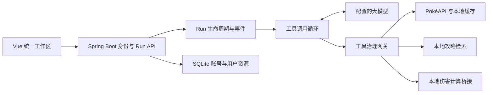

# VIO 宝可梦智能体

基于 **Java 21、Spring Boot、Spring AI 与 Vue** 的宝可梦知识问答和队伍分析应用。接入真实图鉴资料与确定性伤害计算，支持工具调用、正文流式输出、本地账号和数据持久化。

项目面向 AI 应用开发与智能体工程实践，默认支持在个人电脑运行，无需购买服务器。本仓库也保留版本化知识、工具治理、MCP 和生产适配代码；这些扩展的实现、启用和实测状态需要分别确认。

> **秋招升级路线：** [秋招智能体项目完整升级方案](document/秋招智能体项目完整升级方案_2026-10-22.md)。当前可演示应用已具备基础，下一步优先补齐队伍任务执行闭环和真实效果评测。

## 能做什么

- **知识问答**：围绕朱／紫资料和队伍配置进行多轮问答，增量展示回答。
- **图鉴查询**：通过 PokéAPI 适配器获取资料，保存本地缓存、来源、抓取时间与摘要。
- **队伍配置**：保存成员、招式、特性、道具、性格、等级、努力值和个体值。
- **伤害分析**：Java 调用本地固定版本 `@smogon/calc`，由模型结合返回结果解释条件与搭配。
- **攻略检索**：检索内置原创攻略，返回标题、正文、作者、日期等信息。
- **本地账户**：注册、登录、预设头像、昵称、修改密码、恢复码、切换账户及退出。
- **统一工作区**：对话、图鉴、队伍和计算集中使用，支持历史消息、编辑/复制、取消与重连。

图鉴中存在某个物种或招式，不代表其符合当前比赛规则；资料缓存也不代表实时环境强度排名。伤害结果依赖输入条件，不等于胜率或完整对战模拟。

## 核心设计



1. **模型与程序分工**：模型组织语言和选择工具；结构化事实、参数校验和伤害数值交给相应工具。
2. **执行有边界**：工具调用经过白名单、参数、权限与超时等约束，运行过程以事件记录；高风险工具默认不向训练家开放。
3. **数据按账号隔离**：认证上下文确定当前主体，历史、队伍和收藏按归属读取。本地密码及恢复码使用哈希存储。
4. **回答与过程分开**：正文以增量事件展示，工具过程可展开。任务阶段与工具结果不等于模型内部推理内容。

## 当前能力与边界

| 模块 | 当前状态 | 说明 |
|---|---|---|
| DeepSeek 对话与工具循环 | 已实现，有本地验证记录 | 实际输出效果仍受模型、网络和资料影响 |
| 图鉴、队伍、伤害计算 | 已实现，有功能测试 | 本地计算依赖 Node.js 与引擎包 |
| 本地账号与资源持久化 | 已实现，有隔离/恢复/浏览器测试 | 不提供跨设备同步；重启后重新登录 |
| 默认攻略知识库 | 基础可用 | 当前 4 篇原创笔记、关键词检索，不是成熟语义知识库 |
| 混合检索、PGVector、版本化知识门面 | 有实现，按配置启用 | 不能据此认定当前本地链已完成真实向量检索与质量验收 |
| 多智能体与自研 MCP 协议栈 | 实验/兼容能力 | 不作为已验收的生产多 Agent 集群宣传 |
| Run 恢复、租约、生产持久适配 | 有实现与测试，存在启用边界 | 不承诺本地重启后自动续跑任意模型或有副作用步骤 |
| 模型质量评测 | 待补强 | v1.1 七类数据集共 17 条样例，manifest 仍为 draft/scaffold |
| 生产部署与多实例 | 独立验收范围 | 本机功能测试不替代 PostgreSQL、多实例和发布现场证据 |

当前主链每次最多回填同一账号、同一会话的最近 20 条已完成历史，总计不超过 12000 字符；这属于基础上下文窗口，不能等同于完整长期记忆系统。

## 本地快速启动

### 环境

- JDK 21，并正确设置 `JAVA_HOME`；可先运行 `java -version` 检查。
- Node.js 20 与 npm。
- Git；Maven 可使用仓库提供的 Wrapper。
- 个人模型 API Key。下面以现有 DeepSeek profile 为例；模型服务需要网络访问。

默认本地模式使用 SQLite，不需要安装 PostgreSQL、Redis、Docker 或云服务器。首次安装 Maven/npm 依赖，以及首次拉取图鉴资料时仍需要相应网络。

### 1. 获取项目并安装 Node 依赖

以下命令在 PowerShell 中运行：

```powershell
git clone https://github.com/vioabio/AI-Agent.git
cd AI-Agent
npm --prefix tools/pokemon-engine ci
npm --prefix vio-ai-agent-frontend ci
```

已有项目时直接进入项目根目录，不需要再次克隆。Maven Wrapper 必须在项目根目录执行。

### 2. 启动后端

在当前 PowerShell 中设置个人 Key，再启动：

```powershell
$env:DEEPSEEK_API_KEY = '替换为你的个人 API Key'
.\mvnw.cmd spring-boot:run "-Dspring-boot.run.profiles=local,deepseek"
```

Key 仅应存于本机环境或受忽略的本地配置，不要提交到 Git。IDEA 运行时，Active profiles 设为 `local,deepseek`，并在该运行配置中设置 `DEEPSEEK_API_KEY`。

DeepSeek profile 使用 OpenAI 兼容客户端并关闭 DashScope 自动装配，不需要同时填写百炼 Key。模型默认值以 [application-deepseek.yml](src/main/resources/application-deepseek.yml) 为准；如账号支持的模型不同，可设置 `DEEPSEEK_MODEL`。

后端默认地址：`http://localhost:8123/api`。如果提示端口被占用，先检查是否已有后端运行，避免同时启动多个实例。

Linux/macOS 可使用 `./mvnw spring-boot:run -Dspring-boot.run.profiles=local,deepseek`，环境变量使用当前 shell 对应的设置方式。

### 3. 启动前端

在另一个终端进入项目根目录：

```powershell
npm --prefix vio-ai-agent-frontend run dev
```

访问 `http://localhost:3000`，根路径会转到 `/game-master`。创建本地账号、保存恢复码并登录后，直接进入助手，无需经过中间首页。

### 4. 完成一次演示

1. 查询“杰尼龟”，查看图鉴和来源。
2. 加入队伍，填写招式与培养配置并保存。
3. 将当前成员资料带入对话，请助手分析。
4. 在计算区填写完整攻防条件，执行伤害计算并讨论结果。
5. 从左下角账户菜单修改资料；如有旧匿名数据，首次创建的账号可确认认领自己的旧会话和队伍。

目前界面可以完成以上操作；“自然语言分析后由 Agent 预览并确认保存队伍修改”的完整闭环列入下一阶段开发，不提前视为已实现。

## 本地数据与配置

| 数据 | 默认位置 |
|---|---|
| 账号、密码/恢复码哈希 | `.local-data/accounts.sqlite` |
| 会话与完整历史消息 | `.local-data/history.sqlite` |
| 队伍配置 | `.local-data/teams.sqlite` |
| 收藏 | `.local-data/favorites.sqlite` |
| PokéAPI 缓存 | `.local-data/pokeapi/` |
| 内置攻略 | `src/main/resources/pokemon-guides/index.json` |

`.local-data/` 已被 Git 忽略。SQLite 文件中还有个人聊天和配置内容，备份时应按个人数据处理。恢复码仅在生成时显示，重设或修改密码后会轮换。

本地账号只允许在 `local` 且非 `prod/demo` 环境启用，与 OIDC 互斥。需要使用企业 OIDC 时，先设置 `VIO_LOCAL_ACCOUNTS_ENABLED=false`，再按对应身份配置和验收流程接入。

可选配置：

- `DEEPSEEK_MODEL`：覆盖本地模型配置。
- `VIO_LOCAL_HISTORY_PATH`：覆盖历史数据库位置。
- `vio.local-accounts.path` / `vio.local-teams.path` / `vio.local-favorites.path`：覆盖对应存储位置。
- `VIO_POKEMON_REFERENCE_ENABLED`：本地图鉴资料模块开关。
- `VIO_DAMAGE_ENGINE_ENABLED`：本地伤害引擎开关。
- `VIO_LOCAL_GUIDES_ENABLED`：本地攻略模块开关。

联网搜索需要单独配置有效的 `search-api.api-key` 并启用 `vio.tools.search.enabled`。模型 Key 不等于搜索服务 Key；未配置时不提供搜索工具。

### 常见问题

- **找不到 Maven Wrapper**：先进入包含 `mvnw.cmd` 的项目根目录，不要在 `C:\WINDOWS\system32` 执行。
- **JAVA_HOME 无效**：指向 JDK 安装目录，不能指向 `bin` 或 `java.exe`；先更新 `JAVA_HOME`，再把它的 `bin` 加入当前终端的 `Path`。
- **图鉴上游不可达**：可设置 `VIO_POKEAPI_PROXY=http://127.0.0.1:你的代理端口`，或在 `.local-data/pokeapi-network.properties` 配置 `proxy=http://127.0.0.1:端口` 后重启后端。此处不填写模型 Key，不使用带账号密码的代理 URL；已有校验通过的缓存可继续复用。
- **需要预热图鉴缓存**：可在根目录运行 `./tools/warm-pokemon-reference.ps1 -Query squirtle`；脚本说明与限制见[资料代理修复记录](document/正式版v1.1开发计划/PokéAPI查询500与本地代理修复_2026-10-21.md)。

## 测试与评测

在项目根目录运行后端测试和引擎测试：

```powershell
.\mvnw.cmd test
npm --prefix tools/pokemon-engine test
```

前端检查：

```powershell
cd vio-ai-agent-frontend
npm run lint
npm run typecheck
npm run test:contract
npm run build
npm run test:e2e
```

浏览器测试需要 Playwright 浏览器运行环境；本项目的已有 Windows 验证记录使用本机 Edge。PostgreSQL 集成测试还需要可用的对应测试环境，不能把跳过视为通过。

已有验证记录（2026-10-21，属于历史证据，不是本次文档修改重新执行的结果）：

| 范围 | 记录 |
|---|---|
| 后端完整离线 Maven 回归 | 847 项，0 失败、0 错误、3 跳过 |
| 最终账号/安全/持久化定向验证 | 16 项通过 |
| 前端契约 | 100 项通过 |
| 浏览器完整回归 | 55 项通过 |
| 后续登录布局、紧凑聊天专项 | 有单独验证记录，与完整回归存在重叠，不累加总数 |

上述记录支持工程行为验证，不能转换为模型回答准确率、真实任务成功率或生产吞吐量。运行证据目录 `artifacts/` 被忽略，记录并不随克隆自动提供；请按命令复现。

评测入口与规则见 [evaluation/README.md](evaluation/README.md)。CI 模式验证契约和样例；发布模式要求真实数据、实测报告和门禁证据。当前样例不能充当完整黄金集，新增秋招评测也不应降低既有发布标准。

## 下一阶段升级

| 顺序 | 优先级 | 目标 |
|---|---|---|
| S0 | P0 | 冻结演示范围与模型/数据/工具基线 |
| S1 | P0 | 读取队伍 → 追问 → 查询/计算 → 变更预览 → 确认保存 |
| S2 | P0 | 构建真实任务评测集，形成基线与失败分析 |
| S3 | P1 | 扩充资料，完成可引用、可评测的检索链路 |
| S4 | P1 | 完善 Token 预算、上下文和任务耗时/费用记录 |
| S5 | P1 | 交付架构图、演示视频、效果报告与面试材料 |

详细开发步骤、建议验收目标、测试设计和完成定义见 [完整升级方案](document/秋招智能体项目完整升级方案_2026-10-22.md)。目标值均为规划，不是当前成绩。

## 代码入口

| 目录/文件 | 职责 |
|---|---|
| `src/main/java/com/vio/vioaiagent/run/` | Run 生命周期、事件、历史与持久化适配 |
| `src/main/java/com/vio/vioaiagent/agent/` | Agent 执行与工具调用循环 |
| `src/main/java/com/vio/vioaiagent/tools/governance/` | 工具参数、权限、执行边界与审计 |
| `src/main/java/com/vio/vioaiagent/pokemon/` | 事实、队伍、资料、攻略和伤害引擎 |
| `src/main/java/com/vio/vioaiagent/rag/` | 检索、知识生命周期与相关扩展 |
| `src/main/java/com/vio/vioaiagent/security/` | 身份、账号、授权和安全基础 |
| `vio-ai-agent-frontend/src/views/GameMaster.vue` | 统一工作区 |
| `tools/pokemon-engine/` | 固定版本的本地计算桥接与测试 |
| `evaluation/` | 评测数据、契约、运行和门禁 |

## API、路由与扩展文档

Swagger 默认入口：`http://localhost:8123/api/swagger-ui.html`。本地账号模式下，受保护接口需要已登录会话；程序客户端也需要遵守对应认证与 CSRF 约束。接口快照见 [OpenAPI 契约](contracts/openapi-v1.1.json)。

| 前端路由 | 行为 |
|---|---|
| `/` | 重定向到助手 |
| `/game-master` | 登录后使用的统一助手工作区 |
| `/pokemon-workbench` | 兼容入口，转到助手并打开资料面板 |
| `/super-agent` | 兼容入口，转到统一助手工作区 |

生产适配、OIDC、MCP、PostgreSQL/pgvector、容器化和监控属于独立配置与验收范围。CI 工作流存在不代表最近远程流水线已通过，也不代表完成真实生产部署。

- [秋招完整升级方案](document/秋招智能体项目完整升级方案_2026-10-22.md)
- [本地账号实施与使用说明](document/正式版v1.1开发计划/本地账号与登录界面实施_2026-10-21.md)
- [PokéAPI、队伍、伤害与攻略落地记录](document/正式版v1.1开发计划/PokéAPI与队伍伤害攻略四阶段落地_2026-10-20.md)
- [网页端响应式适配](document/正式版v1.1开发计划/网页端响应式适配_2026-10-21.md)
- [历史 v1.0 开发计划](document/正式版v1.0开发计划/README.md)
- [历史企业级实现与待验收边界](document/正式版v1.0开发计划/M2-M7实施完成记录.md)
- [第三方计算引擎说明](tools/pokemon-engine/THIRD_PARTY_NOTICES.md)
- [图鉴插图来源](vio-ai-agent-frontend/public/pokemon/SOURCES.md)

历史计划用于追溯，不替代当前代码和指定运行配置的验证结果。

## 许可证与第三方来源

项目源代码沿用原有的 Apache 2.0 许可声明。第三方依赖与宝可梦名称、插图等资源分别遵循其对应许可与使用范围，不能将项目源码许可视为这些资源的授权。

计算引擎许可说明和图鉴插图来源见上方链接；对外发布前应同时核对完整许可文件、依赖声明与资源来源记录。
