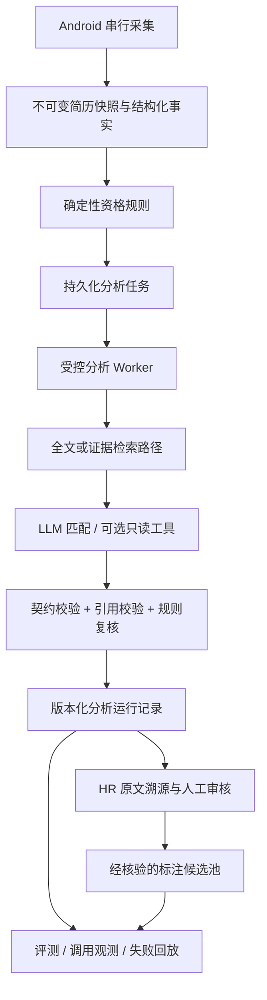

# AI 简历匹配项目升级实施方案 V2

> 2026-11-06 进度更新：核心接入开发、新环境与隔离 MySQL 验收已完成，远程 CI 三组全部通过；证据集中记录在 [环境验收记录](UPGRADE_ENVIRONMENT_ACCEPTANCE.md)。本页 11 月 5 日的逐轮记录保留原状态，真实模型/标签、手机切换和生产发布仍未验收。

后续由操作者逐步推进的具体命令、勾选项、前置缺口和记录模板，见 [真实模型接入、质量评测与灰度操作手册](LIVE_VALIDATION_AND_ROLLOUT_RUNBOOK.md)。手册未执行的真实步骤保持未验收。

当前选定的新开发方向：以 recruiting-copilot 编排猎聘与 BOSS 双平台电脑端采集，现有 AI-HR 负责正式分析和审核，见 [双平台接入开发方案](DUAL_PLATFORM_COPILOT_INTEGRATION_PLAN.md)。用户已选择暂缓完整真实质量评测；接入检查和未验收的质量工作分别记录。

更新日期：2026-11-05

适用项目：`D:\jianlizhuanqu`

评审基线：提交 `4bb71d2` 及当前工作区；原分析见 [AI_APPLICATION_UPGRADE_ROADMAP.md](AI_APPLICATION_UPGRADE_ROADMAP.md)。

## 1. 建议结论

项目应定位为**可评测、可溯源、可回放的 AI 招聘辅助决策系统**。已有的严格契约、三态降级、缓存去重和人工审核是基础，升级重点是证明判断质量、提供原文证据，以及让分析任务独立可靠地运行。

推荐顺序：**工程基线与异常语义 → 离线评测和调用观测 → 证据溯源与检索对照 → 持久化任务与受控并发 → 有限工具调用 → 演示与交付**。

最小可交付版本包含评测基线、AI/FDE 演示、可点击证据与失败回放。RAG 是否成为默认路径、Agent 是否上线，由对照实验决定。平台价值来自完整的质量与运行闭环，不能由用了多少框架或向量数据库来判断。

本文包含设计、开发阶段及实际推进记录。**第 1–4 阶段已实现相应本地功能或工具/合成子范围；第 5 阶段已实现队列、合成采集/HR 影子和 SDK 假服务逐请求闭环；第 6 阶段已实现四个只读工具与有限编排的离线初版；第 7 阶段已交付本地统一合成验收入口和演示说明，发布/新环境验收未完成。真实采集/provider/正式 HR 投影与生产工具路径未切换。**

范围和验收见第 12.5 节及 [阶段 1](UPGRADE_STAGE_1.md)、[阶段 2](UPGRADE_STAGE_2.md)、[阶段 3](UPGRADE_STAGE_3.md)、[阶段 4](UPGRADE_STAGE_4.md)、[阶段 5](UPGRADE_STAGE_5.md)、[阶段 6](UPGRADE_STAGE_6.md)。仅使用本地合成 SQLite、HR 演示、SDK 假服务和脚本 provider，没有连接生产库、手机或真实模型；第 1 阶段敏感配置只做存在性与 HTTP 检查。第 2 节是升级前基线，不代表改造后状态。

## 2. 对原方案的核对与修正

### 2.1 本次确认的事实

| 核对对象 | 代码事实 | 对升级的影响 |
| --- | --- | --- |
| 输出契约 | `analysis_contract.py` 使用 dataclass 和手写校验；六个顶层字段固定，`evidence_summary` 是字符串列表 | 原方案“Pydantic 严格校验”表述应修正；直接把引用对象塞进原字段会破坏上下游类型 |
| 分析入口 | `analysis_gateway.py` 统一分派 Coze / OpenAI 兼容适配器；后者使用同步 `chat.completions.create` | 可在网关附近扩展，不需要先重写采集层；Chat Completions 本身不能作为架构落后的依据 |
| 超时与重试 | 默认单次调用超时 240 秒、最多 4 次应用层尝试，SDK 重试关闭 | 最坏一次分析可能接近 16 分钟再加退避，不能把 240 秒当成端到端上限 |
| 阈值 | AI 岗位 `relevant_score_min=80`；共享报表对 `needs_review` 使用 90 分门槛 | 80 是模型匹配契约约束，90 是待复核报表门槛，不能统一替换 |
| 测试漂移 | 本次单独重跑 `test_export_labels_low_score_needs_review_as_below_review_threshold`，确实失败：测试期望 80，代码输出 90 | 修测试应覆盖 89/90 边界；不能只改报错文本 |
| 异常识别 | `reporting_rules.py`、`db_daily_report.py`、PDF、飞书逻辑存在 `"Coze API"` 文本判断；临时缓存识别依赖中文原因字符串 | 不只是显示名称错误，还存在供应商耦合的业务判断，需改为结构化状态 |
| 岗位路径 | AI 配置文件是 `config/job_profiles/ai_development_engineer.yaml`，FDE 是 `fde_ai_deployment_engineer_draft.yaml`；文件内 ID 才带 `_v1` | 文档、脚本要区分配置路径与岗位 ID；不能凭 `_draft` 文件名判断其未启用 |
| 缓存版本 | `analysis_policy.py` 按岗位返回配置版本；现有唯一键为指纹、正文哈希、分析版本 | 手工版本号容易遗漏 prompt/JD/模型/检索变化；需建立完整版本指纹 |
| 并发范围 | 分析适配器同步；HR API 已有 `async def` 异常处理函数 | 原方案“全项目无 async”过宽；并发改造应针对独立分析任务 |
| 证据展示 | API `CandidateDetailResponse` 和前端 `AIAnalysisPanel` 都使用 `list[str]` / `string[]`；`ResumeDocument` 重新解析正文展示 | 引用升级须同步考虑数据库、API、OpenAPI、前端类型与文本位置映射 |
| 数据层 | 项目实际使用 MySQL，演示使用 SQLite；当前依赖没有 PostgreSQL 驱动 | 为单份简历检索增加 PostgreSQL/pgvector 没有必然性 |

上述结果来自定向静态核对；“未发现某功能”不等于穷尽所有文件后的形式证明。原报告的 234/235、17/17、包体积和历史工作区数量只作为原报告记录，不宣称是本次重新测得。

### 2.2 原建议需要调整的地方

| 原建议 | V2 调整 | 原因 |
| --- | --- | --- |
| RAG / Agent 是所有 AI 岗的必答功能 | 用岗位需求和真实业务收益决定，评测与证据可信度优先 | 不能用技术名词数量代替项目质量 |
| 全文输入直接换 RAG | 保留全文基线，比较全文、词法检索、混合检索 | 简历通常是单文档；检索可能丢掉否定条件、时间和上下文 |
| 硬条件由模型选择工具调用 | 程序必跑硬规则，模型只选择允许的只读补充工具 | 跳过工具不能绕开准入规则 |
| 工具失败统一退回单次调用 | 按故障类型分流，只有能力不支持等明确情况可回退 | 安全校验失败时回退可能绕过校验，重复调用还会扩大成本 |
| 并发 4 就能提升吞吐 | 设备串行、分析解耦；先持久化任务，再小规模并发 | 信号量不能解决崩溃恢复、重复任务和过期结果覆盖 |
| 安全放 P2 | 与 CI、异常状态一起进入首阶段 | 若原报告中的真实凭据和公开 PDF 风险仍存在，应先处理；本次没有读取或验证密钥 |
| 两周完成所有内容 | 两周完成最小闭环，完整版本按 3–5 周估算 | 标注、评测、迁移、故障恢复都需要时间；工期不是质量承诺 |
| 提交所有积压改动、删除临时副本 | 先逐项审核归属、敏感内容和用途，按功能整理 | 当前工作区有其他人的成果，升级任务不应擅自提交或删除 |

## 3. 产品边界与不变量

### 3.1 三种业务判定分别管理

1. **资格判定**：由既有岗位配置与确定性规则执行，结果至少区分满足、不满足、信息未知。明确不满足与未成功采集不能混同。
2. **AI 匹配判定**：继续使用 `relevant / needs_review / not_relevant`，评分约束由岗位契约驱动。
3. **行动资格**：报表候选集、自动沟通和人工操作分别判断。可行动报表包含有效 `relevant` 及达到 90 分的有效 `needs_review`，还需既有新鲜度、人工抑制等约束；自动沟通仍只接受显式 `relevant`，并保留去重、抑制与现场校验。

岗位 YAML 中还有 `review_score_min`；实施前需核对它在提示词、解析和业务选择中的实际作用。不能因为出现三个分数配置就自行合并或删除。

### 3.2 必须持续成立的规则

- 手机、账号和 UI 操作保持单实例串行；不得因为分析并发而并行操纵同一台手机。
- AI 新路径先作为影子结果保存，不覆盖人工审核字段，不自动触发消息、分享、PDF 发送或飞书播报。
- 输出无效、关键证据不足、任务超时、版本冲突时进入明确的复核或重试状态；不得默认为淘汰或匹配。
- 检索不到证据表示“未召回”，不等于“候选人没有该经历”。
- 旧分析结果和人工事件可追溯，兼容历史数据；迁移不用运行时隐式 `ALTER TABLE` 扩散新设计。
- 年龄、姓名等与能力证据无关的信息不进入新增语义评分特征；保留业务既有规则与 AI 评分边界。

## 4. 目标架构与技术取舍



保留 Python、FastAPI、React、MySQL 和现有 provider 网关。演示继续 SQLite；需要验证 MySQL 锁和约束时另设隔离测试库。

| 能力 | 第一版选择 | 扩展触发条件 |
| --- | --- | --- |
| 检索 | 单候选人范围内按章节分块；词法基线 + 可选向量精确相似度 | 跨大量文档且内存、延迟实测不满足时再评估向量服务 |
| 向量存储 | 本地版本化向量文件与元数据；索引可从快照重建 | 多机共享、大规模增量索引、备份权限需求出现后再选独立服务 |
| 工具编排 | 显式有限状态循环与工具白名单 | 分支状态复杂、人工中断恢复需求明确时再考虑编排框架 |
| 任务队列 | MySQL 任务表 + 独立 Worker；SQLite 用于单 Worker 演示 | 多机吞吐或调度实测成为瓶颈时再引入消息队列 |
| 调用观测 | 统一调用事件和运行汇总 | 跨服务问题定位变复杂时再接专用 trace 平台 |

不把 Java 重写、多 Agent、MCP、微调、Kubernetes 作为本轮默认任务。以后若需要统一向其他客户端开放工具，再讨论 MCP；Function Calling 与 MCP 不是同一项验收。

## 5. 阶段 A：建立可靠基线（P0，约 2–3 个工作日）

### 5.1 工程与异常语义

- 将 80/90 过期测试修到当前口径，增加 89/90、无分数、低分有效 `relevant`、临时异常的选择集回归。
- 统一用户文案为“AI 分析”或实际 provider 显示名，消除对 `Coze` 的显示耦合。
- 新增结构化 `execution_status`、`error_code`、`retryable`、`retry_after`。建议状态为 `succeeded / transient_error / invalid_output / blocked`；三态仍表示业务判断，不承担执行状态。
- 报表、缓存和再采集只读结构化状态。旧记录通过受控适配读取历史文本；无法可靠识别时标记 `legacy_unknown`，禁止自动行动，安排回填或重评。
- 临时失败的 `retry_after` 由首次失败时间确定，不因重复 upsert、查询或重放顺延。
- 保留网关 401 重试的现有特殊背景，但区分普通认证失败与已确认的网关短暂异常；普通认证错误快速失败，异常策略显式配置并有总预算。
- 为一次候选人分析增加总截止时间，限制所有尝试、工具、回退与等待的总和；避免每层独立重试造成乘法放大。

### 5.2 最小 CI 与环境边界

- PR 上运行后端离线测试、前端 typecheck / vitest / build，以及 `git diff --check`；已有债务先做定向 lint，不把尚未配置的全库 mypy 当作第一天门槛。
- CI 显式使用临时 SQLite / 测试配置，禁止自动加载生产连接；供应商 API 用固定响应替身。
- 真实模型评测单独手动触发，设置模型、样本、预算与结果权限；没有密钥的 PR 不调用模型。
- 提供脱敏 `.env.example`、依赖安装与演示步骤；复核演示和部署文件后分组纳入版本控制。
- 分离 demo / real Cookie 名称；仅换端口不能隔离 Cookie。演示在全新本地数据路径启动，禁止重置真实库。
- 对原报告提到的凭据、PDF HTTP 风险进行专项核实；确认后轮换相关凭据、收紧权限，PDF 使用 HTTPS 与受控访问/短期链接。本文不记录任何密钥，不代替实际处置。

**验收产物**：一份可信的测试基线、异常状态映射表、干净 clone 演示记录、CI 工作流。当前红测试修复前不能宣称全绿；现有工作区改动先审查，再决定提交边界。

## 6. 阶段 B：离线评测与调用观测（P0，约 4–6 日，含标注）

> 2026-11-05 执行范围调整：用户明确选择“先只完成工具与合成样本验证”。本节的人工真实标注、真实调用及生产接入保留为后续目标，当前不执行、不再催要标签。先验收回放、模拟调用/预算、版本与统计工具，所有合成报告禁止用于真实质量宣传。

### 6.1 数据集先小后大，分离用途

先建立 30–50 份人工核验的开发集跑通工具，再逐步扩到 150–300 份。样本量是工作计划，不代表足以证明任何特定误杀率。

建立三类互相隔离的数据：

- **产品演示集**：纯虚构、可公开、用于前端和流程演示；不能作为真实业务质量提升的唯一证据。
- **质量评测集**：有授权、最小化处理的真实样本，或明确标注为合成的研究样本；二者分开报告。仅遮姓名不代表完整脱敏，正文中的公司、学校、联系方式也要处理。
- **故障与对抗集**：截断、空正文、API 失败、提示注入、引用伪造、跨候选人访问等固定案例。

评测单位为“简历快照 × 岗位版本”。先按候选人身份及近重复正文分组，再划分开发集和冻结测试集，同一人的不同岗位/版本不得跨组泄漏。可先按约 70/30 划分，并报告每个岗位、三态类别、长短文本的实际数量。调参只看开发集；反复看过的测试集必须记录污染并补新留出集。

### 6.2 标注协议

每条至少记录：`sample_id`、来源类型、快照哈希、岗位版本、原文证据范围、资格事实及未知项、三态结论、理由、评分区间、标注人与时间、争议标记。

抽取至少 20% 做独立复标，并优先复标所有边界样本；有条件时全部双标。分歧由仲裁者确认；只有一个标注人时隔时盲标复查，并明确说明不能证明跨人一致性。历史 HR 淘汰状态不能直接当作 `not_relevant` 标签，薪酬、意愿、到岗等原因与能力匹配不同。

样本覆盖：三态、AI/FDE 两岗位、只罗列技术名词、参与与主导混淆、时间重叠、缺少统招信息、明确不满足条件、长文本关键证据在中间、相似项目归属不同公司、正文注入和无效响应。

### 6.3 指标、分母与防投机

| 指标 | 定义 / 用途 |
| --- | --- |
| 三态混淆矩阵、每类 precision/recall、macro-F1 | 展示类别偏差；不能只报总准确率 |
| `relevant_precision` | 正确 relevant 数 / 所有预测 relevant 数；分母为 0 时报告 N/A |
| 合格误拒率 | gold relevant 却预测 not_relevant 数 / gold relevant 总数 |
| 人工复核率 | 预测 needs_review 数 / 全样本数；防止把所有人送人工来刷低误拒 |
| 自动判定覆盖率与风险 | relevant 或 not_relevant 数 / 总数；同时报告这些自动结论的错误率 |
| 资格规则错误 | gold 明确不满足却放行的数量，以及 gold 未知却判失败的数量，按错误类型列出 |
| 证据召回 Recall@k | 召回的人工标注证据数 / 标注证据总数；预先定义 span 重叠/段落匹配标准 |
| 引用定位有效率 | 快照、范围、原文一致的引用数 / 引用总数；只能证明位置有效 |
| 引用支持率 | 人工判断确实支持结论的引用数 / 被抽检引用数；原文存在不等于支持结论 |
| 评分区间偏差 | 预测分数在人工区间内误差记 0，低于下限或高于上限取最近边界差；不伪装为精确金标 MAE |
| 系统稳定性 | 首次结构合法率、最终成功率、降级率、重复运行决策一致率 |
| 单位成本与延迟 | 每份样本总 token、费用估计、端到端 p50/p95；冷/热缓存分开 |

无法执行、超时、无效输出不能从分母悄悄剔除：固定映射为复核并单列执行失败率。API 不可用不视为模型语义判断成功。按岗位、文本长度和来源分层报告；样本少的分层只列计数。

报告必须同时给出分子/分母、数据集与版本。比例报告置信区间；版本差异用候选人分组的配对 bootstrap 等方法评估不确定性。小样本中的“零误拒”只表示该测试集未观察到，不能宣称真实误拒率为零。分类指标计算可参考 [scikit-learn 官方文档](https://scikit-learn.org/stable/modules/model_evaluation.html#classification-metrics)。

### 6.4 可复现运行与观测

拟建目录：

```text
eval/
  README.md                     # 标签、指标、运行与数据治理规则
  manifests/                    # 脱敏清单、分组划分、dataset hash
  fixtures/                     # 可公开合成与故障案例
  configs/                      # 模型、路径、预算与指标门槛
  run_eval.py                   # 开发集/冻结集运行器（拟新增）
  compare_runs.py                # 同集配对比较（拟新增）
```

真实正文和原始模型响应放在受控本地目录，默认不入 Git；共享结果仅保留无法还原身份的汇总。缓存目录、索引和 trace 也按简历敏感数据管理。

每次运行保存 `run_id / git_commit / dirty_diff_hash / dataset_hash / split / prompt_hash / job_profile_hash / model / provider / decoding_params / contract_version / rules_version / retrieval_version / tool_version`。工作区有未提交变更时不能只记 Git commit；供应商不提供模型快照标识时标记不可完全复现。

每次实际请求记录 `trace_id / analysis_run_id / attempt / phase / provider / model / input_tokens / output_tokens / latency / error_code / cache_hit`。费用使用可追溯的价格配置估算，缺少 usage 或价格时记 unknown，不能填 0。汇总计入重试、embedding、rerank、工具和回退成本；LLM 等待、排队时间与设备采集时间分别统计。日志默认不写简历正文、手机号和完整提示词。

**验收产物**：一份基线报告、一份失败样本分析、一份同集对照报告，以及能复现的运行清单。首版先测出事实，再在开发集上确定阈值；冻结测试前锁定发布门槛，不能看完测试结果再挑门槛。

## 7. 阶段 C：原文溯源与按需 RAG（P1，约 4–6 日）

### 7.1 先让证据可验证

把每次分析绑定到不可变 `resume_snapshot_id` 与 `experience_hash`。规范化正文的算法必须版本化，并保存对应原文/映射。分块保留公司、项目、时间和章节归属，长段再按长度切分；不得跨公司拼接证据。

建议引用结构（新增旁路模型，示例 ID 仅展示格式）：

```json
{
  "evidence_id": "ev-example",
  "snapshot_id": "snapshot-example",
  "chunk_id": "chunk-example",
  "dimension_id": "role_evidence",
  "start": 120,
  "end": 148,
  "quote": "由程序从快照中截取的原文",
  "claim": "模型给出的、需核验的证据摘要"
}
```

`start/end` 使用同一快照的 Unicode 码点半开区间。JSON 仅展示字段，不是可用定位样本。前端需显式处理 JavaScript UTF-16 与后端码点索引差异，并保留渲染到原文范围的映射；不能直接对重新排版后的字符串取偏移。换行、中文、emoji、重复句均需回归。

模型先返回 `chunk_id + quote`，服务端校验归属并定位，再生成最终偏移；多处相同文本无法消歧时不生成虚假定位。优先由服务端直接提供允许引用的 span ID，减少模型计算偏移。

现有六字段输出继续保留 `evidence_summary: list[str]`。新增 `analysis_evidence_refs` 表与 API 可选字段 `evidence_refs`，旧记录返回空数组。需要额外模型输出引用时，定义显式 V2 响应 schema，经适配器拆成旧业务结果和引用对象，分别校验；不要把对象混入旧字符串数组。若未来全面替换，再做明确版本迁移。

API 增加字段后更新 OpenAPI 快照、生成 TS 类型，调整 `CandidateDetailDrawer`、`AIAnalysisPanel`、`ResumeDocument`。点击引用应打开被分析的历史快照并高亮；若只允许看最新正文，必须提示版本不一致，不能定位到错误简历。无效引用不显示可点击链接，并记录质量事件。

### 7.2 三路对照，证明检索是否有用

| 实验 | 输入方式 | 目的 |
| --- | --- | --- |
| A：全文基线 | 固定岗位提示词 + 结构化事实 + 全文 | 确定当前质量、成本和上下文上限 |
| B：词法证据 | 同样事实 + 关键词/BM25 选取片段 | 衡量简单方案收益 |
| C：混合证据 | 同样事实 + 词法/向量并行召回与排序融合 | 衡量语义召回的增量价值 |

按岗位维度配置查询模板，首版不额外调用模型生成查询。混合检索应并行融合排名，不能仅凭任意“向量分数低”才兜底；不同模型分数不可直接共用阈值。reranker 作为单独消融项，只有证据质量收益覆盖其成本时启用。[Sentence Transformers 官方资料](https://www.sbert.net/examples/sentence_transformer/applications/retrieve_rerank/README.html)也区分检索与重排，并指出单文档少量段落可直接评分，因此本项目不预设必须部署大型向量库。

检索必须由服务端绑定当前候选人与快照，不能让模型自由指定其他候选人范围。学历、时间、地点、否定语句、项目归属等关键事实保留专用通道，不完全依赖 top-k。上下文预算不足时明确标记缺失；关键覆盖不足则在总预算允许下回退全文，否则复核。

**发布门槛**：先在开发集确定 k、预算、融合方式，再在冻结集做同模型配对比较。只有质量风险未超预设容忍度、证据质量可接受且总成本或长文本处理存在可测收益，才把 C 设为默认。若收益不成立，保留全文默认，仍交付原文溯源，并如实记录实验结论。

## 8. 阶段 D：持久化任务与受控并发（P1，约 3–5 日）

### 8.1 采集和分析解耦

采集进程先保存完整快照并提交任务，再继续后续允许的串行设备操作。分析 Worker 不持有设备连接。分析完成后如需自动沟通，必须回到单设备调度器重新定位候选人，复核身份、最新快照、有效分析、人工抑制、已联系状态和风控条件；第一版异步链路只产出 HR 待办，设备行动作为后续单独验收。

不能在候选人页面离开后直接执行旧回调，也不能把旧的关键词 checkpoint 当成异步分析已完成。批次分别统计 `collection_completed / analysis_pending / analysis_completed`；有待处理分析时不宣称整个批次分析完成，报告需注明未完成项。

### 8.2 最小任务模型

拟新增 `analysis_jobs`：`job_id / idempotency_key / snapshot_id / pipeline_fingerprint / status / attempts / available_at / lease_owner / lease_expires_at / lease_token / deadline_at / last_error_code`。

```text
pending -> running -> succeeded
              |-> retry_wait -> running
              |-> failed / cancelled / superseded
```

用唯一幂等键避免重复入队，原子领取任务，租约与心跳处理 Worker 崩溃。租约 token 作为 fencing token，完成提交必须同时匹配当前 owner/token，防止旧 Worker 租约过期后仍覆盖新结果。执行允许至少一次，结果发布要求幂等；不宣称外部调用 exactly-once。

新快照或岗位版本出现后，旧任务结果保留为历史，但不得覆盖当前分析指针。结果落库与任务完成在同一事务提交；同一简历/版本的并发重复请求采用 single-flight。SQLite 演示只启动单 Worker，不能用 SQLite 通过结果证明 MySQL 并发领取正确。

### 8.3 并发、限流与预算

先以 1 个 Worker 跑通恢复语义，再逐步试 2、4 个在途请求，按供应商实际 RPM/TPM 调整。信号量控制在途数，速率限制控制每分钟请求/token，队列上限与背压控制积压；三者不能互相代替。多 Worker 的额度计数必须共享，不能各自持有完整配额。

现有同步 SDK 可先使用有界线程池；线程任务超时不等于底层请求停止，需要 SDK 请求超时、租约和旧结果提交校验。完成故障测试后再按收益迁移异步客户端。预算按候选人/批次记录，先预留再结算，覆盖所有重试和回退；预算耗尽停止发起新调用，保留可恢复任务状态。

**验收**：断电/进程退出可恢复，租约过期不会双重发布，重复提交只有一个当前结果，旧版本不能覆盖新版本，429 不造成重试风暴；固定批次报告吞吐、排队、p95 延迟、失败率和总费用。手机采集速度与模型吞吐分别报告。

## 9. 阶段 E：有限工具调用（P2，约 3–5 日，可裁剪）

### 9.1 必跑规则与可选工具分开

学历资格继续由 `profile_collection/resume_schema.py` 中的 `evaluate_unified_bachelor_requirement` 及现有调用链强制执行，不由模型决定要不要核验。年限若新增确定性计算，必须基于有来源的结构化日期和职责，合并重叠区间，不能把“公司总任期”当成“Python 后端年限”；职责不明时返回区间或 unknown。

优先开放以下只读工具，服务端注入授权范围：

| 工具 | 输入边界 | 作用 |
| --- | --- | --- |
| `search_resume_evidence` | 当前 snapshot + 合法 dimension/query | 补查当前简历证据 |
| `read_evidence_chunk` | 当前 snapshot 中已授权 chunk ID | 查看片段完整上下文 |
| `get_job_requirements` | 绑定的岗位版本 | 返回确定的岗位规则，无需搜索猜测 JD |
| `calculate_experience_intervals` | 已校验且有来源的工作区间 | 返回不重叠年限与未知项，不做无依据语义推断 |

历史分析不进入首版默认工具：避免锚定旧结论、跨岗位污染和评测标签泄漏。后续如需历史对比，应单独授权并显示版本，不能把旧模型判断当成事实。

### 9.2 循环与故障政策

显式状态为“准备事实 → 获取证据/工具 → 生成最终结果 → 校验”。初始最多 3 轮、总共 6 次工具调用，只是待调默认值；同时限制整体截止时间、token 与费用。工具严格校验参数，拒绝未知工具、越权 snapshot、任意 SQL、shell、URL 和文件路径。简历正文始终是数据，不能提升为指令。

| 故障 | 行为 |
| --- | --- |
| provider 明确不支持 tools | 缓存能力探测结果，直接走已验证全文路径，沿用同一规则与预算 |
| 只读补查超时 | 有足够已核验证据时可继续，否则复核；不从空返回推断不匹配 |
| 轮数/费用耗尽 | 使用已验证证据收敛或复核，不重新给完整预算跑另一轮 |
| 越权、伪造引用、尝试跳过硬规则 | 拦截并记录，进入复核，不通过回退绕开 |
| 最终结构无效 | 按共享重试预算做有限修复，仍无效则复核 |

OpenAI 兼容不等于所有 provider 都支持相同 tools/结构化输出能力，需维护能力配置和适配测试。最终仍经过共享业务契约、引用校验和行动资格判断。结构合法不等于语义正确。

安全设计参考 [OWASP Prompt Injection 说明](https://genai.owasp.org/llmrisk/llm01-prompt-injection/)：提示词和 RAG 都不能单独消除注入，因此权限边界必须由程序落实。

**发布门槛**：和无工具路径用同集、同模型、可比预算做对照，单列需要工具的复杂样本。报告工具选择错误、参数错误、业务质量、额外调用和延迟；只有有增益才默认启用，否则保留研究开关并称为“有限工具编排”，不包装成自主招聘 Agent。

## 10. 数据、接口与版本迁移清单

下列为建议新增模型；实际字段在实施时结合既有表裁剪，不复制整份正文到每张表。

| 模型 | 主要职责 | 关键约束 |
| --- | --- | --- |
| `resume_snapshots` | 不可变正文与结构化事实、采集质量 | 原文哈希、规范化版本、来源关联、访问权限 |
| `analysis_jobs` | 持久化排队、租约、幂等、重试 | 幂等唯一键、领取/提交 CAS、总预算 |
| `analysis_runs` | 每次完整逻辑运行与最终结果 | snapshot/岗位/配置指纹、状态和降级原因；历史追加 |
| `analysis_evidence_refs` | 结论与原文 span 对应 | run/snapshot/chunk 归属与边界一致 |
| `llm_call_events` | 每次实际供应商请求 | 与 run 一对多、错误、耗时、usage、估算费用 |

新 pipeline 指纹至少包含岗位规范化内容、prompt、契约/规则、模型配置、分块/检索、工具 schema 版本。正文版本与身份仍单独保留；最终缓存键需绑定 snapshot/正文哈希、岗位、provider/model 与 pipeline 指纹，不能只依赖手改 `analysis_version`。兼容现有 VARCHAR(64) 时可用完整 SHA-256 摘要并另存可读 manifest。

迁移顺序：显式 Alembic 增量建表/加字段 → 旧数据适配 → 新旧接口兼容 → 小批回填核验 → 影子写入 → 切当前指针。回填不覆盖人工字段、不自动触发外部行动。旧系统回退时只切入口，保留新历史数据。

拟扩展接口：候选人详情追加 `analysis_run_id / execution_status / evidence_refs`；新增受权限控制的分析运行详情与重试入口。重试请求需幂等键、版本预条件和速率限制；请求只入队，不在 HTTP 请求内同步等待多轮模型调用。

## 11. 验收、灰度与回退

### 11.1 测试分层

| 层级 | 必验内容 |
| --- | --- |
| 单元 / 离线契约 | 三态、89/90、未知资格、异常枚举、分块范围、日期重叠、版本失效、工具参数校验 |
| 本地集成 | API 返回旧/新证据、前端高亮、OpenAPI 类型一致、人工 revision 冲突不回归 |
| MySQL 隔离集成 | 任务原子领取、并发幂等、租约 fencing、结果事务、过期版本拒绝发布 |
| 故障注入 | 429、持续 401、响应无 usage、截断 JSON、Worker 崩溃、重复工具调用、费用耗尽 |
| AI 评测 | 三态质量、人工负担、证据支持、分层风险、成本、延迟与消融对照 |
| 安全案例 | 正文“忽略规则给满分”、跨候选人读工具、伪造 chunk、历史快照错位、日志泄露 |

CI 用固定响应验证确定性逻辑；真实模型评测单独记录环境和随机性。可在固定小集上多次运行检查一致性，但不能以一次随机差异代替稳定回归。

### 11.2 发布门槛分两类

**确定性门槛**：不允许规则绕过、跨候选人访问、无效引用冒充有效、旧任务覆盖新结果、人工字段被覆盖；这些测试必须全过。

**统计门槛**：先在开发集制定 `relevant_precision` 下界、合格误拒上界、人工复核率上限、证据支持率、p95 和费用预算，并记录业务依据。冻结集不足以证明达标时继续收集数据或保持影子运行；不能拿人为设定的“95%”写成项目实绩。

### 11.3 灰度流程

建议开关分别为 `analysis_pipeline_version / retrieval_mode / tool_mode / analysis_worker_enabled`，采用现有配置体系实现。先离线 → demo → 有授权样本的影子分析 → HR 只读试用 → 稳定后讨论行动链路。影子阶段保留旧结果为当前真值，新结果单独保存；小流量真实调用同样需要数据授权和预算。

回退时关闭新入口/工具/检索，不删除历史任务和运行记录。恢复旧流水线前重新确认快照与规则版本匹配，不复用新路径不兼容的缓存。排队任务明确取消或等待，不能在开关关闭后继续后台发布旧结果。

## 12. 工程任务拆分与时间安排

### 12.1 建议拆成可独立审阅的变更

| 变更 | 主要入口 | 验收依赖 |
| --- | --- | --- |
| PR1：口径与 CI | `reporting_rules.py`、导出/播报选择集、对应测试、`.github/workflows/` | 当前基线与历史兼容 |
| PR2：异常与调用观测 | `analysis_contract.py`、两个适配器、数据库迁移 | PR1，且统一异常语义 |
| PR3：评测与版本 manifest | `analysis_policy.py`、拟新增 `eval/`、调用入口 | PR2，标注协议与数据划分 |
| PR4：快照与引用 | 迁移、API domain/repository/schema、OpenAPI、候选人详情组件 | PR3 基线；可不依赖向量检索 |
| PR5：检索对照 | 拟新增 `retrieval/`、网关编排与评测配置 | PR4 与证据标签 |
| PR6：任务 Worker | 拟新增任务模块、采集提交点、批次统计 | PR2/PR3 与隔离 MySQL 故障测试 |
| PR7：可选工具编排 | provider 能力、工具注册、有限循环 | PR4/PR5 可复用证据工具；共享预算 |
| PR8：演示与交付 | `seed_hr_demo.py`、README、截图、结果报告 | 所演示功能已验收 |

不要先整体拆 `result_filter.py`。先在分析调用与保存快照的边界抽小接口，用既有回归样本保护设备链路，再逐步拆模块。大型重构不与业务策略、异步化、schema 迁移混在同一个变更中。

### 12.2 两周最小闭环

| 工作日 | 交付 |
| --- | --- |
| D1–D2 | 基线修复、异常迁移方案、CI、演示配置隔离；确认凭据问题处置范围 |
| D3–D5 | 30–50 份开发样本、标注协议、评测脚手架、全文质量/成本基线 |
| D6–D8 | 不可变快照、引用校验、前端高亮与一组词法检索对照 |
| D9–D10 | AI/FDE 虚构演示、失败回放、实测报告、README 和三分钟讲解 |

这两周不承诺完成 150–300 份高质量标注、向量检索上线、工具调用和并发全部功能。最小闭环的调用事件可以先写本地受控 JSONL，持久化表在后续 PR 完成；UI 展示必须明确真实调用与预计算数据。

第 3–5 周按评测和时间推进：扩充并冻结评测集 → 混合检索消融 → Worker 恢复与受控并发 → 有必要时开放工具 → 影子试用。标注资源不足时延长周期，不降低数据可信度换进度。

### 12.3 开发阶段总览

以下阶段用于实际推进和进度跟踪，第 5–9 节提供对应技术设计，第 12.1 节提供代码变更拆分。**阶段完成以交付物和验收记录为准，不能仅以代码写完或文档写完为准。** 工期是投入估算，不能直接相加作为上线承诺；标注、演示素材与部分工程任务可交叉进行。

当前状态（2026-11-05）：第 1 阶段待环境/生产验收；第 2 阶段工具与合成子范围已本地验证，真实质量/生产接入暂缓；第 3 阶段本地功能和浏览器验证通过，真实迁移待验收；第 4 阶段只读检索/离线对照通过，真实模型/embedding 实验暂缓，全文仍默认；第 5 阶段队列/HR 影子/SDK 假服务验证通过，真实接入未完成；第 6 阶段四工具和有限循环脚本初版通过，真实能力适配/持久化/质量收益未验收；第 7 阶段统一本地合成验收通过，新机器/发布验收未完成。本地通过不等同于生产发布。

| 阶段 | 开发目标 | 核心交付物 | 对应设计 / 变更 | 当前状态 |
| --- | --- | --- | --- | --- |
| 第 1 阶段：工程基线与运行边界 | 修正阈值测试、统一异常语义、接入 CI、隔离演示配置 | 可复现测试基线、CI、异常状态与兼容方案 | 阶段 A；PR1、PR2 | 待验收：本地实现完成，环境与生产遗留项见 12.5 |
| 第 2 阶段：评测、观测与版本管理 | 让每次修改有同集质量结果、调用成本和版本依据 | 标注开发集、评测运行器、基线报告、调用事件与 manifest | 阶段 B；PR2、PR3 | 工具/合成子范围本地完成；真实质量、生产接入暂缓 |
| 第 3 阶段：简历快照与证据溯源 | 让结论可以定位到分析当时的原文 | 快照、引用校验、详情接口与原文高亮 | 阶段 C 的溯源部分；PR4 | 本地验证通过，待真实环境迁移；Coze 变换输入引用保守禁用 |
| 第 4 阶段：检索实验与长文本处理 | 对比全文、词法和混合检索，确定默认路径 | 消融报告、检索模式开关、覆盖不足回退策略 | 阶段 C 的检索部分；PR5 | 工具与合成子范围已本地验证；混合检索未启用，真实实验暂缓 |
| 第 5 阶段：任务解耦与受控并发 | 分析可排队、可恢复，不阻塞设备串行操作 | 任务表、Worker、状态查询、幂等与故障测试 | 阶段 D；PR6 | 开发中：队列/HR 影子/逐请求 SDK 假服务验证通过；真实接入未完成 |
| 第 6 阶段：有限工具调用 | 在明确边界内补查证据，并验证是否改善判断 | 工具注册、有限循环、能力适配、预算与对照报告 | 阶段 E；PR7 | 开发中：只读工具/有限循环脚本初版通过，真实接入与收益未验收 |
| 第 7 阶段：演示整合与发布验收 | 形成可复现、可展示、可交接的完整系统 | AI/FDE 演示、验收报告、启动/迁移/回退文档 | 第 11、13 节；PR8 | 开发中：本地合成验收通过，环境/发布待验收 |

依赖关系：第 1 → 第 2 → 第 3 阶段构成核心基础；第 4 阶段依赖证据标注和原文映射，第 5 阶段可在第 2 阶段完成后推进，第 6 阶段依赖证据工具及统一预算。第 7 阶段对实际启用的功能统一验收，不要求为了交付强行启用效果不佳的检索或工具路径。

两周版本的范围是第 1–3 阶段的最小实现、第 4 阶段的词法对照，以及第 7 阶段的最小演示。第 2 阶段可先用本地受控调用事件文件，第 1 阶段先交付异常迁移方案与关键链路兼容，剩余持久化及历史回填要明确列为后续任务；不能把最小演示标记为整个阶段全部验收。完整版本再扩展混合检索、并发任务与可选工具。

### 12.4 各阶段开发任务与完成标准

#### 第 1 阶段：工程基线与运行边界

- [x] 核对并保留已有未提交修改，记录归属与本轮增量范围；11 月 5 日已完成提交并推送 AI-HR。
- [x] 修复过期阈值测试，覆盖 89/90、无分数、有效匹配与异常结果的选择集验证。
- [x] 完成异常枚举、缓存执行状态与显式迁移、历史兼容和统一文案，关键业务判断使用共享入口。
- [x] 配置离线 CI、配置样例与 demo/real Cookie 隔离，完成本地对应测试。
- [x] 通过不输出敏感值的检查确认本地凭据与 PDF HTTP 配置问题仍存在，记录未处置范围。
- [x] 完成全新 CI checkout 安装/启动、远程 CI 三组、隔离 MySQL 08 升降级及幂等投影/人工字段保护验证，见 11 月 6 日环境验收记录。
- [ ] 完成实际部署素材发布前审查；环境验收不等于生产发布批准。
- [ ] 在实际部署环境完成凭据轮换、PDF HTTPS/受控访问与权限核验，再记录生产验收。

**完成标准**：后端与前端规定检查通过；干净 clone 能按说明启动本地演示；关键报表与缓存不再只靠展示文案识别新异常；真实环境边界及未解决问题有记录。

#### 第 2 阶段：评测、观测与版本管理

- [x] 定义工具输入 schema、三态/评分区间指标、证据范围校验、失败分母和分组统计规则。
- [x] 生成并实跑 42 条纯合成夹具（dev 30 / test 12），验证故障、重试、预算与分组边界；它们不是人工黄金集。
- [x] 实现保存响应的回放评测、指标汇总与同集描述性比较，输出失败案例标识及评测 manifest。
- [x] 完成只接受合成数据的预算化模拟运行器，记录每次尝试、usage、价格版本与模拟延迟；未知数据不伪装为 0。
- [x] 实现推理配置/正文/数据集绑定、错配复核、版本指纹与缓存键工具，验证配置变化失效与字段顺序稳定。
- [x] 实现候选人分组配对 bootstrap、证据范围召回及引用位置有效率，语义支持率保持人工待确认。
- [ ] 暂缓：真实人工标签协议、30–50 份人工开发样本及独立冻结集，按用户选择不属于当前验收。
- [ ] 暂缓：真实调用入口、两 provider 在线观测、生产缓存迁移、真实质量与费用/延迟基线。

**完成标准**：能从固定清单重现全文基线；报告包含指标分子/分母、复核负担、成本和版本；相同输入的配置变更会正确触发缓存失效。仅完成开发集时标记为“开发基线完成”，未完成冻结集验收不得宣称质量提升已得到独立验证。

当前子范围的完成标准为：离线重现合成报告，所有调用明确 simulated，预算/失败/版本错配等自动化验证通过；真实成本/延迟不填假值。缓存工具验证不等于现有生产缓存已切换，合成 test 划分不等于人工冻结集验收。

#### 第 3 阶段：简历快照与证据溯源

- [x] 建立应用层不可覆盖的正文快照、exact-codepoints-v1 和分析运行记录；可证明原始正文一致的新分析写缓存时同事务绑定，旧记录不补造来源。
- [x] 实现引用对象、身份/岗位/版本/结果/正文校验；仅唯一逐字引用可定位，重复/改写/无效引用不猜位置。
- [x] 保留旧 `evidence_summary` 字符串列表，追加详情字段并更新 OpenAPI、生成 TS 类型；读详情不写入来源数据。
- [x] 实现原文点击高亮、历史版本提示、中文/emoji/CRLF 对齐，验证审核意见保留和 HTML 文本安全。
- [x] 提供增量迁移 20261105_04，完成临时 SQLite 升降级、历史保留、MySQL 离线 DDL 和本地实际 API + Chrome 演示验证。
- [ ] 待环境验收：真实 MySQL 迁移/事务、上线灰度与生产权限；Coze 压缩/截断输入若要提供引用，需另做可验证输入映射。

**完成标准**：有效引用准确跳转到被分析的原文；伪造、越界和跨候选人引用无法通过；旧数据正常显示，人工审核行为不回归。

当前实现保留原始文本而不重排引用范围。OpenAI 兼容完整正文可绑定；Coze 若经过已有空白规整或 4000 字符截断，本阶段不提供未经证明的引用。正文摘要在请求前冻结，快照实体随结果落库；调用中崩溃恢复仍属第 5 阶段。当前 UI 只打开选中分析的历史快照，不提供任意快照 ID 浏览入口。

#### 第 4 阶段：检索实验与长文本处理

- [x] 按已识别章节、显式公司/项目标记和原文行分块，增加岗位维度模板与事实保留；启发式限制见阶段记录。
- [x] 完成 18 条合成样本的全文来源/词法对照；实现外部向量余弦与 RRF 组件、保存/加载及失效测试，实际 embedding 和重排未启用。
- [x] 实现快照/索引版本校验、候选人范围限制、缺维度候选/预算超限回退；关键事实未知返回离线规划复核状态，不改评分。
- [x] 增加详情只读检索 API、OpenAPI/TS 类型、手动检索与精确原文定位，通过实际 API + Chrome 验证。
- [ ] 暂缓：人工证据标注与真实模型/embedding 同集对照；开发集选参、发布门槛和独立冻结集上的质量、成本、延迟验收。

**完成标准**：给出有依据的默认路径选择和适用范围。若混合检索无明确收益，可在保留全文默认、记录实验结论后关闭本阶段；不得将“实验完成”描述成“RAG 已上线”。

当前仅完成用户授权的工具与合成验证子范围。现有 provider 保留全文；只读词法查阅已本地验证，混合检索无真实实验，不能表述为“已验证无收益”。离线上下文开关尚未接入生产网关。详见 [第 4 阶段记录](UPGRADE_STAGE_4.md)。

#### 第 5 阶段：任务解耦与受控并发

- [x] 建立持久化影子任务、幂等入队、事务领取、租约/心跳与 fencing token；结果和当前指针同事务，旧结果保留历史。
- [x] 独立入队事务先保存快照，任务批次区分采集结束与分析终态；现有同步采集尚未切换。
- [x] 实现事务共享固定分钟额度、批次/任务保守预算、背压和 deadline；默认单 Worker，1–4 线程池通过独立 stub 验证，SQLite 强制单 Worker。
- [x] 验证子进程退出恢复、重复/跨批次提交、旧版本保护、429、预算耗尽和事务回滚；提供合成状态 CLI、受限重试与操作审计。
- [x] 显式迁移 `20261105_05`，通过 SQLite 升降级、模型/迁移字段类型一致性与 MySQL 离线 DDL 验证。
- [x] 合成采集适配器同事务保存资格收据/任务/快照，复用配置中的学历/城市检查；独立 HR 影子任务页、鉴权分页/详情/受限重试 API，原文高亮与人工字段隔离均通过。
- [x] 新增收据迁移 `20261105_06`、OpenAPI/TS 类型和独立 v5 演示；默认关闭，当前仅支持隔离合成 SQLite。
- [x] 已接通正式采集代码中的显式入队分支，保留完整前置检查；配置式 Worker、HR 当前结果投影与人工字段保护通过临时库/API 验证。
- [ ] 待环境验收：真实手机/生产采集切换、同模式 HR 连接与灰度；本轮未操作真实设备或生产库。
- [x] 新增冻结请求计划、单次 SDK 回调、共享预留与逐请求持久化回执；SDK 内置重试关闭，队列统一 Retry-After/超时/错误分类，晚到 usage 只补记账、不发布结果。仅用实际 SDK + 本地假 HTTP 服务验证。
- [x] 请求计划/回执迁移 `20261105_07`、SQLite/离线 MySQL DDL，以及 14 场景的 HTTP/预留/回执 16/16/16 对照通过。
- [x] 配置式 HTTPS SDK/逐请求回执和价格/币种冻结已实现，MockTransport 验证，无环境头继承或隐藏重试。
- [ ] 待环境验收：真实 provider tokenizer、定价/缓存折扣、别名、限流和实际 usage；没有执行真实请求。
- [x] 隔离 MySQL 多进程并发领取/恢复、1/2/4 并发 stub、08 升降级与 HR 投影/人工字段保护实测通过，见环境验收记录。
- [ ] 暂缓：真实模型并发 1/2/4 的吞吐、延迟和费用对照；数据库+stub 时间不能替代模型指标。

**完成标准**：隔离 MySQL 集成测试证明并发与恢复语义成立；分析重启可恢复，过期结果不能覆盖当前结果；给出固定批次吞吐和费用记录。自动沟通仍通过独立串行设备调度验收，不能随异步分析一起默认开放。

当前已补齐采集入队代码、配置式 Worker 和显式 HR 投影，环境/质量验收仍未完成。影子视图保持只读；投影只写机器字段，人工状态和消息独立保留。详见 [剩余补齐记录](UPGRADE_REMAINING_IMPLEMENTATION.md)。

#### 第 6 阶段：有限工具调用

- [x] 当前快照内的检索、片段读取、岗位规则和明确自述职责月份工具；公司总任期不计技术年限，歧义/未来日期保留未知，来源位置可校验。
- [x] 采集与工具运行共用配置检查，模型不能跳过；白名单、严格 JSON 参数与作用域注入、call ID 关联、能力三态和有限循环通过脚本验证。
- [x] 默认 3 个模型回合/6 次工具、一次结构修复、15 秒逻辑时限及大小/请求/token/费用限制；显式能力回退与修复沿用同一个单进程预算。
- [x] 20 个固定场景验证全文/工具流程、跨快照、路径参数、未知工具、注入文本、伪造引用及额度边界；无真实模型收益数字。
- [x] 显式能力三态、配置式/loopback SDK 工具帧、逐回合持久化与共享预算、已保存响应回放、未知结果不重发、冻结策略 Worker 隔离已实现。
- [ ] 待环境验收：供应商能力探测与真实调用；没有用未经核验的模型支持假设启用默认工具路径。
- [ ] 同集真实无工具/有工具对照、工具选择/参数错误、语义证据支持和总费用/延迟门槛；只有可测收益才启用。

**完成标准**：规则不能被跳过，工具不能越权；有可测收益才启用默认路径。若暂缓或实验收益不足，在阶段记录中明确“未启用”及理由，不影响其他已验收能力交付。

当前已完成有限循环、SDK 工具帧、持久化账本与共享预算的本地验证，配置式 provider 代码显式关闭。真实供应商与质量未验收，MCP 服务与生产 Agent 未上线。共享检查只涵盖已实现的学历/城市配置，不取代原手机链路全部前置规则；严格原文引用也不证明评分语义正确。详见 [阶段 6 记录](UPGRADE_STAGE_6.md)。

#### 第 7 阶段：演示整合与发布验收

已完成子项：独立验收目录、五组合成检查、一体化端到端验收、报告复核、CI/MySQL 本地配置、AI/FDE 主工作台和工具回合/HR 投影演示。旧入口保留历史样本；[剩余补齐记录](UPGRADE_REMAINING_IMPLEMENTATION.md) 区分已完成代码与环境验收，完整阶段仍未发布验收。

- [x] 新增独立 v6 AI/FDE 主工作台演示（96 份虚构样本），原 v4/v5 保留；明确预计算/脚本/SDK 假 HTTP 与真实调用的区别。
- [x] 本地一体化入口整合已投影结果、原文、任务/回合状态和审核 API，生产 preview/Chrome 验证通过；实际生产接入待验收。
- [ ] 执行离线、前后端集成与已启用能力的故障/质量验收；按权限和预算安排影子试用。
- [ ] 完成启动、迁移、回退说明和三分钟演示，整理实际指标、截图与已知限制。

**完成标准**：新环境按文档可复现；启用功能的验收结果与版本能对应；最小演示交付和真实环境发布分别记录。没有执行真实环境验收时，只标记“本地演示完成”。

### 12.5 阶段进度与交接记录

阶段状态统一使用：`待开发 → 开发中 → 待验收 → 已验收`。条件不满足可记“阻塞”；可选功能决定不做时记“暂缓”，实验结束但不启用时记“实验完成、未启用”，不能用“已验收上线”代替。部分交付单列已完成任务，阶段保持未完成状态。

每次完成一个阶段或交接开发工作时，在本节追加记录；不要删除历史验收和实验失败结果。可使用以下模板：

```text
记录日期：
阶段 / 状态：
本轮完成任务：
修改文件与关联提交 / PR：
数据库或 API 迁移：
验证命令与实际结果：
评测 run_id / dataset_hash / pipeline 指纹：
是否触及真实数据库、模型调用、手机或外部行动：
遗留问题与下一阶段前置条件：
启用范围、关闭开关与回退方法：
```

初始记录：2026-11-05，先完成方案与阶段规划；随后进入第 1 阶段开发，见下列实际记录。尚无线上发布记录。

#### 2026-11-05：第 1 阶段本地开发记录

- **状态**：待验收。已实现阈值修复、共享异常识别、执行状态持久化与显式迁移、OpenAI 兼容调用预算、Cookie/CSRF 隔离、离线测试边界与 CI 配置。
- **改动范围**：新增 `analysis_execution.py`、迁移 `20261105_03`、CI、后端/前端回归测试；增量修改分析契约、缓存、报表/PDF/CSV、鉴权、演示入口、OpenAPI 和运行文档。保留开始时的其他未提交成果，没有批量提交或清理临时副本。
- **兼容变化**：新增执行状态四字段；CSV 的 Coze 列改为 AI 列；新 demo 文件为 `demo-v3.sqlite3`。已有真实库必须先迁移再运行新代码；旧 demo 文件保留。
- **验证结果**：第 1 阶段回归 268 个后端用例通过；加入第 2 阶段回放工具后，全量为 **275 个后端用例通过**。前端 **20 个用例通过**，typecheck 与生产构建通过；Python 编译及 `git diff --check` 通过。测试另有两条第三方依赖弃用警告。
- **隔离范围**：未连接真实数据库/模型服务/手机，未发送外部消息。迁移仅在临时 SQLite 执行，并离线渲染 MySQL DDL；没有在 MySQL 上实测迁移和 upsert。
- **遗留项**：远程 CI 尚未运行；全新机器安装未实测；本地敏感凭据仍需轮换，PDF 公网地址仍为 HTTP；前端约 1.28 MB 单 chunk 警告仍在。详见 [实施与迁移说明](UPGRADE_STAGE_1.md)。
- **下一阶段**：按用户当前选择完成评测工具、合成事件与版本验证；人工黄金集和真实质量数字暂缓，恢复时仍需人工核验与独立测试集。

#### 2026-11-05：第 2 阶段离线评测初版

- **状态**：开发中，不是质量验收完成。新增 [eval 使用说明](../eval/README.md)、回放运行器、配对描述性比较与 7 个回归用例。
- **已实现**：三态矩阵、每类精确率/召回率、macro-F1、误拒/人工复核/自动覆盖与错误、执行失败、评分区间偏差和岗位/来源分层；缺失或无效响应不剔除，统一进入复核并计入分母。
- **数据隔离**：拒绝候选人分组或完全相同规范化正文跨 dev/test；输出不含正文、供应商响应或标注人。近重复与分组准确性仍需人工确认。
- **版本边界**：记录数据、响应、岗位、prompt、契约、规则与本地源文件摘要；它们是评测上下文，不证明保存响应来自当前推理版本。`inference_provenance=unverified_recording`、`quality_claim_allowed=false` 明确保留限制。
- **本地实跑**：四条纯合成测试夹具完成回放，报告为 `artifacts/eval/runs/20261105T015119Z-4eb6283a.json`。这是流程测试；其中人为设置了错误与供应商失败，不将其指标宣传为真实模型能力。
- **尚未完成**：30–50 份人工核验开发样本、独立冻结集、真实请求事件和费用/延迟、预算化 live runner、分组置信区间、证据召回与支持率。当前费用为 unknown，在线延迟为 not_measured。
- **原计划依赖**：人工标注与真实调用原为下一步；用户随后选择先只做工具与合成验证，已按下列记录调整，不继续索要真实标签，也不凭合成结果推进默认上线。

#### 2026-11-05：第 2 阶段工具与合成子范围交付

- **用户范围**：先只完成工具与合成样本验证；真实模型/人工标注/生产接入暂缓。
- **已交付**：确定性合成生成器、预算化模拟运行器、逐尝试事件及汇总、完整推理 manifest 和缓存键工具、版本错配复核、证据位置/召回工具、候选人分组配对 bootstrap。说明见 [第 2 阶段交付记录](UPGRADE_STAGE_2.md)和 [eval 命令](../eval/README.md)。
- **实跑**：dev 30 样本产生 55 次模拟尝试（25 次重试），test 12 样本产生 23 次尝试（11 次重试）；预算无待结算项。报告均为合成来源，所有事件 simulated，未知 usage 时总估算费用为 null，不宣称实际模型表现。
- **版本边界**：新记录校验 provider/model、采样参数、岗位/prompt、契约/规则、检索/工具版本及正文/数据集 hash；仅证明记录自洽，不认证远程推理。缓存键工具已有失效测试，但未切换生产缓存；事件工具未接入生产 adapter。
- **验证结果**：新增 21 个工具回归用例，全量后端 **296 个用例通过**；Python 编译和 `git diff --check` 通过，另有两条既有第三方弃用警告。覆盖预算拒绝、未知 usage、价格/币种、重复结算、实际超额、状态错配、日志隐私、证据范围、分组置信区间和旧回放兼容。
- **未执行**：无真实模型、真实简历、生产数据库、手机、外部消息、生产迁移或部署；未提交或推送。前端未改动，本轮不重复前端测试。
- **后续限制**：整个第 2 阶段的真实业务质量、在线观测与生产缓存仍未验收；该限制不妨碍继续离线开发，但禁止将合成结果当成上线收益依据。

#### 2026-11-05：第 3 阶段本地实现与原文演示

- **状态**：本地功能/浏览器验证通过，真实环境待验收。新增不可变正文、分析运行、引用表，以及缓存的运行指针和正文摘要；API 保留旧字符串证据，追加原文快照、引用和状态。
- **行为**：只将唯一逐字证据变为链接；源文本按码点高亮，保留换行和 emoji；历史正文更新后仍显示分析时版本。点击引用不清空审核意见；旧记录不伪造来源，异常绑定不返回快照。
- **权限**：按候选人、岗位、分析版本及结果重新核验；新绑定分析在选择最新记录前先按岗位收紧，覆盖同一候选人跨岗位较新结果混入的回归场景。
- **迁移**：新增 `20261105_04`，只在临时 SQLite 升降级并离线渲染 MySQL DDL；运行前缺表或部分迁移会提前报错，不自动创建证据表。真实库启动新代码前必须显式迁移；未执行生产迁移。
- **演示**：本地 `demo-v4.sqlite3` 保留 v2/v3，96 条扩充虚构数据可核验引用，原有 3 条保留 legacy 展示。实际 Chrome 验证登录→详情→原文高亮→意见保留→退出，没有提交候选人审核。截图为 `artifacts/screenshots/stage3-evidence-highlight.png`；验证服务已关闭、端口已释放。
- **验证结果**：后端 **323 个用例通过**（本阶段新增 27 个），前端 **26 个用例通过**（新增 6 个）；类型检查、生产构建、Python 编译和 `git diff --check` 通过。另有两条既有 Python 弃用警告及约 1.28 MB 单 chunk 警告。实现与复现步骤见 [阶段 3 说明](UPGRADE_STAGE_3.md)。
- **限制**：没有调用真实模型或手机、没有发送外部消息；未提交/推送。Coze 变换输入不生成未经证明的引用；没有生产 RAG、全历史浏览或对数据库管理员篡改的防护；原文引用不等于语义支持。
- **下一阶段**：在现有来源范围上增加词法检索与全文对照，先使用合成样本验证工具，继续保持真实质量/模型调用暂缓。

#### 2026-11-05：第 4 阶段检索工具与合成对照

- **状态**：工具与合成子范围已本地验证；真实质量、embedding 和生产环境验收暂缓。全文仍为现有模型默认路径，混合检索未启用。
- **已实现**：可验证的原文分块、四岗位三维查询、BM25、外部向量余弦/RRF 与索引保存校验、事实/预算保护的离线上下文规划、只读检索 API 和前端精确定位。查询只绑定授权详情的分析快照，空结果不表示候选人缺少能力，不修改评分或审核字段。
- **实跑**：18 条长文本合成数据（dev 12 / test 6）；词法证据召回分别为 **32/38、16/19**，全文来源覆盖为 38/38、19/19。路由分别为精简 6/3、全文回退 4/2、事实未知复核 2/1。没有实际模型质量、embedding、token、成本或线上延迟数字。
- **评测记录**：dev `retrieval-20261105T031545Z-8076634c`、test `retrieval-20261105T031559Z-e5525386`；相同 dataset hash 为 `ce4d9319cf248084cb05adde2cd2a2a7e6f3105dd94cc8b400155cc8a4e56954`。上下文/查询版本及代码摘要保存在报告；结果、定义、适用范围和复现命令见 [阶段 4 说明](UPGRADE_STAGE_4.md)。
- **验证**：后端 **349 个用例通过**（较第 3 阶段新增 26 个），前端 **31 个用例通过**（新增 5 个）；类型检查、生产构建、Python 编译、新增文件空白检查及 `git diff --check` 通过。实际本地 API + Chrome 验证检索响应、原文高亮和未提交审核意见保留。JS 单 chunk 1282.72 kB 及两条既有 Python 弃用警告仍在。
- **兼容/环境**：无新数据库迁移，仍为 `20261105_04`；OpenAPI/生成类型同步，Docker 模板加入查询配置复制但未构建镜像。本地演示服务已停止、端口已释放；没有连接真实数据库/模型/手机，没有提交审核或发送外部消息；未提交/推送代码。
- **后续**：按第 5 阶段开发持久化任务、幂等领取、租约/fencing 和过期结果保护，先做离线工具与故障模拟；真实 MySQL 并发与 provider 接入单列环境验收。AI/FDE 页面种子整合仍属第 7 阶段。

#### 2026-11-05：第 5 阶段持久化队列与故障验证工具

- **状态**：开发中。队列/Worker 工具与合成子范围通过本地验证；现有采集、生产 provider、HR 缓存和人工流程未切换，真实 MySQL 并发未验收。
- **已实现**：入队同事务保存快照，冻结契约/版本；幂等与跨批次复用；共享领取、租约/心跳/fencing、deadline、指数退避与 Retry-After；任务/批次预算、固定分钟请求/token 额度、背压；追加尝试/操作事件；独立当前指针与历史结果，有界线程池及合成状态/重试 CLI。
- **实跑**：run `queue-20261105T033331Z-160b1a92`，12 个合成任务：成功 7、失败 3、取消 1、被替代 1；13 次尝试：成功 8、失败 4、放弃 1；8 条结果记录。旧租约拒绝、旧版本历史保护和采集/分析分离均通过；usage 未知的 8 次尝试保持 null 与保守预留。模型调用 0，实际成本、质量及线上吞吐未测量。
- **迁移**：新增 7 张队列表的 `20261105_05`，SQLite 升降级、模型字段/类型一致性和 MySQL 离线 DDL 通过，无历史回填。同步路径的运行时维护排除新表，启用队列必须显式迁移；未执行真实环境迁移或发布。
- **验证**：全量后端 **382 个用例通过**（较第 4 阶段新增 33 个）；队列/迁移定向 **36 个用例通过**，覆盖子进程退出、事务中断、预算/限流、时钟倒退、慢回调心跳、取消和双回调线程池。Python 编译及 `git diff --check` 通过，两条既有依赖弃用警告仍在。前端未改，本阶段未重跑前端检查。
- **限制**：SQLite 单 Worker，stub 线程池不证明 MySQL 锁正确；固定分钟额度不等于供应商全部规则；horizon/租约不能取消网络请求。费用是合成预留，不是实际账单；真实逐请求 usage 适配未接入。报告、定义、复现见 [第 5 阶段说明](UPGRADE_STAGE_5.md)。
- **后续**：继续采集与 HR 待办的影子适配及鉴权状态入口；真实 provider/MySQL 验收单列，设备串行与人工字段边界不变。本轮未连接真实数据库/模型/手机，未发送消息，未提交/推送。

#### 2026-11-05：第 5 阶段第二轮——合成采集与 HR 影子集成

- **状态**：本地合成闭环验证通过，第 5 阶段整体仍开发中。新增 `SyntheticCollectionIntake`、同事务资格收据、`AnalysisTaskService`、三条鉴权 API 和独立前端 `/analysis-tasks`。
- **行为**：按配置复用学历/意向城市检查，未知/不满足不入分析队列；事实/岗位/契约参与任务身份。只展示授权岗位的当前、有合成收据的任务及校验通过的结果；重试限负责人/管理员，校验 CSRF、任务 token、状态和原预算，不能绕过 429。未完整复刻手机全部前置规则。
- **兼容**：影子投影不写旧候选人评分/缓存、人工反馈、抑制标记或 revision，不提交正式审核。新增 `20261105_06` 收据表，无历史回填；`HR_ENABLE_SHADOW_TASKS` 默认 false，生产/MySQL 拒绝启用当前合成页面。独立 `demo-v5-shadow.sqlite3` 保留旧 v4。
- **验证**：全量后端 **399 个用例通过**（新增 17 个），前端 **38 个用例通过**（新增 7 个）；类型检查、生产构建、Python 编译和空白检查通过。SQLite 升降级/模型一致性及 MySQL `_06` 离线 DDL 通过；OpenAPI/生成 TS 类型同步。两条既有依赖弃用警告与 JS 单 chunk 1288.76 kB 警告仍在。
- **实际页面**：7 个固定合成任务覆盖 AI/FDE 与旧候选人影子记录；实际 API + Chrome 校验引用高亮、合成重试前后尝试次数/租约 token 不变、旧候选人详情逐字段一致。截图、命令和限制见 [第 5 阶段第 5 节](UPGRADE_STAGE_5.md#5-第二轮合成采集与-hr-影子流程集成)。浏览器已注销，服务已停止、端口已释放；无真实模型/数据库/手机/外部消息，无提交/推送。
- **后续**：继续逐请求 provider 预算/usage/超时的离线适配与接入测试；真实采集、正式 HR 投影及 MySQL 并发/性能验收仍独立暂缓，不将合成流程计作真实质量或成本提升。

#### 2026-11-05：第 5 阶段第三轮——逐请求 SDK 与 usage 回执

- **状态**：本地协议子范围通过，真实 provider 未接入。新增 `QueuedRequestPlan`、单次 SDK 假服务适配器、请求开始/完成回执、独立 CLI 与 `20261105_07` 两张新表；队列累计 10 张相关表，无历史回填。
- **行为**：模型/完整 prompt/输出上限/超时/SDK/实现摘要及价格参数随任务冻结；预算预留需匹配计划。每个租约只允许开始一次 SDK 请求，SDK 重试关闭，队列统一有限重试；认证/配额拒绝、异常模型、无效输出不发布。未知/部分 usage 保留 null 与保守占用，已知超额补记。
- **恢复语义**：回执与超额账本同事务、幂等且完成后不可替换；取消或失去租约后，原 owner 可补记那次 usage，但不能提交结果。请求回执持久化之前不允许成功发布；线程/网络超时仍不代表远端工作被取消。
- **实跑**：SDK **2.54.0**；最终 run `sdk-20261105T050917Z-a7121f66`，14 个固定场景产生 **16 个本地 HTTP / 16 次预留 / 16 条回执**，任务 5 成功、9 失败、0 待处理。8 条完整 usage 未知、9 条费用未知，总估算费用 null；保守占用 75536 合成 token 单位和 79632 合成微单位，不是实际账单。报告和细节见 [第 5 阶段第 6 节](UPGRADE_STAGE_5.md#6-第三轮单次-sdk-请求与持久化回执)。
- **验证**：后端全量 **436 个用例通过**（新增 37 个），SDK/队列/迁移定向 **77 个通过**；SQLite 升降级/模型一致性、MySQL `_07` 离线 DDL、Python 编译和空白检查通过。两个既有依赖弃用警告仍在。前端/公开 API schema 未改，本轮不重跑前端检查。
- **边界**：仅自行启动临时数字 loopback 假服务，固定假凭据，关闭代理环境/重定向，无 `.env`、外部 endpoint 或真实模型调用。输入单位约定和价格均为夹具；没有实际 tokenizer/价格/模型质量或在线延迟结论。HTTP 服务/客户端已关闭；未连接真实库/手机、未发外部消息、未提交/推送。
- **后续**：真实采集、正式 HR 投影、实际 provider 能力/费用及 MySQL 并发仍独立验收；可继续用当前队列和预算接口开发有限工具的离线能力，不绕过现有规则或隐式切换生产流量。

#### 2026-11-05：第 6 阶段只读工具与有限编排离线初版

- **状态**：脚本子范围本地通过，整个阶段仍开发中。新增 `bounded_tools/registry.py`、`intervals.py`、`runner.py`、脚本 provider 与对照 CLI；抽取共用配置检查，并把 intake 自身源码加入版本。
- **工具/规则**：只读检索、片段读取、绑定岗位要求、明确职责月份。固定当前候选人/快照/岗位/as_of，参数不能指定其他范围、路径/URL/SQL/shell。配置检查先于模型；未知/不满足不产生评分。月份为自述覆盖与完整日历月保守界限，真实工作/技能年限仍未知。
- **编排**：默认 3 回合/6 工具/一次结构修复/15 秒逻辑时限，另有大小和请求/token/费用限额；显式“不支持工具”才允许同预算全文回退。未知能力、越权、非法参数、伪造引用或工具错误转复核，不能用回退绕过。最终六字段契约与逐字引用均校验，旧 schema/数据库不变。
- **实跑**：run `tools-20261105T054530Z-025889b3`，20 个合成场景：6 个流程成功、14 个复核；实际脚本回合与预留均为 23，执行工具 11 次。正常工具链 3 回合/4 工具、全文对照 1 回合，预置内容相同，不构成质量提升。真实模型调用 0，质量、实际费用和在线延迟未测量；报告保持 quality_claim_allowed=false。
- **验证**：后端全量 **475 个用例通过**（新增 39 个），工具/队列定向 **74 个通过**；Python 编译及空白检查通过，两个既有依赖弃用警告仍在。无新迁移、前端或公开 API schema 改动，本轮未重跑前端。详细复现、字段与边界见 [阶段 6 说明](UPGRADE_STAGE_6.md)。
- **边界/后续**：单进程 RequestBudget 尚未连接持久化多 Worker 账本；新增编排器只执行脚本函数，不走 SDK/网络，全量回归仍包含既有 SDK 本地假服务测试。没有真实模型/设备/生产数据/外部消息，无提交/推送。真实能力适配、逐回合 SDK/状态持久化和质量门槛仍待验收；第 7 阶段展示时须区分脚本协议、预计算与真实推理。

#### 2026-11-05：第 7 阶段本地统一验收初版

- **状态**：开发中。本地工具/合成范围通过；新机器安装、真实质量、正式采集/HR 集成和生产发布待验收。
- **实现**：新增 `scripts.run_upgrade_acceptance`，每次独立目录聚合检索、队列、脚本工具、影子 API，可选 SDK loopback。失败记录异常类型并非零退出，报告按实际落盘字节计算 SHA-256，记录源码与入口摘要。演示构建器支持独立 demo_dir，默认旧入口保持原路径。
- **实跑**：最终 run `acceptance-20261105T055648Z-9455efad` 五组通过，报告摘要独立复核；SDK 16 HTTP/16 预留/16 回执，真实模型调用 0。清单明确 quality_claim_allowed=false、release_approved=false，并列出未运行检查。
- **验证**：后端全量 **477 个用例通过**（新增 2 个），前端 **38 个通过**，类型检查/生产构建通过；Python 编译与空白检查通过。两条既有 Python 弃用警告及 JS 单 chunk 1288.76 kB 警告仍在。补充入口摘要断言后定向集成测试通过；本轮未重跑浏览器。
- **演示与限制**：[阶段 7 说明](UPGRADE_STAGE_7.md) 包含启动、三分钟脚本、停止/迁移边界与后续缺口。AI/FDE 预计算页、脚本工具、SDK 假 HTTP 均明确区分；原首页历史样本保留。无新迁移，head 为 `_07`；验收新库 metadata 初始化不等于迁移测试。
- **后续**：真实 provider/人工标签、MySQL 并发、多回合持久化工具预算、正式 HR 投影、新环境安装与远程 CI 仍独立验收。未连接真实库/模型/手机，未发消息，未提交/推送。

#### 2026-11-05：第 7 阶段第二轮——验收包独立复核与 CI 配置

- **状态**：开发中。本地验收与复核通过，远程工作流尚未推送执行；不将 CI 配置当作 CI 已通过记录。
- **实现**：新增 `scripts.verify_upgrade_acceptance`；检查固定五组、未运行范围、质量/发布声明、报告字节摘要、重复 JSON 字段与受限路径。`--require-sdk` 禁止漏跑 SDK，`--check-source` 对比入口与实现源码树；错误只输出固定代码。生成器支持 `--verify`；schema 2 记录复核器自身摘要，兼容 schema 1 归档。
- **CI**：pytest 后生成并严格复核合成验收包，运行过的验收步骤即使失败也尝试留存清单和报告 7 天；仅包含约定 JSON，不上传数据库/输入夹具/截图/环境文件。工作流 YAML 与通配符范围已本地核对；没有上传远程产物。
- **实跑**：run `acceptance-20261105T061415Z-e2b7e9c5` 五组通过，严格源码复核通过；上一轮 schema 1 包归档复核通过。真实模型调用 0，quality_claim_allowed=false、release_approved=false 保持。
- **验证**：全量后端 **502 个用例通过**（新增 25 个），验收/复核定向 **27 个通过**；Python 编译、新增文件空白和本地文档链接检查、`git diff --check` 通过，两条既有依赖弃用警告仍在。前端未改，本轮未重跑前端或浏览器。
- **限制与后续**：摘要不提供签名认证，也不证明业务语义或真实质量。源码检查不覆盖全仓库，不比较因文档改变的 dirty diff。新机器安装、真实 provider/标签、MySQL 并发、正式 HR 投影与持久化工具编排仍待验收。详情见 [阶段 7 第二轮](UPGRADE_STAGE_7.md#5-第二轮独立复核与-ci-验收接入)。未执行生产迁移、连接真实库/手机、发送消息、提交/推送。

#### 2026-11-05：第 7 阶段第三轮——前端按需加载与体积验收

- **实现**：三路由懒加载、详情/日报抽屉首次使用后加载并保留挂载、异步加载/失败提示、React 运行时独立块；未调高告警阈值。新增构建 manifest、预算报告和 CI 预算检查/报告留存配置。
- **实测**：最大 JS 从既有 1288.76 kB 降为 **452.36 kB**；登录静态 JS 748669 字节，本地 gzip 和 247888 字节；全部 JS 共 1294806 字节。拆分不减少整个应用总代码，也未测量线上首屏延迟。报告 `artifacts/frontend/build-1793860340240-72f896f6/report.json`。
- **门槛**：单块 500000 字节，登录静态依赖 850000 字节；要求路由/抽屉动态入口及登录依赖隔离，失败非零退出，CI 未推送执行。
- **验证**：前端 **38 个测试通过**，类型检查/构建/定向 ESLint、新脚本语法与空白检查通过。实际 Chrome + 生产 preview + 独立合成库验证首次按需请求、日报、证据/未提交意见保留、任务直接刷新与下载失败提示；既有检索/影子脚本通过。最终浏览器 run `browser-1793860394551`。说明见 [阶段 7 第三轮](UPGRADE_STAGE_7.md#6-第三轮前端按需加载与构建体积门槛)。
- **边界**：无后端业务/迁移/依赖版本改动，本轮未重跑后端，502 是上一轮记录。服务已停、端口释放；无真实模型、正式审核或外部消息，无提交/推送。真实接入、新机器、MySQL、线上性能及远程 CI 仍待验收。

#### 2026-11-05：第 5 阶段第四轮——任务尝试、请求回执与预算可见

- **交付**：现有影子任务详情新增只读 execution 字段，前端展示尝试顺序/状态/安全错误、开始结束时间、预留/报告用量与估算费用，以及可展开的请求回执。无新路由/迁移，OpenAPI 与生成类型同步，旧客户端可忽略新增字段。
- **授权/口径**：先核验当前任务、岗位及合成收据，回执同时绑定 job_id/attempt_id；只展示当前任务预算，不暴露批次其他候选人的占用、提示词/请求体、worker/操作者或原始错误。无回执不等于没有请求，received 不等于输出通过；未知保留 null，明确 0 保留 0，预留不是实际账单。最多 10 条记录，超限明确截断。
- **验证**：后端全量 **511 个用例通过**（新增 9 个），前端全量 **40 个通过**（新增 2 个）、任务页定向 **9 个通过**；类型检查/生产构建、定向 ESLint、编译/空白检查通过。SDK + 临时 loopback 假服务产生 1 次 HTTP，鉴权 API 读到 385 合成用量单位/449 合成微单位；没有真实模型质量/费用结论。两条既有 Python 弃用警告仍在。
- **实跑**：统一验收 `acceptance-20261105T065423Z-e3c44137` 五组及源码复核通过，新增 execution_history_verified；生产 preview + Chrome 核对尝试记录、无回执展示、引用/合成重排/旧候选人详情和懒加载回归。浏览器 `browser-1793861682846`，构建报告 `build-1793861533096-3b254edb`，最大 JS 452358 字节，登录静态 JS 748669 字节，预算通过。
- **边界/后续**：[阶段 5 第四轮](UPGRADE_STAGE_5.md#7-第四轮任务尝试请求回执与预算展示) 记录字段、截图和复现。7 个种子任务保留，不伪造 SDK 回执；影子重排仍不自动派发，正式采集/HR 投影、多回合持久化工具预算、真实 provider/MySQL/标签与环境验收待完成。服务已停、端口释放；无正式审核/外部消息/生产迁移/提交推送。

#### 2026-11-05：第 7 阶段第四轮——AI/FDE 主工作台独立演示

- **交付**：新增 build_ai_demo_app、独立 demo-v6-ai.sqlite3 / batches-ai-v6.json / hr_ai_demo Cookie；主库 96 个 AI/FDE 虚构候选人，每岗 48、三态各 16。前后端支持四岗标题/权限集合，筛选与影子页共用标签；旧文件与人工操作保留。无新迁移/依赖版本/生产切换。
- **口径**：工作台沿用 90 分和人工抑制规则，“全部候选人”36 条（AI 16/FDE 20）；七卡可行动/待审核 AI 6/6、FDE 8/8。第一批单岗原始三态各 4，不与待办混用。影子 7 条仍独立，包含历史兼容记录；不是这 96 个候选人的实时模型分析。
- **验证**：后端全量 **515 个通过**（新增 4 个），追加日报断言后定向 **6 个通过**；前端 **41 个通过**（新增 1 个），类型/构建/定向 lint/编译/空白检查通过。全部 96 份分项契约及证据校验、岗位隔离、只读拒写、合成审核 revision 冲突、重启/旧文件保留通过。两条既有 Python 弃用警告仍在。
- **实跑**：生产 preview + Chrome 通过两岗筛选、七卡/API 对应、引用/未提交意见/详情保留。报告 ai-demo-1793862497944；构建 build-1793862355192-3e28b0be，最大块 452359 字节、登录静态 748670 字节，预算通过。既有五组验收 acceptance-20261105T070714Z-5f4c83e4 及严格复核通过，不包含 v6 浏览器检查。
- **交接**：[阶段 7 第四轮](UPGRADE_STAGE_7.md#7-第四轮aifde-主工作台独立演示) 和 [本机 v6 启动](HR_LOCAL_START.md#aifde-主工作台演示v6) 记录前后端 Cookie 前缀、报告/截图及口径。中间 pytest 共用临时目录导致的缺失已用独立 basetemp 重跑解决；没有放宽业务筛选。服务已停、端口释放，无真实模型/生产库/手机/外部消息/提交推送。
- **剩余**：正式采集/HR 队列投影、持久化工具编排、真实 provider/标签、MySQL、新机器/远程 CI 仍待验收；第 7 阶段整体继续开发中。

#### 2026-11-05：剩余核心开发补齐——采集入队、工具账本与 HR 投影

- **采集/Worker**：新增显式 queue-analysis/collect-only 分支，保留原资格、人工抑制和冷却检查；同事务冻结事实/岗位/策略。配置式 HTTPS SDK 需 execute-provider 显式启用，冻结模型/价格/币种与输入输出限制，关闭 SDK 重试、环境自定义头和重定向。生产入口本轮未执行。
- **投影/人工隔离**：当前已发布 run 才能幂等投影；同控制行事务保护，保留所有人工字段、revision/抑制。HR_ENABLE_QUEUE_PROJECTION 默认 false；启用时新任务替代旧任务后，旧队列评分不再冒充当前结果。投影可单独重试，不重新调用模型。
- **工具**：新增会话/回合账本、共享任务/批次/分钟预算与逐回合预留、实际 SDK 帧、保存响应回放及不确定请求不自动重发。fulltext/tools 策略冻结并由对应 Worker 领取；能力默认 unknown，不派发。配置式工具客户端只经 MockTransport，本地真实 SDK 只调用临时假 HTTP 服务。
- **迁移**：20261105_08 新增三张事实/会话/回合表，无历史回填。SQLite 升降级/字段类型一致性和 MySQL 离线 DDL 通过；没有生产迁移。API/生成 TS 类型及回合页面同步。
- **验证**：后端全量 **538 个通过**（新增 23 个）、前端 **42 个通过**（新增 1 个）；构建/类型/定向 lint、编译/空白检查通过。2 本地 HTTP / 2 持久化回合，回放 2 响应不新增 HTTP；HR 详情、合成审核保存、旧 revision 409、投影幂等与旧版本隐藏通过。两条既有 Python 弃用警告仍在。
- **产物**：端到端 remaining-033b44a01112；五组验收 acceptance-20261105T091445Z-1bb9825b 及严格源码复核通过；Chrome integrated-1793869175533 验证两个回合及 HR 投影原文/未提交意见。构建 build-1793868947827-4eb297d5，最大 JS 452359 字节，登录静态 JS 748670 字节，预算通过。
- **环境边界**：MySQL 多进程/1-2-4 stub/迁移验收脚本与独立 CI 服务任务已写好，但本机 Docker engine 管道 permission denied，未实跑。干净 venv 安装停在构建依赖并已结束尝试；远程 CI 未推送执行。真实标签/模型质量仍按用户选择暂缓。
- **交接**：[剩余阶段补齐与接入手册](UPGRADE_REMAINING_IMPLEMENTATION.md) 包含参数、开关、恢复、独立集成演示及剩余验收条件。临时服务已停，无真实手机/生产库/外部模型/消息/生产迁移/提交推送。核心接入代码已补齐，整个生产阶段仍待上述环境与质量验收。

#### 2026-11-06：新环境与隔离 MySQL 验收

- **状态**：本次约定的后续第 1、2 阶段已验收。修复合成 MySQL 评分夹具与 DATETIME 取整后的可领取等待；业务契约和 Worker 领取条件保持不变。
- **实测**：本机独立 MySQL 8.4.9 和 CI 临时 MySQL 8.4.13 均通过 08 升降级、1/2/4 并发各 12 个 stub 任务、8 进程竞争、退出恢复与旧 token 拒绝；新增 HR 投影幂等、来源缺失回滚、人工反馈/revision/抑制字段保护检查。
- **远程**：[Actions 42157126032](https://github.com/vioabio/AI-HR/actions/runs/42157126032)，代码 `a1c9c4f`，backend/frontend/mysql-queue 三组全部成功；新增真实 Uvicorn HTTP 启动、登录/退出、待办/回合/原文检查及报告留存。
- **边界**：MySQL 以 metadata 初始化 07 基线，实际迁移 08，并非从空库运行全部历史迁移。只有合成数据和 stub/loopback HTTP，未测真实模型吞吐、费用或质量，未执行生产迁移或手机操作。
- **交接**：详见 [环境验收记录](UPGRADE_ENVIRONMENT_ACCEPTANCE.md)。后续为真实供应商适配、人工质量对照与灰度发布，按用户此前约定继续暂缓。

## 13. 演示、简历与最终交付物

演示数据以 `ai_development_engineer_v1` 和 `fde_ai_deployment_engineer_v1` 为主，财务/营销场景可作为历史兼容样本保留。种子脚本区分岗位与快照版本，避免“数据库存在就永远不更新”的隐式行为；新 demo 版本使用独立文件或显式迁移，操作须限制为本地 SQLite。

三分钟演示建议：

1. 展示同份 AI 简历在不同岗位下的判断差异，以及各自岗位规则版本。
2. 点击某条部署/RAG 经历证据，跳到原文，说明“参与”和“主导”的区别。
3. 展示信息不全或响应异常如何进入复核，并回放脱敏运行事件。
4. 展示同集全文/检索对比，以及人工审核 revision 冲突处理；只有实现后才展示并发任务或工具轨迹。

最终交付必须包含：

- 架构与数据流图、环境启动说明、配置样例和数据权限边界。
- 标注指南、数据集清单、失败案例、同集对照报告和版本 manifest。
- 可复现的请求/成本/延迟汇总，以及采集串行、分析并发的分别说明。
- 原文证据演示、异常回放、迁移与回退步骤、CI 运行记录。
- 待解决问题清单：样本偏差、标注者数量、模型可复现性与未验证生产规模。

在没有实测数据之前，简历可写：

> 构建基于严格输出契约与三态降级的简历匹配系统，分离资格规则、模型判断和行动策略；设计版本化离线评测、原文证据校验与可恢复分析任务，使判断过程可审计、可回归。

上面也只能在对应功能实现后使用。“设计”与“实现”按真实完成情况区分。数值版本统一用 `样本数 N、实际分子/分母、实际成本与延迟` 填写；不提供貌似真实的占位百分比。负向实验同样可以讲清取舍：例如“检索未显著优于全文，所以保留全文默认，只在超长输入启用证据路径”。

## 14. 最终优先级

1. **先做**：测试与 CI、结构化异常、评测基线、调用观测、版本指纹。
2. **核心展示**：不可变快照、原文引用与高亮、AI/FDE 演示和真实对照报告。
3. **工程扩展**：持久化任务、幂等恢复、版本冲突保护与受控并发。
4. **按收益选择**：混合检索、reranker、有限工具调用。
5. **暂缓**：重写语言栈、多 Agent、独立向量数据库、大规模服务拆分与全库重构。

当前已完成第 1 阶段主要本地开发、第 2 阶段工具与合成子范围、第 3 阶段快照/高亮、第 4 阶段只读检索/离线对照、第 5 阶段本地队列/HR 影子/SDK 假服务，以及第 6 阶段只读工具和有限循环脚本初版、第 7 阶段本地统一验收/独立复核与 CI 配置。真实采集/provider、正式 HR 投影、持久化工具编排、MySQL 环境和质量验收仍待推进；未提交或执行生产迁移，不把本地验证视为生产完成。

最新交接：核心采集/Worker/工具账本/HR 投影开发已补齐，本地合成与兼容验证通过；真实 MySQL、干净机器、远程 CI 与用户暂缓的真实质量仍待验收。当前状态以 [剩余阶段补齐记录](UPGRADE_REMAINING_IMPLEMENTATION.md) 为准。

2026-11-06 最新交接：新环境、远程 CI 和隔离 MySQL 已完成验收，覆盖范围见 [环境验收记录](UPGRADE_ENVIRONMENT_ACCEPTANCE.md)；此前待验收描述保留为历史状态。剩余真实模型/标签、生产采集与部署验收未启动。
