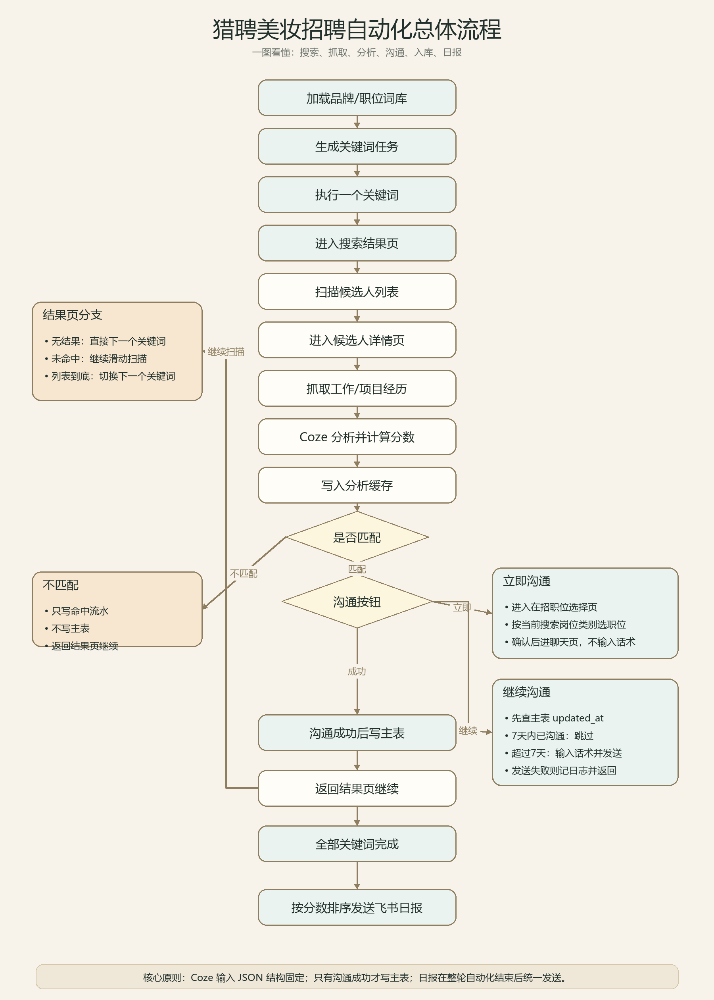

# 猎聘美妆招聘自动化开发文档

## 0. 最新代码逻辑摘要（2026-07-15）

本节记录当前代码已经落地的最新行为，优先级高于旧流程描述。

### 0.1 关键词执行顺序

关键词仍由 `config/brands.yaml` 与 `config/roles.yaml` 全量组合生成，当前总量为 `53 个品牌 × 29 个岗位 = 1537 个关键词`。

岗位执行顺序已经改为“全局核心岗位优先”，不是“每个品牌跑完 29 个岗位再换品牌”：

1. 先按 12 个核心岗位逐个覆盖全部品牌。
2. 核心岗位跑完后，再执行其他泛岗位。
3. 已完成关键词仍按 checkpoint 自动跳过。

当前 12 个核心岗位为：达播总监、达人营销总监、全域营销总监、全域增长负责人、新媒体营销总监、电商总监、媒介总监、整合营销总监、直播业务总监、电商运营总监（达人方向）、直播业务负责人、营销负责人。

对应代码：`src/liepin_rpa/task_generation/generator.py`、`scripts/run_search_workflow.py`。

### 0.2 断点续跑规则

断点文件为 `artifacts/search_workflow_checkpoint.json`。

当前续跑规则：

- `completed_keyword_keys` 中已经完成的关键词会自动跳过。
- `in_progress_keyword` 会被识别，但不会再因为调整排序而跳过它前面的未完成核心关键词。
- 如果中断关键词本身属于 12 个核心岗位，会优先重跑该中断关键词。
- 如果中断关键词不是核心岗位，则继续按“核心岗位全局优先”的新顺序执行。
- 正常续跑不要加 `--reset-checkpoint`，也不要加 `--no-resume`。

### 0.3 年龄与学历预筛

搜索结果页命中候选人后，会先从卡片文本中识别年龄和学历：

- 年龄小于 `32`：不进入详情页，直接跳过。
- 年龄大于 `44`：不进入详情页，直接跳过。
- 卡片没有识别到年龄：不武断跳过，继续按原流程进入详情页。
- 明确出现 `大专`、`专科`、`中专`、`高中`：不进入详情页，直接跳过。
- 明确出现 `本科`、`硕士`、`博士`、`MBA`、`EMBA`、`统招本科`：允许进入详情页。
- 卡片没有识别到学历：不武断跳过，继续按原流程进入详情页。

日报与 PDF 展示也应用同一年龄口径：已知年龄不在 `32-44` 范围内的候选人，不进入高分候选展示与 PDF。

### 0.3.1 JD 智能模式的上海求职意向硬门槛

两个当前 JD 岗位（达人营销与达播负责人、财务共享与管理经理）都在各自岗位配置中设置：

```yaml
required_job_intent_city: "上海"
```

流程进入详情并采集完整简历后，只读取“求职意向”区的原文。该区域必须明确包含“上海”才会继续调用 Coze 并进入沟通流程。当前所在地为上海、搜索城市为上海、曾在上海工作，均不能替代求职意向证据；未填写、未采集到、填写其他城市，或明确排除上海，统一记录为 `job_intent_city_rejected` 并跳过。

### 0.4 飞书日报批次窗口

日报默认不按“昨天”或发送水位取数，而是读取最近一个正常完成的双岗位搜索批次。

批次从达人营销岗位第一次开始搜索的上海本地时间开始，到财务共享与管理经理岗位正常完成的上海本地时间结束。中途暂停、进程重启和断点续跑都沿用同一批次；第二个岗位未正常完成时，日报拒绝取数。

批次信息持久化在 `artifacts/search_workflow_batches.json`。数据库 `created_at` 按上海本地时间直接比较，不减 8 小时；日志文件中的 UTC 时间仅在日志统计时转换。

### 0.5 飞书日报展示规则

飞书日报现在只展示当前统计窗口内分数最高的 `3` 位候选人，且不展示 Coze 的完整分析结论。

展示内容包括：姓名、年龄、分数、状态、命中关键词、岗位、最近一段经历、匹配经历。

日报概览统计使用数据库中的全部命中/分析数据，不只统计已经写入主表的已沟通候选人。

PDF 与飞书正文的关系：

- 飞书正文只展示前 3 位。
- PDF 包含当前统计窗口内全部满足 `75 分以上 + 已打招呼 + 匹配 + 年龄合规` 的候选人简历详情。
- PDF 会上传到服务器，并在飞书日报中提供下载链接。

### 0.6 PDF 上传规则

日报生成 PDF 后会上传到云服务器：

```text
服务器：`your.server.host`
远程目录：/opt/liepin_daily_report/search_pdf/
公网路径：`https://your.domain/search_pdf/<PDF文件名>`
```

`.env` 需要包含：

```env
PDF_UPLOAD_HOST=your.server.host
PDF_UPLOAD_PORT=22
PDF_UPLOAD_USER=your-ssh-user
PDF_UPLOAD_PRIVATE_KEY=C:\path\to\private_key
PDF_UPLOAD_REMOTE_DIR=/opt/liepin_daily_report/search_pdf
PDF_PUBLIC_BASE_URL=https://your.domain/search_pdf
```

服务器 nginx 已配置 `/search_pdf/` 到上述目录的静态文件映射，返回 `Content-Disposition: attachment`，飞书中点击链接可下载 PDF。

## 1. 项目目标

本项目用于在猎聘 App 中自动执行美妆行业候选人搜索、简历抓取、Coze 分析、自动沟通、数据库沉淀和飞书日报汇总。

核心目标：

- 批量执行固定品牌和固定岗位关键词搜索。
- 在搜索结果页筛选命中候选人。
- 进入候选人详情页抓取工作经历和项目经历。
- 调用 Coze 判断候选人与目标美妆岗位的匹配程度。
- 根据沟通按钮类型执行不同沟通动作。
- 将分析结果、沟通结果和命中历史写入数据库。
- 整轮自动化完成后，从数据库统一生成飞书日报。

## 2. 当前整体流程



当前代码主流程如下：

1. 从 `config/brands.yaml` 和 `config/roles.yaml` 生成关键词种子。
2. 读取断点文件，跳过已完成关键词，从上次中断关键词继续。
3. 进入搜索页并提交当前关键词。
4. 进入结果页后滑动扫描候选人卡片。
5. 发现命中卡片后点击进入详情页。
6. 在详情页抓取工作经历和项目经历，整理成 `experience` 字符串。
7. 用 `resume_record` 结构调用 Coze 工作流分析。
8. 根据分析结果和页面沟通按钮执行：
   - `立即沟通`：选择岗位并确认进入聊天页，不输入话术。
   - `继续沟通`：输入固定话术，校验后发送。
   - `意向沟通`：直接返回搜索结果页，不继续处理。
9. 发送成功后写入主表；命中过程写入命中流水；分析结果写入分析缓存。
10. 当前轮次全部关键词执行结束后，再统一发飞书日报。

## 3. 页面状态与识别

系统主要识别以下页面状态：

- `home_recommend`：猎聘首页推荐页
- `search_entry`：搜索入口页
- `search_condition`：搜索条件页/搜索编辑态
- `result_list`：搜索结果列表页
- `empty_result`：无结果页
- `candidate_profile`：候选人详情页
- `chat`：聊天页
- `login_required`：登录异常页
- `risk_control`：风控页
- `network_error`：网络异常页
- `unknown`：未识别页

页面识别依赖：

- `src/liepin_rpa/page_detection/`
- `config/selectors/`
- `src/liepin_rpa/ui_controls.py`

恢复原则：

- 优先通过 UI 探测当前页面状态。
- 能识别返回按钮时优先点击返回按钮。
- 找不到返回按钮时退化为系统返回。
- 每次返回后等待 3 到 5 秒，再做下一次识别。

## 4. 结果页与详情页等待策略

当前代码已经统一加强“页面加载等待”，避免因为识别过快导致误判：

- 从搜索进入结果页后，等待 3 到 5 秒再识别。
- 结果页每次滑动后，等待 3 到 5 秒再扫描卡片。
- 点击候选人进入详情页后，等待至少 3.5 秒，再开始识别。
- 详情页每次点击“展开全部”后，等待 3 到 5 秒。
- 详情页每次滑动后，等待 3 到 5 秒。
- 搜索页点击搜索框、输入关键词、点击提交后，也有等待。

说明：

- 等待不是固定值，当前使用 3 到 5 秒随机等待。
- 目的是降低页面未加载完成时被识别成 `unknown` 的概率。

## 5. 数据库设计

当前核心数据库表有三张。

### 5.1 主表：`candidate_resume_experience_records`

只记录“成功完成沟通动作”的候选人。

字段含义：

- `id`：主键
- `candidate_fingerprint`：候选人稳定唯一指纹
- `candidate_name`：候选人姓名
- `source_platform`：来源平台，当前为 `liepin`
- `search_keyword`：命中的品牌和岗位关键词
- `experience`：整理后的工作经历/项目经历字符串
- `match_score`：Coze 返回的匹配分数
- `analysis_status`：分析状态，例如 `匹配`、`不匹配`、`待复核`
- `created_at`：首次写入时间
- `updated_at`：最近一次成功沟通时间

语义说明：

- 主表代表“这个候选人已被自动化成功沟通过”。
- `updated_at` 用于 7 天内重复沟通跳过判断。
- 只有发送成功才会写主表。

### 5.2 命中流水表：`candidate_resume_search_hits`

记录每次关键词命中候选人后的处理结果。

字段含义：

- `id`：主键
- `candidate_fingerprint`：候选人指纹；部分跳过场景下可能临时使用卡片指纹
- `candidate_name`：候选人姓名
- `search_keyword`：本次命中的搜索词
- `hit_status`：本次处理状态
- `created_at`：命中时间

当前常见 `hit_status`：

- `sent`
- `immediate_job_confirmed`
- `skipped_recent_continue`
- `continue_without_db_record`
- `intention_communication_skipped`
- `profile_collection_skipped`
- `reviewed`
- `send_failed:xxx`

### 5.3 分析缓存表：`candidate_resume_analysis_cache`

记录 Coze 对同一候选人同一份经历的分析结果。

字段含义：

- `id`：主键
- `candidate_fingerprint`：候选人指纹
- `experience_hash`：经历文本 hash
- `analysis_status`：内部分析状态
- `match_result`：`relevant` / `not_relevant` / `needs_review`
- `match_score`：匹配分数
- `score_breakdown_json`：分项得分
- `analysis_reason`：分析结论
- `evidence_summary_json`：证据摘要
- `created_at`：首次分析时间
- `updated_at`：最近一次缓存更新时间

## 6. 指纹与去重规则

候选人唯一指纹不直接依赖整段经历原文，而是优先使用稳定字段组合：

- `candidate_name`
- `current_company`
- `current_position`
- `city`
- `age`
- `education`
- `work_years`
- 第一段工作经历的公司和岗位

如果稳定字段不足，再退化补 `experience` 前 160 个字符。

说明：

- 这样可以降低页面空格、顺序、换行变化带来的指纹漂移。
- 同名同公司同岗位仍然存在小概率误合并风险，但已比直接 hash 原文稳定很多。

## 7. Coze 分析规则

### 7.1 输入结构

当前传给 Coze 的固定结构是：

```json
{
  "resume_record": {
    "id": 0,
    "candidate_name": "候选人姓名",
    "source_platform": "liepin",
    "search_keyword": "品牌，岗位",
    "resume_summary": "",
    "analysis_status": "未执行",
    "created_at": "",
    "experience": "工作内容：... 项目内容：..."
  }
}
```

注意：

- Coze 输入结构已和数据库结构解耦。
- 即使数据库后续扩展，也不要随意修改这个输入 JSON 结构。

### 7.2 输出结构

当前要求 Coze 输出字段：

- `beauty_relevant`
- `match_result`
- `match_score`
- `score_breakdown`
- `analysis_reason`
- `evidence_summary`

### 7.3 容错规则

Coze 已增加以下保护：

- 返回 payload 非法时，重试最多 3 次。
- Coze 接口临时错误 `code=5000` 时，重试最多 3 次。
- 如果仍失败，不中断主流程，回退为 `needs_review`。
- `match_score` 和 `score_breakdown` 会做结构校验。

## 8. 沟通规则

### 8.1 `立即沟通`

处理逻辑：

1. 点击 `立即沟通`
2. 如果出现岗位选择页，根据当前搜索岗位分类选择对应岗位
3. 点击确认
4. 验证是否进入聊天页
5. 不输入话术
6. 不点击发送
7. 返回详情页，再返回结果页

### 8.2 `继续沟通`

处理逻辑：

1. 判断数据库主表中是否存在该候选人
2. 若 `updated_at` 在 7 天内，则跳过
3. 否则点击 `继续沟通`
4. 进入聊天页
5. 输入固定话术
6. 校验输入内容是否与原话术完全一致
7. 校验通过后点击发送
8. 发送后验证输入框已清空且仍在聊天页
9. 成功后返回详情页，再返回结果页

### 8.3 `意向沟通`

处理逻辑：

1. 如果进入详情页后识别到页面存在 `意向沟通`
2. 不继续抓取简历
3. 不执行 Coze 分析
4. 直接返回搜索结果页
5. 记录 `hit_status = intention_communication_skipped`

## 9. 候选人详情采集规则

详情采集范围：

- 工作经历
- 项目经历

当前输出到数据库和 Coze 的是单字段：

- `experience`：字符串类型

格式原则：

- 有工作内容就写 `工作内容：...`
- 有项目内容就写 `项目内容：...`
- 有什么写什么，不强制都有

详情采集页内部策略：

- 先逐屏收集可见文本
- 能点“展开全部”就优先展开
- 每次展开后等待
- 每次滑动后等待
- 连续多次滑动无新增内容则认为到底

## 10. 关键词级异常恢复策略

这是本轮最新补充的重点逻辑。

当前策略：

- 任何关键词执行过程中只要报错，不立即崩溃退出
- 先尝试恢复页面到搜索页
- 页面恢复成功后，重新执行当前关键词一次
- 如果当前关键词第二次仍报错，则跳过该关键词，继续下一个关键词

### 10.1 恢复流程

1. 用 UI 探测当前页面
2. 如果已经在以下页面之一，视为恢复成功：
   - `home_recommend`
   - `search_entry`
   - `search_condition`
3. 如果页面有弹窗，先尝试关闭
4. 如果能找到返回按钮，点击返回按钮
5. 否则执行系统返回
6. 每次返回后等待 3 到 5 秒
7. 最多尝试多轮
8. 仍失败则调用搜索流程自己的 `_reset_to_search_surface()` 再兜底一次

### 10.2 恢复失败后的处理

- 当前关键词记为 `keyword_error`
- 写入断点为已完成失败关键词
- 继续执行后续关键词
- 连续失败过多时仍会触发熔断保护

## 11. 候选人级异常恢复策略

这部分用于保证“单个候选人异常，不影响整个关键词，更不影响整轮”。

### 11.1 详情页滑动失败

如果详情页 `adb swipe` 失败：

1. 先自动执行一次设备自愈
   - `wake_up()`
   - `ensure_unlocked()`
   - `ensure_healthy()`
2. 再重试一次滑动
3. 如果仍失败：
   - 只跳过当前候选人
   - 返回搜索结果页
   - 记录 `hit_status = profile_collection_skipped`
   - 留调试截图

### 11.2 详情页识别为 `unknown`

常见原因：

- 页面没加载完
- 弹层遮挡
- 刚切页就立即识别

当前缓解手段：

- 进入详情页后已增加 3.5 秒以上等待
- 结果页、详情页统一改成 3 到 5 秒等待
- 如果仍出现异常，优先走关键词级恢复链路

## 12. 断点续跑

断点文件：

- `artifacts/search_workflow_checkpoint.json`

当前记录内容包括：

- 已完成关键词列表 `completed_keyword_keys`
- 上一个完成关键词 `last_completed_keyword`
- 当前进行中的关键词 `in_progress_keyword`

恢复行为：

- 再次执行脚本时，会自动跳过 `completed_keyword_keys` 中已经完成的关键词。
- 已完成关键词按 `品牌|||岗位` 的 key 判断，不依赖当前位置。
- 如果词库排序发生变化，仍不会重复跑已完成关键词。
- 如果存在 `in_progress_keyword`，且该关键词属于 12 个核心岗位，会优先重跑该中断关键词。
- 如果存在 `in_progress_keyword`，但该关键词不属于核心岗位，则继续按“核心岗位全局优先”的新顺序执行，避免非核心中断词挡住未完成核心岗位。

常用参数：

- `--checkpoint-file`：指定断点文件路径。
- `--no-resume`：忽略断点，按当前筛选范围重新执行。
- `--reset-checkpoint`：删除旧断点后重新开始。

正常续跑不要加 `--reset-checkpoint`，也不要加 `--no-resume`。

## 13. 飞书日报规则

飞书日报不在单个候选人分析后即时发送，而是由日报脚本统一从数据库生成。

### 13.1 默认统计窗口

默认统计窗口为最近一个正常完成的双岗位搜索批次：

```text
达人营销岗位第一次开始搜索 -> 财务共享与管理经理岗位正常结束
```

暂停、失败重启和断点续跑不会生成新批次。当前批次未完成时，即使两个岗位之间暂时没有搜索进程，日报也不会退回上一批次或自然日数据。

默认命令直接读取最近完成批次；固定日期参数仅用于排障：

```powershell
.\.venv\Scripts\python.exe scripts\send_db_daily_report.py --use-cache
.\.venv\Scripts\python.exe scripts\send_db_daily_report.py --use-cache --report-date 2026-07-14
.\.venv\Scripts\python.exe scripts\send_db_daily_report.py --use-cache --yesterday
```

### 13.2 数据来源

日报概览统计使用数据库中的全部命中和分析数据：

- 主表：成功打招呼候选人，用于 PDF 简历正文和已沟通状态。
- 命中流水表：全部关键词命中和处理状态。
- 分析缓存表：Coze 匹配结果、分数和证据摘要。

因此概览中的匹配/不匹配人数不只看已经写入主表的人。

### 13.3 飞书正文展示

飞书正文只展示当前统计窗口内分数最高的 `3` 位候选人。

展示字段：

- 姓名
- 年龄
- 分数
- 状态
- 命中关键词
- 岗位
- 最近一段经历
- 匹配经历

飞书正文不展示 Coze 的完整 `analysis_reason` 结论。

### 13.4 PDF 详情

PDF 包含当前统计窗口内全部满足以下条件的候选人：

- `match_score >= 75`
- 已打招呼或已确认打招呼岗位
- Coze 判断为匹配
- 已知年龄在 `31-45` 之间；年龄未知暂不拦截

PDF 会上传到云服务器，并在飞书日报中提供下载链接。

## 14. 常用运行命令

一键运行完整自动化：

```powershell
.\.venv\Scripts\python.exe scripts\run_search_workflow.py
```

指定品牌和岗位：

```powershell
.\.venv\Scripts\python.exe scripts\run_search_workflow.py --brand 珀莱雅 --role 达播总监
```

仅发送数据库日报：

```powershell
.\.venv\Scripts\python.exe scripts\send_db_daily_report.py --use-cache
```

清空并重建三张核心表：

```powershell
.\.venv\Scripts\python.exe -c "import sys; sys.path.insert(0, 'src'); from liepin_rpa.config import get_settings; from liepin_rpa.db import reset_resume_experience_tables; reset_resume_experience_tables(get_settings())"
```

## 15. 维护建议

- 词库变更后，优先检查岗位分类是否仍然正确。
- Coze 提示词变更后，必须检查输出字段是否仍包含 `match_score` 和 `score_breakdown`。
- 猎聘页面结构变化后，优先检查：
  - 页面识别
  - 返回按钮识别
  - 沟通按钮识别
  - 岗位选择页控件识别
- 长时间批量搜索时，保持保守等待时间，避免页面未稳定和平台风控。
- 多设备连接时，必须固定 `.env` 中的 `DEVICE_ID`。

## 16. 当前已知风险

- 猎聘 App 页面结构变化可能导致控件识别失效。
- Android 页面偶发漂移，仍可能出现短时 `unknown`。
- Coze 输出结构如果大改，会影响分数和日报展示。
- 候选人同名、同公司、同岗位时，仍存在小概率误合并。
- 平台长时间高频搜索仍有触发风控的风险。
- USB 或 uiautomator2 链路不稳定时，虽然已增加重试，但不能完全消除外部设备故障。


### 0.2.1 ????????????

??????????????????????????? `120-150` ?????????????????????????????? checkpoint ??????

???

- ???? `--brand`?`--role`?`--limit` ???????????????
- ?????? `WORKFLOW_DAILY_KEYWORD_MIN` ? `WORKFLOW_DAILY_KEYWORD_MAX` ??????????????
- ???????? `artifacts/search_workflow_checkpoint.json` ?????
- ????????/??????? `--limit` ?????????????

?????

```env
WORKFLOW_DAILY_KEYWORD_MIN=120
WORKFLOW_DAILY_KEYWORD_MAX=150
```

?????????

```powershell
powershell -ExecutionPolicy Bypass -File scripts\install_daily_search_task.ps1
```

??????? 08:00 ?? `scripts/run_daily_search.ps1`?runner ?????? 08:00-09:00 ?????????????????

## 17. Reliability and Delivery Guarantees

### Candidate identity and analysis cache

- Candidate experience identity uses the complete normalized `experience` text and an `xxhash` digest. It is no longer truncated before hashing.
- `experience_hash_version=2` identifies records built with the full-text algorithm. Existing records are migrated when the schema is initialized.
- Coze analysis cache keys include candidate fingerprint, experience hash, and `COZE_ANALYSIS_VERSION`. Change the version whenever the Coze workflow or scoring prompt changes to force a safe re-analysis.
- Coze output is accepted only when `match_score` is an integer from 0 to 100 and `score_breakdown` contains exactly `beauty_continuity`, `industry_depth`, and `role_evidence`; the three values must sum to the score.

### Batch continuation and mutual exclusion

- Search checkpoints are written atomically. A keyword is marked complete only after its workflow succeeds.
- Failed keywords are stored as failed attempts and are retried on the next run instead of being silently skipped.
- Each checkpoint is bound to a digest of the active keyword catalog. Changing the catalog starts a fresh checkpoint scope and prevents an old checkpoint from skipping unrelated keywords.
- `artifacts/search_workflow.lock` prevents overlapping search runs. `artifacts/daily_report.lock` prevents overlapping report runs.
- The daily report command can wait for an active search lock to clear before reading the database. Configure the limits with `WORKFLOW_LOCK_STALE_SECONDS` and `DAILY_REPORT_WAIT_FOR_SEARCH_SECONDS`.

### Report delivery and external services

- Each daily report snapshot has a deterministic `report_key`. Feishu delivery is skipped when the same snapshot was already recorded as sent.
- Delivery status is persisted as pending, uploaded, sent, upload_failed, or feishu_failed so that retries do not advance the reporting watermark prematurely.
- If a PDF upload is configured but fails, Feishu is not sent without the required attachment link.
- SSH/SCP PDF upload uses strict host-key verification through `PDF_UPLOAD_KNOWN_HOSTS`; unknown hosts fail safely instead of being accepted automatically.

### Operations and privacy

- Runtime logs rotate daily and are retained for `LOG_RETENTION_DAYS` days. Candidate names and resume-like fields are masked unless `LOG_PII=true` is explicitly configured.
- Regression fixtures live under `tests/fixtures`; runtime output directories are not test dependencies.
- Before a production batch, run `pytest` and confirm the device, database, Coze authentication, and SSH host key are available.

### Cache and generated artifacts

- Safe-to-remove local caches are Python `__pycache__` directories, `*.pyc` files, `.pytest_cache`, `.pytest-tmp`, `.mypy_cache`, and `.ruff_cache`. They are recreated automatically and must not be committed.
- Do not delete `artifacts/search_workflow_checkpoint.json`; it is the keyword continuation checkpoint. Do not delete an active `artifacts/*.lock` file while its owning workflow is still running.
- Do not treat `artifacts/daily_reports`, `logs`, generated PDFs, or database records as cache. These are operational outputs and may be required for report delivery, audit, or recovery.
- Cache cleanup must exclude `.venv`, `.env`, configuration files, the database, and all `artifacts` contents unless a specific recovery procedure explicitly requires otherwise.
