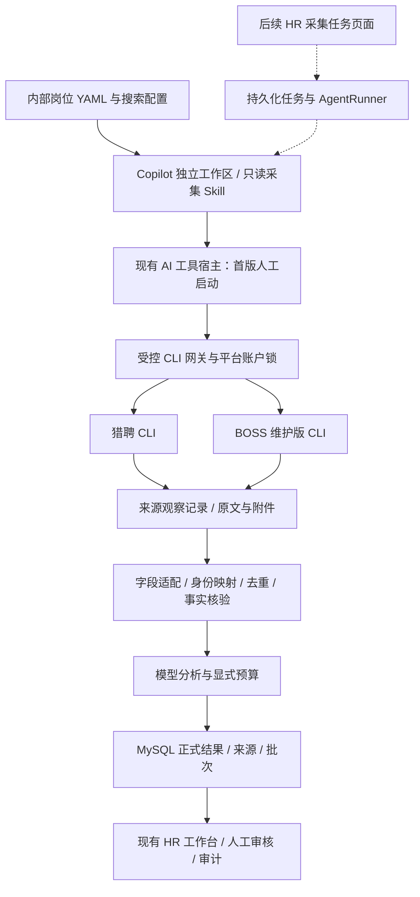

# 猎聘与 BOSS 双平台招聘采集接入方案

日期：2026-11-06。状态：待实施。范围：以 `Viy1204/recruiting-copilot` 为招聘编排入口，使用其猎聘与 BOSS CLI，接入现有 AI-HR 的匹配、数据库和人工审核。

本文的“双端”指两个招聘平台，不是 PC/手机双客户端。采集、分析和审核在电脑端执行；平台登录或安全验证仍可能要求扫码或人工验证。本文没有执行真实账号登录、模型调用、采集或迁移。

## 0. Copilot 是什么，以及本机检查结果

这里的 Copilot 是第三方开源项目 **recruiting-copilot（招聘副驾）** 的名称，不是 Windows Copilot 或 GitHub Copilot。它主要提供招聘工作流 Skills、脚本和本地工作区，由已有 AI 工具宿主执行；实际平台读取由 `liepin`、`boss` 两个 CLI 完成。

上一版方案在本机依赖检查之前写成，本节补充 2026-11-06 的实际检查，区分“电脑支持”“软件已装”和“业务已跑通”。

| 检查 | 本机实测 | 判断 |
| --- | --- | --- |
| 系统 | Windows 11 家庭中文版，64 位，build 26200；PowerShell 7.6.9 | 基础系统可用 |
| 硬件 | i7-13700H，20 逻辑处理器，约 31.5 GiB 内存；D 盘空闲约 293 GiB | 支持本方案的浏览器/CLI 工作负载；不要求先部署本地大模型 |
| 当前内存 | 检查瞬间可用约 4.3 GiB | 首版双平台串行，避免同时开启多组浏览器/Agent；未擅自结束用户程序 |
| Node / npm | Node v24.19.0，npm 11.17.0 | 满足上游 Node ≥22 要求 |
| Git / Git Bash | Git 2.55.0；Git Bash 5.3.15 存在且可运行 | Windows 安装脚本可走 Git Bash；PATH 中的 bash 实际指向 Windows system32，不直接假设它就是 Git Bash |
| 浏览器 | Chrome 155.0.8059.80、Edge 155.0.4283.62 | 已检测安装；尚未启动专用浏览器验证 CDP/招聘账号 |
| Python | 当前项目 venv Python 3.12.14 | 现有 AI-HR 运行环境存在 |
| AI 工具 | Codex CLI 0.154.0、Claude Code 2.1.274、DSH 0.2.0-rc.2 的版本命令可执行；WorkBuddy 正在运行 | 已有宿主候选，无需先安装 Windows/GitHub Copilot；各宿主插件兼容性和后台模式仍需后续核验 |
| 招聘采集 CLI | PATH 与全局 npm 未检测到 `boss`、`liepin` 及对应包 | 接入前需要安装固定版采集工具 |
| recruiting-copilot | 全局 npm、已查常见工作区/技能目录未发现 | 需要准备固定版源码/工作区；未扫描整机所有自定义目录，不声称电脑任意位置都没有副本 |
| 依赖网络 | GitHub API 与 npm registry 返回 HTTP 200；Copilot v0.8.3 tag、BOSS fork 0.8.7、猎聘 CLI 0.2.10 均查询到 | 此次下载源元数据可达；不代表招聘平台账号或完整下载链路已验证 |

本次只执行系统/版本/包元数据和可达性检查，未安装依赖、修改配置、启动新浏览器或读取账号 Cookie。检查结果表明：**本机具备基础运行条件，当前缺少招聘工具和业务桥接，不是设备不支持。**

实施入口据此调整为：优先复用现有 AI 工具会话启动独立工作区；DSH 只是可选宿主，不为了浏览器面板而强制增加依赖。安装并核验两个招聘 CLI、完成人工账号登录后，再进入 A 阶段实际能力确认。

## 1. 目标、首版范围与交付形态

目标闭环：选择内部岗位 → 从猎聘/BOSS 搜索或推荐入口获取候选人 → 读取账号可访问的简历 → 保存来源与原文 → 统一匹配 → MySQL → 现有 HR 工作台审核。

首版交付两个平台适配器、独立 Copilot 招聘工作区、结构化采集桥接、正式结果入库与来源展示。先使用现有 AI 工具会话启动 Copilot，浏览器人工登录；任务结果自动进入 AI-HR。两平台分别可用、能按平台查看失败原因，即可完成第一版业务闭环。

后续再交付 HR 网页内的创建/停止采集任务、实时状态和后台 Agent 执行。**Copilot 是 Skills/工作区流程，安装它不会自动获得后台 Agent 服务或通用采集 REST API。** 第一版的“由 AI 工具启动”和第二版的“HR 网页启动”明确分开，不把操作说明文件当成已运行的后台程序。

首版不自动打招呼、不索要简历、不交换联系方式、不拒绝候选人、不创建日程或推送外部日报。读取在线简历也可能消耗平台权益，采集预算需独立控制。获得的只是列表摘要时，显示“正文未获取”，不伪装为已分析完整简历。

用户已选择跳过完整真实质量评测。本次采用必要的业务冒烟检查完成接入，不把未做的模型质量实验标成通过。

## 2. 上游选型与核验记录

| 组件 | 定位 | 本次接入方式 |
| --- | --- | --- |
| [recruiting-copilot](https://github.com/Viy1204/recruiting-copilot) | 岗位梳理、双平台寻源及过程记录 | 选定发布标签和 commit，保留独立工作区，派生只读采集流程 |
| [liepin-cli](https://github.com/Viy1204/liepin-cli) | 猎聘招聘者端浏览器操作 | 调用搜索、推荐和简历读取，按具体命令校验 JSON |
| [Viy1204/boss-cli](https://github.com/Viy1204/boss-cli) | Copilot 使用的 BOSS 维护 fork | 使用 `@viyzhu/boss-cli-fork`，按安装版本核验命令和输出 |
| 现有 AI-HR | 岗位评分、队列/预算、MySQL、权限、人工审核 | 保留正式结果和人工状态的权威性，增加双平台来源与采集任务 |

2026-11-06 检索时，Copilot README 标示 v0.8.3，安装说明指定 BOSS fork 0.8.7；猎聘 README 标示 0.2.10。实施时以实际选定 tag、安装包版本及本机 help 核验，不把 master/latest 作为可复现版本记录。

已确认的上游边界：

1. Copilot 安装器使用维护 fork，不能同时安装同名上游 `boss` 命令后混用。
2. 猎聘提供 `--json`，BOSS 的若干命令输出为文本、页面列表或简历预览。两个适配器不能共用一个“所有命令都返回 JSON”的假设。
3. BOSS 列表可能姓名打码，列表序号会随刷新变化。姓名或序号都不是跨任务的候选人 ID。
4. Copilot 自带台账以文件为主，看板读取工作区文件；它不直接提供当前 AI-HR 的多账号岗位权限、MySQL 人工 revision 和事务投影能力。
5. 上游频道说明可能落后于 CLI 发布版，例如候选 ID 取法、岗位筛选和预览行为；适配必须固定版本并用实际命令输出做能力核验。

参考：[Copilot 双通道说明](https://github.com/Viy1204/recruiting-copilot/blob/master/skills/recruit-daily/references/channels.md)、[进度协议](https://github.com/Viy1204/recruiting-copilot/blob/master/skills/recruit-board/references/progress.md)、[猎聘字段说明](https://github.com/Viy1204/liepin-cli#readme)。上游上层项目与 CLI 的许可证分别记录；发布集成版本前按实际使用、修改及分发方式核对，不能只记录上层 MIT。

## 3. 总体架构与职责



权威来源按字段划分：

| 信息 | 正式依据 | Copilot 的作用 |
| --- | --- | --- |
| 岗位、评分契约、启用策略 | AI-HR 岗位 YAML 和版本 | 提出岗位/关键词建议；确认后转换生成工作区配置 |
| 候选身份、采集原文与来源 | 平台观察记录和原文快照 | 通过平台适配获取，带上可核实的来源信息 |
| 三态、分数与引用 | AI-HR 统一分析入口 | 可提供辅助意见，不能直接覆盖正式评分 |
| 人工状态、指派、反馈、revision | AI-HR 事务与审计 | 展示摘要，不反向覆盖人工字段 |
| Copilot 运行过程和草稿 | 独立工作区 | 保存步骤、报告、待确认事项 |

不让 Agent 同时维护两份相互覆盖的岗位标准。岗位修改先生成提案，确认后修改 YAML、升版本，再重新生成 Copilot 的 CONTEXT/JD 文件。

## 4. Copilot 如何实际接入

### 4.1 独立工作区和派生 Skill

上游源码和运行工作区分开：源码固定版本存放于依赖管理目录；运行内容存放在 Git 忽略的 `artifacts/recruiting/private/<workspace-id>/` 或受控外部目录。

基于上游 `recruit-grill/recruit-daily` 建立项目级集成流程：

- 岗位梳理产出建议和搜索计划，读取 AI-HR 冻结岗位配置。
- 日常流程先按岗位生成双平台搜索/推荐计划，再通过受控网关执行允许的读取动作。
- 每个候选人的原始读取结果立即提交桥接层，不等最终 Markdown 日报生成后再导入，也不只导入 Copilot 判为“合适”的人。
- 向 Copilot 进度脚本回写有证据的观察收据；采集、分析、投影、人工审核使用不同状态。
- 联系、拒绝、飞书推送和日程步骤记录“本版本未启用”，不能被上游默认流程意外执行。

只修改派生的集成流程，保留上游版本及差异。Skill 路由放在独立工作区，不覆盖当前代码仓库的 AGENTS.md、岗位 YAML 或系统配置。

### 4.2 Agent 与执行器边界

第一版由操作者在现有 AI 工具中进入该工作区、发起本次采集，宿主运行只读派生 Skill。桥接接口返回 run ID、逐人接收结果及错误，操作者在 AI-HR 页面审核。

第二版新增 `AgentRunner` 接口，显式定义启动、心跳、等待登录、取消和收尾。接哪个 Agent 宿主的无交互/进程接口须单独实现并核验，不能假设当前聊天页面就是持久服务。

平台执行由受控网关提供：命令使用参数数组和固定可执行路径；不把 Agent 自由文本拼成 shell。使用账户锁、超时、输出上限和命令白名单；首版不开放任意浏览器脚本、任意 URL 导航或发送命令。网关是执行约束，Skill 文案是额外约束，两者都需要。

## 5. 双平台采集适配

新增统一接口（名称为拟定，不是当前已有 API）：

```text
SourcingAdapter
  capabilities(account)
  search(job, query, cursor)
  recommend(job, cursor)
  read_resume(candidate_ref)
  normalize(observation)
```

平台差异由各自实现负责：

| 项目 | 猎聘 | BOSS |
| --- | --- | --- |
| 上游工具 | `@viyzhu/liepin-cli` | `@viyzhu/boss-cli-fork` |
| 搜索入口 | 人才搜索，核验实际岗位/城市条件 | 岗位绑定的搜索/推荐，核验页面实际条件 |
| 简历入口 | 读取有效 resume ID 对应详情 | 安装版本支持的在线预览/已有可读材料 |
| 输出适配 | 命令级 JSON schema，日志与结果严格分离 | 优先稳定结构化字段；文本适配独立版本，识别不出则返回未知 |
| 身份不足 | 留存观察，补取稳定 ID | 打码姓名/临时序号不作永久身份，不跨页按旧序号操作 |
| 正文不可读 | 记录缺失，不输出虚假全文 | 返回 partial/待获取；附件请求不因“采集”授权而自动发出 |

浏览器使用独立账户资料目录，Cookie 不入业务数据库、日志和 Git。首版双平台串行执行，同一账户单写锁；平台 A 等待人工登录时，可结束/挂起该子任务后执行平台 B。单个平台失败不把整批已成功的结果回滚。

上游账号/简历权益不足、认证失效、安全验证、未知页面结构分别映射为可解释状态；需要人工处理时停止该账户新派发。是否能读取完整正文以实际账号权限与页面返回为准。

## 6. 统一数据与身份去重

### 6.1 采集事件

拟定桥接事件至少包含以下字段；不携带 Cookie、模型密钥或候选人的登录凭据：

```json
{
  "schema_version": "sourcing-observation-v1",
  "event_id": "opaque-event-id",
  "run_id": "opaque-run-id",
  "platform": "liepin",
  "account_alias": "recruiter-a",
  "job_profile_id": "ai_development_engineer_v1",
  "entrypoint": "search",
  "platform_candidate_id": null,
  "platform_resume_id": "source-id",
  "source_url": null,
  "captured_at": "2026-11-06T00:00:00Z",
  "cli_version": "record-actual-version",
  "content_kind": "api_text",
  "completeness": "full",
  "resume_text": "此处为格式占位，不是实际简历",
  "facts": {},
  "raw_payload_hash": "record-actual-sha256"
}
```

示例值只是 schema 说明，不是已采集记录。事实字段保留原始值、来源位置、提取版本及未知项；缺少统招类型不能从“本科”推断为统招，搜索城市不能替代期望工作城市。

若使用截图/OCR，保存图片 hash、OCR 版本与转写文本，前端明确标为“截图转写”。引用绑定被分析的转写快照，不能声称与平台原始文本逐码点一致。OCR/文本抽取失败时保留待复核，不自动补全。

### 6.2 去重规则

1. 事件：`event_id` 和批次范围幂等，同一回执重传不重复落库或派发分析。
2. 来源身份：按 `platform + account_alias + ID类型 + 平台稳定ID` 记录别名映射，使用稳定哈希连接内部 candidate ID。
3. 简历版本：同来源候选人原文 hash/分析版本一致时复用；变化创建新快照/分析，不覆盖历史。
4. 跨平台关联：只标为“疑似同一人”，由人工确认关联。姓名、公司相同或正文相同都不自动合并两个人工审核档案。
5. 没有稳定 ID：保存本次观察身份和来源证据，标为待核验；不能生成看似稳定、实际会随列表顺序变化的永久身份。

### 6.3 当前数据库必须处理的兼容点

现有 `candidate_resume_experience_records.experience_hash` 是全局唯一，旧代码还有按正文哈希查人、合并重复档案的路径。双平台相同文本可能是重复转载，也可能是不同候选人、模板或不完整摘要；不能直接依赖这一唯一约束自动合并。

计划新增迁移（revision 在实施时按实际 head 确定）：

| 新增实体 | 作用 |
| --- | --- |
| `sourcing_runs` | 岗位范围、请求人、配置/来源版本、总预算、父任务状态 |
| `sourcing_platform_runs` | 平台/账户子任务、检查点、登录等待与独立错误 |
| `sourcing_observations` | 原始采集事件、内容摘要、完整性、处理/分析关联 |
| `candidate_source_identities` | 平台稳定 ID 与现有候选指纹的显式映射 |
| `sourcing_account_leases` | 单账户持久化租约与 fencing，避免多进程抢浏览器 |

保留并扩展现有 locator 的 `source_platform/source_account_alias/platform_candidate_id/platform_resume_id`；网页来源不伪造 device ID。现有候选表、分析缓存和人工事件继续使用。

迁移前审查所有依赖 `experience_hash` 唯一性的写入、查询、upsert 和历史自动合并逻辑。新来源改用显式身份映射，将正文哈希变为内容索引；如移除唯一约束，须同时修正旧调用的歧义处理。旧手机数据保留原指纹，不根据空值猜平台 ID 或账户，不批量重写人工历史。

## 7. 接入现有分析、数据库和 HR

### 7.1 首版分析策略

首版采用现有持久化分析队列的 fulltext 策略，单 Worker 处理；采集事件与来源先持久化，再冻结请求计划入队，失败只按队列语义重试分析，不重新采集或发送消息。首版不引入工具推理/RAG 实验。

复用已有岗位契约、配置式全文 Worker、预算/回执、缓存、证据存储和当前结果投影。`analysis_gateway` 的同步入口继续保留给原流程；新采集不再另做一套隐藏重试。封装统一导入服务，按版本化身份写候选、来源、命中和结果；不在平台适配器里复制评分或直接拼 SQL。

前置规则从现有设备类中提取为无设备服务：学历/城市、人工抑制、身份重复、历史冷却、岗位权限都需要明确处理。现有 `CollectedAnalysisIntake` 只覆盖部分配置检查，不能当作完整采集规则服务。规则未知的观察也要持久化并显示待核验，不能静默丢弃或伪造模型分数。

首版直接沿用现有逐请求队列账本，预算覆盖模型重试、退避和截止时间；不能把一次 Python 函数调用记作一次真实请求。外层 `max_candidates` 只控制采集规模，不替代模型费率、token 和费用上限。现有字节预留不是实际 tokenizer 上界，供应商侧消费限额与未知 usage 口径仍保留。

### 7.2 采集编排与分析队列衔接

在 D 阶段将导入服务对接现有 `AnalysisJobQueue`、配置式 Worker 和 HR 当前结果投影。一个父采集任务使用一个共享分析 batch，两个平台子任务通过观察记录关联，不能各自领取一份相同的总费用上限而将预算翻倍。重复复用既有分析的事件单列缓存命中/未新增请求，不重复宣称为新调用。

预算由显式配置提供，不沿用默认批次费用；全局限制不可被重复 configure 改写。两个平台子任务均进入终态后才关闭父批次采集，分析尚未结束时仍显示待处理。关闭后的补采创建新任务，不能直接向已关闭批次追加。队列、来源和 HR 在同一物理 schema，账号权限各自独立。

正式接队列时，为每条观察创建真实来源 locator 和搜索命中，关联父/平台子批次；与当前状态发布/投影事务协调，保证取消或被替代的来源不发布错误的当前结论。保留 `analysis_run_id`，投影只写机器字段。

### 7.3 HR 可见性与批次

现有 HR 页面依赖的不只是候选评分，还包括来源、搜索命中、完成批次与权限。新增采集批次适配器：

- 分别记录采集结束、分析待处理、分析终态和投影失败。
- 双平台有部分失败时使用 `partial_success`，保留已完成候选可审核；为现有完成批次读取器提供明确兼容策略，不把 partial 伪装成全成功。
- 没有完整正文/模型失败/规则未知的人选提供“采集待处理”入口，不为了进入现有高分待办列表而造分或修改原有 90 分报表口径。
- 已完成人工审核、负责人、反馈、revision 和抑制标志不被重新导入覆盖。
- 现有影子任务页仅支持合成 SQLite，真实 MySQL 采集任务另建授权 API/页面，不能直接开启 `HR_ENABLE_SHADOW_TASKS`。

## 8. 后端与前端拟新增内容

以下是待开发接口，当前不可直接调用：

| 接口 | 用途与权限 |
| --- | --- |
| `GET /api/v1/sourcing-platforms` | 当前用户可用平台、账户别名、核验时间与能力状态 |
| `POST /api/v1/sourcing-runs` | 校验岗位权限、账户范围、预算及幂等键，创建持久任务 |
| `GET /api/v1/sourcing-runs/{id}` | 平台子任务、实际计数、错误、等待人工事项 |
| `POST /api/v1/sourcing-runs/{id}/cancel` | 停止新派发；在途调用按结果不确定性记录，不谎报撤销 |
| `POST /api/v1/sourcing-bridge/observations` | 侧车逐人提交；短期凭据绑定 run/岗位/平台，限大小、幂等接收 |

浏览器登录在执行器所在机器人工完成，不把 CDP、Cookie 或上游插件浏览器控制接口直接暴露给 HR 客户端。真实执行器与 Web 服务可在不同进程，但必须记录执行位置，避免在服务器上弹窗口却让用户在另一台电脑等待。

前端新增：

1. **采集任务页**：内部岗位、猎聘/BOSS/双平台、搜索/推荐入口、账户、数量和预算。
2. **平台状态**：最近验证时间、待登录/处理中/权益不足/需人工验证；显示状态过期，不保证长期在线。
3. **任务详情**：已发现、去重、正文获取、待核验、分析成功/失败、已入审核的独立计数。
4. **候选来源**：平台标签、原文类型、采集时间、来源链接、历史快照、疑似跨平台关联。
5. **错误与补偿**：查看具体失败阶段，按范围重试导入/分析；不重新触发已完成的外部动作。

Copilot 原有看板可作为内部运行观察入口；现有 HR 页面是正式审核入口，不把两套网页简单嵌套后就宣称数据已打通。

## 9. 开发阶段、先后依赖与交付标准

| 阶段 | 开发内容 | 完成标志 |
| --- | --- | --- |
| A：锁定上游与实际能力 | 固定 Copilot/CLI 版本；核对两平台 help、身份字段、输出、正文访问、预览额度 | 两份能力清单；不支持的入口明确降级；无发送动作 |
| B：身份与存储 | 来源/任务实体与迁移，审查全局正文唯一约束，定义事件和 batch 映射 | 重复事件幂等；同名/跨平台不会错合并；旧人工记录保留 |
| C：Copilot 双平台只读流程 | 独立工作区、派生 Skill、受控命令网关、猎聘和 BOSS 适配器、逐人桥接 | 同一内部岗位可分别从两平台获取并记录候选与原文；失败独立可见 |
| D：首版业务闭环 | 无设备规则服务、现有全文队列/Worker、共享父批次预算、正式候选/来源/批次入库、HR 来源展示 | AI 工具启动 Copilot 后，两平台结果进入当前 HR 页面并可人工审核 |
| E：网页任务化 | 独立 AgentRunner、持久化采集租约、后台执行/取消、任务 API 与页面 | HR 网页能发起双平台任务；重启可恢复；无重复分析/错误当前结果 |
| F：可选招聘协作 | 岗位梳理提案、日报、人才盘点、面试准备及外部动作授权 | 按启用项交付，不能因采集上线默认开启沟通和推送 |

先完成 A–D 即为第一版双平台采集业务闭环；E 完成后才是网页全程任务化版本。C 的平台开发可分别推进，但真实浏览器执行首版串行。不开模糊的固定工期承诺，A 阶段确认账号正文能力后再估算实施量。

拟新增代码布局：

```text
src/liepin_rpa/sourcing/
  contracts.py            # 采集事件、完整性、来源证据
  cli_gateway.py          # 固定版本 CLI、白名单、锁、超时
  liepin_adapter.py
  boss_adapter.py
  identity_service.py
  import_service.py       # 规则/快照/来源/分析与批次协调
  copilot_bridge.py       # 工作区、逐人结果和进度适配
  runner.py               # 后续持久 AgentRunner
apps/hr_review_api/       # 任务/来源 API，复用现有权限和 CSRF
web/hr-review/src/features/sourcing/
config/sourcing/          # 非敏感平台、岗位映射与显式限额
docs/                    # 启动、版本、停用和已知限制
```

路径和命名为设计草案，实施时遵循现有项目组织；此文档没有创建以上运行代码或表。

## 10. 必要检查与上线边界

不重复铺开此前暂缓的人工黄金集与真实质量实验，但以下接入检查直接决定能否使用：

- 两平台各少量已授权简历能够进入当前岗位审核页，正文不足明确提示。
- 同一事件重放不重复派发；两个不同人的相同模板文本、两个平台同名不被自动合并。
- 重新导入后原人工反馈、revision、指派和抑制字段保持不变。
- 一个平台待登录或失败时，另一个平台已有结果仍可审核；部分成功口径正确。
- CLI 非法输出、版本不符或来源无法核实时停止该项，不能把列表摘要拼成完整简历。
- 预算分别覆盖浏览器预览权益、候选数量、模型请求/重试、token/费用及总运行时间。
- 采集流程不触发消息/索要/拒绝/日历；网页任务受岗位和账户权限约束。

上线记录明确哪些只用夹具验证、哪些在实际账号验证。没有完整模型质量对照时不填写精确率提升；能跑通业务不等于模型质量已经独立验证。

## 11. 版本、升级与停用

记录 Copilot tag/commit、两 CLI 包版本、归一化器版本、岗位/提示词/契约摘要和实际模型/费率。保留小份脱敏输出作为兼容样例；上游版本变更先核验字段，不在运行中自动更新全局 npm 包。

停用新采集入口，停止 AgentRunner 新派发，等待/记录在途调用，保留原文、来源、分析及人工审计。上游浏览器与登录态只由所属账户执行器管理，不关闭用户其他浏览器。

原手机入口继续独立保留。切换回旧入口需显式选择，不因新渠道故障自动启动手机采集或自动沟通。数据库回退不得以删除来源或审核账本实现。

## 12. 开工前材料

仅需准备两个平台的可用招聘者账号、目标岗位、对应平台职位/推荐池映射、允许的样本/预览额度、模型费率与批次预算、运行电脑上的 Chrome/Edge 和 Node.js。密码与 Cookie 不填入本文或 Git。

第一步执行 A：核验 Copilot 固定版和两平台只读能力，形成实际输出字段清单，再开始 B–D 开发。暂不执行完整质量评测，也不启用外部沟通。
