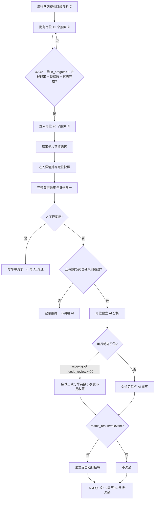

# 猎聘简历自动化项目交接

更新日期：2026-08-27

唯一代码源：`D:\jianlizhuanqu`

开发计划：[`DEVELOPMENT_PLAN.md`](../DEVELOPMENT_PLAN.md)

> 本文记录代码与离线测试可验证的当前架构。它不声称手机、猎聘登录、当日 checkpoint 或外部服务此刻在线。接手运行任务时必须重新只读核验进程、锁、状态、日志和设备。

## 1. 一分钟接手摘要

这是 Windows 上运行的单手机猎聘 RPA。主入口 `scripts/run_search_workflow.py` 通过 ADB/uiautomator2 操作猎聘 App，按岗位配置生成 `jd_smart` 搜索词，执行卡片筛选、详情简历采集、上海意向硬过滤、手机教育卡片统招本科硬过滤、AI 分析、分享链接/收藏和相关候选人沟通，最后将事实写入 MySQL。

当前每日定时任务在 FDE 与 AI 开发工程师之间按批次交叉运行。一个批次只绑定一个岗位、一个岗位配置和一个 checkpoint；两个岗位都使用 OpenAI-compatible 模型分析，不进入历史达人/财务双岗位批次。

`LiepinRpaDailySearch` 继续执行 `scripts/run_daily_search.ps1`。调度器依据最近一次 `search_workflow_run_state.json` 决定岗位：未完成时只续跑原岗位，完成后下一批切换到另一个岗位。FDE 为 40 个搜索词，checkpoint 为 `artifacts/fde_ai_deployment_engineer_<yyyyMMdd>_checkpoint.json`；AI 开发工程师为 32 个搜索词，checkpoint 为 `artifacts/ai_development_engineer_<yyyyMMdd>_checkpoint.json`。两者都必须带 `--standalone-job`。任何时候只能有一个真实 `run_search_workflow.py` 手机采集实例。日报是独立链路，搜索任务不得触发日报。

候选人另有 7 天 AI 分析冷却：同一候选人在此前批次 7 天内已有有效三态分析时，本批只保留详情定位和命中审计，不重复调用 AI、不自动沟通，也不进入本批日报/PDF。同一批次内重复出现不触发该冷却，避免把本批首次分析结果从日报中误删；API 临时异常不算有效分析。

截至本文更新，本地 `master` 最近提交为：

```text
107e771 Complete dual-job resume workflow and reporting safeguards
```

分支当时比 `origin/master` 超前 1 个本地提交，并存在有意保留的未提交 P2 维护代码和文档。接手者第一条命令应为 `git status -sb`；禁止 `git reset --hard`、禁止用旧工作树覆盖。

## 2. 当前每日岗位配置

| 执行顺序 | 业务岗位 | `job_profile_id` | 配置文件 | 生成搜索词 |
|---|---|---|---|---:|
| 1 | AI前沿部署工程师（FDE） | `fde_ai_deployment_engineer_v1` | `config/job_profiles/fde_ai_deployment_engineer_draft.yaml` | 40 |

关键词数已用 `generate_jd_smart_search_task_seeds()` 离线验证。FDE 目录包含核心 AI 岗位、交付与解决方案、工程技术栈、医疗 AI 四类搜索包。

历史达人、财务配置与串行脚本暂时保留用于人工回溯，但不再由每日 Windows 定时任务调用。

当前默认分析服务：

- `RESUME_ANALYSIS_PROVIDER=openai_compatible`；
- OpenAI 兼容 Base URL 为 `https://llm.zhimei.cloud/v1`，模型为 `gpt-5.5`；
- API Key 只保存在被 Git 忽略的本机 `.env`，不得进入代码、日志、文档或提交；
- 财务提示词为 `config/prompts/finance_shared_management_v3.txt`；
- 达人提示词继续复用 `docs/coze_daren_marketing_prompt_v3.txt`，文件名为历史命名；
- FDE 提示词为 `config/prompts/fde_ai_deployment_engineer_v1.txt`，岗位配置强制使用 `openai_compatible`；
- 两岗分别使用 `LLM_JD_ANALYSIS_VERSION` 和 `LLM_FINANCE_ANALYSIS_VERSION`，避免与旧 Coze 缓存混用；
- `src/liepin_rpa/analysis_gateway.py` 负责供应商选择，`openai_compatible_analysis.py` 负责 Chat Completions 调用，`analysis_contract.py` 负责统一三态与 JSON 校验。
- 评分契约从岗位配置的 `selection` 读取：达人分项上限为 `25/15/60`，财务为 `35/25/40`，两岗 `relevant_score_min` 当前均为 `80`；不得再用财务上限校验达人输出。
- 达人契约修复后的分析版本为 `2026-08-19-daren-live-bd-llm-v2`，用于隔离旧版错误校验产生的缓存；财务分析版本不变。

旧 Coze 适配器和以下路由配置暂时保留用于回滚，但在当前 OpenAI 兼容模式下不会调用：

- 达人主工作流：`COZE_JD_WORKFLOW_ID=7672983390107680787`；备用：`COZE_JD_BACKUP_WORKFLOW_ID=7674892283636514831`；
- 财务主工作流：`COZE_FINANCE_WORKFLOW_ID=7673041123845193743`；备用：`COZE_FINANCE_BACKUP_WORKFLOW_ID=7674892681508962319`；
- 两岗分别使用 `COZE_JD_ANALYSIS_VERSION` 与 `COZE_FINANCE_ANALYSIS_VERSION`；
- `finance_shared_management.yaml` 通过 `coze_workflow_key: finance` 明确路由。

工作流 ID 是非密钥路由配置。不要把两岗的提示词、分析版本或岗位配置混用；本文不记录任何 API Key、token、数据库凭据或 webhook 值。

## 3. 端到端流程



每个搜索词默认最多进入 5 份详情（`WORKFLOW_MAX_PROFILES_PER_KEYWORD=5`）。这是单关键词限制，不存在整轮累计 50 份后停止的规则。

## 4. 身份、去重与历史事实

系统分层使用三类标识：

1. **卡片指纹**：结果页上未进入详情前的定位证据，用于同屏/滚动去重；
2. **`candidate_fingerprint`**：候选人主身份，串联命中、分析、链接和沟通；
3. **`experience_hash`**：规范化简历正文哈希，用于姓名掩码变化、跨账号或详情文本变化后的最终同简历确认。

姓名不是唯一键。详情页顶部的“你们之前 HR 找过我”之类平台互动提示由 `sanitize_candidate_name()`/采集规则排除，不应当作候选人姓名；互动提示可写入 `platform_interaction_note`，在 PDF 中以“猎聘互动提示（非姓名）”展示。

去重策略：

- checkpoint 的 `completed_keyword_keys` 防止同一目录续跑时重复执行已完成搜索词；
- 数据库优先按 `candidate_fingerprint`、`experience_hash` 和分析版本复用身份与 AI 缓存；
- 当姓名脱敏形式或简历正文轻微更新导致两者都变化时，只在“同岗位、同年龄、
  姓名兼容、卡片核心文本相似度不低于 0.85、简历正文相似度不低于 0.8、且唯一命中一个历史
  fingerprint”全部成立时复用历史身份；证据缺失、冲突或多重命中均不自动合并；
- 历史已沟通候选人和页面“继续沟通”状态受保护，不能重复发送；
- 人工处理后 `manual_suppress_communication=1`，后续命中详情归一身份后跳过 AI 和沟通；
- 报告候选人历史文件防止同一可行动候选人在后续增量日报重复出现。

## 5. 数据库真值

核心表定义集中在 `src/liepin_rpa/db.py`。

### 5.1 `candidate_resume_experience_records`

候选人主记录：最终身份、`experience_hash`、简历正文、主表 AI 状态/分数以及人工处理字段。

人工字段：

- `manual_review_status`
- `manual_review_feedback`
- `manual_suppress_communication`
- `manual_suppress_report`
- `manual_reviewed_at`

人工处置不得覆盖 AI 的 `analysis_status`、`match_score` 或缓存证据。当前运行时兼容逻辑会为旧库补列；长期应迁移到显式数据库 migration。

### 5.2 `candidate_resume_search_hits`

每次搜索命中/动作流水：来源关键词、候选人展示名、`hit_status`、发生时间。沟通成功通常为 `sent`；待复核、不匹配、跳过、失败和人工抑制均有各自命中状态/原因。

### 5.3 `candidate_resume_analysis_cache`

AI 历史与缓存：候选人 + `experience_hash` + `analysis_version` 唯一，保存三态、分数拆分、原因和证据。

三态必须保持：

| `match_result` | `analysis_status` | 自动沟通 |
|---|---|---|
| `relevant` | 匹配 | 允许（仍需通过去重与页面校验） |
| `needs_review` | 待复核 | 禁止 |
| `not_relevant` | 不匹配 | 禁止 |

唯一决策实现位于 `src/liepin_rpa/candidate_decision_rules.py`。旧缓存中状态文字不一致时，再次命中会惰性修复，不会无条件批量改历史数据；任何未知状态均按待复核安全关闭，不能授权沟通。

### 5.4 `candidate_resume_source_locators`

定位和正式链接事实：账号别名、设备、岗位配置、搜索词/包、卡片轮次/排名/文本、平台 ID、详情 Activity/截图、正式分享链接、收藏降级和互动提示。

进入详情时先保留定位快照；身份完成后更新最终 `candidate_fingerprint` 与 `experience_hash`。正式链接 `locator_quality='share_link'`；额度不足时可降级为 `favorite`。

### 5.5 `candidate_resume_daily_report_runs`

日报投递幂等、水位、PDF 路径/URL、上传和发送状态。日报候选人历史另存于 `artifacts/daily_report_candidate_history.json`，不是可随意清理的缓存。

## 6. AI、链接和 90 分口径

岗位配置中的 `selection.relevant_score_min=80`、`review_score_min=65` 属于岗位 AI 判定契约；报表另有岗位独立的“人工待办价值线”：达人营销总监为 90 分，财务共享与管理经理为 80 分，不要与 AI 判定契约混为一谈。

共享代码口径位于 `src/liepin_rpa/reporting_rules.py`：

```text
ACTIONABLE_NEEDS_REVIEW_MIN_SCORE = 90

可行动候选人：
  relevant：全部纳入，不设分数下限
  needs_review：仅 match_score >= 90
```

统一影响：

- 高价值正式分享链接/收藏优先级；
- PDF 匹配简历与待复核简历；
- 飞书播报当天、按岗位和累计匹配/待复核数；
- 报告成功后的候选人历史水位；
- 搜索结果导出状态文字和补采分享链接脚本。

排除项：

- `not_relevant`；
- `needs_review < 90`；
- 原因为 Coze API 临时异常的伪待复核；
- `manual_suppress_report=1`。

排除只影响当前/累计可行动列表和待复核统计，不删除历史 AI 记录。

## 7. AI 分析失败策略

### 7.1 当前 OpenAI 兼容模型

- 使用官方 OpenAI Python SDK 的 `chat.completions` 和自定义 `base_url`；
- 请求强制 JSON Object，返回后仍执行本地字段、三态、分项上限、总分和布尔一致性校验；
- 分项上限和 `relevant` 门槛由当前岗位配置传入分析适配器，OpenAI 与保留的 Coze 回滚链路使用同一契约；
- HTTP 408/409/429、5xx、连接和超时异常进入最多 4 次重试；401/403 等非可重试错误直接中断，避免批量产生伪待复核；
- 可重试 API 异常耗尽后安全降级为临时 `needs_review`，10 分钟后允许重新分析；
- 模型输出结构连续不合法时降级为普通 `needs_review`，不得沟通；
- 实测该反代的 `gpt-5.5` 延迟较高，客户端单次超时为 240 秒；不得因为超时把候选人写成不匹配；
- `scripts/check_openai_compatible_resume_analysis.py` 只使用虚构样本检查模型契约，不读取数据库、不启动手机、不发送日报。

### 7.2 保留的 Coze 兼容策略

`src/liepin_rpa/coze_workflow.py` 当前事实：

- `COZE_MAX_ATTEMPTS = 4`；
- `code=4000`、429 和部分 5xxx 进入重试/待复核路径；
- 每个工作流独立按同一参数最多尝试 4 次；主工作流失败耗尽后自动切到同岗位备用工作流；
- 非可重试 API 错误会直接切备用；空响应、JSON/字段校验失败耗尽后也会切备用；
- 主工作流只要返回结构合法的 `relevant`、`needs_review` 或 `not_relevant` 就是有效业务结果，不触发备用；
- 主备均失败才生成临时 `needs_review`，不能当成 `not_relevant`；
- 临时异常缓存 TTL 为 10 分钟，到期后允许自动复评；
- 正确的普通 `needs_review` 仍不沟通。

Coze 的兼容布尔字段 `beauty_relevant` 必须与三态严格一致：仅 `match_result=relevant` 时允许为 `true`。矛盾输出属于不安全载荷，进入最多 4 次重试；仍不合法时降级为 `needs_review`，不会沟通。

## 8. 串行、锁、checkpoint 与 run_state

### 8.1 每日文件

按 `yyyyMMdd` 生成：

```text
artifacts/jd_smart_<date>_checkpoint.json
artifacts/finance_shared_<date>_checkpoint.json
artifacts/search_workflow.lock
artifacts/search_workflow_run_state.json
artifacts/search_workflow_batches.json
logs/serial_job_queue_<date>.log
logs/serial_job_queue_<date>_<job>.stdout.log
logs/serial_job_queue_<date>_<job>.stderr.log
logs/app.log
```

checkpoint 以 `catalog_key` 绑定当前目录，核心字段为 `completed_keyword_keys`、`in_progress_keyword` 和失败记录。完成数必须按键集合计数，不能按日志行数猜测。

`ProcessLease` 使用排他创建 `search_workflow.lock` 防止第二个搜索进程；只有持有相同 token 的进程正常退出时才释放。陈旧锁会按配置归档，而不是盲删。

`run_state` 状态包括 `running`、`completed`、`failed`、`interrupted`，但单看它不足以宣布完成：必须同时核验进程退出、锁不存在、checkpoint 满额且无 `in_progress_keyword`。

运行语义已修复：搜索子任务即使进程返回 0，只要 checkpoint 未满额，
`run_state` 就写为 `interrupted`，非零退出写为 `failed`；只有 checkpoint 满额才写
`completed`。完成判定仍以 checkpoint 满额为最高优先级，并同时核验进程、锁和批次状态。

### 8.2 FDE 每日任务安全门

FDE 运行器先离线验证 40 个搜索词；完成需要：

```text
completed_keyword_keys == expected
AND in_progress_keyword 不存在
AND 当前 run_state checkpoint 与该岗一致
AND run_state.status == completed
AND 搜索进程退出
AND search_workflow.lock 不存在
```

运行器最多执行 3 次安全断点续跑。风险日志存在、真实搜索进程存在或锁仍存在时停止，不会启动第二个手机实例。

## 9. 风险事件与人工介入

以下情况禁止自动续跑：

- 验证码、滑块；
- 登录异常、账号风控、实名认证；
- 设备再次离线；
- 沟通权益不足；
- `keyword_device_error_circuit_breaker`；
- `keyword_error_circuit_breaker`；
- 财务职位选择页没有精确职位；
- 队列重复非零退出或候选人身份无法确认。

发生后：保持不启动第二实例，保留 checkpoint/日志/调试证据，明确请求人工处理。不要开发验证码绕过、私有接口逆向或风控规避能力。

## 10. 报表链路

主实现：

- `src/liepin_rpa/db_daily_report.py`：数据库窗口、累计查询、PDF/发送编排；
- `src/liepin_rpa/feishu_report.py`：候选人聚合、播报统计和卡片；
- `src/liepin_rpa/resume_pdf_export.py`：按岗位 PDF；
- `src/liepin_rpa/report_candidate_history.py`：已展示候选人水位；
- `scripts/send_db_daily_report.py`：显式命令入口。

数据库优先于日志。候选人、AI、沟通、链接与人工处置来自数据库；执行关键词数/卡片浏览量仍有部分从结构化 `logs/app.log` 推导，这是待改进点。

当前窗口、累计总数和累计按岗位的 `relevant`/高分 `needs_review` 均排除人工抑制；历史 AI 行仍保留。沟通成功累计是历史事实，不因后续人工淘汰而删除。

没有用户明确授权时：不得运行日报命令、不得 `--send-report`、不得生成测试日报、不得发送飞书。

## 11. 常用只读与离线命令

### 11.1 接手检查

```powershell
Set-Location D:\jianlizhuanqu
git status -sb
git diff --stat
git log -5 --oneline
```

### 11.2 离线验证关键词数

```powershell
.\.venv\Scripts\python.exe -c "from pathlib import Path; from liepin_rpa.task_generation.generator import generate_jd_smart_search_task_seeds as g; print(len(g(Path('config/job_profiles/fde_ai_deployment_engineer_draft.yaml'))))"
```

期望输出为 `40`。

### 11.3 测试

```powershell
.\.venv\Scripts\python.exe -m pytest
.\.venv\Scripts\python.exe -m compileall -q src scripts tests
git diff --check
```

截至 2026-08-17 的最新离线验证为 `131 passed`；唯一警告来自第三方 `cozepy` 的 Authlib 弃用提示。测试不依赖真机、真实 Coze 或飞书发送。

### 11.4 运行命令模板（仅在明确授权且完成安全检查后）

```powershell
powershell.exe -NoProfile -ExecutionPolicy Bypass -File scripts\run_fde_search.ps1 `
  -RunDate yyyyMMdd `
  -ExpectedKeywords 40 `
  -MaxResumeAttempts 3
```

正式续跑不得添加 `--no-resume`、`--reset-checkpoint` 或任何日报参数。

## 12. 代码结构

```text
config/job_profiles/                 岗位 JD、搜索包和卡片规则
config/selectors/                    页面选择器
scripts/run_search_workflow.py       单岗位搜索入口
scripts/run_daily_search.ps1         Windows 每日搜索任务入口
scripts/run_single_ai_job_search.ps1 FDE/AI开发工程师通用单岗位断点续跑与安全门
scripts/run_fde_search.ps1           FDE 兼容入口
scripts/run_ai_development_search.ps1 AI开发工程师兼容入口
scripts/run_serial_job_queue.ps1     历史达人/财务串行队列（定时任务不再调用）
src/liepin_rpa/search_execution/     搜索、卡片、详情、AI与沟通编排
src/liepin_rpa/profile_collection/   简历采集和姓名/正文结构化
src/liepin_rpa/db.py                 表结构、读写、身份和人工处置
src/liepin_rpa/candidate_decision_rules.py AI三态、中文状态和沟通授权
src/liepin_rpa/reporting_rules.py    可行动报表/链接共享口径
src/liepin_rpa/db_daily_report.py    数据库日报编排与累计查询
src/liepin_rpa/feishu_report.py      播报候选人和统计
src/liepin_rpa/resume_pdf_export.py  PDF 生成
tests/unit/                          离线回归
artifacts/                           checkpoint、锁、状态、批次和报告产物
logs/                                结构化运行日志与队列输出
```

## 13. 当前 P2 维护变更（尚未提交）

截至 2026-08-17，本轮工作基于并保留下列已有未提交改动：

- AI 三态 `needs_review` 映射与缓存惰性修复；
- 正式链接策略：`relevant` 全部 + `needs_review>=90`；
- 人工复核字段、人工抑制沟通和报表；
- PDF 排除人工处理候选人；
- 毛先生/袁先生的人工反馈已写入数据库（不在本文记录候选人详细隐私）。

本轮新增/调整：

- `src/liepin_rpa/reporting_rules.py` 共享口径；
- 达人低于 90 分、财务低于 80 分的 `relevant` 不进入 PDF、当天/岗位匹配统计或报告水位；
- 高分 `not_relevant` 不会被补采链接脚本误选；
- 累计、按岗位和历史待复核查询过滤 `manual_suppress_report`；
- PDF 仍正确区分已打招呼和匹配未打招呼；
- 数据查询、选择集、90/89 边界、矛盾字段、人工抑制和历史 AI 保留测试；
- 重写 `DEVELOPMENT_PLAN.md`、README 并新增本文。

随后完成的 P1 统一维护：

- AI 三态、中文状态与自动沟通授权集中到 `candidate_decision_rules.py`；
- Coze `beauty_relevant` 与 `match_result` 矛盾时重试并安全降级待复核；
- 采集、缓存复用、数据库日报和展示不再用旧 `matched` 布尔值覆盖显式三态；
- `match_result` 优先于冲突的历史 `analysis_status`，未知值一律禁止沟通。

这些改动尚未提交 Git。接手者应先跑全量测试并 review diff；除非用户明确要求，不要自行提交或推送。

## 14. 已知风险与下一步

按优先级：

1. **历史身份审计**：新命中已支持强证据复用历史 fingerprint；既有重复记录仍应先
   只读审计，再由人工确认是否回填，不执行自动批量合并或删除。
2. **队列缺少独立锁**：搜索锁防第二个手机实例，但不能防两个串行观察器。
3. **指标来源混合**：部分浏览量和关键词数来自日志，不如数据库事件表稳定。
4. **运行时数据库补列**：应引入正式 migration，避免生产库字段漂移。
5. **`result_filter.py` 体积大**：拆分需高样本覆盖，不能在每日任务前仓促重构。
6. **旧文档**：`docs/PROJECT_HANDOVER_2026-08-11.md` 仅保留历史审计，其中 2250 搜索组合、75 分 PDF 门槛等已过时，不能作为当前运行依据。

## 15. 安全和隐私

- `.env`、Coze token、飞书 webhook、数据库密码、PDF 上传密钥不进入文档或提交；
- 候选人完整简历、电话、PDF、截图和数据库导出不得发布到公共仓库；
- 不删除活跃锁、正式 checkpoint、日报水位、数据库记录或审计日志；
- 不以测试通过替代真机运行核验，也不以 `run_state=completed` 单点宣布任务完成。
