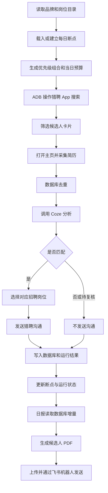

# 猎聘自动化项目交接文档

> 更新时间：2026-08-11（Asia/Shanghai）
> 项目目录：`D:\智美\code\jianlizhuanqu`
> 当前业务重点：达人营销岗位候选人搜索、简历分析、沟通与日报
> 当前运行状态：**已按用户要求暂停；搜索与日报计划任务均为 Disabled**

> 2026-08-11 10:03 状态变更：搜索和日报计划任务已启用；当日搜索预算为 121 个组合，已从“海蓝之谜 + 达人营销总监”开始。日报任务正在等待搜索完成，完成后仅发送测试机器人且不推进正式日报水位。收到业务确认前，不得切换或补发到正式群。

> 2026-08-11 10:25 状态变更：新版 Coze 工作流 `v0.0.4` 已确认发布，但对象、JSON 字符串和普通字符串测试均返回 `4000 Invalid request parameters`。为避免无效评分，搜索在完成 7 个组合后停止，断点保留在第 8 个“法尔曼 + 达人营销总监”；等待中的测试日报也已停止，未向测试群或正式群发送本次日报。

> 2026-08-11 10:40 状态变更：根据 Coze 开始节点截图，将本地入参修正为 6 个必填子字段，并将 `id` 改为 Number。高匹配、证据不足和不相关三组契约测试均通过。搜索已跳过前 7 个组合，从“法尔曼 + 达人营销总监”续跑剩余 114 个组合；日报仅等待并发送测试机器人。

> 2026-08-11 暂停状态：用户再次要求暂停流程。搜索和日报进程均已停止，两个计划任务均已禁用，运行锁已清理。本目录累计完成 68 个组合，保留 4 个失败记录，当前断点为“Cynovate + 达人营销总监”。本轮测试日报未发送到测试群或正式群。

## 1. 交接摘要

该项目是在 Windows 环境中运行的猎聘手机端 RPA。系统通过 ADB 操作指定安卓手机，在猎聘 App 内按“品牌关键词 + 岗位关键词”搜索候选人，采集简历后调用 Coze 工作流评分，并按结果决定是否发起沟通，最后将运行结果写入 MySQL、生成 PDF 日报并通过飞书机器人发送。

项目从其他电脑迁移到当前电脑后，Python 虚拟环境、ADB、手机连接、数据库、Coze、飞书日报和 Windows 计划任务均已做过恢复和多轮实跑。当前代码和测试可用，业务方向已从传统美妆管理岗位切换为达人营销岗位。流程曾根据用户要求暂停，后于 2026-08-11 10:03 恢复；当前日报暂时投递测试群，等待业务确认后再切回正式群。

恢复正式运行前，必须先完成以下事项：

1. 将新版达人营销提示词发布到 Coze 工作流。
2. 验证 Coze 开始节点的 `resume_record` 是 Object 类型，结束节点字段与代码完全一致。
3. 用单个关键词无沟通试跑，确认手机搜索、简历采集和 Coze 解析正常。
4. 经确认后再启用猎聘搜索和日报计划任务。
5. 排查期间不得主动向正式飞书群发送日报或补发历史结果，除非用户明确要求。

## 2. 当前状态快照

### 2.1 Windows 计划任务

| 任务 | 当前状态 | 原计划 | 最近一次结果 | 说明 |
| --- | --- | --- | --- | --- |
| `LiepinRpaDailySearch` | Disabled | 每天 08:00 启动 | 2026-08-11 手工续跑后暂停 | 累计完成 68 个组合，断点已保留 |
| `LiepinRpaDailyReport` | Disabled | 每天 10:00 启动 | 2026-08-11 等待任务被停止 | 未发送；计划任务仍保留 `-UseTestWebhook` 配置 |
| `竞品价格监控-每日12点` | Disabled | 原每日运行 | 已关闭 | 避免与猎聘抢占手机/ADB |

`D:\智美\code\大众点评-收集医生数据` 在最后一次检查时没有发现已注册的每日计划任务，也没有相关运行进程。

### 2.2 进程、锁和断点

- 当前没有搜索或日报相关进程运行。
- `artifacts/search_workflow.lock` 不存在。
- 新关键词目录总组合 2250；累计完成 68 个组合，4 个组合保留失败记录，当前停在“Cynovate + 达人营销总监”。
- 运行锁使用文件年龄判断陈旧锁，不依赖 PID；人工强制中断后仍应检查锁文件和状态文件。

### 2.3 最近一次成功日报

数据库中最近一条成功日报记录：

| 字段 | 值 |
| --- | --- |
| 报告 ID | 13 |
| 数据窗口 | 2026-08-05 10:00:09 至 2026-08-09 13:44:07 |
| 加载记录数 | 17 |
| 候选结果数 | 17 |
| 发送状态 | `sent` |
| 发送时间 | 2026-08-09 13:44:20 |
| 本地 PDF | `artifacts\daily_reports\featured_candidates_resumes_2a931e4f9e1ed135b2b18d90.pdf` |

日报程序默认从上次成功发送的水位继续取数。因此任务暂停期间如果数据库产生了新结果，恢复日报后可能将积压数据一起纳入下一份日报，恢复前需要先做 `--dry-run` 检查。

## 3. 当前业务规则

### 3.1 招聘方向

- 传统美妆岗位当前不再作为主要抓取目标，相关人员已经找到。
- 后续重点为达人营销、媒介、直播电商、KOL 商务及相关负责人岗位。
- “安和颜负责人”当前不需要再找，代码已加入明确排除标记。
- 搜索优先级最高的岗位是 `达人营销总监`。
- 正式运行时，品牌与岗位按目录生成组合；能力词只用于简历证据判断，不直接作为手机搜索岗位。

### 3.2 用户确认过的运行约束

- 正式流程最终需要每日定时运行，但当前根据最后指令保持暂停。
- 排查日报或飞书问题时，只检查结果，不自动转发。
- 使用测试 Webhook 时必须由用户明确指定；正式群仅用于确认后的正式日报。
- 历史日报通常可以基于数据库结果单独补发，不一定需要重新跑完整猎聘流程。
- 多个手机自动化项目同时运行可能发生 ADB、前台 App 或设备占用冲突，因此猎聘运行时应保持其他手机项目停用。

## 4. 搜索关键词目录

### 4.1 岗位关键词

当前代码中共有 15 个岗位关键词，配置文件为 `config/roles.yaml`：

1. 达人营销总监
2. 媒介总监
3. 直播电商负责人
4. 达人运营总监
5. 达人运营负责人
6. KOL商务BD
7. 内容营销总监
8. 新媒体营销总监
9. 电商总经理
10. 整合营销总监
11. 直播负责人
12. 抖音负责人
13. 直播推广负责人
14. BD负责人
15. BD总监

`src/liepin_rpa/task_generation/generator.py` 中设置了岗位和品牌优先顺序，首个岗位为 `达人营销总监`。当前这些岗位在 `src/liepin_rpa/search_execution/job_selection.py` 中统一映射到达人/直播相关职位类型。

### 4.2 品牌关键词

当前代码中共有 150 个品牌关键词，配置文件为 `config/brands.yaml`，分为四类：

| 类别 | 数量 | 示例 |
| --- | ---: | --- |
| 高端美妆与院线护肤 | 50 | 海蓝之谜、HR赫莲娜、SK-II、CPB肌肤之钥、莱珀妮 |
| 家用美容仪器与轻医美设备 | 30 | FOREO、雅萌、初普、宙斯、觅光 |
| 高端医疗耗材与家用健康设备 | 50 | 强生医疗、雅培医疗、罗氏诊断、美敦力、迈瑞医疗 |
| 高端快消与个人护理 | 20 | 戴森、徕芬、追觅、卡诗、飞利浦个人护理 |

当前目录共生成：`150 × 15 = 2250` 个品牌岗位组合。

首批优先组合从以下品牌开始：`海蓝之谜`、`HR赫莲娜`、`SK-II`、`CPB肌肤之钥`、`莱珀妮`，并优先搭配 `达人营销总监`。

### 4.3 不直接用于搜索的能力证据词

用户提供的其余 40 个词属于简历证据和评分维度，不作为 `roles.yaml` 中的独立岗位搜索词，主要包括：

- 达人矩阵：KOL矩阵、KOL资源、头部达人、腰部达人、垂类达人、达人孵化、达人资源库、达人分层管理等。
- 直播转化：直播带货、达人专场、短直联动、直播间投流、坑产优化、场观、逼单转化等。
- 数据指标：ROI、GMV、GSV、搜索进店、综合转化率、业绩目标等。
- 平台生态：抖音电商、小红书 KOS、腾讯视频号、内容场、站外引流、IP 账号等。
- 行业属性：美妆医美、高端消费、轻医美、功效护肤、日化、医疗、快消等。

## 5. Coze 简历分析工作流

### 5.1 当前提示词

新版提示词文件：`docs/coze_daren_marketing_prompt_v3.txt`

该文件是本地交付稿，**不会自动同步到 Coze**。恢复正式运行前，需要登录 Coze 工作流编辑页面，将提示词粘贴到大模型节点并点击发布。

旧文件 `docs/coze_resume_analysis_prompt_v2.txt` 是传统美妆岗位阶段使用的提示词，仅作历史参考，不应继续用于当前达人营销招聘。

### 5.2 输入格式

代码通过 Coze SDK 传入：

```json
{
  "resume_record": {
    "...": "标准化后的简历字段"
  }
}
```

即 `resume_record` 应为 Object，而不是序列化后的 JSON 字符串。线上开始节点要求且代码只发送以下 6 个必填子字段：

| 字段 | Coze 类型 |
| --- | --- |
| `id` | Number |
| `candidate_name` | String |
| `source_platform` | String |
| `search_keyword` | String |
| `experience` | String |
| `analysis_status` | String |

代码会在调用前清洗和截断字符串字段，以控制请求体大小。`resume_summary` 和 `created_at` 不属于线上 Object 子字段，不能发送，否则 Coze 会返回 `4000`。

历史上曾出现 Coze 错误码 `4000`（input parameters invalid）。恢复时重点检查：

1. 开始节点输入变量名必须是 `resume_record`。
2. 变量类型必须与代码传入对象一致。
3. 大模型节点引用的是整个 `resume_record`，而非不存在的子字段。
4. 结束节点必须返回所有约定字段。
5. 修改后必须发布，不能只保存草稿。

### 5.3 固定输出字段

Coze 输出和代码校验器当前要求以下 6 个顶层字段：

```json
{
  "beauty_relevant": true,
  "match_result": "relevant",
  "match_score": 80,
  "score_breakdown": {
    "industry_depth": 20,
    "beauty_continuity": 12,
    "role_evidence": 48
  },
  "analysis_reason": "...",
  "evidence_summary": ["..."]
}
```

字段名不能增加、删除或改名。`evidence_summary` 必须为字符串数组。

`beauty_continuity` 是为兼容现有 Coze 输出结构和代码保留的旧字段名；在 V3 提示词中，其实际含义已经调整为目标行业/达人营销经历的连续性。短期内不要直接改名，否则 Coze 结束节点、代码解析、数据库或报告都需要同步修改。

### 5.4 当前评分标准

当前满分为 100 分：

| 分项 | 满分 | 判断重点 |
| --- | ---: | --- |
| `industry_depth` | 25 | 目标行业、品牌层级、业务复杂度和行业深度 |
| `beauty_continuity` | 15 | 相关行业及达人营销经历连续性 |
| `role_evidence` | 60 | 达人资源、直播电商、平台、业绩指标和管理证据 |

判定为 `relevant` 必须同时满足：

- `match_score >= 75`
- `role_evidence >= 42`

提示词要求 `beauty_relevant` 与 `match_result` 强制一致，并要求所有证据只能来自简历原文，不得把无口径数字擅自解释成 GMV，不得把公司整体业绩写成候选人个人业绩，也不得拼接不同公司的经历。

代码侧目前将 `beauty_relevant == true` **或** `match_result == "relevant"` 视为匹配。虽然提示词要求两者一致，但代码没有对矛盾结果做完全强制纠正，这是后续可加固的一处风险。

### 5.5 重试和降级

- Coze 单条分析最多重试 3 次。
- 错误码 `4000`、限流 `429` 和部分 `5xx` 在重试耗尽后会降级为 `needs_review`。
- 降级可保证整批流程继续，但不能将 `needs_review` 当成有效匹配结果。

## 6. 端到端运行流程



关键执行逻辑：

1. 读取 `config/brands.yaml` 和 `config/roles.yaml`。
2. 根据目录指纹判断是否沿用旧断点；目录变化会自动切换到新目录。
3. 无筛选参数时，每日随机取 120 至 150 个关键词组合。
4. ADB 启动猎聘、进入搜索页面，输入品牌与岗位组合。
5. 检查候选人卡片中的品牌、岗位、年龄、学历等信息。
6. 打开候选人主页并读取经历，利用数据库避免重复采集或重复联系。
7. 调用 Coze 获取结构化评分。
8. 匹配时选择对应招聘职位并发送沟通，之后写入数据库。
9. 每处理一个关键词更新断点；连续 8 个关键词异常会触发熔断。
10. 日报任务等待搜索结束，从数据库成功水位之后读取增量，生成 PDF 后发送飞书。

候选人页面如果显示“继续沟通”，通常代表已经建立过沟通。系统会结合数据库记录避免重复联系；如果页面状态与本地数据库不一致，应记录并人工复核，不要直接再次发送。

## 7. 手机与 ADB 环境

### 7.1 猎聘专用手机

| 项目 | 值 |
| --- | --- |
| ADB 序列号 | `AQML6R3815001305` |
| 设备型号 | `CRT_AN00` |
| 猎聘包名 | `com.lietou.mishu` |
| 主 Activity | `.HomeActivity` |
| ADB 程序 | `D:\platform-tools\adb.exe` |

当前电脑可能同时连接多部安卓设备，所有人工 ADB 命令都应显式使用：

```powershell
D:\platform-tools\adb.exe -s AQML6R3815001305 devices -l
```

检查猎聘是否处于前台：

```powershell
D:\platform-tools\adb.exe -s AQML6R3815001305 shell dumpsys window windows | Select-String "mCurrentFocus|mFocusedApp"
```

启动猎聘：

```powershell
D:\platform-tools\adb.exe -s AQML6R3815001305 shell am start -n com.lietou.mishu/.HomeActivity
```

### 7.2 环境变量

环境模板位于 `.env.example`。正式值保存在本机 `.env`，交接文档不记录密码、Token、Webhook 或工作流 ID。

主要变量分组：

- 运行环境：`APP_ENV`、`LOG_LEVEL`、`ARTIFACTS_DIR`、`LOGS_DIR`
- ADB：`DEVICE_ID`、`ADB_EXECUTABLE`、`LIEPIN_PACKAGE`、`LIEPIN_MAIN_ACTIVITY`
- MySQL：`MYSQL_HOST`、`MYSQL_PORT`、`MYSQL_USER`、`MYSQL_PASSWORD`、`MYSQL_DATABASE`
- Coze：`COZE_API_TOKEN`、`COZE_API_BASE_URL`、`COZE_WORKFLOW_ID`、`COZE_ANALYSIS_VERSION`
- 飞书：`FEISHU_BOT_WEBHOOK`、`FEISHU_TEST_BOT_WEBHOOK`
- 运行预算：`WORKFLOW_DAILY_KEYWORD_MIN`、`WORKFLOW_DAILY_KEYWORD_MAX`
- 熔断与锁：`WORKFLOW_MAX_CONSECUTIVE_KEYWORD_ERRORS`、`WORKFLOW_LOCK_STALE_SECONDS`
- 日报等待：`DAILY_REPORT_WAIT_FOR_SEARCH_SECONDS`

当前关键非敏感配置：

```text
WORKFLOW_DAILY_KEYWORD_MIN=120
WORKFLOW_DAILY_KEYWORD_MAX=150
WORKFLOW_MAX_CONSECUTIVE_KEYWORD_ERRORS=8
COZE_ANALYSIS_VERSION=2026-08-10-daren-v3
```

## 8. 代码结构与关键文件

| 文件 | 用途 |
| --- | --- |
| `scripts/run_search_workflow.py` | 搜索主入口，支持单关键词、批量和无沟通模式 |
| `scripts/run_daily_search.ps1` | Windows 每日搜索包装脚本 |
| `scripts/run_daily_report.ps1` | Windows 每日日报包装脚本 |
| `scripts/prepare_daily_search_checkpoint.py` | 正式运行前检查、归档或重建断点 |
| `scripts/send_db_daily_report.py` | 从数据库生成并发送日报 |
| `scripts/export_search_results.py` | 导出搜索结果 |
| `scripts/install_daily_search_task.ps1` | 安装或更新搜索计划任务 |
| `scripts/install_daily_report_task.ps1` | 安装或更新日报计划任务 |
| `config/brands.yaml` | 150 个品牌关键词 |
| `config/roles.yaml` | 15 个达人营销岗位关键词 |
| `src/liepin_rpa/workflow.py` | 搜索、采集、Coze、沟通和落库的主流程 |
| `src/liepin_rpa/search_execution/search_pages.py` | 猎聘搜索页和候选人页面操作 |
| `src/liepin_rpa/search_execution/job_selection.py` | 沟通前的招聘职位选择及排除逻辑 |
| `src/liepin_rpa/task_generation/generator.py` | 关键词组合生成和优先级 |
| `src/liepin_rpa/integrations/coze_workflow.py` | Coze 请求、校验、重试和降级 |
| `src/liepin_rpa/runtime_control.py` | 运行锁、状态文件和防重入 |
| `src/liepin_rpa/db.py` | 搜索结果和候选人数据入库 |
| `src/liepin_rpa/db_daily_report.py` | 日报数据窗口和发送水位 |
| `src/liepin_rpa/feishu_report.py` | 飞书消息发送 |
| `src/liepin_rpa/resume_pdf_export.py` | 候选人简历 PDF 生成 |
| `src/liepin_rpa/pdf_upload.py` | PDF 外部上传 |
| `docs/coze_daren_marketing_prompt_v3.txt` | 当前达人营销 Coze 提示词 |

根目录 `README.md` 的部分说明已经落后于当前实现。例如 README 仍描述“当前不自动沟通”，但当前正式流程在 Coze 判定匹配后已经具备自动发送沟通能力。交接和操作以本文件、现有代码及命令帮助为准。

## 9. 常用运行命令

以下命令均在项目目录执行：

```powershell
Set-Location 'D:\智美\code\jianlizhuanqu'
```

### 9.1 检查环境和测试

```powershell
.\.venv\Scripts\python.exe --version
.\.venv\Scripts\python.exe -m pytest -q
D:\platform-tools\adb.exe devices -l
```

最近一次完整测试结果：`29 passed, 1 warning`。警告来自 `cozepy/authlib.jose` 的 `AuthlibDeprecationWarning`，目前不影响执行。两个 PowerShell 包装脚本已避免将该 stderr 警告误判为脚本失败。

### 9.2 单关键词无沟通验证

该模式不会发送猎聘沟通；当前实现也不会写正式数据库结果，适合恢复前检查：

```powershell
.\.venv\Scripts\python.exe .\scripts\run_search_workflow.py --brand 海蓝之谜 --role 达人营销总监 --no-send-message
```

### 9.3 正式单关键词

该命令可能向匹配候选人发送沟通并写数据库，只能在 Coze 发布验证完成后执行：

```powershell
.\.venv\Scripts\python.exe .\scripts\run_search_workflow.py --brand 海蓝之谜 --role 达人营销总监
```

### 9.4 当日批量流程

无品牌、岗位或 limit 参数时，使用每日 120 至 150 个组合预算和断点：

```powershell
.\.venv\Scripts\python.exe .\scripts\run_search_workflow.py
```

### 9.5 日报只预览不发送

```powershell
.\.venv\Scripts\python.exe .\scripts\send_db_daily_report.py --use-cache --dry-run
```

### 9.6 查询计划任务

```powershell
Get-ScheduledTask -TaskName 'LiepinRpaDailySearch','LiepinRpaDailyReport' |
    Select-Object TaskName, State

Get-ScheduledTaskInfo -TaskName 'LiepinRpaDailySearch'
Get-ScheduledTaskInfo -TaskName 'LiepinRpaDailyReport'
```

### 9.7 启用与暂停计划任务

恢复前先完成第 13 节清单。

```powershell
Enable-ScheduledTask -TaskName 'LiepinRpaDailySearch'
Enable-ScheduledTask -TaskName 'LiepinRpaDailyReport'
```

再次暂停：

```powershell
Disable-ScheduledTask -TaskName 'LiepinRpaDailySearch'
Disable-ScheduledTask -TaskName 'LiepinRpaDailyReport'
```

## 10. 日报和飞书规则

- 日报入口为 `scripts/send_db_daily_report.py`。
- 正式计划任务使用 `--use-cache --wait-for-search`，会等待搜索任务结束后再取数。
- 飞书正式 Webhook 和测试 Webhook 分开配置在 `.env`，不得写入代码、日志或交接文档。
- PDF 精选候选人的展示门槛为 `MIN_DISPLAY_SCORE=75`。
- 候选人进入精选 PDF 通常需要同时满足：已匹配、已沟通、评分不低于 75。
- 日报发送成功后会写入发送记录和数据水位，后续日报从该水位继续。
- 流程已跑完但日报没发时，可以直接从数据库重新生成/补发，不需要重跑手机搜索；但补发前先 `--dry-run` 并确认发送目标。
- 用户曾明确要求某些日期“今天先别发”，因此任何历史补发都必须再次获得明确确认。

## 11. 历史过程与重要节点

### 11.1 迁移与设备恢复

- 项目从另一台电脑迁移到当前 Windows 电脑。
- 重建了 `.venv`、依赖、`.env`、ADB 路径和计划任务。
- 猎聘专用手机最终识别为 `AQML6R3815001305`。
- 电脑同时连接过多部手机，曾出现目标手机未出现在 `adb devices -l` 中；重新连接并授权后恢复。

### 11.2 早期美妆岗位阶段

- 早期关键词目录主要是约 48 个美妆品牌与约 18/19 个管理岗位，共约 864/912 个组合。
- Coze 最初按美妆行业深度、连续性和岗位证据评分。
- 在候选人页面识别到“继续沟通”状态后，流程增加了避免重复触达的处理。
- 后续用户确认“安和颜负责人”不再需要寻找，代码加入排除。

### 11.3 典型运行记录

| 日期 | 运行情况 | 结果 |
| --- | --- | --- |
| 2026-08-01 | 手工恢复运行，约 15:07 至 18:31 | 完成 120 个关键词、打开 29 份主页、日报候选结果 8 条，飞书已发送 |
| 2026-08-05 | 定时搜索 | 计划 121，完成 44 后因连续 8 次 UI 重置失败熔断；打开 3 份主页；10:00 日报发送 1 位候选人 |
| 2026-08-07 | 上午运行中断，下午从断点恢复 | 上午完成 68；13:28 手工续跑固定 78 个，15:26 完成；当日按用户要求不发日报，dry-run 通过 |
| 2026-08-09 | 数据库日报 | 17 条候选结果，13:44 成功发送，为当前最近一次成功日报 |
| 2026-08-10 | 旧目录流程再次启动后被停止 | 搜索任务结果 `267014`，随后搜索和日报计划任务均被禁用 |

部分中断记录曾出现结果 `3221225786`，即 Windows 状态码 `0xC000013A`，通常表示进程被外部中断，而不是代码正常完成。

搜索脚本触发熔断后可能以退出码 0 结束，所以“计划任务结果为 0”不一定代表当日预算全部完成。必须结合运行状态 JSON、日志事件、完成数量和断点检查。

### 11.4 达人营销方向切换

- 用户确认美妆岗位招聘已完成，新的重点为达人营销岗位。
- 提供了 55 个岗位/能力/平台/指标词和 150 个品牌。
- 代码将其中 15 个真正岗位写入搜索目录，其余 40 个作为 Coze 简历证据词。
- 品牌目录更新为 150 个，组合总数变为 2250。
- 新增 `docs/coze_daren_marketing_prompt_v3.txt`，评分改为 100 分制并强化达人营销证据权重。
- 用户最后要求“流程和日报都先停了”，因此尚未恢复新目录的每日正式运行。

## 12. 已知问题与风险

### 12.1 Coze 输入契约风险

Coze 曾因本地代码把 Number 类型的 `id` 转为字符串，并额外发送未定义的 `resume_summary`、`created_at` 而返回 `4000 input parameters invalid`。该契约问题已于 2026-08-11 修复并完成三档测试。Coze 偶尔仍可能瞬时返回 `4000`，代码会重试 3 次；持续失败则降级为 `needs_review`。

### 12.2 页面变化和 UI 熔断

猎聘 App 页面结构、弹窗、网络状态、登录状态或搜索页焦点变化，都可能导致 UI 重置失败。连续 8 次失败会提前停止当批任务，以避免手机长时间失控操作。

### 12.3 外部中断和陈旧状态

系统休眠、终端关闭、手机断连、其他自动化抢占设备或人工终止，都可能产生 `0xC000013A`。此时需要检查实际进程、锁文件和断点，不能只看状态文件中的 `running`。

### 12.4 多项目争用设备

竞品价格监控和大众点评/医生数据项目可能操作 ADB 或前台 App。猎聘正式运行期间不得同时启用这些项目的每日自动化。目前竞品价格监控任务已禁用。

### 12.5 判定字段一致性

提示词要求 `beauty_relevant` 与 `match_result` 对应，但代码使用 OR 逻辑决定匹配。如果模型返回矛盾字段，可能误触发沟通。建议后续将代码改为严格校验一致性，矛盾结果统一降级为 `needs_review`。

### 12.6 日报积压

日报暂停后，恢复时会从最近一次成功发送水位继续。若中间有正式入库结果，下一份日报可能跨多天。启用日报任务前必须先 dry-run 检查候选人数和时间窗口。

### 12.7 文档与代码偏差

根目录 README 已落后于当前自动沟通、评分和关键词逻辑，不能单独作为运行依据。后续应在流程稳定后同步更新 README。

## 13. 正式恢复清单

按以下顺序恢复，不要直接先启用计划任务：

- [ ] 确认 `AQML6R3815001305` 在线、已解锁、猎聘账号正常登录。
- [ ] 确认竞品价格监控及其他手机自动化仍为 Disabled/Paused。
- [ ] 在 Coze 发布 `docs/coze_daren_marketing_prompt_v3.txt`。
- [ ] 确认 Coze 输入 `resume_record` 为 Object。
- [ ] 确认 Coze 结束节点输出 6 个顶层字段及 3 个评分子字段。
- [ ] 运行完整测试，确认仍为全绿。
- [ ] 执行“海蓝之谜 + 达人营销总监”的 `--no-send-message` 单关键词验证。
- [ ] 检查 Coze 是否返回合法 JSON、总分是否等于三个分项之和。
- [ ] 经业务确认后执行一个正式单关键词，观察职位选择和沟通状态。
- [ ] 执行日报 `--dry-run`，确认不会误发历史积压或错误候选人。
- [ ] 启用 `LiepinRpaDailySearch`。
- [ ] 启用 `LiepinRpaDailyReport`。
- [ ] 次日分别在 08:00 后和 10:00 后检查真实完成数及飞书发送记录。

## 14. 故障恢复步骤

### 14.1 搜索中断后续跑

1. 检查是否仍有相关 Python 或 PowerShell 进程。
2. 检查 `artifacts/search_workflow.lock` 是否存在及更新时间。
3. 查看 `artifacts/search_workflow_run_state.json` 的 run id、预算、完成数和最后事件。
4. 确认手机在线、解锁且猎聘位于可操作页面。
5. 不删除有效断点，重新执行搜索入口即可从未完成组合继续。
6. 如果关键词目录已经变化，先运行断点准备脚本确认新目录指纹。

### 14.2 日报未发送

1. 先查询搜索是否真正结束，不能只看计划任务退出码。
2. 使用 `--use-cache --dry-run` 生成预览。
3. 检查数据库报告水位、候选数量、PDF 和上传结果。
4. 判断应使用测试 Webhook 还是真实 Webhook。
5. 仅在用户明确要求后执行发送；通常无需重跑猎聘搜索。

### 14.3 ADB 找不到目标手机

1. 执行 `D:\platform-tools\adb.exe devices -l`。
2. 检查 USB 数据线、USB 调试和手机端授权弹窗。
3. 避免只看设备型号，必须确认序列号 `AQML6R3815001305`。
4. 多设备环境中所有命令显式添加 `-s AQML6R3815001305`。
5. 恢复连接后重新检查猎聘前台 Activity。

## 15. 日志与产物

主要运行产物位于 `artifacts`：

| 路径 | 内容 |
| --- | --- |
| `artifacts/search_workflow_run_state.json` | 最近一次搜索任务状态 |
| `artifacts/search_workflow.lock` | 搜索任务互斥锁，正常结束后应删除 |
| `artifacts/search_results/` | 搜索结果 CSV 等导出文件 |
| `artifacts/daily_reports/` | 日报 PDF |
| `logs/` | 结构化运行日志和错误信息 |

已知历史导出示例：

```text
artifacts/search_results/search_results_latest_run_20260801_183158.csv
```

排查时避免把含候选人隐私的完整日志、简历 JSON 或 PDF 上传到公开位置。

## 16. 代码和仓库状态

- 当前工作树存在较多未提交修改和未跟踪文件，这是前期恢复、功能增强和关键词切换累积的结果。
- 不得使用 `git reset --hard`、`git checkout --` 等命令覆盖当前工作树。
- 最近检查的差异规模约为 34 个已跟踪文件、2020 行新增、369 行删除，另有未跟踪文件。
- 当前没有按本次交接要求创建提交。
- 后续提交前应先按功能拆分检查：环境恢复、定时任务、日报、Coze V3、达人关键词目录和测试。

## 17. 安全与隐私

以下内容只能保存在 `.env`、密码管理工具或受控系统中，不得写入 Git、Markdown、聊天截图或普通日志：

- MySQL 用户名和密码
- Coze API Token、工作流 ID
- 飞书正式和测试机器人 Webhook
- PDF 上传凭证或受限地址
- 候选人手机号、完整简历、沟通内容和其他个人信息

本交接文档仅记录了变量名、非敏感运行参数和本地文件位置，没有记录真实密钥。

## 18. 建议的下一步

当前最合理的下一步不是立即批量运行，而是完成一次受控恢复：先发布并验证 Coze V3，再执行单关键词无沟通测试。测试通过后，检查日报 dry-run 的时间窗口，最后才重新启用两个猎聘计划任务。

恢复后的目标状态应为：

- 每天 08:00 启动猎聘搜索，实际处理 120 至 150 个未完成组合。
- 搜索以 `达人营销总监` 和优先品牌开头，随后推进其余达人营销岗位。
- 匹配候选人才发送猎聘沟通并落库。
- 每天 10:00 日报等待搜索结束，从数据库增量生成 PDF 并发送正式飞书群。
- 竞品价格监控和医生数据项目不再每日运行，避免设备冲突。
