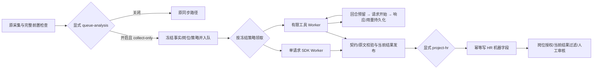

# 剩余阶段补齐记录与接入手册

日期：2026-11-05。关联 [V2 主计划](AI_APPLICATION_UPGRADE_PLAN_V2.md)。

> 2026-11-06 更新：本页保留 11 月 5 日交付时的历史状态。“未推送/未执行 MySQL/安装未完成”等描述不是当前进度；后续实测与 CI 结果见 [新环境与隔离 MySQL 验收记录](UPGRADE_ENVIRONMENT_ACCEPTANCE.md)。

本轮补齐**采集入队、配置式 SDK Worker、HR 当前结果投影、工具逐回合持久化/共享预算和一体化演示**。原有同步入口保持默认；生产执行仍须显式启用并完成环境验收。用户此前选择只做工具与合成验证，本轮没有向真实模型、手机或生产数据库发送请求。

## 1. 已完成与待验收范围

| 范围 | 已交付 | 本轮验证边界 |
| --- | --- | --- |
| 正式采集代码入口 | `--queue-analysis`，在原有身份、人工抑制、年龄、城市、学历、冷却检查之后入队 | 用假设备/采集报告验证；没有操作真实手机 |
| 冻结输入 | 原文快照、结构化事实、岗位 YAML、策略和请求计划参与任务身份；同事务保存 | 重复提交、输入变化与篡改拒绝已验证 |
| 配置式模型 Worker | HTTPS 显式凭据、一次租约一次请求、SDK 重试关闭、冻结模型/价格/输出限制 | 用 MockTransport 验证，无外部模型调用 |
| HR 结果投影 | 只接受当前已发布结果；幂等机器字段写入，保留人工 revision/反馈/抑制 | 用临时 SQLite 和真实 API 验证 |
| 当前结果可见性 | `HR_ENABLE_QUEUE_PROJECTION` 默认 false；启用后隐藏已被新任务替代的旧队列结果 | 新版本创建后旧详情不再冒充当前结果 |
| 有限工具编排 | 原四工具/规则/引用检查，增加会话、逐请求账本、共享任务/批次/分钟预算与响应回放 | 脚本、实际 SDK + 本地 HTTP、配置式 SDK + MockTransport |
| Worker 策略隔离 | fulltext/tools 随任务冻结，Worker 只领取对应策略 | 不靠启动哪个 Worker 来临时改任务策略 |
| MySQL 验收入口 | 独立脚本、1/2/4 并发 stub 对照、8 子进程争抢/退出恢复、迁移 08 升降级 | 本机 Docker 引擎管道拒绝访问，未执行 MySQL 实测 |
| CI 与干净安装 | CI 增加集成报告与独立 MySQL 服务任务 | 未推送；干净 venv 安装未完成，不能标为新环境通过 |
| 真实质量 | 评测工具保留 | 人工标签、真实模型/embedding 对照继续暂缓 |

“代码已接通”“本地合成通过”和“生产已验收”在本记录中分别使用，不互相替代。

## 2. 数据流与开关



采集和 Worker 都不会因为异步结果而自动沟通。采集入队必须使用 `--collect-only`；`--send-report` 与入队模式不能组合。原设备操作仍串行，分析并发由队列共享上限控制；SQLite 只允许单 Worker。

HR 和采集/队列必须使用**同一物理数据模式**中的表及原采集 locator，才能在一个事务内投影。HR 仍使用自己显式配置的连接和账号；没有跨数据库同步或隐式连接回退。

## 3. 迁移与历史兼容

新增 `20261105_08`，head 从 `_07` 更新为 `_08`，创建：

- `analysis_collected_inputs`：不可替换的结构化事实、岗位及 fulltext/tools 策略。
- `analysis_tool_sessions`：冻结规则/工具/来源/价格/能力/实现身份。
- `analysis_tool_rounds`：逐回合预留、请求开始、私有响应、用量及完成状态。

三张表无历史回填。工具运行不能从旧简历正文猜造结构化事实，旧任务若缺输入或实现版本不符，应按新版本重新入队，不能改写旧请求计划。回合响应包含私有内容，只留在受控数据库；API 只输出白名单运行字段，不返回私有 transcript。

临时 SQLite 的升降级/模型一致性和 MySQL 离线 DDL 已通过。生产迁移未执行。实际环境先完成备份和停消费者，再用已显式配置的隔离/目标库执行 Alembic；不能用 demo 的 `metadata.create_all` 代替迁移。降级 `_08` 会删除事实和回合账本，不能在仍有依赖任务运行时执行。

## 4. 配置式采集与 Worker

以下是接入参数说明，本轮没有执行真实采集或 provider 命令。

采集的先决条件：`WORKFLOW_SELECTION_MODE=jd_smart`、明确的 `WORKFLOW_JOB_PROFILE_PATH`、批次身份、数据库已迁移、模型配置已准备。新增参数：

| 参数 | 含义 |
| --- | --- |
| `--collect-only --queue-analysis` | 保留写库，禁止消息发送，模型分析改为入队 |
| `--queue-price-version` | 经核验的计价版本；不能使用合成示例冒充实际费率 |
| `--queue-currency` | 费率币种，默认 USD；CNY 等须显式提供并匹配 Worker 的 `--currency`，无隐式换汇 |
| `--queue-input-price-micros` / `--queue-output-price-micros` | 每百万输入/输出 token 的货币微单位价格，必须显式提供 |
| `--queue-input-reserve` / `--queue-output-limit` | 输入预留与输出上限；默认 30000/1024，随计划冻结 |
| `--queue-strategy fulltext` 或 `tools` | 随收集事实冻结，不能靠切换 Worker 偷换策略 |
| `--queue-concurrency-limit 1/2/4` | 初次配置的队列全局在途上限；SQLite 只接受 1 |

批次中的所有采集岗位都完成后才标记 collection_completed；不把单个岗位结束当作全批采集结束。队列限额与计价身份不可被重复初始化覆盖，需另行规划变更。

配置式 Worker 必须明确提供 `--execute-provider` 才能打开外部 HTTPS 请求路径：

```powershell
# 安全查看参数，不连接数据库或模型
.\.venv\Scripts\python.exe -m scripts.run_analysis_worker --help
```

单次分析选择 `--price-version`、`--currency`、`--concurrency`、`--max-dispatches`；需要 HR 投影时显式增加 `--project-hr`。工具模式再增加 `--tools --as-of-month YYYY.MM` 及明确的 `--tool-capability`。能力默认 unknown，此时不派发；显式 unsupported 才能在原预算内全文回退。没有自动探测或未经核验的供应商能力结论。

仅重试投影可选择 `--projection-only --price-version`，此路径不创建模型客户端。投影失败不破坏已完成结果，可后续幂等重试。程序输出派发/失败/投影计数，业务失败仍需检查结果状态，不能只把进程结束解释为所有候选人成功。

实际凭据从既有 Settings 显式读取，不出现在示例、日志或报告中。配置客户端不继承 SDK 环境自定义头，关闭代理环境/重定向，限制请求不能离开绑定 HTTPS 端点。模型响应身份保持精确校验，供应商别名/定价/usage 差异仍须真实环境验证。

当前输入预算使用 UTF-8 字节计数的预留方式，**不是实际 tokenizer 结果，也不保证任意供应商都满足同一 token 上界**。返回 usage 后补记超额；缺失/部分 usage 继续保守占用，不能把未知当成 0。费用是配置费率估算，不是实际账单。

## 5. HR 投影与人工字段保护

投影与入队/完成共用队列控制行事务锁，核对当前 job/head/published run、冻结契约、原文快照、证据与原 locator。已经投影的同一 run 不重复写入；另一 run 不得替换同一缓存身份；历史结果保留。

只写机器分析字段与正文/哈希，不覆盖人工状态、反馈、revision、指派或抑制。原规范化正文哈希继续用于去重，精确快照摘要继续用于证据绑定。若出现身份唯一性冲突，事务失败，而不是吞并另一候选人。

HR 服务显式启用 `HR_ENABLE_QUEUE_PROJECTION=true` 后，查询会排除已经被新任务替代的队列缓存。新版本尚未完成时，旧结果不再作为“当前结论”出现，相关详情可暂时返回 404；人工记录仍保留在数据库。关闭开关时继续沿用原查询口径。启用前必须迁移，服务不会偷偷建表。

## 6. 工具回合持久化与恢复

会话身份包含快照/事实/岗位/工具/规则/as_of、策略、模型能力、价格和实现摘要；任一变化拒绝恢复。正式 Worker 由冻结计划选择模型与预算，日期截止显式提供。

每个新模型回合先在数据库预留，再标记请求开始，最后保存响应及用量；首个新请求消耗该租约已有预留，后续回合增加共享请求/token/费用占用。任务、批次和固定分钟限制都不能被工具循环绕过。保守占用不退款，已知部分用量的超额也需补记。

已保存响应按规范请求摘要回放，重新执行当前绑定的只读工具，不重发 SDK 请求。开始后无响应的回合结果不确定，转复核，不自动重发；因此不宣称外部模型端“严格 exactly once”。晚到响应可保留/结算，最终发布仍需当前租约和任务指针校验。

回合使用 [OpenAI 官方函数调用协议](https://developers.openai.com/api/docs/guides/function-calling) 的 assistant tool_calls 和 tool_call_id 关联。生产接口依然需要供应商适配验收；本轮实际网络仅为数字 loopback 假服务，配置式 HTTPS 客户端只通过 MockTransport 测试。明确引用出现多处而旧证据存储无法保留同一位置时，拒绝发布，避免静默切换来源。

影子详情新增“工具请求回合”，展示所属领取尝试、状态、预留、用量与时间；不暴露模型原始回复、参数或提示词。普通领取尝试与工具请求回合分别显示，不能把尝试次数等同于 HTTP 次数。

## 7. 本地验收与演示

```powershell
# 不读真实模型配置，不连接手机/生产库
.\.venv\Scripts\python.exe -m eval.remaining_acceptance
.\.venv\Scripts\python.exe -m scripts.run_upgrade_acceptance --include-sdk --verify
```

本轮端到端包：[`remaining-033b44a01112/report.json`](../artifacts/remaining/remaining-033b44a01112/report.json)。验证两次本地 HTTP = 两条工具回合，重放两条已保存响应后没有新增 HTTP；HR 详情/引用、合成库审核保存、旧 revision 409、投影幂等及新版本隐藏旧结论全部通过。记录源码/管线摘要，quality_claim_allowed=false、release_approved=false。新库初始化使用 metadata，迁移另由专门测试验证。

旧五组验收与源码复核：[`acceptance-20261105T091445Z-1bb9825b`](../artifacts/acceptance/acceptance-20261105T091445Z-1bb9825b/manifest.json)。这份五组包仍不包含新的端到端检查，两份报告分别记录。

一体化页面演示（独立 `artifacts/hr_demo/integrated-v1/`；保留 v4/v5/v6）：

```powershell
# 根目录终端一；首次只调用自行启动的本地假 HTTP 服务
.\.venv\Scripts\python.exe -m uvicorn scripts.run_integrated_demo:build_integrated_demo_app --factory --host 127.0.0.1 --port 18182

# 新终端二
cd web/hr-review
$env:HR_API_PROXY_TARGET="http://127.0.0.1:18182"
$env:VITE_HR_DEMO="true"
$env:VITE_HR_COOKIE_PREFIX="hr_ai_demo"
node.exe node_modules/vite/bin/vite.js --host 127.0.0.1 --port 15176 --strictPort
```

登录 `demo` / `DemoReview2026!`，影子页打开“虚构工具回合演示”可见两个回合；返回工作台搜索同名候选人可见已投影结果与原文。所有结果来自固定夹具，不是现场推理。首轮成功后重启不重置人工操作。

实际 Chrome 使用生产 build/preview，通过上述两回合、HR 投影引用与未提交备注保留；报告与截图 [`integrated-1793869175533`](../artifacts/frontend/integrated-1793869175533/report.json)。浏览器未提交审核；审核写入只发生在临时验收库。构建预算通过：最大块 452359 字节、登录静态 JS 748670 字节，见 [`build-1793868947827-4eb297d5`](../artifacts/frontend/build-1793868947827-4eb297d5/report.json)。

本轮最终后端全量 **538 个用例通过**（较上一轮新增 23 个），前端 **42 个通过**（新增 1 个）；构建/类型检查、定向 ESLint、Python 编译、脚本语法、OpenAPI/TS 类型同步和空白检查通过。SQLite 升降级/模型一致性及 MySQL 离线 DDL 在全量测试内通过；两条既有 Python 依赖弃用警告仍在。没有把这些结果记为真实 MySQL 或新机器验收。

## 8. 环境验收与停用

MySQL 脚本仅接受 `UPGRADE_MYSQL_TEST_URL` 指定的 **127.0.0.1 / hr_upgrade_test_* 空库**，拒绝其他主机、数据库名和非空库。显式执行入口为 `python -m eval.mysql_queue_acceptance --execute`；会创建测试表、真实升降级 `_08`、运行并发/故障场景，保留测试库，不能指向生产库。报告只描述数据库+stub 时间，不是模型吞吐/延迟。租约过期使用注入时钟，进程竞争和数据库锁则应是真实 MySQL。

CI 增加独立 MySQL 8.4 服务任务，以及端到端集成检查与报告留存。工作流 YAML 已本地检查，没有推送或远程执行。本机 Docker Linux engine 管道返回 permission denied，MySQL 运行结果保持**未验证**。新 venv 已创建，但依赖安装没有在受控尝试内完成，不能标为干净安装通过；记录见 [`environment-status.json`](../artifacts/remaining/environment-status.json)。

停用时先停止采集/Worker，撤销显式入队/执行参数，关闭 `HR_ENABLE_QUEUE_PROJECTION`，保留所有历史结果、人工审计和回合账本。不得靠删除数据库来“回退”。本轮临时 API/preview 已停止，没有真实库迁移或生产发布，代码未提交/推送。

剩余的是实际环境验收与用户已暂缓的质量工作：真实手机/供应商能力和费率、隔离 MySQL 执行、干净机器安装、远程 CI，以及人工标签后的质量对照；这些不能由本地合成结果替代。
