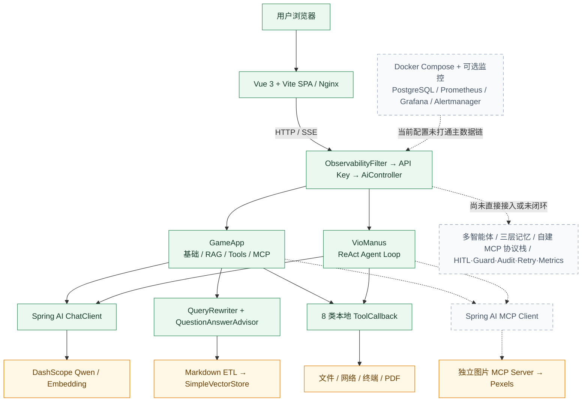

# VIO AI Agent 项目架构图

> 基于当前源码、配置、前端 API 与 Docker Compose 的静态接线核对。
>
> - 实线：当前主请求链。
> - 虚线：按配置启用、半接入或尚未进入主链。

## 两条当前主业务链

1. 宝可梦问答：`Vue EventSource → AiController → GameApp → Spring AI → DashScope → SSE`。
2. 通用智能体：`Vue EventSource → AiController → VioManus → Think → ToolCall → Observe → SSE`。

## 接入状态说明

- 当前 RAG 使用 `SimpleVectorStore` 内存向量库；PGVector/PostgreSQL 已声明但未进入当前生产链。
- 当前业务 MCP 路线使用 Spring AI `ToolCallbackProvider`；自建 `mcp/` JSON-RPC 协议栈是独立预备能力。
- 多智能体、三层记忆、HITL/围栏/审计及 Prometheus 监控资产已有代码或配置，但没有完整接入当前主请求链。
