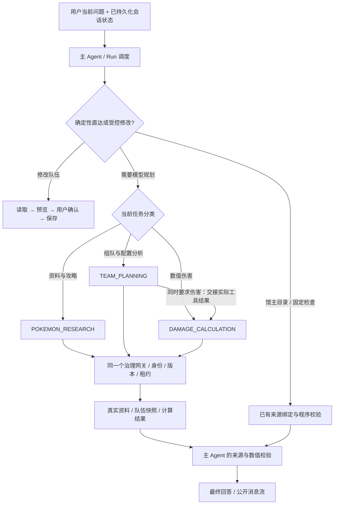

# 三类专用 Agent 开发与配置清单

## 已实现的协作方式



这是一套进程内顺序协作实现，三个角色共享已配置的 ChatModel，不是三个服务器或三个模型供应商。各角色有独立系统提示词、工具白名单及私有工具工作记录；对话历史由当前账号和会话的 Run 上下文提供，不建立跨用户共享记忆。主 Agent 继续负责最终回答、证据校验及公开消息输出。

| 角色 | 负责内容 | 允许的主要工具 | 明确边界 |
| --- | --- | --- | --- |
| 资料检索 | 图鉴、学习记录、机制、攻略、联网来源 | lookupPokemonReference / Resource / Learnset / Machine / Mechanics、searchPokemonGuides、searchWeb、竞技样例及使用率工具 | 不读取保存队伍，不修改队伍，不计算伤害；使用率不能代替完整队伍 |
| 组队规划 | 保存队伍读取、整队资料、配招核对、候选与道馆应对资料 | listCurrentTeams、readCurrentTeam、lookupPokemonTeamReference、checkPokemonBuild / TeamBuild、planGymChallenge 等只读工具 | 不执行保存或修改预览，不生成虚假的计算结果；理论建议不等于当前可获得或合法 |
| 伤害核验 | 明确双方配置及目标后调用确定性引擎 | calculateBattleDamage、calculateGymDamage、必要的资料及队伍读取 | 类型倍率不等于伤害；缺条件先澄清；单次结果不等于胜率 |

这些是规划职责拆分：专用角色决定本阶段的只读工具计划，工具仍在主请求线程上由现有网关执行。角色之间只交接实际工具调用及返回，不把私有模型文字当作证据。最终策略说明仍由主 Agent 生成并受现有校验器约束。

## 调度与故障处理

- 队伍与伤害的混合问题先交组队角色，收集完成后再交伤害角色；一般问题只进入相关角色。明确修改队伍、保存确认及问候走主流程。
- 固定馆主目录、已实现的馆主应对路由、明确配招检查等程序直达路径保留，不为了形式增加模型调用。模型分工开关不把这些结果改为模型推理产物。
- 角色可用工具是自身白名单与当前请求可用工具的交集；不获得管理员工具、MCP 任意能力、递归委派或保存权限。
- 每个请求最多6次专用规划调用、8次工具选择，单批最多3个。与主角色共用模型用量账本、全局预算及 Run 截止时间，不为每个角色额外复制一份额度。
- 拒绝未知工具、重复调用、篡改版本、显式指定其他用户/Run 的参数。带错误标记的工具在当前请求中停止再次选择，避免换关键词反复消耗。
- 专用角色返回纯文字时，只视为结束规划，不把它的文字显示给用户。已委派任务发生错误或到达预算上限后进入主角色的最终校验，不悄悄扩大为完整工具权限。未获得有效计算时只显示缺失条件，不展示猜测数值。
- `route.selected` 记录 `agent.delegation.*` 和角色；真实网关工具事件带 `agentRole`、`selectionOrigin=SPECIALIST_TOOL_PLAN`。可在执行详情或本地诊断接口检查。
- `GET /api/chat/runtime` 的 `agentCollaboration` 显示总开关、角色列表与上限。接口仍需要登录/鉴权，不返回 Key。
- 总开关关闭时保留原流程；旧的项目资料检索开关只在总开关关闭时生效。评测策略当前维持原单 Agent 基线，不能将其成绩当成新协作模式质量结果。

## 你需要配置的部分（集中清单）

### 1. 必须：聊天模型与分工开关

在 IDEA 的后端 Run Configuration → Environment variables 中设置；不要把真实 Key 写入 Git 跟踪的文件。

```text
SPRING_PROFILES_ACTIVE=local,deepseek
DEEPSEEK_API_KEY=你的聊天模型Key
VIO_AGENT_SPECIALISTS_ENABLED=true
```

`DEEPSEEK_MODEL`、DeepSeek 端点继续沿用已能正常问答的配置；不用给每个 Agent 再创建 Key。`VIO_AGENT_GUIDE_RESEARCH_ENABLED` 可以保持未设置，三角色总开关已覆盖资料规划，避免两个路径重复启动。

保存后重新编译并重启后端；仅刷新浏览器不会加载新类或环境变量。本地不要开启 `demo`，也不要在准备验证此模式时启用评测工具策略。

PowerShell 临时环境变量示例（只影响从该窗口启动的后端）：

```powershell
$env:SPRING_PROFILES_ACTIVE='local,deepseek'
$env:VIO_AGENT_SPECIALISTS_ENABLED='true'
# DEEPSEEK_API_KEY 在本机设置；不要粘贴到聊天、日志或提交记录。
.\mvnw.cmd spring-boot:run
```

### 2. 必须用于伤害计算：本地 Node.js 及计算依赖

在项目根目录执行：

```powershell
node --version
npm --prefix tools/pokemon-engine ci
npm --prefix tools/pokemon-engine test
```

后端进程需要能找到 `node`。IDEA 找不到时配置 `VIO_DAMAGE_NODE` 为本机 `node.exe` 的绝对路径。`VIO_DAMAGE_ENGINE_ENABLED` 和 `VIO_POKEMON_REFERENCE_ENABLED` 在当前本地默认配置中为 true；不要在私有覆盖配置中关闭它们。脚本默认使用 `tools/pokemon-engine/calculate-v2.cjs`，不需要另开 Node HTTP 服务。

### 3. 资料网络（首次读取时需要）

确保后端能访问 PokéAPI；成员资料存在有效缓存后可复用缓存。网络被限制时按本机网络设置配置 `VIO_POKEAPI_PROXY`。Smogon 完整样例来源可能有访问限制，失败时保留原网页链接供手动查看，不补造完整队伍。

### 4. 可选：Embedding 语义检索

本项与角色拆分独立。你可以先保持关闭，用默认 BM25 完成三角色测试。

```text
VIO_GUIDE_SEMANTIC_ENABLED=true
VIO_GUIDE_EMBEDDING_ENDPOINT=完整的Embeddings接口地址
VIO_GUIDE_EMBEDDING_API_KEY=Embedding供应商的Key
VIO_GUIDE_EMBEDDING_MODEL=该接口支持的Embedding模型名
VIO_GUIDE_EMBEDDING_DIMENSIONS=与你选择模型及接口输出一致的向量维度
```

不要把聊天模型名或 DeepSeek 聊天端点直接填到 Embedding 配置中。当前构建实现每批最多8条，批量上限由同一常量统一控制；选择服务时需确认其单次批量限制至少为8条；模型、接口和维度发生变化后重新构建。当前缓存/检索代码默认1536维，这不是任何模型都支持的维度。当前本机使用text-embedding-v4时配置为1024维，需与服务实际输出一致。

后端重启后，在独立 PowerShell 中按脚本的认证参数说明执行：

```powershell
Get-Help .\ops\local\build-guide-semantic-index.ps1 -Detailed
.\ops\local\build-guide-semantic-index.ps1
```

脚本使用本机账号登录认证，会提示输入用户名和密码；也可以用 `-Username` 传用户名，密码仍交互输入。脚本会独立登录、处理 Session/CSRF，并在结束后注销自己的会话。状态接口为 `/api/pokemon/guides/semantic`，构建接口为 `POST /api/pokemon/guides/semantic/index`。首次建库会调用外部 Embedding 服务并产生费用；需要人工明确执行，不在每次启动时自动调用。

### 5. 可选：联网搜索

设置 `SEARCH_API_KEY` 后重启，才会注册联网搜索能力；不配置仍能使用本地资料与工具。聊天模型 Key 不能代替搜索服务 Key。该搜索是项目现有 SearchAPI 适配，不能任填其他供应商 Key。

### 6. 不需要配置的服务

当前本机模式不需要新增 Redis、PostgreSQL、Docker、多 Agent 服务地址或服务器。账号、历史及攻略缓存继续使用现有 SQLite 配置。前端仍使用当前工作区和 Run 接口。

## 配置完成后的验收顺序

1. 登录后查看本地 `/api/chat/runtime`，确认 `agentCollaboration.specialistsEnabled=true`，并确认可用工具含计算及资料工具。
2. 先问“介绍皮卡丘的图鉴属性和种族值”，检查 `POKEMON_RESEARCH` 规划与来源；再问“分析这两名参考成员的队伍：squirtle、charmander”，检查 `TEAM_PLANNING` 的完整队伍读取。
3. 在伤害面板使用完整双方配置，发起一次明确数值计算；检查 `DAMAGE_CALCULATION` 和 `calculateBattleDamage`，回答应与实际引擎结果一致，不用模型猜测数字。
4. 测试混合任务、缺少对手、资料断网、取消、切换账号，以及“先查询馆主→第几位→读取已保存队伍”的长对话。确认没有串用版本、跨账号读取或自动保存。
5. 配置 Embedding 并显式构建后，再用未参与调试的新问题检查召回、错误命中、时延与费用。多角色通过链路测试不代表回答质量已全部达标。

## 本轮验证记录

- 最终离线 `mvnw package`：**1514项，0 failures、0 errors、3 skipped，BUILD SUCCESS**。日志：`artifacts/specialists-final-full.log`。该结果包括编译、后端单元及应用测试和打包，不代表外部数据库集成环境均已执行。
- 新增协调器与 Run 集成测试共14项：工具隔离、身份/版本拒绝、私有文字隔离、顺序交接、重复调用与预算、取消、正反修改意图、真实工具回调及公开输出一致性。计算 Schema 另外新增1项经治理网关的回归测试。
- 本地 `npm --prefix tools/pokemon-engine test`：**13/13通过**，日志：`artifacts/specialists-node-engine.log`。
- 打包后在隔离端口18147使用本机现有聊天模型验证 **4/4链路通过**：资料（`searchPokemonGuides`）、整队（`lookupPokemonTeamReference`）、单独伤害（`calculateBattleDamage`）、队伍与伤害顺序交接（两角色均有持久化事件，且确实执行整队读取与计算）。计算实际返回164～194 HP，主回答与引擎结果一致。证据：`artifacts/all-specialists-http-results.json`。隔离服务已退出，未重启用户当前后端。
- 真实测试发现并修复一个原有问题：新增 `TeamBuild.teraType` 后，生成的工具 Schema 将太晶误当必填；现已在 DTO 声明和伤害 Schema 适配中统一标为可选，保持普通非太晶请求兼容。这不新增普通伤害桥接的主动太晶计算能力；道馆战斗状态仍使用已有专用接口。
- 以上4题是链路 smoke及已知场景回归，**不是独立保留集的回答质量验收**。本轮没有调用真实 Embedding 服务，向量召回与质量仍需你完成配置后验收。日志和运行数据保留在本机忽略的 `artifacts`，可复现的测试源码及配置步骤随代码保存。

## 源码入口

- `SpecialistRole`：角色提示词与只读工具边界。
- `SpecialistAgentCoordinator`：每请求私有状态、顺序交接、预算、参数范围及事件。
- `ToolCallAgent.think/act`：接入专用规划，仍使用原治理执行与来源校验。
- `DefaultRunExecutor.configureSpecialists`：开关注入与共享模型用量账本。
- `TeamAnswerEvidence`、`SavedTeamAnswerEvidence`、`DamageAnswerEvidence`、`GuideAnswerEvidence`：最终事实门禁。
- `SpecialistAgentCoordinatorTest`、`SpecialistRunIntegrationTest`：角色边界、混合任务、异常与公开输出验证。
