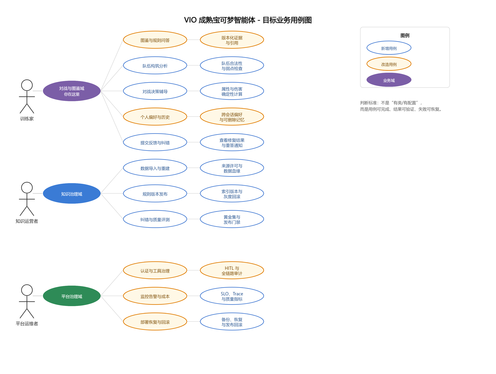
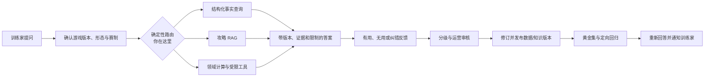
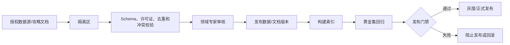
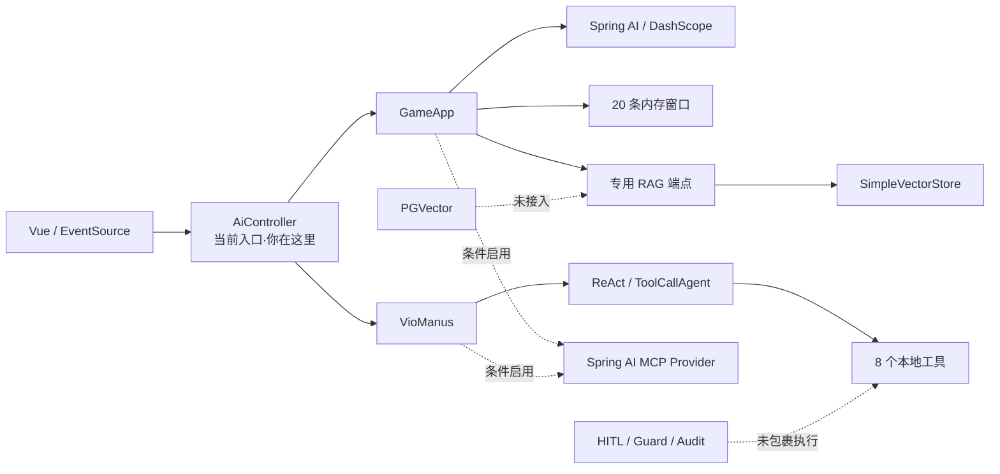
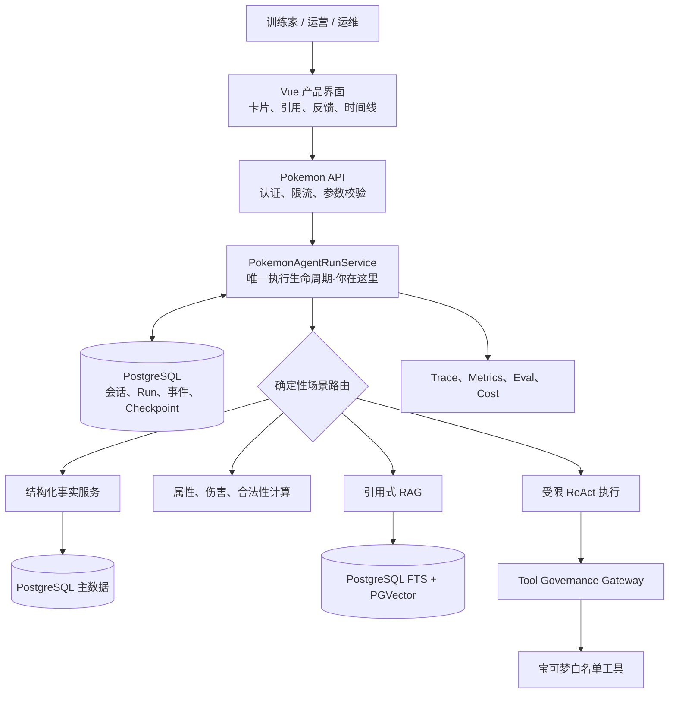
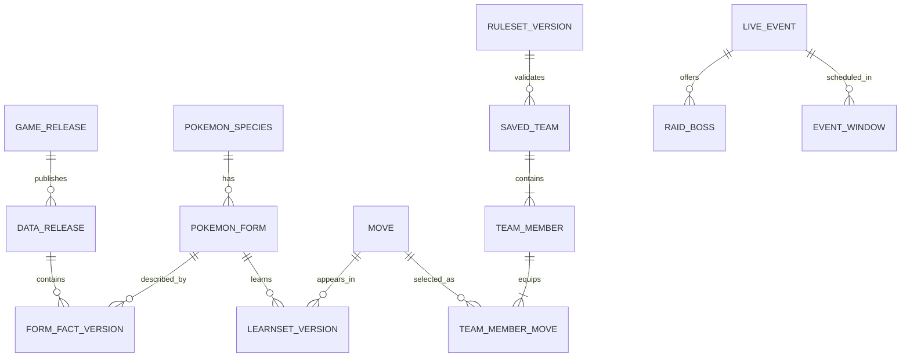

# VIO 成熟宝可梦智能体：企业级架构与技术对照报告

> 项目：VIO AI Agent  
> 文档代码基线（2026-08-28 历史快照，非当前工作树）：`main@708126a691bd7a789ddb261d11bb464caa96a45e`
> 更新日期：2026-09-02（补充历史快照说明）  
> 当前实施证据：[`正式版v1.0开发计划/M2-M7实施完成记录.md`](./正式版v1.0开发计划/M2-M7实施完成记录.md)；该记录中的“已实现”仍不等于真实生产验收。
> 参考实现：[Nexus Agent 固定提交](https://github.com/java-up-up/nexus-agent/tree/7ef51a53ef43dcfbf8982189c8560a2de70c1af2)  
> 目标：把当前工程展示型 Demo 升级为“版本明确、答案有依据、计算可复现、错误可纠正、发布可回退”的生产级宝可梦垂直智能体。

## 0. 文档定位与阅读规则

这份报告不再以“复制 Nexus 的技术栈”为主线，而是回答四个问题：

1. 成熟宝可梦智能体应该为谁解决什么问题；
2. 当前 VIO 哪些能力已经进入真实请求链，哪些只是旁路、代码壳或测试样例；
3. 应该以什么目标架构和建设顺序完成升级；
4. 每个阶段如何用数据、测试和运行证据证明已经完成。

全文使用以下标记：

| 标记 | 含义 |
|---|---|
| ✅ 主链已接入 | 用户真实请求会经过，且存在代码调用证据 |
| 🟡 部分接入 | 有可运行分支或原型，但默认主链、持久化或治理闭环不完整 |
| 🔴 未落地/阻塞 | 只有代码壳、测试样例、配置草案，或当前存在阻塞 |
| 🎯 近期目标 | 成熟宝可梦产品必须完成的能力 |
| ⏳ 后移能力 | 只有达到明确触发条件后才建设 |

> 本文中的准确率、延迟、可用性等数字均是“候选目标门槛”，不是当前已经达到的成绩。上线前必须用固定数据集和真实运行报告建立基线，再冻结最终 SLO。
>
> **历史快照提示**：第 5 节、第 5.4～5.5 节、第 13.5 节和第 14.2 节中的“当前/基线/差距”均指上述 2026-08-28 快照；代码已发生后续变更时，以当前实施记录和工作树源码为准。

## 1. 核心结论

### 1.1 产品定位

VIO 的合理定位不是通用 Agent 平台，而是：

> **基于 Spring AI 的成熟宝可梦知识与对战决策智能体。**

它首先要稳定完成三类任务：

1. **精确事实查询**：图鉴、形态、属性、种族值、特性、招式、进化和版本可用性；
2. **版本化策略建议**：在指定游戏、DLC、赛制和规则集下生成配招、队伍与攻略；
3. **受控复杂任务**：通过确定性计算器、RAG 和白名单工具完成队伍分析、团体战攻略、报告生成。

### 1.2 成熟度判断

| 成熟度 | 定义 | 当前判断 |
|---|---|---|
| L0 Prompt Demo | 大模型 + 系统提示词 | 已超过 |
| L1 工程原型 | SSE、RAG 分支、工具、Agent 循环 | **历史快照（2026-08-28）** |
| L2 可用垂直产品 | 主场景闭环、持久数据、结构化计算、引用与反馈 | **本轮候选构建：部分代码/契约已落地，生产验收未完成** |
| L3 生产级垂直智能体 | 安全、评测、SLO、发布回滚、可运营 | **目标；发布仍受实施记录中的门禁阻断** |
| L4 大规模企业平台 | 多组织、多租户、HA、复杂控制面和规模化运营 | 有真实业务需求后再建设 |

对于秋招项目，能够以证据达到 L3，比在 README 中宣称“拥有全部企业中间件”更有说服力。

### 1.3 非目标

当前阶段明确不追求：

- 给公网用户开放终端、任意文件写入和资源下载；
- 默认覆盖所有世代、所有游戏和所有对战规则，却没有版本化数据保证；
- 同时维护两套生产 MCP 协议栈；
- 为了技术数量提前引入 Kafka、Elasticsearch、Neo4j、Kubernetes；
- 在单 Agent 尚不可靠时优先建设多 Agent 平台；
- 把“存在某个类或配置”描述成“生产能力已经接入”。

### 1.4 首发支持矩阵：开发前必须冻结

“成熟”首先意味着明确回答 **支持什么、不支持什么**。建议把首版收窄到下表；其中 `待冻结` 是 M1 开工门禁，不能让模型自行猜测。

| 维度 | 推荐首发范围 | 必须固化的版本键 |
|---|---|---|
| 主游戏 | 《宝可梦 朱／紫》单一主版本 | `game_release_id`、准确补丁号（待冻结） |
| DLC | 零之秘宝；是否包含具体篇章须显式选择 | `dlc_id`、数据截止时间 |
| 对战模式 | 剧情/休闲单打、双打；VGC 只支持一个已审核规则集 | `battle_format_id`、`ruleset_version_id`、生效期（待冻结） |
| 语言 | `zh-CN` 为正式输出；英文/日文只做别名消歧 | `language`、别名表版本 |
| 数据发布 | 每次主数据、文档和索引作为同一可追溯发布单元 | `data_release_id`、`knowledge_release_id`、`index_release_id` |
| 明确不支持 | 其他世代的混合规则、实时天梯代打、账号/交易操作、未审核活动传闻 | `unsupported_reason`、可替代路径 |

如果后续扩展到其他游戏或世代，应新增独立支持矩阵和回归集，而不是把“全世代”写进首页文案后让同一 Prompt 混答。当前 [Home.vue](../vio-ai-agent-frontend/src/views/Home.vue#L14) 的“全世代至 ZA”表述，在对应数据集和评测完成前应视为待下线的超范围承诺。

## 2. 用户角色与核心业务用例

### 2.1 用户角色

| 角色 | 核心目标 | 主要功能 |
|---|---|---|
| 训练家 | 获得准确、适用、可执行的宝可梦答案 | 图鉴、配招、组队、属性/伤害计算、团体战、收藏与反馈 |
| 知识运营者 | 让知识持续正确且可追溯 | 数据导入、来源审核、纠错、版本发布、索引重建与回滚 |
| 平台运维者 | 让系统稳定、安全、成本可控 | 鉴权、工具治理、Trace、SLO、告警、备份和发布回滚 |

### 2.2 业务用例图



[查看可缩放 SVG 原图](./成熟宝可梦智能体业务用例图.svg)

### 2.3 核心用例与验收

| 优先级 | 用例 | 关键能力 | 候选验收标准 |
|---|---|---|---|
| P0 | 精确图鉴问答 | 结构化主数据、形态消歧、版本过滤、来源 | 200 条固定事实题准确率 ≥ 98% |
| P0 | 版本与规则澄清 | 游戏、DLC、单打/双打、赛制、规则版本 | 歧义问题正确澄清率 ≥ 90%；不得跨版本混答 |
| P0 | 属性与伤害计算 | 双属性、特性、太晶、伤害公式的确定性实现 | 确定性测试 100% 通过 |
| P0 | 配招与养成方案 | 招式、努力值、性格、道具、太晶属性和定位 | 字段完整；规则合法性测试 100% 通过 |
| P1 | 六人队伍构筑 | 弱点矩阵、速度线、角色覆盖、合法性和导出 | 非法组合识别率 100%；人工可用率建立基线 |
| P1 | 太晶团体战攻略 | 星级、Boss 属性/招式、单刷/联机和回合策略 | 答案绑定游戏版本、数据版本和更新时间 |
| P1 | 时效活动与环境资讯 | 受限联网检索、发布日期、来源和新鲜度 | 时效问题引用覆盖率 100%；无可靠来源时拒答 |
| P1 | 用户资产 | 会话、队伍、收藏、分享、删除 | 重启后恢复；不同用户数据零串用 |
| P1 | 反馈纠错 | 点赞/点踩、错误类型、证据、模型和知识版本 | 每条反馈关联 traceId 并可进入纠错流程 |

## 3. 成熟产品的三条闭环

### 3.1 训练家问答闭环



反馈不是“存一条记录”就结束，必须形成可运营状态机：

```text
SUBMITTED → TRIAGED → IN_REVIEW → APPROVED / REJECTED
          → PUBLISHED → VERIFIED → CLOSED
```

| 环节 | 责任角色 | 候选时限 | 产物 |
|---|---|---:|---|
| 提交与自动分级 | 训练家 / 系统 | 实时 | `feedbackId`、`answerId`、错误类型、证据、traceId |
| Triage | 知识运营者 | P0 2 小时；P1 1 个工作日 | 优先级、责任人、重复问题合并 |
| 审核与修订 | 领域审核者 | P0 8 小时；P1 2 个工作日 | 修订记录、来源、评审意见 |
| 发布与回归 | 发布负责人 / EvaluationService | P0 24 小时 | 数据/知识/索引版本、定向评测结果 |
| 验证与回访 | 系统 / 训练家 | 发布后自动 | 新答案、差异、站内通知、关闭原因 |

首版至少提供以下闭环接口，并配一个只对运营角色开放的后台页面或等价 CLI：

| 接口 | 作用 |
|---|---|
| `POST /answers/{answerId}/feedback` | 提交点赞、点踩或带证据纠错 |
| `GET /admin/corrections` / `PATCH /admin/corrections/{id}` | 分级、认领、审核和状态流转 |
| `POST /admin/content-releases` | 创建绑定修订内容的发布候选 |
| `POST /admin/content-releases/{id}/evaluate` | 执行黄金集和定向回归 |
| `POST /admin/content-releases/{id}/publish` / `rollback` | 发布或回滚 |
| `GET /users/me/notifications` | 查看修复、重答与关闭结果 |

### 3.2 知识发布闭环



### 3.3 工程发布闭环

```text
代码 / Prompt / 模型 / 数据 / 索引变更
→ 自动测试
→ 宝可梦黄金集
→ 性能与安全门禁
→ 构建不可变镜像
→ 冒烟与灰度
→ 监控
→ 发布或回滚
```

## 4. 事实、计算、RAG 与 Agent 的边界

这是成熟宝可梦智能体最重要的设计决策。

| 能力 | 应解决的问题 | 推荐实现 | 禁止做法 |
|---|---|---|---|
| 结构化事实 | 种族值、属性、招式威力、进化条件、版本可用性 | PostgreSQL 领域模型和版本化查询 | 让模型凭记忆生成 |
| 确定性计算 | 属性倍率、伤害、速度线、队伍合法性 | Java 计算器和完整单元测试 | 让模型心算后直接输出 |
| RAG | 攻略、解释、配队思路、版本说明 | PostgreSQL FTS + PGVector + 引用 | 把所有主数据都向量化 |
| Agent/工具 | 多步骤搜索、分析、报告和外部查询 | 有预算、有白名单、有审计的受限执行 | 把任意终端和文件能力暴露给公网 |
| Memory | 会话历史和用户明确授权的偏好 | 持久会话、摘要、可删除偏好 | 全局 JSON 记忆或跨用户混用 |

> 大白话理解：数据库负责“标准答案”，计算器负责“算对”，RAG 负责“从资料里找依据”，Agent 负责“决定先做哪一步并调用工具”。

## 5. VIO 历史代码基线快照（2026-08-28）

> 本节用于解释为什么制定 M0～M7，不是当前实现清单。后续落地与测试状态请看 [`M2-M7实施完成记录.md`](./正式版v1.0开发计划/M2-M7实施完成记录.md)。

### 5.1 历史技术栈快照（2026-08-28）

| 维度 | 当前项目 | 说明 |
|---|---|---|
| 后端 | Java 21、Spring Boot 3.5.16 | 模块化单体 |
| AI | Spring AI 1.0.0、Spring AI Alibaba 1.0.0.2 | ChatClient、ToolCallback、VectorStore |
| 模型 | DashScope / 通义千问 | 当前主模型 |
| 前端 | Vue 3、Vite | 对话页面 |
| 通信 | REST、SSE | 当前主要流式方式 |
| 数据 | Markdown、内存 Memory、SimpleVectorStore | 当前默认并未真正使用 PostgreSQL |
| 可选依赖 | PostgreSQL、PGVector、MCP | 依赖或配置存在，但未形成完整主链 |
| 交付 | Docker、Compose、GitHub Actions 草案 | 尚未形成可验证的生产发布链 |

版本证据见 [pom.xml](../pom.xml)。

### 5.2 历史真实请求链（2026-08-28）

> 这是实施前的兼容链快照；现代 `/chat/runs` 主链及其验证状态见 [`M2-M7实施完成记录.md`](./正式版v1.0开发计划/M2-M7实施完成记录.md)。



### 5.3 历史能力接线分级（2026-08-28）

> 本表描述历史快照中的接线状态；现代 Run、工具网关、知识生命周期、前端契约和评测骨架已在后续变更中补入，不能据此否定或宣称当前生产能力。详见 [`M2-M7实施完成记录.md`](./正式版v1.0开发计划/M2-M7实施完成记录.md)。

| 能力 | 状态 | 当前证据 | 产品影响 |
|---|---|---|---|
| 基础对话与 SSE | ✅ | [GameApp.java](../src/main/java/com/vio/vioaiagent/app/GameApp.java#L93)、[AiController.java](../src/main/java/com/vio/vioaiagent/controller/AiController.java#L114) | 可以完成基础流式聊天 |
| 20 条短期记忆 | ✅ | [GameApp.java](../src/main/java/com/vio/vioaiagent/app/GameApp.java#L51) | 仅进程内；重启丢失 |
| 玩家前端双入口 | ✅/原型 | [Home.vue](../vio-ai-agent-frontend/src/views/Home.vue#L8)、[GameMaster.vue](../vio-ai-agent-frontend/src/views/GameMaster.vue#L44)、[SuperAgent.vue](../vio-ai-agent-frontend/src/views/SuperAgent.vue#L107) | GameMaster 只走基础 `GameApp`；SuperAgent 走 `VioManus → 8 个本地工具`；两者都未形成成熟宝可梦业务闭环 |
| 宝可梦 RAG | 🟡 | [GameApp.java](../src/main/java/com/vio/vioaiagent/app/GameApp.java#L132) | 只在专用端点使用，无引用和版本治理 |
| RAG 存储 | 🟡 | [GameAppVectorStoreConfig.java](../src/main/java/com/vio/vioaiagent/rag/GameAppVectorStoreConfig.java#L29) | 使用测试/演示型 SimpleVectorStore，重启需重建 |
| PGVector | 🔴 | [PgVectorVectorStoreConfig.java](../src/main/java/com/vio/vioaiagent/rag/PgVectorVectorStoreConfig.java#L22) | 配置未激活，生产仍排除数据源 |
| 宝可梦属性工具 | 🟡 | [PokeTypeTool.java](../src/main/java/com/vio/vioaiagent/tools/PokeTypeTool.java#L62) | 支持单攻击属性对单防御属性以及对全部 18 属性查询；尚不支持双属性组合、特性修正和太晶规则 |
| 本地工具 | ✅/高风险 | [ToolRegistration.java](../src/main/java/com/vio/vioaiagent/tools/ToolRegistration.java#L12) | 文件、终端、下载等不适合直接暴露给公网玩家 |
| VioManus ReAct | ✅ | [VioManus.java](../src/main/java/com/vio/vioaiagent/agent/VioManus.java#L36) | 具备循环执行骨架，但生命周期存在缺陷 |
| Spring AI MCP | 🟡 | [GameApp.java](../src/main/java/com/vio/vioaiagent/app/GameApp.java#L245) | 有条件注入路径，默认配置和测试仍有阻塞 |
| 图片搜索 MCP Server | 🟡/旁路 | [VioImageSearchMcpServerApplication.java](../vio-image-search-mcp-server/src/main/java/com/vio/vioimagesearchmcpserver/VioImageSearchMcpServerApplication.java#L28)、[application.yml](../vio-image-search-mcp-server/src/main/resources/application.yml#L8) | 独立官方 Spring AI MCP Server 注册了 ImageSearchTool，主应用指向 8127；但不在根 Compose 中且生产默认关闭 |
| 自建 MCP | 🔴/实验 | [mcp](../src/main/java/com/vio/vioaiagent/mcp/) | 未进入真实业务主链 |
| 三层 Memory | 🔴/壳 | [MemoryConfig.java](../src/main/java/com/vio/vioaiagent/memory/MemoryConfig.java#L17) | 没有正确注入当前 Agent 执行 |
| HITL、Guard、Audit | 🔴/壳 | [security](../src/main/java/com/vio/vioaiagent/security/) | 工具真实执行绕过治理组件 |
| 超时、重试、幂等、状态机 | 🔴/壳 | [orchestration](../src/main/java/com/vio/vioaiagent/orchestration/) | 独立类存在，但未进入主链 |
| 指标与 Prometheus | 🔴/壳 | [AgentMetrics.java](../src/main/java/com/vio/vioaiagent/observability/AgentMetrics.java#L41) | 计数器没有被生产主链调用 |
| Multi-Agent | 🔴/实验 | [multiagent](../src/main/java/com/vio/vioaiagent/multiagent/) | 没有进入业务接口 |
| Skills | 🔴 | 未发现 Loader、Registry、Resolver、Executor | 尚未实现 |

### 5.4 历史 P0 阻塞快照（2026-08-28）

> 以下阻塞项是报告编写时的排查结果；其中部分已在本轮修复，未修复项和现场验收项以 [`M2-M7实施完成记录.md`](./正式版v1.0开发计划/M2-M7实施完成记录.md) 为准。

| 问题 | 证据 | 风险 |
|---|---|---|
| 缺失 `mcp-servers.json` | [application.yml](../src/main/resources/application.yml#L26) | Spring 测试上下文启动失败 |
| 测试配置仍启用 MCP | [application-test.yml](../src/test/resources/application-test.yml#L29) | 不依赖 MCP 的测试也被连带阻塞 |
| HitlManager 不是 Spring Bean | [HitlController.java](../src/main/java/com/vio/vioaiagent/controller/HitlController.java#L17)、[HitlManager.java](../src/main/java/com/vio/vioaiagent/security/HitlManager.java#L28) | Controller 依赖注入不完整 |
| Search API 配置强制读取 | [ToolRegistration.java](../src/main/java/com/vio/vioaiagent/tools/ToolRegistration.java#L15) | 干净环境可能无法启动 |
| Controller 重复 `/api` | [application.yml](../src/main/resources/application.yml#L41)、[MetricsController.java](../src/main/java/com/vio/vioaiagent/controller/MetricsController.java#L20)、[HitlController.java](../src/main/java/com/vio/vioaiagent/controller/HitlController.java#L18) | 已证实会形成 `/api/api/...`；必须去掉 Controller 的重复前缀 |
| 拦截器路径与 context-path 组合 | [SecurityConfig.java](../src/main/java/com/vio/vioaiagent/config/SecurityConfig.java#L45) | `/api/ai/**` 是否能匹配 servlet 内部路径是高风险待确认项，必须用 MockMvc 集成测试证明认证确实执行 |
| 前端把 API Key 放 URL，后端只读 Header | [index.js](../vio-ai-agent-frontend/src/api/index.js#L27)、[ApiKeyAuthInterceptor.java](../src/main/java/com/vio/vioaiagent/security/ApiKeyAuthInterceptor.java#L101) | 认证失败且密钥可能进入日志 |
| 生产 API Key 有公开 fallback，Compose 未传 Secret | [application-prod.yml](../src/main/resources/application-prod.yml#L29)、[docker-compose.yml](../docker-compose.yml#L24) | 未配置时使用可预测 `sk-prod-change-me`；必须移除 fallback 并在 Secret 缺失时启动失败 |
| stop 请求未携带认证 | [index.js](../vio-ai-agent-frontend/src/api/index.js#L126) | 即使聊天认证修复，停止接口仍可能 401 或被错误放行 |
| 凭据型全开放 CORS | [CorsConfig.java](../src/main/java/com/vio/vioaiagent/config/CorsConfig.java#L17) | `allowedOriginPatterns("*") + allowCredentials(true)` 不可用于生产 |
| 双层异步 | [AiController.java](../src/main/java/com/vio/vioaiagent/controller/AiController.java#L182)、[BaseAgent.java](../src/main/java/com/vio/vioaiagent/agent/BaseAgent.java#L198) | stop、并发许可和运行状态不可信 |
| 前端可并发覆盖当前流 | [ChatRoom.vue](../vio-ai-agent-frontend/src/components/ChatRoom.vue#L46)、[GameMaster.vue](../vio-ai-agent-frontend/src/views/GameMaster.vue#L50)、[SuperAgent.vue](../vio-ai-agent-frontend/src/views/SuperAgent.vue#L112) | 首块数据后输入重新可用，第二次发送会覆盖 `currentEventSource`；首版采用单飞锁，后续才按 Run 独立管理连接 |
| 工具绕过治理层 | [ToolCallAgent.java](../src/main/java/com/vio/vioaiagent/agent/ToolCallAgent.java#L164) | 高风险工具缺少审批、超时和审计 |

### 5.5 历史测试基线（2026-08-25）

2026-08-25 最新留存的 Surefire 报告为：

```text
Tests run: 253
Failures: 0
Errors: 23
Skipped: 2
```

首个主要根因是 `classpath:mcp-servers.json` 缺失。该数字和根因只代表历史快照；本轮已补充受控测试配置并重新执行测试，最新命令、报告数量和未完成的外部验收见 [`M2-M7实施完成记录.md`](./正式版v1.0开发计划/M2-M7实施完成记录.md)。无论测试是否全绿，都不能把它等同于真实生产质量。

## 6. 最小可用目标架构

第一阶段采用 **Spring Boot 模块化单体**。模块化单体的意思是“仍部署成一个后端服务，但内部职责清晰”，比过早拆微服务更适合当前规模。



实线主链只包含首版白名单本地工具；MCP Adapter 不画进首版同步依赖。只有满足第 17 节启用条件后，才把经过同一 `ToolExecutionGateway` 的 MCP Adapter 作为可选扩展接入。

### 6.1 核心模块职责

| 模块 | 大白话解释 | 主要职责 |
|---|---|---|
| PokemonAgentRunService | 总调度台 | 统一启动、状态、取消、超时、事件和清理 |
| PokemonContextResolver | 先问清楚条件 | 解析游戏、版本、形态、赛制、语言；缺失则澄清 |
| PokemonRouteService | 分诊台 | 决定走事实查询、计算、RAG 或受限 Agent |
| PokemonFactService | 标准答案库 | 查询版本化结构化数据 |
| BattleCalculationService | 计算器 | 属性、伤害、速度线和合法性校验 |
| PokemonRetrievalService | 查资料 | 混合检索、过滤、重排和证据拼装 |
| EvidenceAssembler | 整理证据 | 返回来源、版本、片段和引用编号 |
| ToolExecutionGateway | 工具安检 | 权限、参数、审批、超时、审计和指标 |
| ConversationService | 用户历史 | 持久会话、消息、摘要、删除和隔离 |
| KnowledgeReleaseService | 内容发布台 | 审核、索引版本、评测、灰度和回滚 |
| EvaluationService | 质检中心 | 运行黄金集并生成发布报告 |

## 7. 宝可梦领域数据模型

### 7.1 结构化主数据

必须拆开“稳定身份”和“会随游戏/补丁变化的事实”。推荐主模型如下：



| 表/实体 | 主键、外键与关键唯一约束 |
|---|---|
| `pokemon_species` | `species_id PK`；`national_no UNIQUE`，只保存稳定物种身份 |
| `pokemon_form` | `form_id PK`、`species_id FK`；`UNIQUE(species_id, form_key)`；地区形态、Mega、超极巨等仅在可靠来源明确为独立形态时入表 |
| `form_fact_version` | `form_fact_id PK`、`form_id FK`、`data_release_id FK`；属性、种族值、特性、可用性；`UNIQUE(form_id, data_release_id)`，含 `effective_from/effective_to` |
| `move` / `move_fact_version` | 稳定招式身份与版本化威力、命中、PP、效果拆开；`UNIQUE(move_id, data_release_id)` |
| `learnset_version` | `form_id FK`、`move_id FK`、`data_release_id FK`、学习方式/等级；组合唯一键防重复 |
| `ability` / `item` / `evolution_edge` | 稳定身份与版本事实分离，全部关联 `data_release_id` |
| `game_release` / `data_release` | 游戏、DLC、补丁、数据截止时间；已发布版本不可原地修改，只能创建新 release |
| `battle_format` / `ruleset_version` | 单打/双打/VGC、禁限用、队伍规则、生效期；`UNIQUE(format_id, version_key)` |
| `localized_name` / `entity_alias` | `entity_kind + entity_id + language + name_type` 组合唯一；正式名、曾用名、英文/日文名和玩家别名可追溯 |
| `pokemon_availability` | `form_id + game_release_id` 组合唯一，记录获得、转入与对战可用性 |
| `saved_team` / `team_member` | 队伍绑定 `ruleset_version_id`；成员保存 `form_id`、特性、道具、性格、等级、努力值/个体值和 `tera_type_id` |
| `team_member_move` | `team_member_id FK`、`move_id FK`、`slot 1..4`；`UNIQUE(team_member_id, slot)` |
| `live_event` / `raid_boss` / `event_window` | 活动来源、Boss 模板、星级、招式池、开始/结束时间、地区与状态 |

模型边界必须写入代码和测试：普通极巨化是战斗状态，太晶属性是队伍成员/对局配置，二者不能塞进 `pokemon_form`；超极巨、地区形态等只有在数据源确实提供独立形态身份时才建 `form_id`。

所有 FK 使用数据库约束；业务 ID 可用 UUID/ULID，外部编号仅作唯一业务键。版本化事实禁止 `UPDATE` 覆盖历史，发布通过 `effective_from/effective_to + release_id` 生效。策略答案必须绑定 `game_release_id + battle_format_id + ruleset_version_id + data_release_id`。

### 7.2 攻略知识数据

| 表 | 作用 |
|---|---|
| `knowledge_source` | 数据源、作者、URL、许可、可信等级 |
| `knowledge_document` | 文档逻辑实体 |
| `document_version` | 内容版本、校验和、审核与发布状态 |
| `document_chunk` | 切块文本、元数据和向量 |
| `ingestion_batch` | 一次导入批次、代码/Schema 版本、开始结束时间与状态 |
| `knowledge_release` | 本次发布关联的文档、索引和评测版本 |

### 7.3 用户与运行数据

| 表 | 作用 |
|---|---|
| `user_account` | 用户身份和角色 |
| `conversation` / `chat_message` | 持久会话与消息 |
| `saved_team` / `team_member` | 用户队伍和成员配置 |
| `user_feedback` / `correction_case` | 反馈、纠错、审核状态 |
| `agent_run` / `agent_event` | 一次 Agent 执行及结构化事件 |
| `agent_checkpoint` | 中断、恢复和补偿状态 |
| `tool_execution` / `hitl_approval` | 工具调用、风险和审批 |
| `evaluation_case` / `evaluation_run` / `evaluation_result` | 评测数据和发布门禁 |

### 7.4 统一数据元信息

所有外部数据和文档至少记录：

```text
source_id / source_url / license / trust_level
language / game_version / battle_format / ruleset_version
effective_from / effective_to / retrieved_at / checksum
schema_version / content_version
owner / review_status / published_at
```

还应明确 Pokémon 数据、图片、攻略转载和商标使用的许可边界；没有明确授权或允许使用方式的数据，不进入正式发布数据集。

### 7.5 数据血缘、冲突与发布

外部事实必须走一条可追溯链：

```text
ingestion_batch
→ source_record（原始记录、来源、checksum、抓取时间）
→ fact_provenance（字段级来源与转换规则）
→ data_release_item（本次发布采用/替换/删除的事实）
→ data_release（审核、评测、发布或回滚）
```

冲突处理不是“后写覆盖前写”：每个数据域配置来源优先级；相同业务键值冲突时，低风险且规则明确的记录自动合并，不完整记录进入 `quarantine`，Schema/许可/主键错误直接 `reject`，关键事实冲突进入人工审核。每次决策保留候选值、采用值、规则版本、审核人和时间。

向量产物同样需要版本：

| 元数据 | 必需字段 |
|---|---|
| `embedding_profile` | provider、model、model_version、dimensions、normalization、created_at |
| `chunk_profile` | parser_version、strategy、chunk_size、overlap、metadata_schema_version |
| `vector_index_release` | data/knowledge release、embedding/chunk profile、索引参数、构建状态、checksum |

每次导入至少计算：必填字段完整率、业务键唯一率、孤儿 FK 数、来源冲突数、隔离/拒绝率、数据新鲜度和抽样正确率。阈值不达标不得生成正式 `data_release`。

## 8. Agent Runtime 与流式事件协议

### 8.1 唯一执行生命周期

建议用一个服务统一拥有 Agent 全生命周期：

```text
CREATED
→ RUNNING
→ WAITING_APPROVAL（可选）
→ COMPLETED / FAILED / CANCELLED / TIMED_OUT
```

Controller 只负责认证、参数校验和流响应，不再自行维护第二层异步线程。

首版统一采用“创建 Run + 可恢复事件订阅”，不再同时维护 GET 提问、POST 流和 EventSource 查询参数三套契约：

| 接口 | 作用 |
|---|---|
| `POST /chat/runs` | 创建问答；返回 `202 Accepted + runId + eventsUrl` |
| `GET /chat/runs/{runId}/events/stream?afterEventId=42` | 用 `fetch ReadableStream` 订阅；也接受 `Last-Event-ID` 恢复 |
| `GET /chat/runs/{runId}/events?afterEventId=42` | JSON 事件回放，不是长连接 |
| `POST /chat/runs/{runId}/cancel` | 取消执行 |
| `GET /conversations/{id}/messages` | 查询持久会话 |
| `DELETE /conversations/{id}` | 删除用户会话 |

表中为 Controller/MVC 路径；默认 `server.servlet.context-path=/api` 时，对外 URL 需加 `/api` 前缀（例如 `/api/chat/runs`）。

断连策略必须确定：**浏览器断开不隐式取消 Run**；Run 继续执行到终态或服务端超时，客户端按最后 `eventId` 重连。只有显式 `POST /cancel` 才取消。事件在保留期内从 PostgreSQL/事件存储补发，超出保留期返回明确的 `410 Gone`。

> **当前候选构建边界**：`/events/stream` 目前读取事件页后发送一次性 SSE snapshot 并完成，前端以客户端轮询/有限重连补读；尚未接入 broker 驱动的长连接、跨实例 fan-out 或完整背压。上表和本节其余内容是目标契约，不能当作已完成的生产实时订阅能力。

### 8.2 结构化事件

当前裸字符串 SSE 应升级为版本化事件：

```json
{
  "schemaVersion": "1",
  "eventId": "42",
  "type": "tool.finished",
  "sessionId": "session-id",
  "runId": "run-id",
  "traceId": "trace-id",
  "timestamp": "2026-08-28T10:00:00+08:00",
  "payload": {}
}
```

必要事件：

- `run.started`
- `context.confirmed`
- `route.selected`
- `retrieval.started / retrieval.finished`
- `tool.started / tool.finished`
- `approval.required / approval.resolved`
- `answer.delta`
- `citation`
- `usage`
- `run.completed / run.failed / run.cancelled / run.timed_out`

协议约束：

- `eventId` 单调递增；
- 每次 Run 恰好产生一个 `run.*` 终态事件；`retrieval.failed`、`tool.failed` 等可恢复步骤错误不是终态；
- stop 后不得继续输出正文；
- 工具结果、证据和最终答案能通过 ID 关联；
- 客户端断线后按 `eventId` 恢复，服务端不得把网络断开误判为任务取消；
- `traceId` 从浏览器贯穿模型、检索、工具、日志和指标。

## 9. 生产级 RAG 与知识治理

### 9.1 摄取链路

```text
上传/采集
→ 隔离区
→ 文件与许可证校验
→ 解析
→ Schema/元数据补全
→ 去重和冲突检测
→ 人工审核
→ 切块
→ Embedding
→ 构建候选索引
→ 黄金集回归
→ 发布或回滚
```

不要在应用首次请求时临时扫描 classpath 并重建全部向量；摄取应成为可观察、可重试、可回滚的离线任务。

### 9.2 检索链路

```text
上下文解析
→ 查询改写
→ game_version / format / language 元数据过滤
→ PostgreSQL 全文检索
→ PGVector 向量检索
→ RRF 融合
→ 可选 Rerank
→ 证据去重与拼装
→ 有证据回答或拒答
```

第一版使用 PostgreSQL FTS + PGVector 即可，不需要立刻引入 Elasticsearch。Spring AI 官方也明确将 `SimpleVectorStore` 定位为测试/演示用途；生产目标使用 [PGVector 集成](https://docs.spring.io/spring-ai/reference/api/vectordbs/pgvector.html)。

### 9.3 回答契约

RAG 回答至少返回：

```text
answer
applicableGameVersion
battleFormat
rulesetVersion
citations[]
  - documentId
  - documentVersion
  - sourceTitle
  - sourceUrl
  - chunkId
  - evidenceText
  - retrievalScore
limitations[]
traceId
```

无证据、来源冲突、版本不明确时必须拒答或先追问，不能用通用模型内容冒充知识库事实。

## 10. 工具、MCP、Skills 与多 Agent

### 10.1 宝可梦工具白名单

近期主链只开放：

- 图鉴和版本化事实查询；
- 双属性克制；
- 伤害与速度线计算；
- 队伍合法性校验；
- 只读知识检索；
- 域名白名单内的时效搜索；
- 经过模板约束的报告导出。

公网入口默认禁用：

- 任意 `cmd.exe /c` 或 Shell；
- 任意文件读写；
- 任意 URL 下载；
- 无域名和响应大小限制的网页抓取；
- 未声明副作用、幂等性和风险等级的 MCP 工具。

> `readFile` 的 Java 运行时能力卡和 `resources/tools/tool-capabilities.yml` 均仅允许 `operator/admin`，仍必须限制到允许根目录的只读报告，不能暴露通用服务器文件读取。

### 10.2 统一工具治理网关

```text
身份与用户上下文
→ 工具白名单/权限
→ JSON Schema 参数校验
→ 路径、命令和出网策略
→ 风险分级与 HITL
→ 幂等键
→ 超时与有限重试
→ 真正执行
→ 结果脱敏
→ 审计、指标和事件
```

建议核心类：

- `ToolExecutionGateway`
- `ToolPolicyEngine`
- `GovernedToolCallback`
- `ToolDescriptor`
- `SafePathResolver`
- `NetworkEgressPolicy`
- `ToolAuditRepository`

只有幂等的读操作或明确可安全重试的工具才允许自动重试。

> **当前候选构建边界**：HITL pending 状态仍在 JVM 内存；`HitlAuditSink` 默认 noop，工具审计由 `AuditLogger` 写本地 JSONL，尚未形成可跨实例共享、集中式且与业务事务绑定的审计记录。

### 10.3 MCP 决策

- 生产主链只保留一套 MCP 接入方式，优先复用 Spring AI MCP Provider；
- 自研 JSON-RPC/STDIO/SSE 栈移动到 `mcp-lab` 或实验模块；
- 本地进程工具可用 STDIO；远程服务优先 Streamable HTTP 或 Stateless Streamable HTTP；
- 远程 MCP 必须在网关或安全层完成鉴权、受众校验、最小权限和凭据隔离；
- 当前项目使用 Spring AI 1.0.0，不能直接复制最新版 Spring AI 2.x 配置，升级前必须做依赖兼容和回归测试。

> **当前候选构建边界**：自研 `src/main/java/com/vio/vioaiagent/mcp/**` 仍位于主源码树，尚未迁移到 `mcp-lab`，默认关闭且不得视为生产 MCP 主链。

参考：

- [Spring AI MCP Client](https://docs.spring.io/spring-ai/reference/api/mcp/mcp-client-boot-starter-docs.html)
- [Spring AI MCP Overview](https://docs.spring.io/spring-ai/reference/api/mcp/mcp-overview.html)
- [MCP 2026-07-28 规范发布说明](https://blog.modelcontextprotocol.io/posts/2026-07-28/)

版本边界：当前项目锁定 Spring AI `1.0.0`，实现阶段先以 [Spring AI 1.0.x 版本化文档](https://docs.spring.io/spring-ai/reference/1.0/index.html) 和项目实际依赖 API 为准。上面的默认链接当前指向较新的稳定文档，只作为升级目标/能力参考；不得直接复制配置，升级必须在独立分支完成依赖、配置、MCP、Observability 和全量回归验证。

### 10.4 Skills

只有当存在至少 3 个稳定、需要独立版本和权限控制的 SOP 时，再建设完整 Skills 运行时。第一版 Skill Manifest 可以包含：

```yaml
name: pokemon-team-review
version: 1.0.0
instructions: 固定的队伍审查步骤
allowedTools:
  - pokemon-fact-query
  - type-calculator
  - legality-checker
knowledgeBase: pokemon-competitive
riskLevel: LOW
evaluationSuite: team-review-v1
```

### 10.5 多 Agent

多 Agent 后移。只有当单 Agent 在复杂报告黄金集上长期达不到任务成功率，且 Planner/Worker/Reviewer 拆分带来可测量收益时再引入。

## 11. 会话记忆、身份与安全

### 11.1 先持久会话，再做长期记忆

建设顺序：

1. PostgreSQL 保存 conversation、message、summary；
2. 会话绑定后端生成的用户和 conversationId；
3. 支持刷新/重启恢复、导出和删除；
4. 用户明确授权后，再抽取长期偏好；
5. 长期偏好设置 TTL、来源、置信度和删除入口。

聊天 Memory 与完整聊天历史不是同一概念：窗口 Memory 用于给模型当前上下文，完整历史应单独持久化和治理。

> **当前候选构建边界**：`LongTermMemory` 仍使用全局 `user.dir/memory/long-term.json`，生产 profile 默认关闭；user 隔离、授权、TTL、删除和备份恢复语义尚未实现，不能作为多用户生产记忆。

### 11.2 身份与角色

第一阶段不需要完整企业 ABAC，但认证机制必须选定。Web 首版采用 **OIDC Authorization Code + PKCE 登录，由后端保存服务端 Session，并签发 HttpOnly Cookie**：

- 匿名玩家：后端签发匿名会话并按 IP/设备限额；
- 登录玩家：OIDC 身份映射到服务端用户和 Session；Cookie 必须设置 `Secure`、`HttpOnly`、`SameSite=Lax/Strict`、短 TTL 和轮换；
- 知识运营者：可查看反馈、审核内容和发起发布；
- 平台管理员：管理数据源、工具策略、评测和发布；
- 模型、搜索、数据库和 MCP 密钥只存在服务端 Secret。

所有状态变更接口使用 CSRF Token，并校验 `Origin/Referer`；流式 GET 通过同源 Cookie 认证和 Origin 校验。机器到机器接口后续另用短期、限定 audience/scope 的 Access Token，不能把浏览器 API Key、长期 JWT 和 Session Cookie 混成同一首版方案。

### 11.3 安全边界

- URL、浏览器历史、Nginx 日志中不得出现 API Key；
- CORS 只允许正式域名；
- 生产必需 Secret 缺失时拒绝启动；
- 管理接口必须独立授权和审计；
- Prompt Injection、恶意文档、越权检索、敏感信息泄漏进入安全回归集；
- 任何真实写操作默认 HITL，审批绑定用户、Run、工具参数摘要和过期时间。

## 12. 前端产品形态

当前纯文本聊天页应升级成场景化产品。

### 12.1 输入侧

- 选择游戏、版本/DLC、语言；
- 选择剧情、单打、双打、VGC 规则；
- 选择查询目标：图鉴、配招、组队、团体战、版本入坑；
- 录入当前队伍或导入队伍文本；
- 缺少关键上下文时由系统追问，不默认猜测。

### 12.2 输出侧

| 组件 | 展示内容 |
|---|---|
| 上下文卡 | 游戏、版本、赛制、规则版本 |
| 图鉴卡 | 属性、种族值、特性、进化链、获取地点 |
| 配招卡 | 招式、努力值、性格、道具、太晶属性、定位和替代项 |
| 队伍矩阵 | 弱点、抗性、速度线、输出和辅助覆盖 |
| 计算卡 | 输入参数、公式版本、计算结果 |
| 引用卡 | 来源、适用版本、更新时间和证据片段 |
| 执行时间线 | 澄清、检索、计算、工具、生成、完成/取消 |
| 操作区 | 收藏、复制、导出、反馈、纠错和继续追问 |
| 错误卡 | 无证据、版本冲突、认证、工具或模型故障 |

### 12.3 流式实现

先 `POST /chat/runs` 创建任务，再用携带同源 Session Cookie 的 `GET /chat/runs/{runId}/events/stream` + `fetch ReadableStream` 消费结构化事件；`GET /events` 仅用于 JSON 回放。前端保存最后 `eventId`，断线后自动恢复；取消必须调用显式 `POST /cancel`，不能仅关闭浏览器连接。

首版执行 **单飞锁**：Run 进入任一非终态后禁用该对话的再次发送，直到 `run.completed/failed/cancelled/timed_out`；每个 Run 独立持有连接、AbortController、事件游标和 UI 状态。后续若支持并行 Run，必须用 `Map<runId, RunViewModel>` 管理，禁止继续用一个全局 `currentEventSource` 覆盖前一条流。

前端必须渲染 creating、running、waiting_approval、reconnecting、completed、failed、cancelled、timed_out、无证据和会话过期状态；任何终态都应关闭流、释放计时器并恢复输入。

## 13. 可观测、评测、KPI 与 SLO

### 13.1 评测集

最低建立以下版本化数据集：

| 评测集 | 最小规模 | 验证内容 |
|---|---:|---|
| 结构化事实集 | 200 题 | 图鉴、形态、种族值、进化和版本 |
| 属性/伤害计算集 | 覆盖全部组合和边界 | 计算正确性 |
| 规则合法性集 | 100 组合法/非法队伍 | 版本和赛制规则 |
| RAG 知识集 | 100 题 | Recall@5、引用和 Groundedness |
| 无答案集 | 50 题 | 正确拒答与澄清 |
| Agent 工具集 | 50 个任务 | 路由、工具选择、参数和终态 |
| 安全红队集 | 100 条 | Injection、路径、命令、出网和越权 |

LLM-as-Judge 只能作为辅助；确定性事实和计算必须由程序断言或人工标注答案判断。Spring AI 提供 [Evaluator、RelevancyEvaluator 和 FactCheckingEvaluator](https://docs.spring.io/spring-ai/reference/api/testing.html)，可用于 RAG 相关辅助评测。

### 13.2 指标字典与产品 KPI

每个指标必须登记 `metric_id、公式、合格请求定义、排除项、环境、统计窗口、最小样本量、数据/模型/Prompt 版本、负责人、告警阈值、回滚条件`。没有指标字典的百分比不能进入简历或发布门禁。

| 产品 KPI | 候选目标 | 精确定义与最小样本 |
|---|---:|---|
| 事实任务成功率 | ≥ 98% | 完整事实答案全部关键字段正确的任务 / 合格事实任务；固定版本集，`n ≥ 200` |
| 证据任务成功率 | ≥ 95% | 结论正确且至少一条有效引用充分支持结论的任务 / 存在可用证据的合格任务；`n ≥ 200` |
| 版本/规则任务成功率 | ≥ 98% | 结论正确且遵守指定 game/ruleset 的任务 / 有约束任务；`n ≥ 200` |
| 无答案正确处理率 | ≥ 90% | 正确拒答或提出必要澄清 / 无答案与歧义任务；`n ≥ 100` |
| 高优先级纠错按时发布率 | ≥ 95% | 24 小时内完成 P0 修复发布的 case / 到期 P0 case；滚动 30 天 |
| 纠错闭环率 | ≥ 95% | 已 `VERIFIED/CLOSED` 的到期 case / 所有到期 case；滚动 30 天 |

### 13.3 诊断指标

诊断指标用于解释 KPI 为什么变化，不能代替产品任务成功：

| 指标 | 候选目标 | 口径 |
|---|---:|---|
| 确定性计算正确率 | 100% | 通过断言 / 总断言；全部组合与边界 |
| RAG Recall@5 | ≥ 90% | Top 5 含标注证据的查询 / RAG 合格查询 |
| 引用正确率 | ≥ 95% | 实际支持对应声明的引用 / 全部引用 |
| Groundedness | ≥ 95% | 被证据支持的关键声明 / 全部需证据关键声明 |
| 工具选择与参数正确率 | ≥ 95% | 工具、参数、顺序均正确的任务 / 工具任务 |
| 路由正确率 | ≥ 98% | 正确进入 fact/calc/RAG/agent 的任务 / 路由集 |
| 空检索率、人工接管率、拒答率、合法请求 429 率 | 建立基线 | 只作分群诊断，不能单独判断好坏；合法请求被限流需单独告警 |

### 13.4 服务 SLO 与安全护栏

| SLI/SLO | 演示环境候选目标 | 分母与排除规则 |
|---|---:|---|
| HTTP 传输成功率 | ≥ 99.5% | 成功创建 Run 且事件流可建立 / 合法、已认证、未被限流的请求；4xx、主动取消不计服务失败 |
| Run 终态成功率 | ≥ 99% | `run.completed` / 已启动且需要完成的 Run；用户主动取消、策略拒绝、非法输入单列，不进入分母 |
| 评测任务成功率 | 见产品 KPI | 只来自冻结离线集，绝不能用 HTTP 200 或 `run.completed` 冒充正确答案 |
| 首 Token 时间 | P95 ≤ 2.5 秒 | `run.started` 到首个 `answer.delta`；按 fact/RAG/tool 分桶 |
| 简单事实题耗时 | P95 ≤ 10 秒 | `run.started` 到 `run.completed` |
| 工具型任务耗时 | P95 ≤ 30 秒 | `run.started` 到唯一终态 |
| 取消生效 | P95 ≤ 2 秒 | cancel 被接受到 `run.cancelled` |
| 演示环境月可用性 | ≥ 99.5% | 合成探针可成功完成固定事实任务的时间 / 月度时间 |

生产环境 SLO 只有在真实容量、业务损失和部署拓扑确定后再冻结，不能直接复制演示值。确定性计算、队伍合法性和数据库 FK 回归必须 100%；用户数据串用、越权工具执行、未审批高风险写操作和高危安全防护失败数必须为 0。

月度错误预算由 `1 - SLO` 计算；当月过半已消耗 50% 预算则暂停高风险功能发布，预算耗尽时仅允许可靠性、安全和回滚变更，直到窗口恢复。

### 13.5 历史可观测性差距快照（2026-08-28）

目标使用 Micrometer、Actuator、Prometheus 和 Grafana，至少记录 HTTP、Run 终态、TTFT/完整耗时、模型/Embedding/Rerank、Token/成本、检索、工具、审批和反馈闭环指标。Spring AI 提供 ChatClient、ChatModel、EmbeddingModel、Tool Calling 和 VectorStore 的 Metrics/Tracing 基础，参考 [Spring AI Observability](https://docs.spring.io/spring-ai/reference/observability/index.html)。

> 下列结论针对 2026-08-28 代码快照；本轮已补充 Actuator/Prometheus、规则和告警配置骨架，但未在真实 Docker/Prometheus 环境验收。当前证据请看 [`M2-M7实施完成记录.md`](./正式版v1.0开发计划/M2-M7实施完成记录.md)。

该快照中的 `monitoring` Profile **不可视为可用**：

- [MetricsController.java](../src/main/java/com/vio/vioaiagent/controller/MetricsController.java#L20) 返回业务 JSON，不是 Prometheus exposition format，且 context-path 下实际路由为 `/api/api/metrics`；
- [prometheus.yml](../prometheus.yml#L4) 抓取 `/api/metrics`，与上述路由和格式都不匹配；
- [docker-compose.yml](../docker-compose.yml#L49) 没有让 Prometheus 加载规则和 Alertmanager 配置，却把 [alert-rules.yml](../alert-rules.yml) 错挂到 Alertmanager；
- Grafana 没有 datasource/dashboard provisioning；现有 `AgentMetrics` 也未接入所有生产主链。

改造后使用 `/actuator/prometheus`，在集成测试中断言 Content-Type 和关键时序；Prometheus 明确加载 rule files 并配置 Alertmanager，Grafana 配置随仓库版本化，一键启动后 Targets、Rules、Alerts、Dashboard 都必须可验证。

### 13.6 发布门禁

每次代码、Prompt、模型、主数据、知识文档或索引变更都必须绑定：

```text
commit
container image digest
model version
prompt version
schema/data release
document/index release
evaluation run
```

候选门禁：

- 后端和前端测试 0 failure、0 error；
- 确定性计算、合法性和关键数据约束测试 100%，不得出现任何回归；
- 每项产品 KPI 同时满足冻结的绝对阈值和最小样本量；
- 只在同一评测集、模型参数、Prompt、数据/索引和运行环境下做配对比较；`n ≥ 500` 且单侧 95% 置信区间确认下降超过 **2 个百分点** 时自动阻止发布；样本不足时不使用“2%”规则，关键样本新增一个错误即阻断，其余进入人工评审；
- P95 延迟或单次成功请求成本恶化超过 10% 进入人工评审；
- 任意一个高风险安全防护失败、用户数据串用或越权执行都立即阻止发布；
- 发布后消耗错误预算达到冻结线时自动停止普通发布并回滚高风险变更。

## 14. 部署与运维目标

### 14.1 目标交付链

```text
Pull Request
→ Java/前端测试
→ 宝可梦黄金集
→ 安全与依赖扫描
→ 后端/前端多阶段镜像
→ Compose 冒烟
→ 推送不可变镜像
→ 目标环境灰度
→ readiness 验证
→ 发布或回滚
```

### 14.2 历史部署差距快照（2026-08-28）

> 下表是历史代码/部署快照，不是当前工作树的逐项结论；本轮已落地部分 Docker、CI、Secret 和探针改造，但 Docker/PG/监控/恢复仍待现场验收。请以 [`M2-M7实施完成记录.md`](./正式版v1.0开发计划/M2-M7实施完成记录.md) 的门禁结果为准。

| 当前问题 | 影响 | 目标 |
|---|---|---|
| 后端 Dockerfile 依赖预构建 JAR | 干净 checkout 不可复现 | 多阶段 Maven 构建 |
| 前端使用 `npm install` | 锁文件复现性不足 | 使用 `npm ci` |
| Nginx 配置使用不会自动展开的 Shell 变量 | 后端地址可能无效 | 模板化或显式生成配置 |
| Compose 启动 PostgreSQL，但生产排除 DataSource | 拓扑与应用不一致 | 数据库真正承载主数据、会话和知识 |
| 健康检查依赖镜像中未保证存在的命令 | 容器可能假失败 | 使用镜像内明确提供的探针 |
| deploy workflow 只在临时 Runner 启动 Compose | 不是真实发布 | 构建推镜像并部署目标环境 |
| [ci.yml](../.github/workflows/ci.yml#L22) 只有 Maven 测试和前端构建 | 无前端质量门禁和交付验证 | 增加前端 unit/lint/e2e、镜像构建、Compose 冒烟、依赖/镜像/Secret 扫描 |
| [package.json](../vio-ai-agent-frontend/package.json#L6) 没有 test/lint/e2e 脚本 | UI 回归只能手工发现 | Vitest + Vue Test Utils、ESLint、Playwright，并纳入 CI |
| Compose 未注入 `VIO_API_KEY` 且生产配置有默认值 | 认证不可控 | Secret 必填、缺失启动失败，并删除公开 fallback |

相关文件：[Dockerfile](../Dockerfile)、[docker-compose.yml](../docker-compose.yml)、[frontend Dockerfile](../vio-ai-agent-frontend/Dockerfile)、[nginx.conf](../vio-ai-agent-frontend/nginx.conf)、[deploy.yml](../.github/workflows/deploy.yml)。

### 14.3 运维验收

- 干净 checkout 配置 Secret 后一条命令启动；
- liveness 与 readiness 分离；
- readiness 校验数据库、必要数据版本和关键依赖；
- Prometheus Targets 为 UP，Grafana 面板自动 provisioning；
- 故意制造依赖故障能够触发告警；
- 5 分钟内回滚上一镜像；
- 数据库定期备份，并完成恢复演练；
- 恢复后用户会话、队伍、主数据和知识版本可查询。

### 14.4 恢复与数据保留基线

| 项目 | 秋招演示环境候选值 | 对外生产前目标 |
|---|---:|---:|
| RPO | ≤ 24 小时 | ≤ 1 小时 |
| RTO | ≤ 60 分钟 | ≤ 30 分钟 |
| 恢复演练 | 每次大版本前 | 每季度且发布报告留档 |

RPO/RTO 必须通过“删除容器/模拟数据库故障 → 从备份恢复 → 执行固定业务探针”证明，不能只写备份脚本。推荐首版保留策略如下，最终值需按隐私、许可和真实业务要求冻结：

| 数据 | 在线保留 | 删除规则 |
|---|---:|---|
| `agent_event` 与详细 Trace | 30 天 | 聚合指标保留 90 天后删除原始事件 |
| 会话与消息 | 180 天无活动 | 用户可立即申请删除；主库 24 小时内不可见，备份在 30 天轮转后清除 |
| 工具/HITL/管理审计 | 180 天 | 到期删除或不可逆匿名化 |
| 反馈与纠错 case | 关闭后 365 天 | 去除用户标识后可保留质量统计 |
| 数据/知识发布记录 | 长期 | 只保留许可允许的内容和 checksum；撤回内容不可继续检索 |
| 加密备份 | 30 天滚动 | 到期销毁，恢复权限和操作全审计 |

## 15. 代码改造映射

### 15.1 现有文件

| 当前文件 | 改造方向 |
|---|---|
| [AgentRunController.java](../src/main/java/com/vio/vioaiagent/controller/AgentRunController.java) | 现代 Run 创建、事件回放/SSE、取消和会话边界 |
| [AiController.java](../src/main/java/com/vio/vioaiagent/controller/AiController.java) | 历史兼容链；生产默认关闭，不作为 v1.0 主入口 |
| [GameApp.java](../src/main/java/com/vio/vioaiagent/app/GameApp.java) | 拆分为 Chat、Fact、RAG、Agent 执行器 |
| [BaseAgent.java](../src/main/java/com/vio/vioaiagent/agent/BaseAgent.java) | 保留唯一异步边界，统一返回 RunResult/AgentEvent |
| [ToolCallAgent.java](../src/main/java/com/vio/vioaiagent/agent/ToolCallAgent.java) | 所有执行改走 ToolExecutionGateway |
| [ToolRegistration.java](../src/main/java/com/vio/vioaiagent/tools/ToolRegistration.java) | 区分 pokemonTools 与 adminTools，增加风险元数据 |
| [PokeTypeTool.java](../src/main/java/com/vio/vioaiagent/tools/PokeTypeTool.java) | 扩展双属性、太晶和可测试计算模型 |
| [GameAppVectorStoreConfig.java](../src/main/java/com/vio/vioaiagent/rag/GameAppVectorStoreConfig.java) | 仅保留测试 Profile；生产切换 PGVector |
| [PgVectorVectorStoreConfig.java](../src/main/java/com/vio/vioaiagent/rag/PgVectorVectorStoreConfig.java) | 配合 Flyway、数据源和生产 Profile 正式启用 |
| [MemoryConfig.java](../src/main/java/com/vio/vioaiagent/memory/MemoryConfig.java) | 先接入持久 ConversationRepository，再建设长期偏好 |
| [index.js](../vio-ai-agent-frontend/src/api/index.js) | 改为 `POST` 创建 Run + `GET` fetch ReadableStream 订阅，使用 Session/CSRF，移除 URL API Key |
| [ChatRoom.vue](../vio-ai-agent-frontend/src/components/ChatRoom.vue) | 支持结构化事件、引用、卡片、错误和取消 |
| [MetricsController.java](../src/main/java/com/vio/vioaiagent/controller/MetricsController.java) | 使用 Actuator Prometheus，不再伪装自定义 JSON 为 Prometheus |

### 15.2 建议新增包

```text
com.vio.vioaiagent
├─ pokemon
│  ├─ domain
│  ├─ repository
│  ├─ service
│  └─ calculator
├─ runtime
│  ├─ PokemonAgentRunService
│  ├─ AgentExecutionContext
│  ├─ AgentEventPublisher
│  └─ AgentCancellationService
├─ knowledge
│  ├─ ingestion
│  ├─ retrieval
│  ├─ evidence
│  └─ release
├─ tool
│  ├─ governance
│  └─ pokemon
├─ conversation
├─ evaluation
└─ observability
```

## 16. 分阶段实施路线

| 阶段 | 时间参考 | 主要交付 | 退出条件 |
|---|---:|---|---|
| M0 可信基线 | 3～5 天 | 修复 MCP 测试配置、Bean、路由、默认密钥/CORS/认证、双异步、前端单飞锁和高危工具默认关闭 | 全量测试 0 error；基础聊天、cancel、断线恢复、并发限制可重复验证 |
| M1 领域核心 | 1～2 周 | PostgreSQL 主数据、版本/形态模型、属性/伤害/合法性计算 | 事实准确率达到候选门槛；计算测试 100% |
| M2 引用式 RAG | 1～2 周 | Flyway、PGVector、FTS、RRF、文档生命周期、引用与拒答 | Recall@5、引用正确率和拒答率达标 |
| M3 产品闭环 | 1～2 周 | 持久会话、队伍收藏、反馈纠错、运营审核后台、通知与重答、结构化前端 | 重启可恢复；数据隔离；反馈从提交到发布/回访完整闭环 |
| M4 治理与评测 | 1 周 | 工具网关、事件协议、Micrometer、黄金集、CI 门禁 | 高风险未审批执行为 0；发布有评测报告 |
| M5 交付加固 | 1 周 | 多阶段镜像、真实部署、告警、备份恢复、回滚 | 干净环境一键启动；回滚和恢复演练通过 |
| M6 扩展能力 | 按需 | MCP、Skills、时效资讯、多 Agent | 满足本报告第 17 节触发条件 |

最短秋招主线：

```text
测试变绿
→ 版本化宝可梦主数据与确定性计算
→ PGVector 混合 RAG + 引用
→ 持久会话与反馈纠错
→ 工具治理、指标和评测
→ 可复现部署与演示
```

## 17. 后移能力与启用条件

| 能力 | 当前处理 | 启用条件 |
|---|---|---|
| Multi-Agent | 不进产品主链 | 单 Agent 在复杂任务集持续失败，拆分后任务成功率有明确收益 |
| 完整 Skills 运行时 | 后移 | 至少 3 个稳定、需独立版本和权限的 SOP |
| 自建 MCP 生产栈 | 移到实验模块 | 官方实现不能满足明确协议或性能需求 |
| Elasticsearch | 后移 | PostgreSQL FTS/PGVector 无法满足已测召回或延迟 |
| Neo4j | 后移 | 多跳关系问题占比高且关系库实现无法达标 |
| Kafka/DLQ | 后移 | DB Job/线程池无法满足摄取吞吐和恢复 |
| Redis/分布式锁 | 后移 | 服务多实例并出现共享状态协调需求 |
| 完整企业 IAM/ABAC | 后移 | 出现真实组织、租户隔离和合同要求 |
| 多模型网关 | 后移 | 单主模型 + 单备用模型无法满足成本或可用性 |
| Kubernetes/多地域容灾 | 后移 | 流量、SLO 和业务损失评估证明需要 |
| 跨会话长期记忆 | 后移 | 用户授权、保留/删除和隔离策略全部完成 |

## 18. 最终验收清单

### 产品正确性

- [ ] 首发游戏、DLC、补丁、语言和规则集已经冻结，超范围问题明确拒答或降级；
- [ ] 图鉴事实来自结构化数据，并返回版本与来源；
- [ ] 关键问题缺少版本/赛制时先澄清；
- [ ] 属性、伤害、速度线和合法性由代码计算；
- [ ] RAG 回答返回文档版本、chunk 和证据片段；
- [ ] 无可靠证据时拒答，不硬编答案；
- [ ] 用户可以保存、查看、删除会话和队伍；
- [ ] 用户反馈能完成提交、分级、审核、修订、评测、发布、重答通知和关闭。

### 工程可靠性

- [ ] 所有测试 0 failure、0 error；
- [ ] 每次 Run 恰好一个终态事件；
- [ ] cancel、timeout、断线恢复和并发限制真实有效；
- [ ] 工具执行统一经过权限、校验、超时和审计；
- [ ] 公网入口没有终端、任意文件和任意下载能力；
- [ ] 用户、会话、知识和工具权限隔离；
- [ ] Prompt、模型、数据、文档和索引均可版本化和回滚。

### 可运营性

- [ ] Trace 贯穿前端、后端、检索、模型和工具；
- [ ] TTFT、P95、Token、成本、工具和任务成功率可观测；
- [ ] 每次发布运行黄金集和安全红队集；
- [ ] 产品 KPI、诊断指标和服务 SLO 有独立指标字典与最小样本；
- [ ] CI/CD 生成不可变镜像并部署目标环境；
- [ ] Prometheus/Grafana/告警真实接通，回滚、备份、RPO/RTO 恢复演练通过；
- [ ] 所有对外准确率和性能数字都有可复查报告。

## 19. 秋招演示与简历证据

### 19.1 三分钟演示链

1. 训练家选择游戏版本和赛制；
2. 查询宝可梦事实，返回结构化图鉴卡和来源；
3. 输入六人队伍，系统调用确定性工具生成弱点、速度线和合法性结果；
4. 询问攻略，系统走混合 RAG 并返回引用；
5. 对错误答案提交纠错，运营端审核并发布新知识版本；
6. 重新提问显示修复结果和新版本；
7. 展示 Trace、Token、P95、评测结果和一键回滚。

### 19.2 简历描述模板

- 基于 Spring AI 构建版本化宝可梦领域智能体，将结构化事实、确定性计算、RAG 和受限 Agent 进行场景化路由；
- 基于 PostgreSQL、PGVector 和全文检索实现混合 RAG，在 X 条黄金集上将 Recall@5 从 A 提升至 B，引用正确率达到 C%；
- 设计 Agent Run 状态机和结构化事件协议，实现取消、超时、Checkpoint、幂等与全链路 Trace；
- 设计 Tool Governance Gateway，统一治理本地与 MCP 工具，实现权限、HITL、超时、审计和出网限制；
- 建设 Micrometer/Prometheus 与 CI 评测门禁，使 Prompt、模型、数据和索引发布均可量化回归和回滚。

其中 X、A、B、C 必须从实际评测报告填写，不得使用计划值。

## 20. Nexus Agent 参考价值与边界

Nexus Agent 仍值得借鉴：

1. 确定性准备编排；
2. 场景化 Executor Registry；
3. 混合检索和证据拼装；
4. 文档生命周期、会话持久化和 Checkpoint；
5. Trace、租约、运维和发布治理的系统性思路。

### 20.1 Nexus、历史 VIO 快照与目标 VIO 对照

> 表中“当前 VIO”列实际指 2026-08-28 历史快照；本轮 M2～M7 的落地状态请以 [`M2-M7实施完成记录.md`](./正式版v1.0开发计划/M2-M7实施完成记录.md) 为准。

| 维度 | Nexus 固定快照 | 当前 VIO | 成熟宝可梦目标 |
|---|---|---|---|
| 产品边界 | 企业知识与聊天平台 | 宝可梦 Prompt + 多条演示接口 | 宝可梦事实、计算、攻略、组队和运营闭环 |
| 任务编排 | Preparation Orchestrator + ExecutionMode | Controller 分流 basic/RAG/tools/MCP/Manus | PokemonContextResolver + 确定性路由 + 唯一 Agent Run |
| RAG | PGVector、关键词检索、RRF、Parent-Child 等 | SimpleVectorStore 专用端点 | PostgreSQL FTS + PGVector + 版本过滤 + 引用与拒答 |
| 领域事实 | 偏企业文档知识 | Markdown 与系统提示词 | 版本化宝可梦主数据和规则集 |
| 确定性计算 | 非主要展示点 | 基础属性克制工具 | 双属性、伤害、速度线和合法性计算器 |
| Memory | 持久会话与 Checkpoint | 20 条内存窗口；三层 Memory 未接线 | 持久会话、摘要、可删除偏好和 Checkpoint |
| Tool/MCP | 工具基础；MCP 主要在示例模块 | 本地工具主链 + 条件 Spring AI MCP + 自研实验栈 | 单一 MCP 适配路径 + Tool Governance Gateway |
| Skills | 未形成完整运行时 | 未实现 | 达到 3 个稳定 SOP 后再建设 |
| 安全治理 | 有基础鉴权和部分保护 | Guard/HITL/Audit 有类但未包裹执行 | 玩家/运营角色、最小权限、审批和全链路审计 |
| 评测观测 | Actuator/Prometheus/Trace 基础 | HTTP Trace 部分接入，Agent 指标未打通 | 领域黄金集、质量 SLO、成本和发布门禁 |
| 规模化设施 | Redis、Kafka、ES、Neo4j、MinIO 等 | Compose/配置草案 | 先模块化单体；达到触发条件后再扩展 |

Nexus 参考源码入口：

- [BusinessChatService](https://github.com/java-up-up/nexus-agent/blob/7ef51a53ef43dcfbf8982189c8560a2de70c1af2/nexus-agent-business/nexus-agent-business-chat/src/main/java/org/javaup/ai/chatagent/service/BusinessChatService.java#L101-L124)
- [ChatPreparationOrchestrator](https://github.com/java-up-up/nexus-agent/blob/7ef51a53ef43dcfbf8982189c8560a2de70c1af2/nexus-agent-business/nexus-agent-business-chat/src/main/java/org/javaup/ai/chatagent/rag/service/ChatPreparationOrchestrator.java#L86-L149)
- [ExecutionMode](https://github.com/java-up-up/nexus-agent/blob/7ef51a53ef43dcfbf8982189c8560a2de70c1af2/nexus-agent-business/nexus-agent-business-chat/src/main/java/org/javaup/ai/chatagent/rag/model/ExecutionMode.java#L9-L63)
- [RagRetrievalEngine](https://github.com/java-up-up/nexus-agent/blob/7ef51a53ef43dcfbf8982189c8560a2de70c1af2/nexus-agent-business/nexus-agent-business-chat/src/main/java/org/javaup/ai/chatagent/rag/service/RagRetrievalEngine.java#L70-L166)
- [PersistentConversationMemoryService](https://github.com/java-up-up/nexus-agent/blob/7ef51a53ef43dcfbf8982189c8560a2de70c1af2/nexus-agent-business/nexus-agent-business-chat/src/main/java/org/javaup/ai/chatagent/service/PersistentConversationMemoryService.java#L92-L120)

但以下内容只能作为参考，不能写成 VIO 当前事实：

- Nexus 的 MySQL、Redis、Kafka、Elasticsearch、Neo4j 和 MinIO；
- Nexus 的五类执行模式；
- Nexus Pro 或官网描述的 GraphRAG、RAPTOR、Cross-Encoder 等能力；
- Nexus 示例模块中的 MCP；
- README 或架构图中没有主链调用证据的能力。

## 21. 参考资料

### VIO 当前工作树源码与实施证据

- [M2～M7 实施完成记录](./正式版v1.0开发计划/M2-M7实施完成记录.md)

- [AiController](../src/main/java/com/vio/vioaiagent/controller/AiController.java)
- [AgentRunController](../src/main/java/com/vio/vioaiagent/controller/AgentRunController.java)
- [GameApp](../src/main/java/com/vio/vioaiagent/app/GameApp.java)
- [VioManus](../src/main/java/com/vio/vioaiagent/agent/VioManus.java)
- [ToolCallAgent](../src/main/java/com/vio/vioaiagent/agent/ToolCallAgent.java)
- [RAG 配置](../src/main/java/com/vio/vioaiagent/rag/)
- [Memory](../src/main/java/com/vio/vioaiagent/memory/)
- [Security](../src/main/java/com/vio/vioaiagent/security/)
- [Frontend API](../vio-ai-agent-frontend/src/api/index.js)

### 参考实现

- [Nexus Agent 固定提交源码](https://github.com/java-up-up/nexus-agent/tree/7ef51a53ef43dcfbf8982189c8560a2de70c1af2)
- [Nexus Agent 项目介绍](https://javaup.chat/super-agent/overview/project-intro/)
- [Nexus Agent 核心架构](https://javaup.chat/super-agent/overview/core-architecture/)

### 官方技术资料

- [Spring AI 1.0.x 版本化文档（当前项目实现基线；仍需按 1.0.0 实际 API 验证）](https://docs.spring.io/spring-ai/reference/1.0/index.html)
- [Spring AI PGVector](https://docs.spring.io/spring-ai/reference/api/vectordbs/pgvector.html)
- [Spring AI Vector Stores](https://docs.spring.io/spring-ai/reference/api/vectordbs.html)
- [Spring AI Observability](https://docs.spring.io/spring-ai/reference/observability/index.html)
- [Spring AI Evaluation Testing](https://docs.spring.io/spring-ai/reference/api/testing.html)
- [Spring AI MCP Client](https://docs.spring.io/spring-ai/reference/api/mcp/mcp-client-boot-starter-docs.html)
- [Spring AI MCP Overview](https://docs.spring.io/spring-ai/reference/api/mcp/mcp-overview.html)
- [MCP 2026-07-28 规范发布说明](https://blog.modelcontextprotocol.io/posts/2026-07-28/)

除明确标注 `1.0.x` 的链接外，Spring AI 默认文档当前可能指向更新的稳定版，仅用于目标设计参考；项目落地必须以锁定依赖和兼容性测试结果为准。

## 22. 一句话总结

> 成熟的宝可梦智能体不是“知道很多宝可梦名词的聊天机器人”，而是一个以版本化领域数据为事实底座、以确定性计算保证规则正确、以 RAG 提供可核查证据、以受控 Agent 完成复杂任务，并且能够持续评测、纠错、发布和回滚的垂直 AI 产品。
