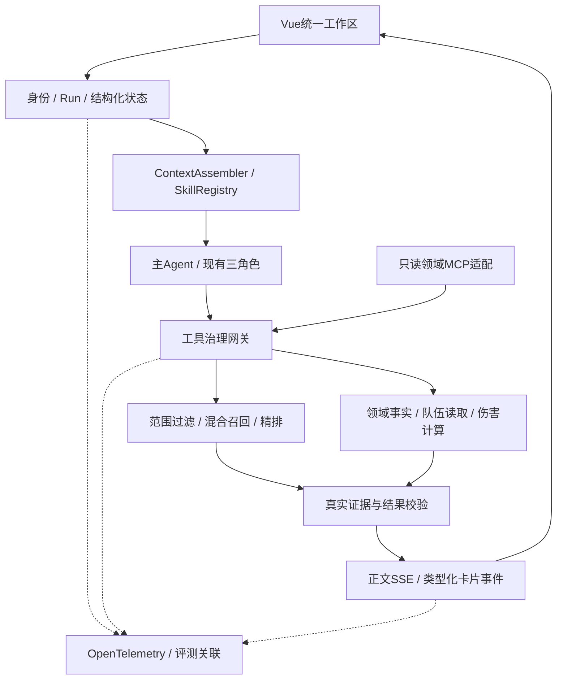

# VIO v1.1 智能体能力升级开发方案

## 2026-11-17正式发布收尾

U0～U6计划内开发已完成，13组问答质量失败已修复并回归，升级分支通过 `17c9425` 合并main。用户随后明确要求重新打包最新主线、创建 `v1.1.0` 标签和发布记录。本轮继续修复简短回答范围、已声明游戏版本承接及名称缺失/资料故障提示，重新执行工程回归和45轮问答。

正式发布范围、构建步骤及验收摘要见 [v1.1.0发布记录](../发布记录/v1.1.0.md)。发布由用户明确授权，回答质量评分为AI辅助复核，人工领域审核继续待办。以下历史快照保留各自日期和首次失败评分。

## 2026-11-17发布前质量缺陷修复与统一回归快照

首轮登记的13组质量缺陷已修复。统一总册68项业务用例及24组45轮已知题回归通过AI辅助复核。补充属性计算问法、馆主阶段与序号指代、长历史目标、实际保存队伍承接、公开样例来源、缺参数与非法EV提示、零伤害解释及无答案处理。网页窄窗口适配修复同时增加多尺寸浏览器测试。原首答失败继续归档，正式人工质量审核和发布流程继续待办。最新范围、实际回答及体验观察见[统一测试复测记录](../测试文档/测试报告_2026-11-17_统一测试修复与复测.md)。

## 2026-11-17新增质量复核

该首答轮由8123后端采集24组45轮，AI辅助逐段复核11组通过、13组失败、0阻塞。172个可对照运行类与前一候选JAR一致，Embedding、精排、Skills及上下文装配实际开启。原始失败已封存，集中在意图路由、重赛与序号上下文、长历史、属性解释及无答案处理。随后13组失败已修复并按已知题回归复测，原首次评分继续保留。详见[首轮报告](../测试文档/测试报告_2026-11-17_回答质量首轮验收.md)与上文修复记录。

下面保留2026-11-16技术交付快照及实施记录。

初版日期为2026-11-12，最新技术状态更新至2026-11-16。**U0～U6计划内开发与本机验证已完成，本地发布候选已生成，正式发布待人工审核。**真实Embedding/Jina精排已完成两批144次检索对照，精排质量与混合检索持平，继续默认关闭、按需启用。最新安全构建后端1894项零失败、零错误，8项条件跳过；Node工具链497项、前端契约231项、Chrome回归114项及打包JAR的12项HTTP检查通过。首次失败评分和修复回归继续保留。交付范围、检索局限及验收依据见[开发收尾记录](v1.1开发收尾与真实精排对照_2026-11-16.md)和[本地候选记录](../发布记录/v1.1.0-rc.1-local.md)。

稳定基线：`v1.0.0`（提交`d2e3d19541b2839e050be65ecacf26f586977d30`）；升级分支：`codex/v1.1-agent-upgrade`。本文不替代历史“正式版v1.1开发计划”，是基于当前本地产品与本轮岗位调研的新一轮能力升级，任务统一使用U0～U6编号。

## 1. 目标与范围

围绕已有产品改善三个问题：检索命中后内容仍不够相关；回答以长文本为主、操作衔接不足；新增角色或检索策略的效果缺少统一独立对照。

交付六项增量：**检索精排、结构化答案卡片、上下文与Skills、统一可观测性、领域MCP、独立评测闭环**。保留Java / Spring Boot / Vue架构，保持主Agent与现有工具权限边界，不重写为另一套框架。

### 1.1 基线能力和差距

| 方向 | 当前已有 | 本轮增量 |
| --- | --- | --- |
| 检索 | 范围过滤、BM25、Embedding、RRF、缓存与降级 | 候选扩展、重排、去重、有效性检查及相关性评估 |
| 界面 | 流式正文、图鉴卡片、队伍预览 | 类型化培养/队伍/伤害/证据卡片及安全操作 |
| 状态与角色 | 结构化目标、三角色进程内顺序协作 | 按任务装配上下文、版本化任务Skills、过期证据剔除 |
| 观测 | Run/Trace、usage、耗时与失败类别 | 标准Span、上下文传播、可视化链路、评测关联 |
| 工具集成 | Java领域工具、已有可选MCP适配 | 小范围只读领域MCP Server和端到端契约验证 |
| 质量 | 68项已知业务回归、自动化检查 | 未参与调试的新题、对照实验、发布质量门禁 |

### 1.2 本轮不做

不以增加Agent数量、微调、Kubernetes、百万级向量库作为完成条件。暂不向MCP开放保存队伍、任意文件、终端或任意URL抓取。不承诺未完成任务跨重启自动恢复。公网部署与生产高可用独立验收。

## 2. 总体架构与数据流



原则：身份、版本、预算、授权由程序掌握；Skills只能收窄工具范围。事实与计算从实际输出生成，模型负责有依据的说明。外部协议与页面操作均不能绕过原保存确认链。

## 3. 分阶段任务与依赖

| 阶段 | 交付 | 前置条件 | 完成判据 |
| --- | --- | --- | --- |
| U0 | 配置、独立题集与实验基线 | v1.0.0冻结 | 题集/判据/指纹冻结，基线可复现 |
| U1 | 检索精排 | U0 | 相关性和引用指标达门禁，失败回退BM25/RRF |
| U2 | 结构化答案与业务卡片 | U0；与U1可分开实现 | 字段可验证、流式兼容、按钮安全 |
| U3 | Context Engineering与Skills | U1/U2接口稳定 | 选对任务、按需装配、证据失效正确 |
| U4 | OTel可视化链路 | U0指标契约；可提前做基础埋点 | 完整Trace、脱敏、额外开销可控 |
| U5 | 领域MCP Server | U3授权/任务边界稳定 | 只读工具可调用，身份和版本不可伪造 |
| U6 | 独立验收与v1.1候选 | U1～U5 | 回归、独立验证、故障和回退全部留证 |

默认按表中顺序推进，每完成阶段更新本文状态和验收记录。U0/U6构成评测闭环，评测不留到全部开发完成后才补。

## 4. U0：基线、实验与配置契约

### 4.1 任务清单

- [x] U0-01：登记Git提交、profile、模型/Prompt版本、依赖、语料指纹和索引状态。
- [x] U0-02：编写并冻结至少40道新题，避免照抄既有68题；按资料、检索、长对话、计算、授权/缺项各8题分层。
- [x] U0-03：冻结rubric与相关片段标签；预先区分可答、需澄清、应拒绝、依赖外部服务失败。
- [x] U0-04：实现采集和报告适配，优先复用tools/campus与evaluation/campus，避免复制第二套账本。
- [x] U0-05：延迟、调用和usage口径已归档；真实BM25、HYBRID和精排完成两批共144次检索对照。以来源、参数预算、候选一致性和既有超时控制作本机验收依据，延迟报告实测分布。精排质量与混合检索持平，维持默认关闭，详见2026-11-16收尾记录。

新40题可分20题开发集、20题封存验收集。封存题在验收前不用于调Prompt；一旦失败并参与修复，转为回归题，另补新验证题。单一开发者编题不称第三方盲审。

### 4.2 记录格式（拟新增）

```json
{
  "schemaVersion": "upgrade-evaluation-v1",
  "caseId": "U0-RAG-001",
  "candidateCommit": "实际提交",
  "datasetSha256": "实际摘要",
  "profileFingerprint": "不包含凭证的配置摘要",
  "expected": {"relevantChunkIds": [], "requiresClarification": false},
  "observed": {"runId": "实际Run", "toolCalls": 0, "ttftMs": null},
  "verdict": "PASS/FAIL/BLOCKED",
  "reviewMethod": "deterministic/manual/ai-assisted"
}
```

实际Token usage、估算和参考成本分别记账；未知值保留null。保存首次结果、失败文本与人工/AI辅助意见，不用COMPLETED代替内容判定。

## 5. U1：混合检索后的精排

### 5.1 当前入口和设计

源码：`pokemon/guides/SqliteGuideKnowledgeRetriever`、`LocalGuideSemanticSearch`、`GuideEmbeddingClient`，包前缀均为`src/main/java/com/vio/vioaiagent/`。

当前按query.topK截断；引入精排前先区分`candidateK`与`answerTopK`，否则精排无法挽回已经丢失的相关片段。建议初值candidateK=12、answerTopK=4，语料少时取实际候选量；后续以评测调整。

链路：适用范围过滤 → 词法/语义召回 → RRF融合候选 → 规范片段去重 → 精排 → answerTopK → 证据绑定。

拟新增接口：`GuideReranker`、`RerankRequest`、`RerankResult`及可选HTTP适配器。请求只含问题与必要片段；返回候选索引与有限分数，映射回原canonical片段。外部服务不能返回新来源、改正文或引入越权片段。

### 5.2 任务清单

- [x] U1-01：抽离候选预算，保留现有版本/语言/规则/主题过滤。
- [x] U1-02：增加可替换精排接口，优先兼容单一供应商或本地实现，避免默认新增Python服务。
- [x] U1-03：校验空结果、重复/越界索引、NaN/无穷分数、响应大小及超时。
- [x] U1-04：精排失败回退原RRF候选顺序，输出实际降级状态。
- [x] U1-05：记录召回排名、精排排名、耗时、选中片段与版本；限制片段总Token预算。
- [x] U1-06：建立培养、伤害、机制、同名/错版本等相邻干扰用例。

已实现开关：`VIO_GUIDE_RERANK_ENABLED`（默认false）及ENDPOINT/MODEL/API_KEY/TIMEOUT_MS/CANDIDATE_K/ANSWER_TOP_K配置，另有`VIO_GUIDE_RERANK_MAX_INPUT_TOKENS`（默认12000）。配置类校验URL与参数，Key不进入toString、日志或指纹。当前适配器要求Jina-style请求/响应；真实供应商兼容和质量对照仍待验证。

### 5.3 验收和回退

在同指纹数据上比较BM25、现有HYBRID、HYBRID+精排。新题检索统计Recall@k、MRR或nDCG，回答另评引用和完整性。候选不足明确说明，不以精排高分证明真实性。

建议质量门槛：范围越界为0、伪造来源为0、目标相关片段排序不劣于基线；如收益不足则保持默认关闭。精排超时不得使原本可回答的查询失败。具体耗时阈值在U0实测后冻结，不预写“性能提升百分比”。

## 6. U2：类型化答案与生成式UI

### 6.1 输出契约

正文SSE保持兼容，增加版本化`answer.block`事件（拟新增）。只有完成Schema和证据校验的卡片才能发布，不向页面展示半段JSON。块使用稳定blockId及revision，游标重连按Run/事件/块标识幂等消费。

| 块类型 | 核心字段 | 可信来源 |
| --- | --- | --- |
| pokemon | formId、名称、属性、版本、证据ID | 图鉴工具实际字段 |
| teamSuggestion | 成员、配置、角色说明、缺项 | 实际资料/候选与受约束建议 |
| trainingPlan | 目标、等级/EV、条件、步骤 | 核对资料与模型策略，分别标注 |
| damageResult | 双方、招式、条件、范围、HP、假设 | 引擎真实输入输出 |
| evidence | 来源、片段、获取/核对时间、范围 | 现有canonical证据 |

区分`FACT`、`ADVICE`、`ASSUMPTION`与`MISSING`。schemaVersion、runId、blockId和引用ID必需；API Key、账号凭证与内部堆栈禁止进入块。

### 6.2 前后端实现任务

- [x] U2-01：设计Java DTO及JSON Schema，在契约目录登记并更新前端类型。
- [x] U2-02：事实/计算字段直接组装；仅将策略说明交给模型，禁止模型改写工具数值。
- [x] U2-03：扩展现有回答发布器；Schema失败降级为安全正文/缺项，不强行展示坏卡片。
- [x] U2-04：Vue增加队伍、培养、伤害和证据组件，复用现有图鉴与预览组件。
- [x] U2-05：支持展开、复制、图鉴联动和“导入为草稿”；不自动保存。
- [x] U2-06：确认修改仍绑定快照与账号，冲突后重新核对，不直接接受卡片传入的保存权限。
- [x] U2-07：覆盖长中文、未知名称、空字段、窄屏、键盘、断网补读、重复事件和未知块类型。

服务端限制块数量、文本长度与嵌套层级；链接协议与来源白名单分别校验。模型不得生成任意HTML/JS让页面执行。

### 6.3 完成标准

图鉴跳转目标正确；完整配置不丢太晶/EV/IV；卡片数值与实际工具一致；取消与重连不重复操作；老客户端忽略未知事件后仍正常显示正文。保存必须继续通过预览确认。

## 7. U3：Context Engineering与任务Skills

### 7.1 设计边界

保留现有三角色和业务状态，新增`ContextAssembler`与只读`SkillRegistry`（拟命名）。这是任务知识的模块化，不是新建更多Agent。当前状态与工具证据仍由程序管理，Skill不能授予授权、修改身份或自动执行脚本。

初始任务包：`gym-challenge`、`saved-team-review`、`training-build-review`、`damage-verification`、`competitive-team-reference`。

### 7.2 Skill结构（拟新增目录）

```text
src/main/resources/agent-skills/
  gym-challenge/
    SKILL.md
    examples.json
    references.md
```

元数据包括id/version/description/requiredInputs/allowedTools/outputKinds/referenceVersions。先加载短元数据，匹配后只加载必要正文和引用；记录选中版本与装配摘要。

### 7.3 上下文装配顺序

身份与版本（程序可信） → 当前问题 → 当前结构化目标 → 必要近期历史 → 匹配Skill → 本次工具证据。不同来源明确标记信任层级，召回文本不能升级为系统指令。

队伍修改后重新读取；切馆主、阶段、版本或计算条件时清理对应旧证据。摘要不能替代原始授权/工具输出，压缩时保留缺项与否定条件。

### 7.4 任务与验收

- [x] U3-01：实现元数据解析和版本/schema校验，限制加载目录与大小。
- [x] U3-02：Skill白名单与当前Run/角色工具取交集；不能扩大权限。
- [x] U3-03：ContextAssembler按优先级分配Token预算，保留系统/当前问题和授权边界。
- [x] U3-04：覆盖“不要修改”、序号不明、跨版本、已保存/建议混淆、9轮填充和任务切换。
- [x] U3-05：对照关闭/开启Skills的相同输入，核对任务选择、证据完整性、Token与耗时。

拟新增`VIO_AGENT_SKILLS_ENABLED=false`开关。错误Skill或未知版本不悄悄启用；回退现有流程并记录原因。验收要求越权0、身份混用0、已知长对话回归不退化；不能仅凭Token减少宣称质量提高。

## 8. U4：统一Trace与效果关联

### 8.1 Span与标识

基于已有Micrometer/Run观测盘点后接OpenTelemetry，优先复用已存在的Instrumentation，避免重复埋点。Java工作线程与工具执行器显式传播上下文，清理ThreadLocal，防跨请求串Trace。

拟Span树：`agent.run` → `context.assemble` / `agent.plan` / `retrieval.lexical` / `embedding.query` / `retrieval.rerank` / `tool.execute` / `answer.validate` / `answer.publish`。

记录runId、role、toolName、Prompt/Skill版本、模型标识、语料指纹、耗时、usage与失败类别。不把runId/userId等高基数字段当Metrics标签；不默认采集正文、Key、Cookie和完整工具参数。

### 8.2 任务与验收

- [x] U4-01：确定SDK/Agent与OTLP导出方式，按现有Spring版本兼容验证。
- [x] U4-02：开发/本机可使用本地Collector和Trace查看器，默认无导出也能正常运行。
- [x] U4-03：增加采样、脱敏、长度限制、有界队列和导出失败降级。
- [x] U4-04：报告绑定evaluationCaseId与Trace，链接一次失败的模型、检索和工具事件。
- [x] U4-05：比较首个可见正文TTFT与总耗时，不把排队事件当首字。

验收：正常、工具失败、取消、断流各有完整链路；双Run无串线；导出器不可达不拖垮问答；关闭导出可恢复原模式。额外开销通过U0实测门槛判定。

## 9. U5：只读领域MCP Server

### 9.1 工具范围和传输

首批只开放图鉴、配招核对、伤害计算三个能力；复用服务层和网关，不经HTTP绕回自身，也不复制权限/校验。优先验证本地STDIO接入；若另选Streamable HTTP，则单独实现连接、身份、Origin与会话校验。

已有MCP客户端依赖不代表领域Server已完成，须先核对当前SDK/协议版本再决定兼容升级。MCP是工具连接协议，不是角色间自动协商协议。

### 9.2 身份与运行范围

外部客户端不能直接声明userId/runId冒充内部请求。适配器创建受控执行范围并绑定调用方；默认只读公共资料。伤害输入不得携带任意Node路径或命令；不允许客户端把工具名当授权。

### 9.3 任务与验收

- [x] U5-01：明确协议版本、工具Schema、错误输出与资源上限。
- [x] U5-02：实现本地适配器，分别验证工具发现、参数错误、取消、超时与正常结果。
- [x] U5-03：限制并发、参数体积与返回大小，版本/模型条件沿用领域校验。
- [x] U5-04：恶意参数、未知工具与伪造身份必须拒绝；日志不泄露凭证。
- [x] U5-05：用独立兼容客户端真实调用，证明无需网页也能取得相同事实/数值。

以上按首批三个公开工具、本地STDIO与固定MCP 2024-11-05范围验收：Node及固定Java SDK客户端调用通过，真实HTTP/MCP的13项矩阵一致；取消由Node验证。长期内存压力、更多协议版本/桌面客户端和SDK取消行为仍保留为扩展验收，未宣称全部兼容。证据见[真实HTTP对照与U6证据校验](U5真实HTTP对照与U6证据校验_2026-11-13.md)。

验收：同输入与网页领域工具结果一致，保存/终端工具不可发现或执行；关闭MCP不影响原网页。写工具在后续单独设计，不纳入本阶段。

## 10. U6：质量门禁、发布候选与回退

### 10.1 必须通过

| 层次 | 核验 |
| --- | --- |
| 单元/契约 | 参数、Schema、排序、卡片、Skill、权限和错误状态 |
| HTTP/浏览器 | SSE兼容、游标、账号隔离、图鉴联动、草稿/预览、冲突与窄屏 |
| 故障 | 精排/Embedding503、维度错误、索引损坏、坏结构化输出、OTLP不可达、上游EOF |
| 既有业务回归 | 现有68题重新执行，逐项记录正文与实际事件 |
| 独立验证 | 冻结新题保留首答，区分环境阻塞和应用失败 |
| 对照实验 | 单项开关对照，再执行全组合；比较质量、延迟、usage和工具数 |

硬门禁：越权/跨账号/伪造保存/篡改工具数值/伪造来源为0；已知安全与确定性计算用例不得退化。开放策略回答使用预先冻结rubric复核，不以语义相似度代替正确性。

基准样本不足或统计不稳时写明限制，不报告不存在的显著提升。建议功能开关默认false，逐项达到门禁后再决定默认开启。

### 10.2 回退矩阵

| 新能力失败 | 回退 |
| --- | --- |
| 精排 | 原RRF/BM25路径，保留真实降级状态 |
| 卡片Schema | 已验证正文/缺项；不生成坏卡片、不执行动作 |
| Skill/装配 | 现有Prompt与状态流程；权限不变 |
| Trace导出 | 本地已有诊断，问答不依赖观测后端 |
| MCP | 关闭新入口，原网页继续使用 |

配置回退前后不清空个人数据库。新SQLite字段/表用可追踪迁移，旧版不应因加载新可选能力而启动失败；不可逆迁移单独评审与备份演练。

### 10.3 交付清单

- [x] 更新README、公开配置模板与新手操作说明。
- [x] 保存评测集版本、首次结果、Badcase、修复与最终报告。
- [x] 给出功能开关、数据迁移、回退和外部服务成本说明。
- [x] 明确剩余缺口，更新学习路线/面试题中实际已实现部分。
- [x] 生成本地发布候选，核对JAR私有资源排除、294项文件摘要、ZIP与清单一致性、源码快照和随包伤害引擎。
- [x] 归档可随Git查看的技术验收摘要与测试代码指纹，统一README、主方案和U6入口的最新状态。
- [x] 按用户明确指令合并main，合并提交为17c9425，本次发布创建v1.1.0标签与记录。
- [x] 修复2026-11-17新增问答质量验收的13组失败，保留首答评分并按已知题回归复测。
- [x] 补充简短回答、已声明版本和故障分类体验修复，按最新主线重新构建发布包。
- [ ] 持续进行人工领域质量审核和新增独立问答验收，评分方式按实际参与者记录。

当前主线已合并升级内容，本次按用户发布指令重新打包并创建版本。发布包源码身份和逐文件摘要记录于manifest，最新技术摘要位于`evaluation/upgrade-v1.1/release/v1.1.0-20261117.json`。2026-11-16候选记录保留其封存口径。人工领域复核、条件跳过和原始首答评分按各自证据登记。

## 11. 实施时需要用户配置的内容

现有DeepSeek和Embedding继续沿用本机配置。U0～U3可先做接口、Fake服务、契约与本地验证，不因尚未购买新服务停工。

1. 精排：确定支持的模型、端点和额度；也可先使用本地实现。接入完成后再按公开模板填写Key，不能把聊天或Embedding Key默认视为通用凭据。
2. Trace：选择本地查看器/Collector或已有受信任服务，默认不上传原始正文。
3. MCP：准备一个兼容客户端；只有需要远程服务时才配置HTTPS与认证。
4. 质量：检查冻结rubric，复核策略答案的领域正确性；不要把AI辅助评分写成人工通过。

未来新增变量应在实现时正式登记，本文的拟命名不是立即可用配置。模型结构化输出、精排协议和SDK版本需真实验证，不因“兼容API”而假设功能齐全。

## 12. 分支操作与协作约定

```powershell
git fetch origin --tags
git switch codex/v1.1-agent-upgrade
git pull --ff-only
git status
```

其他设备若没有本地分支，使用`git switch --track origin/codex/v1.1-agent-upgrade`。有未提交修改时先检查归属，不能直接reset/clean；不强推稳定分支或标签。main只接收审查后的稳定变更。

阶段记录模板：任务ID、起止提交、修改文件、配置/数据指纹、预期、实际证据、失败与原因、验收人/方式、回退验证、剩余问题。

## 13. 岗位与技术依据

调研日期：2026-11-12。部分官方职位正文来自搜索索引，职位状态与届别投递前再核对；下面是技术方向依据，不是所有公司统一门槛。

- [美团AI应用校招](https://zhaopin.meituan.com/web/position/detail?highlightType=campus&jobShareType=1&jobUnionId=4694862735)：应用、RAG、工具、工作流及工程基础。
- [小红书AI应用校招](https://job.xiaohongshu.com/campus/position/22021)：上下文、生成式UI、评测与Badcase。
- [美团Agent社招](https://zhaopin.meituan.com/web/position/detail?highlightType=social&jobUnionId=4428189649)：规划/执行/评估、可观测与工程化；经验要求不套成秋招门槛。
- [小红书AI全栈](https://job.xiaohongshu.com/campus/position/17376)：Skills、MCP、工具编排与交付。
- [Spring AI RAG](https://docs.spring.io/spring-ai/reference/api/retrieval-augmented-generation.html)、[结构化输出](https://docs.spring.io/spring-ai/reference/api/structured-output/converters.html)：按项目锁定版本选接口，不直接照搬新版API。
- [Agent Skills](https://www.anthropic.com/research/equipping-agents-for-the-real-world-with-agent-skills)：按需加载和知识模块化思路。
- [OpenTelemetry Java](https://opentelemetry.io/docs/languages/java/)与[MCP架构](https://modelcontextprotocol.io/docs/learn/architecture)：标准链路与工具连接协议。

## 14. 当前进度

截至2026-11-17，U0～U6计划内开发项和main合并已完成，本轮按用户指令交付v1.1.0。最新记录见[正式发布记录](../发布记录/v1.1.0.md)，历史性能对照见[开发收尾与真实精排对照](v1.1开发收尾与真实精排对照_2026-11-16.md)。

| 阶段 | 当前完成情况 |
| --- | --- |
| U0 | 冻结题集、rubric、配置与组件身份、首答和失败记录；性能口径与本机基线归档 |
| U1 | 候选、精排、来源绑定、预算与回退已实现；真实Jina和Embedding两批144次检索，36次精排成功，12次空候选跳过，0次回退 |
| U2 | 计划内五类答案块、图鉴联动、培养核对、草稿导入和预览确认已实现并有HTTP与浏览器证据 |
| U3 | Skills白名单、上下文预算、目标切换与状态失效已实现；开关对照和长历史采集归档 |
| U4 | Run与工具执行追踪、线程关联、审批恢复、导出失败与采样已实现；Jaeger及探针验证归档 |
| U5 | 三个公开只读工具、本地STDIO、Node/Java SDK、取消传播与一小时持续运行已验证 |
| U6 | 统一测试修复、最新工程回归、45轮问答与主线发布包按v1.1.0记录归档，保留人工领域审核事项 |

后续持续完善人工领域审核、新题验证与来源时效。首答失败与同题修复回归保留各自成绩。性能结论基于8道开发检索题，见收尾记录中的适用范围。

### 2026-11-15及以前的阶段快照

| 阶段 | 状态 |
| --- | --- |
| 正式基线与分支 | v1.0.0标签及main已推送；本方案提交到codex/v1.1-agent-upgrade |
| U0 | 已解决旧class未重建问题；最新后端20题/24轮开发复核20通过、0失败、0阻塞（AI辅助）。账号澄清及形态出口已实际加载复验；封存题与新开关对照、成本/检索基线仍待完成 |
| U1 | 候选扩展、HTTP适配、回退与请求级排名诊断已开发；补总输入代理Token预算、整数溢出拒绝及Run观测事件。默认未启用；真实供应商/检索标签/质量对照待完成 |
| U2 | 首批图鉴与确定性伤害卡片已接线；实际引擎普通/零伤害、实际条件、百分比、版本拒绝、去重及真实浏览器展示通过。已补伤害来源证据块；已补完整参考成员及已保存培养配置快照卡片；保存配置快照已支持导入新草稿；已补保存配置的分步骤培养核对、目标等级差距、逐招学习条件联动及整队条件式资源预算及绑定保存快照的馆主覆盖评估及静态能力值对照、明确进度/奖励前提声明核对；已补有限第一人称自然语言声明；自由表达抽取、目标训练参数/完整获取路线、完整队伍建议的草稿投影、通用证据和真实provider开启对照仍待完成，默认关闭 |
| U3 | Skills与上下文装配已完成真实Run启用接线验证，修复context事件被过滤；只读工具边界测试通过。默认关闭，已补培养声明切换游戏失效与主动重置；真实模型单项/组合对照及其他状态失效专题待验收 |
| U4 | 本地OTel导出基础已完成验证，本轮补网关工具回调线程的父关联与作用域清理；已完成真实Jaeger收集/查询/UI及流式取消验证；全Run排队/授权/提交链路及真实模型开销对照仍待完成 |
| U5 | 首批三个公开只读工具的本地STDIO范围验收收口：真实HTTP/MCP 13项一致，Node与固定Java SDK调用通过；含取消、断连与短时背压。已补5,069请求持续连接和客户端有界回复窗口；更广客户端/协议、小时级压力及服务端内存趋势仍待验收，非公网交付 |
| U6 | 已开发证据校验和开启接线测试；最新后端整体1,758项0失败/0错误/3跳过，前端契约222项通过。上轮检索实现已核对运行构建，本轮新增卡片仍为隔离构建；真实开关对照、68项业务回归及封存题仍待执行，未通过整体阶段验收 |

下一步继续U2队伍/培养块，完成U1真实精排和U3真实模型对照、U4完整链路，再执行68项业务回归与独立封存题；U5首批只读STDIO范围已有验证，长期压力与更多客户端仍待补。当前进度见[U0说明](../../evaluation/upgrade-v1.1/u0/README.md)。本次未启用精排、卡片或新Skills。

最新复核、修复和验收边界：[U0开发集复核与多轮修复收尾](U0开发集复核与多轮修复收尾_2026-11-13.md)。

本轮重启复测及U4导出配置：[U4本地OTel导出与重启复测](U4本地OTel导出与重启复测_2026-11-13.md)。

最新开发集复核、工具线程及U5首批边界：[U4工具线程追踪与U5只读目录](U4工具线程追踪与U5只读目录_2026-11-13.md)。

U5独立服务、配置生成、构建核对与最新复测：[U5只读STDIO服务与构建核对](U5只读STDIO服务与构建核对_2026-11-13.md)。

U5协议可靠性与入口对照：[U5协议取消与入口等价验证](U5协议取消与入口等价验证_2026-11-13.md)。

后续验收准备：[U6验收执行清单](U6验收执行清单_2026-11-13.md)。

U5首批范围验收及U6首批开发：[真实HTTP对照与U6证据校验](U5真实HTTP对照与U6证据校验_2026-11-13.md)。

U6开启接线修复与运行产物更新：[真实浏览器验收](U6开启接线修复与真实浏览器验收_2026-11-13.md)。

本轮U1修复与U2扩展：[精排观测补齐与伤害卡片](U1精排观测补齐与U2伤害卡片_2026-11-13.md)。

2026-11-14：已补齐文档去重/主题保留之后的实际来源记录，并开始U6检索指标工具。定向Java18项、Node4项通过，真实标签及供应商质量对照未执行。见[最终来源与检索指标](U1最终来源记录与U6检索指标_2026-11-14.md)。

后续已开发同题/同标签检索对照报告，补检索服务构建摘要核对；Node17项通过，真实质量成绩仍未生成。见[检索对照报告与构建证据](U6检索对照报告与构建证据_2026-11-14.md)。


本轮实现与限制：[U1服务适配和U0修复记录](U1精排服务适配与U0修复记录_2026-11-13.md)。

本轮进度：[U2首批卡片与重启复测记录](U2首批卡片契约与重启复测_2026-11-13.md)。

本轮更新：[事件接线与第三轮复测](U2事件接线与第三轮开发集复测_2026-11-13.md)。

本轮更新：[U3首批任务Skills与定向复测](U3任务Skills首批开发与报告解释复测_2026-11-13.md)。

本轮更新：[U4观测基础与图鉴集成验证](U4观测基础与图鉴Run集成验证_2026-11-13.md)。

本轮更新：[构建隔离与U4流式收尾](构建隔离与U4流式观测收尾_2026-11-13.md)。

本轮更新：[上下文装配与父观测关联](U3上下文装配与U4父观测关联_2026-11-13.md)。

2026-11-14：补齐伤害卡片的可展开来源证据、异常来源回退和U6浏览器核对，见[伤害证据块与回归推进](U2伤害证据块与U6回归推进_2026-11-14.md)。

2026-11-14：继续U2完整参考成员投影与U6只读/窄屏验收，见[队伍参考卡片与只读验收](U2队伍参考卡片与U6只读验收_2026-11-14.md)。完整配置与培养计划未宣称完成。

2026-11-14：补齐已保存培养配置快照，覆盖程序快捷读取、账号/版本拒绝、太晶字段和U6重连时序验证，见[培养配置快照与重连验收](U2培养配置快照与U6重连验收_2026-11-14.md)。这不代表最优培养建议生成或完整U2验收。

2026-11-14：保存配置卡片支持导入新草稿、版本拒绝及未保存冲突确认，并补原JSON导入回归。后端业务Java未改，全量数量沿用上轮，不计为本轮重跑。见[导入草稿与交互回归](U2配置卡片导入草稿与U6交互回归_2026-11-14.md)。

2026-11-14：新增保存队伍的培养核对待办，通过治理网关单次调用整队核对，绑定配置参数及资料快照后才引用学习记录；未取得资源证据不编造获取路线。见[培养路线与证据核对](U2保存队伍培养路线与U6证据核对_2026-11-14.md)。

2026-11-14：培养步骤四交叉核对实际学习记录与固定学习器/配方/区域目录（4种招式、最多展开4条记录），不推断游戏内解锁或库存；U6构建核对增加培养辅助类。见[资源接线与构建核对](U2培养资源目录接线与U6构建核对_2026-11-14.md)。

2026-11-14：培养条件支持显式标签重建、冲突提示和明确更新，读取当前会话已完成用户消息，修复明确培养请求被馆主路由截获以及“目标改为”被误判为队伍修改。自然语言抽取、真实目标参数与完整获取条件仍待完成。见[条件复用与多轮验收](U2培养条件复用与U6多轮隔离验收_2026-11-14.md)。

2026-11-14：U2新增明确馆主/阶段资料等级范围、可选声明目标等级和只读差距核对，禁止/未知/超限练级不安排升级；修复条件等级更新被修改意图误判。U6已扩展12轮浏览器交互，仍不代替真实模型质量验收。见[目标资料与等级差距核对](U2目标资料与等级差距核对_2026-11-14.md)。

2026-11-14：U2逐招学习记录与用户练级限制联动，保留替代途径的资源缺项，不写配置；U6后端整体1,679项0失败/0错误/3跳过，Node10项和浏览器12轮通过。见[招式学习条件联动与验收](U2招式学习条件联动与U6验收_2026-11-14.md)。

2026-11-14：U2补齐整队学习器条件式资源汇总、争议/缺失配方排除和资源限制；U6整体1,687项0失败/0错误/3跳过，Node10项及浏览器14轮通过。见[整队资源预算与条件更新验收](U2整队资源预算与U6条件更新验收_2026-11-14.md)。

2026-11-14：U2培养步骤五接入受治理的保存队伍馆主覆盖评估，绑定队伍修订号、成员配置及固定目标资料，取消或变更时不使用旧结果；U6后端整体1,696项0失败/0错误/3跳过，Node10项、浏览器14轮通过。见[目标覆盖与快照绑定验收](U2培养目标覆盖接线与U6快照绑定验收_2026-11-14.md)。单次伤害及实际NPC数值不在本轮自动生成范围。

2026-11-14：U2新增保存配置的静态能力值和有条件的目标等级假设，统一等级约束解析；U6后端整体1,710项0失败/0错误/3跳过，Node10项、浏览器14轮通过，250组/1,500数值与锁定计算库交叉验证一致。见[静态能力值对照与数值验收](U2静态能力值对照与U6数值交叉验收_2026-11-14.md)。仍不代表最优参数建议或真实模型质量验收。

2026-11-14：U2补齐明确进度/学习器声明的重赛与奖励前提核对，拒绝跨字段矛盾；U6最终后端整体1,719项0失败/0错误/3跳过，Node10项、浏览器18轮通过。见[进度与奖励前提核对及多轮验收](U2进度与奖励前提核对及U6多轮验收_2026-11-14.md)。用户声明不等于存档或实际库存核验。

2026-11-14：U6真实服务开发集20题/24轮复核19通过、1工具范围说明问题；6轮实际培养联调通过且临时队伍已删除。U1补两个历史修订的工具范围适用策略；U3新增可选v11-preview配置并以实际profile完成2项HTTP/浏览器测试（18轮）。最终业务Java整体1,727项0失败/0错误/3跳过，脚本17项通过；补丁的个人服务复测仍需重建重启，不计为整体发布验收。见[真实服务复核与U3预览配置](U6真实服务复核与U3预览配置_2026-11-14.md)。

2026-11-14（相关性后续）：新增通用资料合法性单次攻略检索与馆主太晶成员聚焦回答，保留来源校验和公共回答审核。后端整体1,738项0失败/0错误/3跳过，Node脚本17项、固定模型页面21轮通过。个人服务仍为旧构建，实际模型复测及整体发布验收未完成。见[回答相关性修复与聚焦追问验收](U6回答相关性修复与聚焦追问验收_2026-11-14.md)。

2026-11-14（U5持续连接）：修复本地验证客户端回复ID集合无限增长，增加4,096槽位窗口与128待请求上限；新增5,069请求、5轮慢消费者恢复及自然退出验证。联合MCP测试12项和Node测试13项通过。核对SDK源码确认其closeGracefully主动destroy子进程，区分客户端关闭与服务端自然EOF。个人后端仍未加载最新补丁，真实模型验收未完成。见[持续连接边界与构建阻塞复核](U5持续连接边界与U6构建阻塞复核_2026-11-14.md)。

2026-11-14（U6证据门禁）：构建核对升级v3共享清单，严格校验6个核心及17个辅助组件、清单摘要和注销结果；旧报告只标记历史归档范围。旧构建退出1、环境阻塞退出2，防止自动化误通过。相关脚本14项及相邻脚本22项通过；实际8123仍有7个组件不匹配，未执行补丁实际模型验收。见[构建证据清单与验收门禁修复](U6构建证据清单与验收门禁修复_2026-11-14.md)。

2026-11-14（U2自然语言条件）：新增有限第一人称声明解析，支持朱紫、中文徽章、指定馆主与阶段、练级上限及资源限制，复用原冲突/明确更新语义，不增加模型调用或写权限。最终后端1,746项0失败/0错误/3跳过、固定模型页面25轮、Node脚本22项通过。实际个人服务复测仍需重建重启。见[自然语言培养声明与多轮验收](U2自然语言培养声明与U6多轮验收_2026-11-14.md)。

2026-11-14（U3状态专题）：修复自然语言重赛别名未被下游核对器接受，以及自然目标更新被写意图路由误拦截的问题。补明确切换游戏后的培养条件失效、同句新条件保留与零调用主动重置。整体1,753项0失败/0错误/3跳过、29轮固定模型页面、14项脚本测试通过。个人服务实际模型验收仍需重建重启。见[培养状态失效与重赛别名接线](U3培养状态失效与重赛别名接线_2026-11-14.md)。

2026-11-14（推送后U5接续）：已将此前209文件进度推送至codex/v1.1-agent-upgrade，提交f59a15b。随后补官方Java SDK传输层显式取消、worker中断、重复取消及连接恢复验证，联合MCP13项0失败/0错误/0跳过。该新增测试和记录尚未推送；未重跑整体后端或实际模型。见[官方SDK取消验证与Git快照](U5官方SDK取消验证与Git进度快照_2026-11-14.md)。

2026-11-14（U4调度观测）：工具执行器边界增加agent.tool.dispatch，关联Run/worker回调并输出已冻结阶段耗时和有限结果标签；缓存不伪造Span，观测故障不重放业务。共享构建清单v2增至26组件。定向44项、最终整体1,758项0失败/0错误/3跳过、固定模型页面29轮、Node14项通过。Docker引擎未运行，真实Jaeger及全Run排队/提交链路仍待验收；本轮未推送。见[工具调度Span与耗时关联](U4工具调度Span与耗时关联_2026-11-14.md)。

2026-11-14（U3任务选择）：修复OU匹配到could/you的英文子串错误，以及直接点名馆主时任务Skill选错的问题。使用当前Run问题选择任务，并通过协调器Prompt与工具集合回归。最终Java定向26项、Node14项通过，构建清单v3共28组件。真实模型开关对照仍待执行。见[任务Skills选择修复](U3任务Skills选择修复_2026-11-14.md)。

2026-11-14（U4真实收集器）：已启动本地Docker引擎及固定Jaeger 2.23.0容器，补真实OTLP接收、v3查询、父子链/冻结耗时、异常脱敏、跨线程流式取消和Chrome时间线展示。最终观测测试20项通过，含3项真实Jaeger用例，浏览器检查通过。服务保留本地运行，下一步继续真实模型追踪、开销与完整生命周期专题。见[真实Jaeger接收查询与流式验收](U4真实Jaeger接收查询与流式验收_2026-11-14.md)。

2026-11-14（U4关联与U6复查）：新增评测case/轮次/Run到Jaeger v3 Trace的关联脚本，校验唯一根、父链、重复和循环，输出受限字段及原采集摘要。修复真实Jaeger空窗口返回404 No traces found造成的测试偶发失败。Node19项及真实Jaeger3项通过，3条固定测试链路关联成功，历史模型开发集24轮在本次窗口内标记未找到Trace。下一步将报告接入真实模型开关对照。见[评测Run与Trace关联](U4评测Run与Trace关联_2026-11-14.md)。

2026-11-14（U6单开关对照）：修复采集初始化/部分失败/清理失败仍成功退出的问题，增加采集前后公开配置和28组件核对。新增同题同源码/运行组件的单开关轮询耗时报告，保留逐轮差值、中位数、P95和内容评审待办。Node29项通过，含实际子进程CLI状态测试。当前后端最小采集为SETUP_BLOCKED，未创建问答Run，需重建后继续真实模型对照。见[采集完成状态与单开关耗时对照](U6采集完成状态与单开关耗时对照_2026-11-14.md)。

2026-11-14（U3多轮Skills接线）：协调器复用GymTurnPlan，将本会话已解析馆主/阶段带入道馆Skill，修复后续这个队伍如何应对退回通用Skill的问题。覆盖9轮填充与历史裁剪、普通任务切换、新馆主替换、含糊/助手历史和新会话。最终Java定向47项、Node25项通过。真实模型开关质量对照继续按采集计划执行。见[多轮馆主任务与Skills接线](U3多轮馆主任务与Skills接线_2026-11-14.md)。

2026-11-14（真实开关执行）：使用独立端口和数据库、现有IDEA模型Key完成首批真实Skills三题开关采集。实际运行修复空名称HTTP500、框架NOOP追踪上下文覆盖、部分选题Trace关联三处接线问题。两组6个Run的Trace均关联成功。通用组队额外读列表已通过新增team-core-planning修复，原题复测通过；随后开始上下文装配单题配对，实际出现CONTEXT_READY。最新Java定向45项、Node41项通过。所有隔离后端已关闭，完整样本和发布验收继续待办。见[真实开关对照与应用接线修复](U3真实开关对照与U4应用接线修复_2026-11-14.md)。

2026-11-14（U3完整对照与U6事件校验）：扩展至上下文开关各20题/24轮，实际修复种族值问题夹带物种、默认值片段漏答，以及地域形态缓存入口与英文别名。最新两组AI辅助复核均20通过、0失败、0阻塞，48个Run全部关联Trace。U6新增Run身份、事件摘要/顺序、正文及终态交叉校验，构建清单v4共31组件。最新Java定向60项0失败/0错误/1跳过，Node46项通过；本轮较早的整体1774项0失败/0错误/6跳过发生在业务修复前。长历史、真实精排、完整生命周期及整体发布验收继续待办。见[上下文开发集对照与事件证据校验](U3上下文完整开发集对照与U6事件证据校验_2026-11-14.md)。

2026-11-14（U4 Worker生命周期）：已完成上轮修复后的整体1779项回归，随后将Run根观测延长到Worker清理，新增执行租约和答案提交阶段、排队等待字段及最终状态，复用默认执行器根节点。新增代码最终整体1785项0失败/0错误/3跳过，定向123项、Node47项通过；4道真实服务开发题正文及Jaeger阶段关联均通过。构建清单v5共32组件与整体测试产物一致。请求准入、排队中止、审批恢复关联及68项/封存集继续待办。见[执行租约与答案提交追踪及整体回归](U4执行租约与答案提交追踪及整体回归_2026-11-14.md)。

2026-11-15（U4准入与U6多次执行）：补齐Run服务准入、未执行即取消/超时的排队观测，审批恢复按独立执行批次关联。真实HTTP发现外部未采样父上下文抑制领域Span，已通过具名处理器修复并新增回归，构建清单v6共33组件。最终后端整体1791项0失败/0错误/3跳过，定向129项和Node51项通过；4题真实HTTP及真实SDK两批次关联通过。真实精排、长历史、开销与68项/独立验收继续推进。见[准入排队与审批恢复追踪及多次执行关联](U4准入排队与审批恢复追踪及U6多次执行关联_2026-11-15.md)。

2026-11-15（U3长历史与U6重复校验）：修复上游历史窗口裁剪后专用角色仍报告CONTEXT_READY的问题，补充上游/装配省略轮数与模型提示。新增独立15轮开发场景及结构证据校验器，两个隔离会话各15轮实际采集和AI辅助正文复核通过，30个Run全部关联Trace。构建清单v7共34组件与整体测试产物一致，公开指纹补历史窗口和安全系数。最终后端1793项0失败/0错误/3跳过，定向34项、Node60项通过。使用隔离BM25，后续继续真实精排、开销、68项与封存题验收。见[长历史裁剪诊断与重复采集校验](U3长历史裁剪诊断与U6重复采集校验_2026-11-15.md)。

2026-11-15（U4采样开销与U6重复验收）：补公开采样率指纹和严格开关对照门禁，避免不同采样配置混入耗时配对。新增0/25/100%领域采样、外部父上下文隔离和显式SDK固定工作量探测，导出失败时业务次数保持一致。两个隔离网页服务完成两轮各4题/5轮追踪开关对照，累计20轮AI辅助正文复核通过，开启组10个Run关联Trace，关闭组查询窗口内无对应领域链路。最终后端1797项0失败/0错误/3跳过，定向20项、Node62项通过。保留原始纳秒样本和HTTP轮询耗时，性能结论待更多独占资源样本；68项、真实精排和封存题验收继续待办。见[采样诊断与开销对照及重复验收](U4采样诊断与开销对照及U6重复验收_2026-11-15.md)。
2026-11-15（U2真实模型与U6卡片开关）：新增真实Chrome、Vite代理、隔离本地账号和DeepSeek四场景卡片开关测试。实际运行修复无伤害字样的招式计算路由、none无道具别名、冗余request封装、PokéAPI名称路径来源丢失及纯资料队伍追加建议。共享构建清单v8共43组件，包含嵌套来源校验及计算DTO。最终后端1804项0失败/0错误/3跳过，Java定向106项、Node65项、前端223项及lint/typecheck/build通过。最终开关两组共8轮正文复核与页面检查通过，8个Run均关联Trace。使用已校验公开缓存，网络稳定性、真实精排、68项和封存题继续验收。见[真实模型卡片验收与伤害路由来源修复](U2真实模型卡片验收与伤害路由来源修复_2026-11-15.md)。
2026-11-15（U6阶段2业务回归）完成14题15轮真实采集入口及证据校验器，增加隔离test1队伍逐题快照核对。首轮12通过、1失败、1阻塞，修复含糊版本切换后复测13通过、0失败、1阻塞，完整队伍来源业务链路仍不可用。15轮事件和实际Trace关联通过；AI辅助内容复核，封存独立验收仍待执行。见[阶段2业务回归与版本范围修复](U6阶段2业务回归与版本范围修复_2026-11-15.md)。

2026-11-15（U6阶段3推进）新增伤害常规采集及直接引擎证据校验，修复参考成员行末句号造成已成功查询与计算结果被丢弃的问题。完整队伍来源增加固定仓库备用地址和异常保留，阶段2最终14题15轮通过，阶段3常规10题12轮通过，27个实际Run关联Trace。原始来源仍有网络超时记录，4项阶段3受控专题及其余业务阶段继续验收。见[阶段3伤害协作回归与完整队伍来源恢复](U6阶段3伤害协作回归与完整队伍来源恢复_2026-11-15.md)。

2026-11-15（U6阶段3专题收尾与阶段4）补齐真实浏览器首段前取消/重连、独立引擎故障及2次调用跨角色预算验证。阶段4按原题执行4组会话25轮，16项语义与9轮填充分别通过，组内对话标识及跨组隔离、只读队伍快照、事件和25个Trace均核对。基于上轮整体1812项构建，新增脚本89项通过。阶段4为程序直达与结构化状态验证，开放式模型长对话、阶段5/6共24项及独立质量继续验收。见[阶段3专题收尾与阶段4多轮状态验收](U6阶段3专题收尾与阶段4多轮状态验收_2026-11-15.md)。

2026-11-15（U6阶段5混合检索）完成真实text-embedding-v4的1024维30片段建库、同题对照及回答引用，补受控HTTP降级、维度/摘要损坏、失败重建原子性和模型切换，共12项通过AI辅助复核。修复口语“队伍是不是已经改好”的project主题遗漏，新增工具级候选词法/语义排名事件；构建清单v12共50组件。最终后端1817项0失败/0错误/3跳过，脚本97项通过。8题已参与调试的种子不作为独立验收，仍有一个无答案种子返回非空候选。阶段6剩余12项及独立质量继续推进。见[阶段5混合检索验收与保存状态召回修复](U6阶段5混合检索验收与保存状态召回修复_2026-11-15.md)。

2026-11-15（U6阶段6起步）修复无答案题因通用领域词与时间词误召回，8道开发种子的BM25和真实v4对照中正向召回6/6、无答案空候选2/2。新增阶段6双账户治理采集器，S6-02与S6-11通过AI辅助复核，S6-04接口部分通过；首轮暴露“几倍伤害”问法绕过属性路由，已修复并在隔离后端复测。修订当前语料代码绑定为v3，冻结基线保留。后端1819项0失败/0错误，补跑Jaeger及开销探针后剩3项条件跳过；Node421项通过，52组件摘要匹配。68项完整覆盖58项，剩10项含页面确认、账号切换及端到端交互，独立质量验收继续推进。见[阶段6治理验收起步与无答案召回修复](U6阶段6治理验收起步与无答案召回修复_2026-11-15.md)。

2026-11-15（U6阶段6角色与页面确认）新增S6-01五类代表任务的角色/工具交集验证，以及S6-03独立语料提示注入的两条路径；真实页面完成S6-05拒绝、确认、保存回读及基线恢复，修复审批拒绝后的空白气泡。原始Run正文与审计终态按既有契约保留，页面提供明确取消提示。53组件匹配上轮测试构建，Node425项、前端224项通过，构建、Lint及类型检查通过。68项累计完整覆盖61项，剩余7项；自由组队建议仍有降级提醒，独立质量验收继续推进。见[角色权限提示注入与页面确认验收](U6阶段6角色权限提示注入与页面确认验收_2026-11-15.md)。

2026-11-15（U6阶段6身份切换与消息操作）完成S6-06两份旧快照预览的冲突保护，补齐S6-04真实页面账号切换，继续完成S6-07正常流式、完整复制与编辑请求核对。修复身份切换只清理存储而残留旧会话URL，导致B首次发送404的问题；清理会话参数完成后再开放新身份工作区。实际观察运行中104字符、完整公开正文1034字符，2次模型调用；Windows剪贴板按换行归一化核对并保留原始摘要。Node425项、前端225项、构建、Lint与类型检查通过，53组件匹配既有测试构建。68项累计64项，剩余4项及独立质量继续推进。见[会话切换修复与冲突及消息交互验收](U6阶段6会话切换修复与冲突及消息交互验收_2026-11-15.md)。

2026-11-15（U6业务回归收尾）完成S6-08受控流截断及断连期间尾正文补读、S6-09图鉴名称/编号/卡片联动、S6-10完整培养与太晶字段JSON往返及坏文件拒绝、S6-12隔离重启后的账号/历史/队伍/索引回读。local旧Run返回404，旧审批不能提交；已验证v4缓存重启前后READY_REUSED与摘要一致。68项业务用例全部覆盖并通过AI辅助复核，定向HTTP/浏览器2项、Node430项、前端225项通过。下一阶段已完成20道封存题33轮的预检，首答提交数0；自由组队建议、真实精排与组合回退继续推进。见[业务回归收尾与独立质量验收预检](U6业务回归收尾与独立质量验收预检_2026-11-15.md)。

2026-11-15（U6首次独立质量验收与修复）执行冻结20题33轮，AI辅助复核8通过、12失败、0阻塞，保存原始首答与评分。修复已确认图鉴数据的自由补写、馆主对战模式及成员不足追问、越界配置说明与旧计算说明的工具范围，4题5轮开发回归通过，另有8项质量缺口继续处理。采集器增加显式封存首答和已知题回归模式，新增问题、正文和事件绑定校验；隔离启动器补原子状态写入与共享访问重试。最终后端1825项零失败零错误，补跑Jaeger与追踪探针后剩3项条件跳过，Node434项通过，56组件匹配。首次评分保留，人工审核、真实精排和组合回退继续待办。见[封存集首次质量验收与问题修复](U6封存集首次质量验收与问题修复_2026-11-15.md)。

2026-11-15（U6配置解释、回溯与组合回退）修复剩余8个已知失败题，补充匹配来源的完整原文、道具意图解释、保存队伍表述、基于持久化用户消息的主题回溯、精确背景确认及来源受阻链接。最终两组各12题24轮通过AI辅助复核，四开关组合的源码、公开配置和事件绑定校验通过，61个运行组件匹配。后端整体1836项零失败零错误，追踪补跑后剩3项条件跳过，Node437项通过。首次评分保留，真实精排、浏览器审批组合、开放式回答精简和新增题人工验收继续待办。见[配置解释与会话回溯修复及组合回退](U6配置解释与会话回溯修复及组合回退_2026-11-15.md)。

2026-11-15（U6精排回退与浏览器组合）补齐隔离启动及重启的精排接线，清单v19核对66组件。浏览器四开关组合开启、关闭两组共20个Run覆盖卡片、窄屏、审批、冲突与账号切换。修复未知名称无查询证据却声称已查询的回答，补充明确未找到与读取失败的区分。合成精排服务及重启后共20个Run覆盖正常排序、8种异常回退与空检索。最终后端1838项零失败零错误，补跑后剩3项条件跳过，Node469项及前端契约225项通过，类型检查和构建通过。真实精排服务缺配置，效果对照、更多组合与新增题人工验收继续待办。见[精排回退接线与浏览器组合验证](U6精排回退接线与浏览器组合验证_2026-11-15.md)。

2026-11-15（U6终止与恢复组合）修复终态残留审批、历史刷新后的资料版本漂移，以及等待审批时停止事件消费导致的超时不收敛。待审批状态采用2秒事件补读，保留有限重连。四项开关开启/关闭两组共18个Run通过开发核对，覆盖迟到确认409/410、队伍回读、刷新及正常审批/卡片回归。前端契约230项、Node475项、typecheck/lint/build通过，复用后端构建的两个实例各66组件匹配。真实精排、部分正文后的取消/MCP交叉组合、开放式回答精简与新增题人工验收继续待办。见[终止审批清理与历史版本恢复](U6终止审批清理与历史版本恢复_2026-11-15.md)。

2026-11-15（U6部分正文与MCP恢复）新增开关组合两组Spring HTTP及Chrome检查，共8个受控Run验证正文已发布后的取消、超时、断连恢复及迟到上游输出。新增6项Java测试、相关回归34项、Node482项通过。启动项目实际MCP STDIO入口，完成5轮1ms客户端期限与取消通知后的同连接发现/计算恢复，无效帧和重复响应为0，正常关闭。真实模型质量、网页Agent外部MCP取消传播、持续压力与独立题人工验收继续待补。见[部分正文终止组合与MCP超时恢复](U6部分正文终止组合与MCP超时恢复_2026-11-15.md)。
