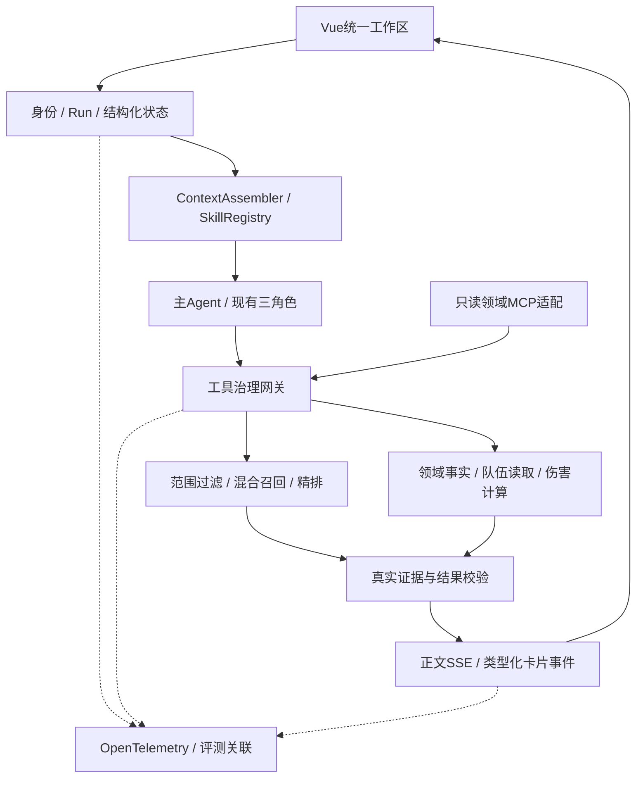

# VIO v1.1 智能体能力升级开发方案

日期：2026-11-12。状态：**设计完成，功能尚未开始开发**。

稳定基线：`v1.0.0`（提交`d2e3d19541b2839e050be65ecacf26f586977d30`）；升级分支：`codex/v1.1-agent-upgrade`。本文不替代历史“正式版v1.1开发计划”，是基于当前本地产品与本轮岗位调研的新一轮能力升级，任务统一使用U0～U6编号。

## 1. 目标与范围

围绕已有产品改善三个问题：检索命中后内容仍不够相关；回答以长文本为主、操作衔接不足；新增角色或检索策略的效果缺少统一独立对照。

交付六项增量：**检索精排、结构化答案卡片、上下文与Skills、统一可观测性、领域MCP、独立评测闭环**。保留Java / Spring Boot / Vue架构，保持主Agent与现有工具权限边界，不重写为另一套框架。

### 1.1 基线能力和差距

| 方向 | 当前已有 | 本轮增量 |
| --- | --- | --- |
| 检索 | 范围过滤、BM25、Embedding、RRF、缓存与降级 | 候选扩展、重排、去重、有效性检查及相关性评估 |
| 界面 | 流式正文、图鉴卡片、队伍预览 | 类型化培养/队伍/伤害/证据卡片及安全操作 |
| 状态与角色 | 结构化目标、三角色进程内顺序协作 | 按任务装配上下文、版本化任务Skills、过期证据剔除 |
| 观测 | Run/Trace、usage、耗时与失败类别 | 标准Span、上下文传播、可视化链路、评测关联 |
| 工具集成 | Java领域工具、已有可选MCP适配 | 小范围只读领域MCP Server和端到端契约验证 |
| 质量 | 68项已知业务回归、自动化检查 | 未参与调试的新题、对照实验、发布质量门禁 |

### 1.2 本轮不做

不以增加Agent数量、微调、Kubernetes、百万级向量库作为完成条件。暂不向MCP开放保存队伍、任意文件、终端或任意URL抓取。不承诺未完成任务跨重启自动恢复。公网部署与生产高可用独立验收。

## 2. 总体架构与数据流



原则：身份、版本、预算、授权由程序掌握；Skills只能收窄工具范围。事实与计算从实际输出生成，模型负责有依据的说明。外部协议与页面操作均不能绕过原保存确认链。

## 3. 分阶段任务与依赖

| 阶段 | 交付 | 前置条件 | 完成判据 |
| --- | --- | --- | --- |
| U0 | 配置、独立题集与实验基线 | v1.0.0冻结 | 题集/判据/指纹冻结，基线可复现 |
| U1 | 检索精排 | U0 | 相关性和引用指标达门禁，失败回退BM25/RRF |
| U2 | 结构化答案与业务卡片 | U0；与U1可分开实现 | 字段可验证、流式兼容、按钮安全 |
| U3 | Context Engineering与Skills | U1/U2接口稳定 | 选对任务、按需装配、证据失效正确 |
| U4 | OTel可视化链路 | U0指标契约；可提前做基础埋点 | 完整Trace、脱敏、额外开销可控 |
| U5 | 领域MCP Server | U3授权/任务边界稳定 | 只读工具可调用，身份和版本不可伪造 |
| U6 | 独立验收与v1.1候选 | U1～U5 | 回归、独立验证、故障和回退全部留证 |

默认按表中顺序推进，每完成阶段更新本文状态和验收记录。U0/U6构成评测闭环，评测不留到全部开发完成后才补。

## 4. U0：基线、实验与配置契约

### 4.1 任务清单

- [ ] U0-01：登记Git提交、profile、模型/Prompt版本、依赖、语料指纹和索引状态。
- [ ] U0-02：编写并冻结至少40道新题，避免照抄既有68题；按资料、检索、长对话、计算、授权/缺项各8题分层。
- [ ] U0-03：冻结rubric与相关片段标签；预先区分可答、需澄清、应拒绝、依赖外部服务失败。
- [ ] U0-04：实现采集和报告适配，优先复用tools/campus与evaluation/campus，避免复制第二套账本。
- [ ] U0-05：冻结延迟、调用和usage定义，先测本机基线，再决定最终性能门槛。

新40题可分20题开发集、20题封存验收集。封存题在验收前不用于调Prompt；一旦失败并参与修复，转为回归题，另补新验证题。单一开发者编题不称第三方盲审。

### 4.2 记录格式（拟新增）

```json
{
  "schemaVersion": "upgrade-evaluation-v1",
  "caseId": "U0-RAG-001",
  "candidateCommit": "实际提交",
  "datasetSha256": "实际摘要",
  "profileFingerprint": "不包含凭证的配置摘要",
  "expected": {"relevantChunkIds": [], "requiresClarification": false},
  "observed": {"runId": "实际Run", "toolCalls": 0, "ttftMs": null},
  "verdict": "PASS/FAIL/BLOCKED",
  "reviewMethod": "deterministic/manual/ai-assisted"
}
```

实际Token usage、估算和参考成本分别记账；未知值保留null。保存首次结果、失败文本与人工/AI辅助意见，不用COMPLETED代替内容判定。

## 5. U1：混合检索后的精排

### 5.1 当前入口和设计

源码：`pokemon/guides/SqliteGuideKnowledgeRetriever`、`LocalGuideSemanticSearch`、`GuideEmbeddingClient`，包前缀均为`src/main/java/com/vio/vioaiagent/`。

当前按query.topK截断；引入精排前先区分`candidateK`与`answerTopK`，否则精排无法挽回已经丢失的相关片段。建议初值candidateK=12、answerTopK=4，语料少时取实际候选量；后续以评测调整。

链路：适用范围过滤 → 词法/语义召回 → RRF融合候选 → 规范片段去重 → 精排 → answerTopK → 证据绑定。

拟新增接口：`GuideReranker`、`RerankRequest`、`RerankResult`及可选HTTP适配器。请求只含问题与必要片段；返回候选索引与有限分数，映射回原canonical片段。外部服务不能返回新来源、改正文或引入越权片段。

### 5.2 任务清单

- [ ] U1-01：抽离候选预算，保留现有版本/语言/规则/主题过滤。
- [ ] U1-02：增加可替换精排接口，优先兼容单一供应商或本地实现，避免默认新增Python服务。
- [ ] U1-03：校验空结果、重复/越界索引、NaN/无穷分数、响应大小及超时。
- [ ] U1-04：精排失败回退原RRF候选顺序，输出实际降级状态。
- [ ] U1-05：记录召回排名、精排排名、耗时、选中片段与版本；限制片段总Token预算。
- [ ] U1-06：建立培养、伤害、机制、同名/错版本等相邻干扰用例。

拟新增开关：`VIO_GUIDE_RERANK_ENABLED`（默认false）及ENDPOINT/MODEL/API_KEY/TIMEOUT_MS/CANDIDATE_K配置。**这些名称是设计，不是当前可用环境变量。**配置类校验URL与参数，Key不进入toString、日志或指纹。

### 5.3 验收和回退

在同指纹数据上比较BM25、现有HYBRID、HYBRID+精排。新题检索统计Recall@k、MRR或nDCG，回答另评引用和完整性。候选不足明确说明，不以精排高分证明真实性。

建议质量门槛：范围越界为0、伪造来源为0、目标相关片段排序不劣于基线；如收益不足则保持默认关闭。精排超时不得使原本可回答的查询失败。具体耗时阈值在U0实测后冻结，不预写“性能提升百分比”。

## 6. U2：类型化答案与生成式UI

### 6.1 输出契约

正文SSE保持兼容，增加版本化`answer.block`事件（拟新增）。只有完成Schema和证据校验的卡片才能发布，不向页面展示半段JSON。块使用稳定blockId及revision，游标重连按Run/事件/块标识幂等消费。

| 块类型 | 核心字段 | 可信来源 |
| --- | --- | --- |
| pokemon | formId、名称、属性、版本、证据ID | 图鉴工具实际字段 |
| teamSuggestion | 成员、配置、角色说明、缺项 | 实际资料/候选与受约束建议 |
| trainingPlan | 目标、等级/EV、条件、步骤 | 核对资料与模型策略，分别标注 |
| damageResult | 双方、招式、条件、范围、HP、假设 | 引擎真实输入输出 |
| evidence | 来源、片段、获取/核对时间、范围 | 现有canonical证据 |

区分`FACT`、`ADVICE`、`ASSUMPTION`与`MISSING`。schemaVersion、runId、blockId和引用ID必需；API Key、账号凭证与内部堆栈禁止进入块。

### 6.2 前后端实现任务

- [ ] U2-01：设计Java DTO及JSON Schema，在契约目录登记并更新前端类型。
- [ ] U2-02：事实/计算字段直接组装；仅将策略说明交给模型，禁止模型改写工具数值。
- [ ] U2-03：扩展现有回答发布器；Schema失败降级为安全正文/缺项，不强行展示坏卡片。
- [ ] U2-04：Vue增加队伍、培养、伤害和证据组件，复用现有图鉴与预览组件。
- [ ] U2-05：支持展开、复制、图鉴联动和“导入为草稿”；不自动保存。
- [ ] U2-06：确认修改仍绑定快照与账号，冲突后重新核对，不直接接受卡片传入的保存权限。
- [ ] U2-07：覆盖长中文、未知名称、空字段、窄屏、键盘、断网补读、重复事件和未知块类型。

服务端限制块数量、文本长度与嵌套层级；链接协议与来源白名单分别校验。模型不得生成任意HTML/JS让页面执行。

### 6.3 完成标准

图鉴跳转目标正确；完整配置不丢太晶/EV/IV；卡片数值与实际工具一致；取消与重连不重复操作；老客户端忽略未知事件后仍正常显示正文。保存必须继续通过预览确认。

## 7. U3：Context Engineering与任务Skills

### 7.1 设计边界

保留现有三角色和业务状态，新增`ContextAssembler`与只读`SkillRegistry`（拟命名）。这是任务知识的模块化，不是新建更多Agent。当前状态与工具证据仍由程序管理，Skill不能授予授权、修改身份或自动执行脚本。

初始任务包：`gym-challenge`、`saved-team-review`、`training-build-review`、`damage-verification`、`competitive-team-reference`。

### 7.2 Skill结构（拟新增目录）

```text
src/main/resources/agent-skills/
  gym-challenge/
    SKILL.md
    examples.json
    references.md
```

元数据包括id/version/description/requiredInputs/allowedTools/outputKinds/referenceVersions。先加载短元数据，匹配后只加载必要正文和引用；记录选中版本与装配摘要。

### 7.3 上下文装配顺序

身份与版本（程序可信） → 当前问题 → 当前结构化目标 → 必要近期历史 → 匹配Skill → 本次工具证据。不同来源明确标记信任层级，召回文本不能升级为系统指令。

队伍修改后重新读取；切馆主、阶段、版本或计算条件时清理对应旧证据。摘要不能替代原始授权/工具输出，压缩时保留缺项与否定条件。

### 7.4 任务与验收

- [ ] U3-01：实现元数据解析和版本/schema校验，限制加载目录与大小。
- [ ] U3-02：Skill白名单与当前Run/角色工具取交集；不能扩大权限。
- [ ] U3-03：ContextAssembler按优先级分配Token预算，保留系统/当前问题和授权边界。
- [ ] U3-04：覆盖“不要修改”、序号不明、跨版本、已保存/建议混淆、9轮填充和任务切换。
- [ ] U3-05：对照关闭/开启Skills的相同输入，核对任务选择、证据完整性、Token与耗时。

拟新增`VIO_AGENT_SKILLS_ENABLED=false`开关。错误Skill或未知版本不悄悄启用；回退现有流程并记录原因。验收要求越权0、身份混用0、已知长对话回归不退化；不能仅凭Token减少宣称质量提高。

## 8. U4：统一Trace与效果关联

### 8.1 Span与标识

基于已有Micrometer/Run观测盘点后接OpenTelemetry，优先复用已存在的Instrumentation，避免重复埋点。Java工作线程与工具执行器显式传播上下文，清理ThreadLocal，防跨请求串Trace。

拟Span树：`agent.run` → `context.assemble` / `agent.plan` / `retrieval.lexical` / `embedding.query` / `retrieval.rerank` / `tool.execute` / `answer.validate` / `answer.publish`。

记录runId、role、toolName、Prompt/Skill版本、模型标识、语料指纹、耗时、usage与失败类别。不把runId/userId等高基数字段当Metrics标签；不默认采集正文、Key、Cookie和完整工具参数。

### 8.2 任务与验收

- [ ] U4-01：确定SDK/Agent与OTLP导出方式，按现有Spring版本兼容验证。
- [ ] U4-02：开发/本机可使用本地Collector和Trace查看器，默认无导出也能正常运行。
- [ ] U4-03：增加采样、脱敏、长度限制、有界队列和导出失败降级。
- [ ] U4-04：报告绑定evaluationCaseId与Trace，链接一次失败的模型、检索和工具事件。
- [ ] U4-05：比较首个可见正文TTFT与总耗时，不把排队事件当首字。

验收：正常、工具失败、取消、断流各有完整链路；双Run无串线；导出器不可达不拖垮问答；关闭导出可恢复原模式。额外开销通过U0实测门槛判定。

## 9. U5：只读领域MCP Server

### 9.1 工具范围和传输

首批只开放图鉴、配招核对、伤害计算三个能力；复用服务层和网关，不经HTTP绕回自身，也不复制权限/校验。优先验证本地STDIO接入；若另选Streamable HTTP，则单独实现连接、身份、Origin与会话校验。

已有MCP客户端依赖不代表领域Server已完成，须先核对当前SDK/协议版本再决定兼容升级。MCP是工具连接协议，不是角色间自动协商协议。

### 9.2 身份与运行范围

外部客户端不能直接声明userId/runId冒充内部请求。适配器创建受控执行范围并绑定调用方；默认只读公共资料。伤害输入不得携带任意Node路径或命令；不允许客户端把工具名当授权。

### 9.3 任务与验收

- [ ] U5-01：明确协议版本、工具Schema、错误输出与资源上限。
- [ ] U5-02：实现本地适配器，分别验证工具发现、参数错误、取消、超时与正常结果。
- [ ] U5-03：限制并发、参数体积与返回大小，版本/模型条件沿用领域校验。
- [ ] U5-04：恶意参数、未知工具与伪造身份必须拒绝；日志不泄露凭证。
- [ ] U5-05：用独立兼容客户端真实调用，证明无需网页也能取得相同事实/数值。

验收：同输入与网页领域工具结果一致，保存/终端工具不可发现或执行；关闭MCP不影响原网页。写工具在后续单独设计，不纳入本阶段。

## 10. U6：质量门禁、发布候选与回退

### 10.1 必须通过

| 层次 | 核验 |
| --- | --- |
| 单元/契约 | 参数、Schema、排序、卡片、Skill、权限和错误状态 |
| HTTP/浏览器 | SSE兼容、游标、账号隔离、图鉴联动、草稿/预览、冲突与窄屏 |
| 故障 | 精排/Embedding503、维度错误、索引损坏、坏结构化输出、OTLP不可达、上游EOF |
| 既有业务回归 | 现有68题重新执行，逐项记录正文与实际事件 |
| 独立验证 | 冻结新题保留首答，区分环境阻塞和应用失败 |
| 对照实验 | 单项开关对照，再执行全组合；比较质量、延迟、usage和工具数 |

硬门禁：越权/跨账号/伪造保存/篡改工具数值/伪造来源为0；已知安全与确定性计算用例不得退化。开放策略回答使用预先冻结rubric复核，不以语义相似度代替正确性。

基准样本不足或统计不稳时写明限制，不报告不存在的显著提升。建议功能开关默认false，逐项达到门禁后再决定默认开启。

### 10.2 回退矩阵

| 新能力失败 | 回退 |
| --- | --- |
| 精排 | 原RRF/BM25路径，保留真实降级状态 |
| 卡片Schema | 已验证正文/缺项；不生成坏卡片、不执行动作 |
| Skill/装配 | 现有Prompt与状态流程；权限不变 |
| Trace导出 | 本地已有诊断，问答不依赖观测后端 |
| MCP | 关闭新入口，原网页继续使用 |

配置回退前后不清空个人数据库。新SQLite字段/表用可追踪迁移，旧版不应因加载新可选能力而启动失败；不可逆迁移单独评审与备份演练。

### 10.3 交付清单

- [ ] 更新README、公开配置模板与新手操作说明。
- [ ] 保存评测集版本、首次结果、Badcase、修复与最终报告。
- [ ] 给出功能开关、数据迁移、回退和外部服务成本说明。
- [ ] 明确剩余缺口，更新学习路线/面试题中实际已实现部分。
- [ ] 新建PR审查后合并main，创建新的候选/正式标签，不覆盖v1.0.0。

## 11. 实施时需要用户配置的内容

现有DeepSeek和Embedding继续沿用本机配置。U0～U3可先做接口、Fake服务、契约与本地验证，不因尚未购买新服务停工。

1. 精排：确定支持的模型、端点和额度；也可先使用本地实现。接入完成后再按公开模板填写Key，不能把聊天或Embedding Key默认视为通用凭据。
2. Trace：选择本地查看器/Collector或已有受信任服务，默认不上传原始正文。
3. MCP：准备一个兼容客户端；只有需要远程服务时才配置HTTPS与认证。
4. 质量：检查冻结rubric，复核策略答案的领域正确性；不要把AI辅助评分写成人工通过。

未来新增变量应在实现时正式登记，本文的拟命名不是立即可用配置。模型结构化输出、精排协议和SDK版本需真实验证，不因“兼容API”而假设功能齐全。

## 12. 分支操作与协作约定

```powershell
git fetch origin --tags
git switch codex/v1.1-agent-upgrade
git pull --ff-only
git status
```

其他设备若没有本地分支，使用`git switch --track origin/codex/v1.1-agent-upgrade`。有未提交修改时先检查归属，不能直接reset/clean；不强推稳定分支或标签。main只接收审查后的稳定变更。

阶段记录模板：任务ID、起止提交、修改文件、配置/数据指纹、预期、实际证据、失败与原因、验收人/方式、回退验证、剩余问题。

## 13. 岗位与技术依据

调研日期：2026-11-12。部分官方职位正文来自搜索索引，职位状态与届别投递前再核对；下面是技术方向依据，不是所有公司统一门槛。

- [美团AI应用校招](https://zhaopin.meituan.com/web/position/detail?highlightType=campus&jobShareType=1&jobUnionId=4694862735)：应用、RAG、工具、工作流及工程基础。
- [小红书AI应用校招](https://job.xiaohongshu.com/campus/position/22021)：上下文、生成式UI、评测与Badcase。
- [美团Agent社招](https://zhaopin.meituan.com/web/position/detail?highlightType=social&jobUnionId=4428189649)：规划/执行/评估、可观测与工程化；经验要求不套成秋招门槛。
- [小红书AI全栈](https://job.xiaohongshu.com/campus/position/17376)：Skills、MCP、工具编排与交付。
- [Spring AI RAG](https://docs.spring.io/spring-ai/reference/api/retrieval-augmented-generation.html)、[结构化输出](https://docs.spring.io/spring-ai/reference/api/structured-output/converters.html)：按项目锁定版本选接口，不直接照搬新版API。
- [Agent Skills](https://www.anthropic.com/research/equipping-agents-for-the-real-world-with-agent-skills)：按需加载和知识模块化思路。
- [OpenTelemetry Java](https://opentelemetry.io/docs/languages/java/)与[MCP架构](https://modelcontextprotocol.io/docs/learn/architecture)：标准链路与工具连接协议。

## 14. 当前进度

| 阶段 | 状态 |
| --- | --- |
| 正式基线与分支 | v1.0.0标签及main已推送；本方案提交到codex/v1.1-agent-upgrade |
| U0 | 待开发 |
| U1 | 待开发 |
| U2 | 待开发 |
| U3 | 待开发 |
| U4 | 待开发 |
| U5 | 待开发 |
| U6 | 待执行 |

下一步从U0开始，先建立独立基线，再接入精排；本文提交不代表上述功能已实现。
