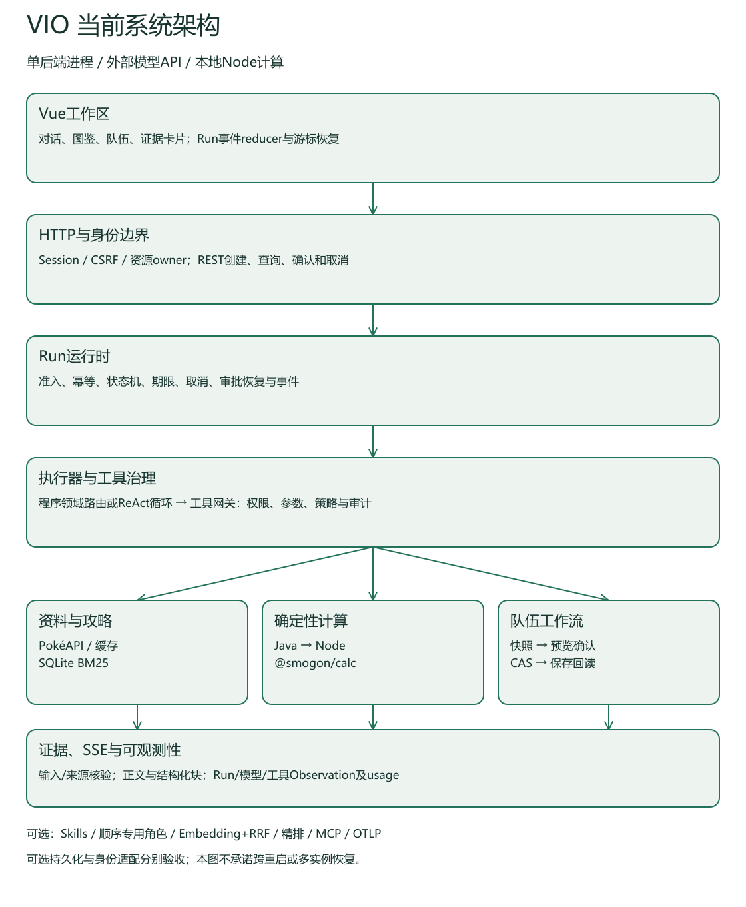
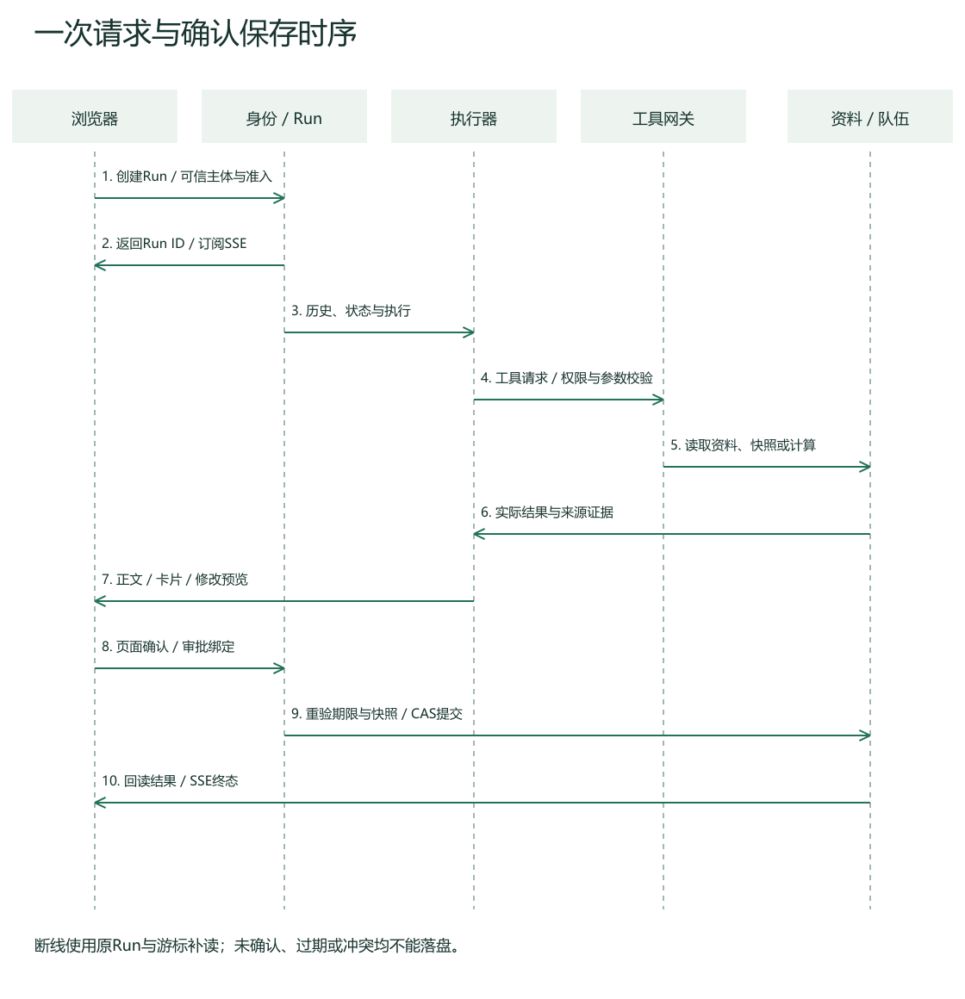

# VIO 项目架构详解

更新：2026-11-20。依据当前v1.1主线源码静态核对，不代表重新完成部署验收。产品是单后端进程的模块化应用：Vue SPA提供交互，Spring Boot编排任务，外部API提供模型，Node提供确定性计算。本地默认路径与可选部署能力分别说明。

## 1. 系统全景与模块职责

配置启用、组件就绪、某次请求实际使用是三种状态，需分别由诊断、索引状态和事件证明。

| 层次 | 职责 | 核心代码 |
| --- | --- | --- |
| 页面与交互 | 对话、图鉴、队伍、卡片及确认操作 | [GameMaster.vue](../../vio-ai-agent-frontend/src/views/GameMaster.vue)、[ChatRoom.vue](../../vio-ai-agent-frontend/src/components/ChatRoom.vue) |
| 前端任务状态 | Run身份、游标、重连、single-flight和reducer | [useRunStream.js](../../vio-ai-agent-frontend/src/composables/useRunStream.js)、[run-contract.js](../../vio-ai-agent-frontend/src/api/run-contract.js) |
| API与身份 | HTTP适配、Session/CSRF、资源归属与错误映射 | [AgentRunController](../../src/main/java/com/vio/vioaiagent/controller/AgentRunController.java)、[本地安全链](../../src/main/java/com/vio/vioaiagent/config/LocalAccountSecurityConfiguration.java) |
| Run运行时 | 准入、幂等、状态、超时/取消、审批恢复与事件 | [PokemonAgentRunService](../../src/main/java/com/vio/vioaiagent/run/PokemonAgentRunService.java)、[RunAdmissionController](../../src/main/java/com/vio/vioaiagent/run/RunAdmissionController.java) |
| 执行与规划 | 领域直答、多轮状态、模型工具循环 | [DefaultRunExecutor](../../src/main/java/com/vio/vioaiagent/run/DefaultRunExecutor.java)、[ToolCallAgent](../../src/main/java/com/vio/vioaiagent/agent/ToolCallAgent.java) |
| 工具治理 | 身份、白名单、Schema、出口策略、HITL、有限重试与审计 | [ToolExecutionGateway](../../src/main/java/com/vio/vioaiagent/tools/governance/ToolExecutionGateway.java) |
| 领域证据 | 参考事实、版本攻略、队伍快照与计算结果 | [LocalGuideSearch](../../src/main/java/com/vio/vioaiagent/pokemon/guides/LocalGuideSearch.java)、[LocalDamageEngine](../../src/main/java/com/vio/vioaiagent/pokemon/engine/LocalDamageEngine.java) |
| 提交与存储 | 审批绑定、版本检查、事务CAS与回读 | [TeamWorkflowService](../../src/main/java/com/vio/vioaiagent/pokemon/team/TeamWorkflowService.java)、[SQLite队伍仓储](../../src/main/java/com/vio/vioaiagent/pokemon/repository/SqliteSavedTeamRepository.java) |
| 质量与观测 | Run/模型/工具追踪、用量与独立评测 | [ModelUsageLedger](../../src/main/java/com/vio/vioaiagent/observability/ModelUsageLedger.java)、[评测工具](../../tools/campus/campus-independent-20261120.mjs) |

从当前页面调用的API阅读源码。仓库保留的AiController、GameApp及早期实验入口不全部属于当前工作区主链；DefaultRunExecutor自身也有不同配置分支。

## 2. 核心请求与确认保存时序

1. 浏览器携带会话创建Run；服务端解析可信主体和版本，检查幂等、准入，再返回任务身份。202只表示受理。
2. 浏览器订阅事件；执行器装配历史与领域状态。有限事实和机制可程序直答，其他任务进入模型工具循环。
3. 模型产生工具请求，网关校验后执行；真实输入、结果和来源回到执行器，与当前Run绑定。
4. SSE发布正文及结构化块。程序分段发布与供应商逐Token生成分别解释，answer.delta不一定来自模型。
5. 要求修改时先读真实队伍快照，生成差异预览并等待审批；模型建议本身不写入。
6. 用户从可信接口确认，服务端重验主体、Run、审批、摘要、期限、执行资格及快照，再条件更新并回读。
7. 发布业务终态；断线后用原Run和游标补读，不重新创建任务。

不变量：确认前不写；旧快照不覆盖；终态不反转；未知用量不按零；晚到结果不能绕过提交资格。

## 3. Agent：程序路由与模型规划

当前并非每轮都由模型自主规划。有限规则使用程序路由保持数值、版本及输出范围一致；开放任务进入ReAct风格think/act循环。每次工具调用都需网关校验，并受步数、错误、上下文、调用和时间预算限制。模型工具JSON是待验证请求，不是已执行事实。

多轮状态以owner及conversation范围历史重建馆主、阶段和意图；当前纠正覆盖旧值，无关新问题不继承旧目标。TaskContextAssembler按完整旧轮裁剪，当前请求和工具调用/响应配对不可拆散；保护内容仍超限则明确失败。

可选Skills装配六份任务知识。资料、组队、伤害专用角色在同一worker顺序协作，复用身份、模型、网关及共享预算，不是多进程并行集群。交接实际工具证据，私有规划文本不升级为事实。收益需与单主Agent配对评估。

## 4. RAG与事实证据

检索链：查询及范围 → 适用片段过滤 → BM25候选 → 可选Embedding与RRF → 可选精排 → 选中片段及原文来源 → 回答证据。

默认攻略路径在SQLite持久化文档、分块和词项，由程序计算BM25。可选语义路径保存向量，按模型、维度和内容检查索引，做余弦搜索和RRF融合；不宣称已验证大规模ANN服务。精排校验完整分数与候选索引，超预算或异常时保留可用排序并记录回退；取消继续传播。

图鉴、攻略、公开竞技样例和私人队伍分别作为证据源。世代、规则、语言、修订和来源时间需匹配；内容摘要证明一致性，不证明事实绝对正确。无答案、服务故障和缺失输入不能混为一种结果。

已有8题开发实验仅支持混合MRR高于BM25、额外精排持平的结论，不支持生产SLA。新增30组48轮评测尚待执行与人工审核。

## 5. 写入一致性与审批边界

流程：owner限定快照及revision → 差异预览 → 绑定Run/动作/参数摘要 → 用户确认 → 重验授权与状态 → CAS更新 → 回读与回执。

SQLite更新条件含id、owner和revision，未更新到行表示冲突。synchronized只协调同JVM调用，数据库条件更新覆盖其他访问者的竞争。提交前资格检查失败应使事务回滚。TTL过期与快照冲突分别处理；重复确认复用既有回执。

数据库事务不包含远程模型和任意外部副作用，不能宣称跨系统exactly-once。网络超时不证明对方未执行，未知效果需核实，不能盲目重试写操作。

## 6. 存储与恢复边界

| 状态 | 当前默认本地理解 | 不应推断的保障 |
| --- | --- | --- |
| 账号、历史、队伍与索引 | 依local配置保存在本机文件/SQLite | 不自动跨设备同步或多节点共享 |
| 执行中的Run及事件 | 默认本地实现与持久化适配分开核对 | 历史落盘不等于执行中任务可重启恢复 |
| 待确认预览 | 与工作流、Run及快照绑定 | 不宣称全部审批可跨进程无损恢复 |
| PostgreSQL/Flyway、Redis、OIDC | 可选配置与实现，分别验收 | 依赖已声明不等于部署已完成 |
| 在线来源与缓存 | 缓存提高可用性，仍核对版本和来源 | 不保证实时最新，空缓存可能受上游阻塞 |

SQLite备份需考虑WAL并实际恢复。代码回滚不自动回滚迁移；跨实例准入、幂等、审批和任务恢复需按目标配置单独验证。

## 7. 安全、观测与取消

Session和CSRF保护Web入口，资源服务继续校验owner。提示、检索原文和模型参数不能提供身份授权。实际工具能力受主体权限与角色白名单约束；只读MCP复用治理边界，不因协议切换扩大权限。

Run ID关联业务任务，Trace/Span关联执行阶段，工具线程和审批恢复需传播上下文。指标使用低基数标签，具体Run放受控日志与追踪。供应商usage、估算Token和参考费用分别记录，缺数据保留未知。

取消贯穿浏览器、Run、工具、MCP和子进程；Future取消不证明供应商停止计费。提交资格检查防止晚到结果落盘。浏览器断线只触发恢复，不直接等价于业务取消。

## 8. 部署与故障处理

开发：浏览器 → Vite代理 → Spring Boot。单机部署：Nginx提供静态页面并转发API/SSE，后端访问本机数据、Node及外部模型和资料服务。代理缓冲和超时需真实验证。角色、语义、精排、追踪独立配置。

| 故障 | 证据与处理 |
| --- | --- |
| 模型超时或正文后断流 | 证明真实调用，保留部分正文，明确失败，不伪装完成 |
| Embedding或精排异常 | 核对就绪和实际调用，按实现降级或拒绝，记录原因 |
| 资料503且无缓存 | 明确服务故障，不冒充物种不存在 |
| 浏览器断网 | 同Run与游标补读，无第二次创建与重复正文 |
| 旧预览或取消竞争 | 校验审批、期限、快照及资格，拒绝并回读真实状态 |
| 准入满载 | 按全局/租户/主体容量有界拒绝，验证预留释放 |

## 9. 取舍与演进

模块化单体减少本地基础设施；Java/Spring承载后端治理，Vue负责交互；外部模型降低推理部署负担；固定计算引擎提供可复现数值；预览确认限制模型建议的写入影响。

代价包括本机状态边界、核心编排类职责偏多、规则覆盖有限、外部服务网络依赖和评测样本较小。优先完成独立题、人工审核及目标部署恢复，再测量瓶颈、按需拆分编排或共享状态，不在无负载证据时承诺高并发与多实例一致性。

## 10. 三方向白板讲解

AI应用围绕“输入如何变成有证据的答案”：工具循环、版本检索、上下文、计算与评测。

AI全栈围绕“用户任务如何可靠完成”：页面、Run、SSE、工具、卡片、确认与保存恢复。

全栈围绕“状态与数据如何保持一致”：接口、身份、事务CAS、并发幂等、前端异步、代理与备份。

自查：画出一次请求及一次写入，指出可信边界、持久化位置和可选组件；解释模型断流、浏览器断线与数据库冲突的区别，明确未验收能力。配套[完整学习文档](三方向完整学习文档_2026-11-20.md)、[535题面试文档](三方向完整面试文档_2026-11-20.md)。
