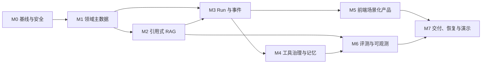

# VIO 正式版 v1.0 分阶段开发计划

> 关联规格：[`v1.0需求规格与完成定义_spec.md`](./v1.0需求规格与完成定义_spec.md)  
> 关联手册：[`正式版v1.0开发步骤手册.md`](./正式版v1.0开发步骤手册.md)  
> 源码基线（计划编写时的历史快照，非当前工作树）：`main@708126a691bd7a789ddb261d11bb464caa96a45e`
> 计划状态：本计划已用于一轮 M2～M7 实施；目标仍未全部通过生产验收。本文件保留目标步骤，不是代码变更记录，也不替代测试结果。实际落地、测试证据和发布阻断项见 [`M2-M7实施完成记录.md`](./M2-M7实施完成记录.md)。

## 1. 计划目标

用一条可回退的迁移路径，把**历史基线**模块化单体中的 `AiController → GameApp/VioManus` 演示链，收敛为：

```text
请求认证
→ 上下文确认
→ 确定性路由
→ 事实/计算/RAG/受限 Agent
→ 结构化 Run 事件
→ 持久化、引用、反馈和评测
→ 观测、发布和回滚
```

默认周期为 8 周（每周 5 个工作日），可按个人投入压缩，但不能跳过 M0、M1、M2 和最终验收。阶段编号是依赖顺序，不是必须的日历日期。

## 2. 依赖关系



**关键原则**：先让系统在干净环境可启动，再增加领域能力；先让单 Agent 的边界可控，再考虑 MCP、Skills 或多 Agent。

## 3. 里程碑总表

| 阶段 | 参考工期 | 交付重点 | 进入条件 | 退出条件 |
|---|---:|---|---|---|
| M0 | 3～5 天 | 构建、测试配置、路由、认证、异步和高危工具基线 | 已阅读规格并冻结支持矩阵 | 测试无启动错误；基础聊天/cancel/限流可复现 |
| M1 | 5～8 天 | 版本化宝可梦主数据和确定性计算 | M0 通过 | 事实、属性、伤害、合法性测试达到门槛 |
| M2 | 5～8 天 | PostgreSQL FTS + PGVector、摄取、引用、拒答 | M1 数据键稳定 | 可重建索引；Recall/引用/版本过滤有报告 |
| M3 | 5～8 天 | 唯一 Run、事件游标、持久会话、队伍和反馈 | M1、M2 契约稳定 | 重启/断线/删除/纠错闭环可演示 |
| M4 | 3～5 天 | Tool Governance、HITL、Memory 边界、MCP 开关 | M3 Run 可记录 | 越权和高危执行为 0；MCP 只经统一网关 |
| M5 | 3～5 天 | 场景化 Vue 页面、结构化事件、单飞锁 | M3 事件契约 | 卡片、引用、错误态、取消和重连通过 E2E |
| M6 | 3～5 天 | 黄金集、Micrometer、Prometheus、Grafana、CI 门禁 | M2～M5 有稳定接口 | 每次发布能输出质量/延迟/成本证据 |
| M7 | 3～5 天 | 多阶段镜像、Compose、备份恢复、灰度回滚和秋招材料 | M6 质量门禁通过 | 干净环境一键启动，恢复与回滚演练通过 |

## 4. 每日工作循环

每个工作日只做一个可验证切片：

1. **读**：确认入口、调用方、数据结构和已有测试，不先写抽象。
2. **设计**：写接口/状态/错误和回滚点，说明复用哪个现有类。
3. **写**：按 Controller、Service、Repository、Client/Adapter、DTO 分层实现。
4. **测**：先单测，再集成/契约；依赖失败和权限失败必须有用例。
5. **记**：在 [`v1.0开发日志模板.md`](./v1.0开发日志模板.md) 写命令、结果、证据和下一步。

每个切片的最小提交单位应是“一个业务行为 + 测试 + 文档”；是否提交由开发者自行决定，本次任务没有执行任何 commit。

## 5. M0：可信基线与安全止血

### 目标

让 fresh checkout 能构建，测试上下文不因缺失 MCP 文件失败；消除默认密钥、重复 `/api`、全开放 CORS、URL API Key、双层异步和公网高危工具暴露。

### 建议顺序

| 步骤 | 主要文件/目录 | 结果 |
|---:|---|---|
| 0.1 | `pom.xml`、`mvnw.cmd`、`src/main/resources/*` | 记录 Java/Spring AI 版本和 profile 预期 |
| 0.2 | `mcp-servers.example.json`、测试 profile | 明确 MCP 测试替身或默认关闭；不再依赖不存在的真实配置 |
| 0.3 | `MetricsController`、`HitlController`、`SecurityConfig` | 统一 context-path，补 MockMvc 路由认证测试 |
| 0.4 | `application-prod.yml`、`docker-compose.yml`、`.env.example` | Secret 必填、删除公开 fallback、限制 CORS |
| 0.5 | `AiController`、`BaseAgent`、`AgentConcurrencyGuard` | 只保留一个异步边界，stop/timeout/release 对称 |
| 0.6 | `ToolRegistration`、工具类、`HitlManager` | 只读宝可梦工具进入玩家白名单，高危工具默认拒绝 |
| 0.7 | 前端 `src/api/index.js` 和三个页面 | 暂时采用单飞锁，移除 URL 中的 API Key |

### 验证与退出门槛

```powershell
./mvnw.cmd -q -DskipTests compile
./mvnw.cmd test
git diff --check
```

补充 MockMvc 断言：`/api/ai/**` 无凭据返回 401；`/api/health` 和 `/api/ready` 按约定可访问；`/api/api/**` 不存在；stop 请求必须携带同源 Session/CSRF。记录 Surefire XML，而不是只看进程退出码。

### 回滚点

保留旧聊天端点作为短期兼容层，新增 `vio.agent.v1.enabled` 开关；如果新 Run 链失败，可把玩家流量切回只读 fact/RAG 端点，但不能重新打开 Shell、任意文件写入或默认密钥。

## 6. M1：版本化领域模型与确定性计算

### 目标

把“模型记忆中的宝可梦知识”替换为可查询的标准答案，把属性、伤害、速度线和合法性从 Prompt 中拿出来，形成纯函数/领域服务。

### 实施切片

1. 建立 `game_release`、`data_release`、`pokemon_species`、`pokemon_form`、`form_fact_version`、`move_fact_version`、`learnset_version`、`ruleset_version` 等表和 Flyway 迁移。
2. 设计 `PokemonFactQuery`、`BattleCalculationService`、`TeamLegalityService` 的输入/输出 DTO；所有请求必须携带版本键。
3. 将稳定身份与版本事实分离；禁止用 `UPDATE` 覆盖已发布事实，用新 `data_release` 替代。
4. 将 [PokeTypeTool.java](file:///D:/ai-intern-cjt/my/AI-Agent/src/main/java/com/vio/vioaiagent/tools/PokeTypeTool.java#L16-L106) 的单属性矩阵收敛到可测试的领域计算器，补双属性、免疫、特性和太晶修正的边界模型。
5. 让工具只负责参数适配和结果序列化，计算规则留在 domain/calculator 层；不要在 Tool 方法里堆叠数据库查询和策略判断。
6. 用固定 JSON/CSV 样例建立事实集、全部属性组合和合法/非法队伍集；每个结果保存 `calculation_version`。

### 验证与退出门槛

- 所有确定性断言 100% 通过；非法版本、未知形态、重复招式、超限努力值和禁用成员都能明确报错。
- 同一输入在不同运行中结果字节级一致；数据库 FK、唯一键和有效期约束可由集成测试证明。
- 事实题固定集达到规格中的候选门槛后，才进入 M2；未达标时只修数据/规则，不让模型兜底。

### 回滚点

先以只读查询适配旧 Markdown 数据，保留 `legacy` adapter；新数据库查询按 feature flag 灰度，发现版本过滤错误时可切回旧端点并保留错误样本。

## 7. M2：生产级知识摄取与引用式 RAG

### 目标

让知识入库、切块、向量化、检索和发布成为离线可重试任务；回答能展示证据和版本，证据不足时拒答。

### 实施切片

1. 用 Flyway 创建 `knowledge_source`、`knowledge_document`、`document_version`、`document_chunk`、`ingestion_batch`、`knowledge_release`。
2. 把 [GameAppDocumentLoader.java](file:///D:/ai-intern-cjt/my/AI-Agent/src/main/java/com/vio/vioaiagent/rag/GameAppDocumentLoader.java#L18-L53) 的 classpath 启动时扫描改造成显式 ingestion job；记录 checksum、许可、解析器和 schema 版本。
3. 以隔离区接收文档，执行文件/许可/Schema/去重/冲突校验；失败记录进入 quarantine，不覆盖已发布版本。
4. 启用 [VersionedPgVectorStoreConfig.java](file:///D:/ai-intern-cjt/my/AI-Agent/src/main/java/com/vio/vioaiagent/rag/VersionedPgVectorStoreConfig.java#L18-L52) 前，确认 JDBC、维度、Embedding 模型和 Spring AI `1.0.0` API 兼容；`SimpleVectorStore` 仅保留测试 profile。
5. 实现 PostgreSQL FTS + PGVector 双路召回、元数据过滤、RRF 融合和可选 rerank；不要把结构化事实全部向量化。
6. 让 `EvidenceAssembler` 生成 `documentId/documentVersion/chunkId/sourceUrl/evidenceText/retrievalScore`，并把 `game_release_id`、`ruleset_version_id` 注入过滤器。
7. 建立无证据、版本冲突、过期来源和提示注入样例；回答契约必须支持 `limitations[]` 和 traceId。

### 验证与退出门槛

```powershell
docker compose up -d postgres
./mvnw.cmd test -Dtest=*Rag*,*Document*,*Retrieval*
```

离线报告至少包含 Recall@5、引用正确率、Groundedness、空检索率和拒答正确率；每个数字绑定数据/索引/Embedding/Prompt 版本和样本量。迁移失败、Embedding 超时和索引构建中断都要能重试或回滚。

### 回滚点

维护 `active_index_release` 指针；新索引先构建为候选版本，评测通过后原子切换，失败只删除候选索引并恢复旧指针，绝不原地重建线上索引。

## 8. M3：唯一 Agent Run、事件和持久会话

### 目标

用一个 `PokemonAgentRunService` 拥有执行生命周期，消除 Controller 和 Agent 双重异步；事件可排序、可恢复、可审计。

### 实施切片

1. 定义 `agent_run` 状态：`CREATED → RUNNING → WAITING_APPROVAL → COMPLETED/FAILED/CANCELLED/TIMED_OUT`。
2. 定义 `agent_event`：`schemaVersion/eventId/type/sessionId/runId/traceId/timestamp/payload`；数据库唯一约束保证 `runId + eventId` 不重复。
3. 提供 `POST /chat/runs`、`GET /chat/runs/{runId}/events`、`POST /chat/runs/{runId}/cancel`、会话查询和删除接口；这些是 MVC 路径，默认 `context-path=/api` 时对外访问为 `/api/chat/...`。
4. 浏览器断线只结束订阅，不取消 Run；客户端以 `afterEventId` 或 `Last-Event-ID` 重连；事件过期返回 `410 Gone`。
5. 将 [BaseAgent.java](file:///D:/ai-intern-cjt/my/AI-Agent/src/main/java/com/vio/vioaiagent/agent/BaseAgent.java#L107-L311) 中的线程创建、状态切换、清理和 stop 责任收敛到 Run service；Agent 变成可被编排的执行器。
6. 先持久化 `conversation/chat_message`，再考虑用户授权的长期偏好；窗口记忆和完整历史分开治理。
7. 将已存在的会话/反馈和工具执行绑定 `userId + conversationId + runId`，并为后续队伍、收藏资源预留同样的资源级授权测试；当前工作树尚未提供队伍/收藏持久化读写 API。

### 验证与退出门槛

- 每个 Run 恰好一个终态事件；重复 cancel、重复创建和断线重连都幂等。
- 服务重启后能查询已完成 Run、消息；队伍/收藏查询需待资源 API 落地后验收。不同用户查询返回 404/403，不泄漏资源存在性。
- 用 MockMvc/WebTestClient 或真实浏览器验证事件游标连续、不重复、不乱序。

### 回滚点

保留旧 `/ai/game_app/chat/*` 只读兼容端点，新的 `/chat/runs` 以灰度比例接流量；数据库写入采用向后兼容字段，迁移失败时仍能读取旧消息。

## 9. M4：工具治理、HITL、MCP 与记忆边界

### 目标

把工具执行从“模型返回什么就执行什么”改成统一安检流程；MCP 是可选适配器，不是绕过权限的后门。

### 实施切片

1. 定义 `ToolDescriptor(name/version/riskLevel/sideEffect/idempotent/timeout/allowedRoles/inputSchema/outputSchema)`。
2. 实现 `ToolPolicyEngine → JSON Schema 校验 → NetworkEgressPolicy/SafePathResolver → HITL → 幂等 → 超时/有限重试 → 执行 → 脱敏 → 审计`。
3. 将 [ToolRegistration.java](file:///D:/ai-intern-cjt/my/AI-Agent/src/main/java/com/vio/vioaiagent/tools/ToolRegistration.java#L12-L39) 拆为 `pokemonTools` 和 `adminTools`；玩家主链只注册事实、计算、只读检索和受限报告工具（本轮已落地，详见实施记录）。
4. 基线阶段的 [ToolCallAgent.java](file:///D:/ai-intern-cjt/my/AI-Agent/src/main/java/com/vio/vioaiagent/agent/ToolCallAgent.java#L105-L214) 直接 `ToolCallingManager` 调用已包进 `ToolExecutionGateway`；3000 字截断仍是待补齐项，后续应改为结构化错误和结果引用。
5. [HitlManager.java](file:///D:/ai-intern-cjt/my/AI-Agent/src/main/java/com/vio/vioaiagent/security/HitlManager.java#L28-L129) 已成为 Spring Bean，审批记录绑定用户、Run、参数摘要、过期时间和最终决策；正式路径不再默认批准中/高风险写操作。兼容旧端点的行为和生产持久化仍按实施记录验收。
6. 只保留一条生产 MCP 路径，优先使用 Spring AI MCP Provider；自研 JSON-RPC/STDIO/SSE 代码移到 `mcp-lab`，默认 profile 关闭。
7. 记忆系统先接 `ConversationRepository`，长期偏好必须有授权、TTL、置信度和删除接口；不要继续使用全局 JSON 文件承载多用户记忆。

### 验证与退出门槛

- 100% 高风险未审批调用被拒；路径穿越、命令注入、SSRF、超时和重试边界有红队用例。
- 每次工具调用都有 `tool_execution` 和 traceId；重复幂等键返回同一结果，不重复副作用。
- MCP 开关关闭时应用仍能启动；开启时工具列表、超时、受众和凭据隔离都有集成证据。
- 现代 `/chat/runs` 默认以 `trainer` 角色建立工具上下文；仅允许 `operator/admin` 的管理卡会按设计拒绝，除非接入经过认证的角色映射。该默认拒绝必须在 API 契约和红队报告中明确记录。

### 回滚点

默认只注册本地只读宝可梦工具；MCP 适配器由独立开关控制，远程服务故障时路由到事实查询或明确拒答，不自动暴露原有 Shell/下载工具。

## 10. M5：前端场景化体验与流式恢复

### 目标

让用户看到“上下文—检索—计算—工具—答案—证据”的过程，而不是裸字符串；任何终态都能恢复输入和资源。

### 实施切片

1. 将基线版本 [index.js](file:///D:/ai-intern-cjt/my/AI-Agent/vio-ai-agent-frontend/src/api/index.js#L1-L130) 的 EventSource 查询参数契约改为 `POST create Run + fetch ReadableStream`；本轮已落地 fetch/AbortController 契约，生产认证仍需按部署环境验收，且不得把 API Key 放 URL 或 localStorage。
2. 以 `RunViewModel` 管理 `creating/running/waiting_approval/reconnecting/completed/failed/cancelled/timed_out`，每个 Run 独立保存连接、AbortController、游标和错误。
3. 改造 [ChatRoom.vue](file:///D:/ai-intern-cjt/my/AI-Agent/vio-ai-agent-frontend/src/components/ChatRoom.vue#L1-L257)、`GameMaster.vue`、`SuperAgent.vue`：输入上下文卡、图鉴/配招/计算/引用卡、执行时间线、反馈和错误卡。
4. 首版实行单飞锁，禁止同一对话在非终态发送第二个 Run；后续并行时用 `Map<runId, RunViewModel>`，不能继续依赖全局 `currentEventSource`。
5. 增加过期会话、无证据、版本冲突、429、网络断开和审批等待的 UI；关闭流时释放计时器、AbortController 和监听器。
6. 在 [package.json](file:///D:/ai-intern-cjt/my/AI-Agent/vio-ai-agent-frontend/package.json#L1-L26) 增加 lint/typecheck/unit/e2e 脚本，锁定 `npm ci`；API DTO 与 OpenAPI 版本同步。

### 验证与退出门槛

```powershell
Set-Location .\vio-ai-agent-frontend
npm ci
npm run build
```

随后用浏览器验证：创建 Run、收到首块、刷新后重连、显式 cancel、终态解锁输入、引用可展开、不同会话不串消息。没有真实后端/模型时使用固定 SSE fixture，不把 fixture 结果当成生产效果。

### 回滚点

保留旧 GameMaster 页面作为只读 fallback；新事件渲染失败时展示通用错误卡并保留 runId，不能静默丢失任务。

## 11. M6：评测、可观测性和发布门禁

### 目标

把“看起来能答”变成可重复的质量证据，并让一次失败可以沿 traceId 定位到路由、检索、模型、工具或前端。

### 实施切片

1. 建立结构化事实 200 题、计算全组合、合法性 100 组、RAG 100 题、无答案 50 题、Agent 工具 50 题和安全红队 100 条的版本化数据集。
2. 定义 `evaluation_case/run/result`，保存模型、Prompt、数据、索引、代码 commit、环境和样本量；确定性计算使用程序断言，LLM-as-Judge 只作辅助。
3. 用 Micrometer/Actuator 记录 HTTP、Run 终态、TTFT、P95、Token、成本、检索、工具、审批、反馈和错误预算；不要把自定义 JSON `/api/metrics` 当 Prometheus 格式。
4. 基线目标涉及 [AgentMetrics.java](file:///D:/ai-intern-cjt/my/AI-Agent/src/main/java/com/vio/vioaiagent/observability/AgentMetrics.java#L21-L80)、`MetricsController`、`prometheus.yml`、`grafana-dashboard.json` 和 Compose 的 rule/Alertmanager 挂载；本轮已补齐配置骨架，但 `/actuator/prometheus` 与真实 Targets/Alerts 仍需现场集成验收（见实施记录）。
5. 在 CI 中依次执行后端测试、前端 lint/typecheck/unit/build、契约检查、黄金集评测、安全扫描、镜像构建和 Compose 冒烟；失败不允许用 `continue-on-error` 吞掉。
6. 以“质量阈值 + 最小样本 + 配对比较 + 安全零容忍”作为发布门禁；所有准确率和性能数字必须来自报告。

### 验证与退出门槛

每次候选发布都生成一份不可变报告，至少有：事实成功率、计算正确率、Recall@5、引用正确率、拒答正确率、工具参数正确率、TTFT/P95、Token/成本、错误预算和红队结果。候选值未实测前标记为“待测”，不得写进简历。

### 回滚点

以 `image digest + model/prompt/data/index release` 作为发布单元；质量或安全门禁失败时阻止切换，线上指标越过错误预算线时恢复上一镜像和上一索引指针。

## 12. M7：可复现交付、恢复和秋招展示

### 目标

让面试官从干净 checkout 运行项目，并看到真实 AI 功能、指标、失败处理和回滚，而不是只能阅读 README。

### 实施切片

1. 把 [Dockerfile](file:///D:/ai-intern-cjt/my/AI-Agent/Dockerfile#L1-L22) 改为多阶段 Maven 构建；前端 Dockerfile 使用 `npm ci`，健康检查使用镜像内确实存在的探针。
2. 修正 [docker-compose.yml](file:///D:/ai-intern-cjt/my/AI-Agent/docker-compose.yml#L1-L73) 的 Secret、数据库、MCP、Prometheus、Grafana、Alertmanager 和 readiness 依赖；生产不使用公开默认密码。
3. 修正 `nginx.conf` 的后端地址模板、SSE 超时和 `/api` 路由；验证 SPA、API、事件流和静态资源均能访问。
4. 将 [ci.yml](file:///D:/ai-intern-cjt/my/AI-Agent/.github/workflows/ci.yml#L1-L32) 与 `deploy.yml` 变成可审计流水线：构建不可变镜像、推送 digest、部署目标环境、跑冒烟、记录回滚。
5. 做一次“删除容器/模拟数据库故障 → 备份恢复 → 固定业务探针”的 RPO/RTO 演练；保存日志和时间戳。
6. 按三分钟脚本演示事实卡、计算卡、RAG 引用、反馈纠错、Trace/指标和一键回滚；README 只写已验证内容。

### 验证与退出门槛

```powershell
docker compose config
docker compose up -d --build
curl.exe -f http://localhost:8123/api/health
curl.exe -f http://localhost:8123/api/ready
```

再执行一条固定事实题、一个计算题、一个引用题、一次取消、一次断线恢复和一次回滚。保存镜像 digest、Git commit、测试报告、截图和演示录像索引。

### 回滚点

部署前保留上一镜像 digest、数据库迁移版本、索引 release 和配置快照；readiness 未通过不切流，切流后异常按 run/数据/索引粒度回退。

## 13. 风险登记与处理顺序

| 风险 | 早期信号 | 处理 | 负责人 |
|---|---|---|---|
| MCP 配置阻塞测试 | Spring context 找不到配置 | 测试 profile 默认关闭/提供 fixture | 后端 |
| 版本数据混答 | 同一问题不同版本答案不同 | 强制上下文解析和 FK/过滤器 | 领域 |
| RAG 召回低 | Recall@5 下降、空检索上升 | 查数据质量、切块、过滤和索引版本 | RAG |
| 工具越权 | 审计出现未授权调用 | 网关 fail-closed，关闭高危工具 | 安全 |
| 断线丢 Run | 客户端刷新后无结果 | 事件持久化与游标重放 | 运行时 |
| 成本失控 | Token/P95 突增 | 步数、输出、重试和模型预算 | 运维 |
| 文档与代码漂移 | 链接行号/接口失效 | 每个里程碑更新索引和回归 | 文档 |

## 14. 里程碑签收格式

每个 M 阶段在日志中填写：

```text
阶段：M__
范围：
变更文件：
数据/Prompt/模型版本：
运行环境：
验证命令：
结果摘要：
证据路径：
未完成项与风险：
回滚点：
签收人/日期：
```

只有当“退出条件 + 证据路径 + 回滚点”全部存在，才把阶段状态改成 `completed`；否则保持 `in_progress` 或 `blocked`，不要用文字包装未验证结果。
