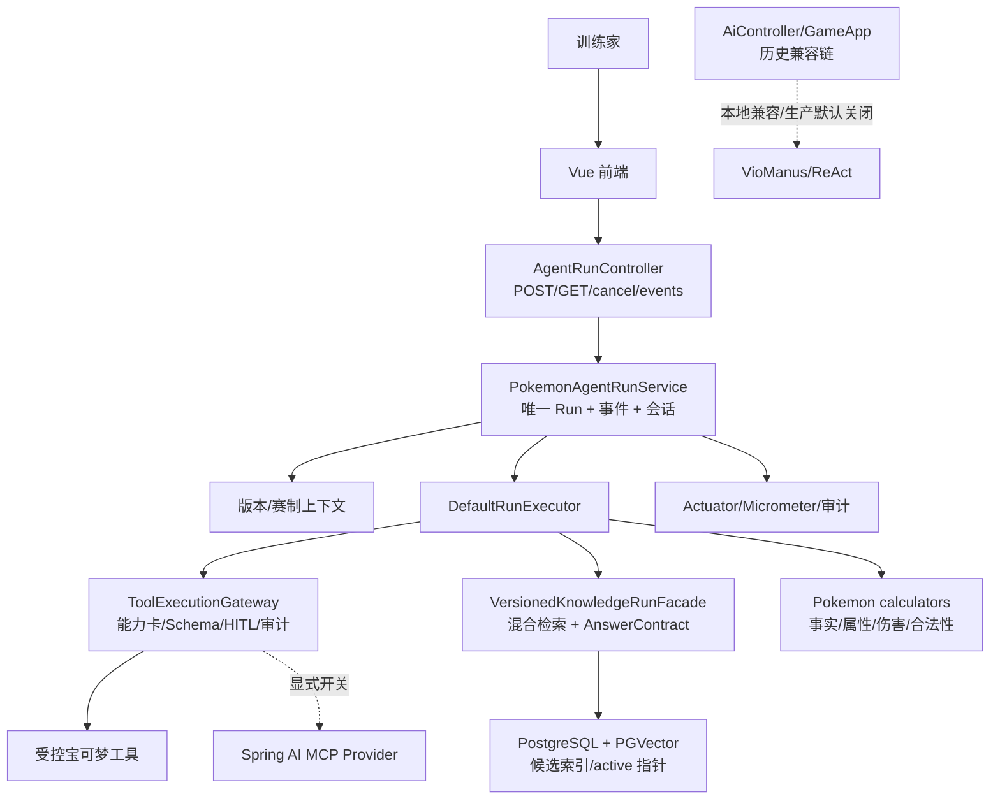
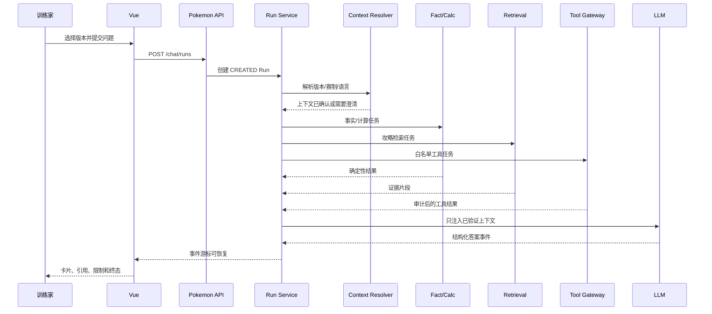

# VIO 成熟宝可梦智能体：正式版 v1.0 开发步骤手册
> 目标：把 VIO 从展示型 AI Agent 原型升级为“版本明确、答案有依据、计算可复现、错误可纠正、发布可回退”的可用垂直智能体。  
> 源码基准：main@708126a691bd7a789ddb261d11bb464caa96a45e  
> 依据报告：[企业级智能体架构与技术对照报告.md](../企业级智能体架构与技术对照报告.md)  
> 当前事实范围：本手册只描述仓库静态扫描到的事实；目标类、候选指标、计划接口必须在实施和测试后才能称为已完成。  
> 本手册是实施基线；本轮已对 Java、Vue、配置、测试、数据库迁移和运维文件做了对应改动。实际落地与验证证据见 [M2-M7实施完成记录.md](./M2-M7实施完成记录.md)，历史“当前事实”段落保留为基线快照，不应代替运行验收。**阅读时以该实施记录和最新工作树为准；源码链接中的旧行号只用于定位主题。**
## 0. 怎么使用这份手册
### 三档阅读路线
| 读者 | 读法 | 你应该得到的结果 |
|---|---|---|
| 🐤 小白 | 从第 1 节顺读到第 14 节，照着每个 Step 做 | 知道每一步为什么做、改哪里、如何证明做对 |
| 🦾 后端开发者 | 先看第 2～5 节，再按 M0→M4 执行 | 建立 Controller、Service、Repository、Agent Runtime 和数据边界 |
| ⚡ 面试速查 | 先看架构图、阶段表、设计决策和 Q&A | 能讲清取舍、失败案例、指标和个人贡献 |
### 三种状态标记
- ✅ 当前主链：真实请求已经过，并有源码调用证据。
- 🟡 代码存在但未接入：有类、配置或测试，但不能当作产品能力。
- 🎯 v1.0 目标：只有完成对应验证门禁后才能写进 README 或简历。
### 先记住一条规则
不要用“有一个类”“配置里写了某个组件”“README 宣称通过”代替运行证据。每完成一个 Step，都在开发日志中记录环境、命令、输出摘要、证据路径和回滚点。
## 1. 一句话概括与业务背景
### 一句话概括
VIO 是一个以宝可梦朱/紫为首发范围、面向训练家的版本化知识与对战决策智能体：数据库提供标准事实，计算器保证规则正确，RAG 提供可核查依据，受控 Agent 负责多步骤编排。
### 业务背景
训练家问“这个宝可梦能不能学某招”时，需要查版本化事实；问“火属性打双属性目标是多少倍”时，需要确定性计算；问“六星太晶团体战怎么打”时，需要攻略检索、来源和适用版本。单靠模型记忆会混版本、算错倍率，也无法解释答案从哪里来。

成熟产品的核心不是把所有能力放到一个超级 Prompt，而是把问题分流给正确的执行器，并为每次回答留下版本、证据、事件和反馈记录。
## 2. 项目全景图
### 类比开场
把系统想成一座宝可梦道馆：前台先确认训练家使用的游戏版本和赛制；资料室保存官方和审核过的攻略；计算台负责属性、伤害和合法性；裁判记录每个动作；馆长只允许经过安检的工具执行。历史兼容链仍保留在 `AiController/GameApp`，当前正式入口已经收敛到 `AgentRunController → PokemonAgentRunService`；现代 Run 与发布骨架的真实状态见 [M2-M7实施完成记录.md](./M2-M7实施完成记录.md)。
### 当前主链与目标主链

实线表示当前仓库可找到的现代主链；虚线表示兼容或条件能力。当前后端入口由 [VioAiAgentApplication.java](file:///D:/ai-intern-cjt/my/AI-Agent/src/main/java/com/vio/vioaiagent/VioAiAgentApplication.java#L7-L11) 启动，正式入口见 [AgentRunController.java](file:///D:/ai-intern-cjt/my/AI-Agent/src/main/java/com/vio/vioaiagent/controller/AgentRunController.java#L39-L120)，历史兼容入口见 [AiController.java](file:///D:/ai-intern-cjt/my/AI-Agent/src/main/java/com/vio/vioaiagent/controller/AiController.java#L27-L114)。
### v1.0 目标分层
| 层 | 目标职责 | 不能做的事 |
|---|---|---|
| API/Controller | 认证、参数校验、创建 Run、订阅事件、取消 | 不直接编排模型、工具和数据库 |
| Runtime | Run 状态、取消、超时、事件、Checkpoint | 不把领域规则写进事件适配器 |
| Domain | 版本事实、属性/伤害/合法性计算 | 不依赖 LLM 自由生成 |
| Knowledge | 摄取、审核、索引、检索、证据 | 不覆盖已发布版本 |
| Tool Governance | 白名单、权限、Schema、HITL、超时、审计 | 不给公网暴露 Shell/任意下载 |
| Persistence | 用户、会话、队伍、反馈、发布记录 | 不保存未脱敏密钥 |
| Frontend | 场景表单、卡片、事件时间线、错误和重连 | 不用一个全局连接覆盖多个 Run |
## 3. 一条请求如何走完
### 类比开场
一次问答像参加道馆挑战：先报出版本和规则，前台把问题分到事实柜、计算台、资料室或受控裁判席；每个动作都写入计分板，最后把答案、证据和限制一起交给训练家。
### 请求时序图

### 一步步走
1. 前端提交一个带版本上下文的创建请求，服务端返回 runId，而不是把任务和长连接绑定在一次 GET 查询上。
2. Context Resolver 发现关键条件缺失时，先产生澄清事件；不能让模型猜测游戏、形态或赛制。
3. Route Service 根据意图选择 fact、calc、RAG 或受控 Agent；同一个问题可以组合多个只读执行器，但每一步都要有预算。
4. Runtime 记录 started、route、retrieval、tool、answer 和终态事件；事件 ID 单调递增。
5. 最终答案引用来源、版本和限制；用户断线时按最后 eventId 继续读取，显式 cancel 才会取消 Run。
### 源码定位
历史基线中的 GameApp 把基础聊天、RAG、工具和 MCP 作为多个方法放在一个组件中，见 [GameApp.java](file:///D:/ai-intern-cjt/my/AI-Agent/src/main/java/com/vio/vioaiagent/app/GameApp.java#L31-L199) 与 [GameApp.java](file:///D:/ai-intern-cjt/my/AI-Agent/src/main/java/com/vio/vioaiagent/app/GameApp.java#L203-L290)。VioManus 的执行骨架见 [VioManus.java](file:///D:/ai-intern-cjt/my/AI-Agent/src/main/java/com/vio/vioaiagent/agent/VioManus.java#L36-L140)；现代 Run 入口以实施记录为准。

> 📦 **额外知识：什么是确定性路由？**
>
> 确定性路由就是先用可测试的规则决定“这题应该走哪条路”，而不是把所有选择交给模型。比如出现“倍率/伤害/速度”就优先走计算器，出现“来源/攻略”才走 RAG。这样可以定位错误，也能避免模型用自然语言替代程序计算。
### 阶段结论
v1.0 的主链必须只有一个拥有 Run 生命周期的服务；GameApp、VioManus、MCP 和工具都变成可被它调度的执行器。
## 4. 开工前：冻结范围与建立基线
### 类比开场
如果道馆规则每天变化，裁判再认真也无法判定胜负。开发前先把游戏、补丁、DLC、语言和赛制写在“规则牌”上，所有数据、测试和答案都挂在这张牌上。
### 一步步走
#### Step 1：冻结首发支持矩阵
推荐首版范围：宝可梦朱/紫、零之秘宝（篇章显式选择）、zh-CN、剧情/休闲单打和双打，以及一个审核过的 VGC 规则集。将最终值写入规格书，不要留在 Prompt。
#### Step 2：盘点工作区
~~~powershell
git rev-parse HEAD
git status --short
rg --files -g '!target' -g '!node_modules'
~~~
记录 HEAD、未提交文件、Java/Node 版本和可用外部服务。当前仓库已有未提交的架构文档；本次新增计划目录时应保持这些既有变更不被覆盖。
#### Step 3：建立证据目录
建议在项目外部或被忽略的 artifacts 目录保存：
~~~text
artifacts/v1.0/
  baseline/
  test/
  eval/
  screenshots/
  release/
  rollback/
~~~
每个文件名带日期、commit 和环境，例如 20260901-M0-mvn-test.txt。
#### Step 4：建立开关和回退表
| 开关 | 默认值 | 作用 | 关闭时 |
|---|---|---|---|
| vio.agent.v1.enabled | false | 新 Run 主链灰度 | 走兼容只读端点 |
| vio.rag.pgvector.enabled | false | PGVector 生产检索 | 仅测试/演示存储 |
| vio.mcp.enabled | false | 远程 MCP 适配器 | 只用本地白名单工具 |
| vio.tools.high-risk.enabled | false | 高风险管理工具 | 全部拒绝 |
### 源码定位
**历史基线快照**：主配置把 context-path 设为 /api，并默认排除 JDBC/PGVector，见 [application.yml](file:///D:/ai-intern-cjt/my/AI-Agent/src/main/resources/application.yml#L1-L42)；基线时生产配置仍排除数据库且有公开密钥 fallback，见 [application-prod.yml](file:///D:/ai-intern-cjt/my/AI-Agent/src/main/resources/application-prod.yml#L1-L46)。本轮已修改生产配置为必填 Secret/数据库，当前是否可启动仍以 [M2-M7实施完成记录.md](./M2-M7实施完成记录.md) 的现场验收栏为准。

> 📦 **额外知识：什么是版本键？**
>
> 版本键是答案的“适用范围标签”，例如 game_release_id、battle_format_id 和 ruleset_version_id。没有标签的事实无法判断是否过期；把版本键写进数据库约束、检索过滤和回答契约，才能阻止跨版本混答。
### 阶段结论
冻结项未完成前不导入大规模数据、不开启远程 MCP，也不把“全世代至 ZA”写成首发承诺。

## 5. M0：先让系统可信、可启动、可停下
### 类比开场
M0 像给道馆做消防验收：先确认门能开、报警器能响、危险房间锁得住，再装修训练场。功能再多，干净环境起不来或停不住，都不能进入正式版。
### 一步步走
#### Step 1：修复构建和测试上下文
1. 确认 mcp-servers.json 的测试策略：默认关闭外部 MCP，或提供完全受控的 fixture；不要让测试依赖开发者本机文件。
2. 统一 Java 21、Spring Boot 3.5.16、Spring AI 1.0.0 和 Spring AI Alibaba 1.0.0.2 的实际依赖。
3. 先运行编译，再运行测试；将每个 Spring context error 单独归因，不用“测试数量很多”掩盖错误。
~~~powershell
./mvnw.cmd -q -DskipTests compile
./mvnw.cmd test
~~~
留存的**历史基线**是 253 tests、0 failures、23 errors、2 skipped，不能当作当前结果；修复后应以新的 Surefire XML 和 [M2-M7实施完成记录.md](./M2-M7实施完成记录.md) 门禁表为准。
#### Step 2：统一 URL 和认证边界
1. application.yml 已有 /api context-path，Controller 不再重复写 /api。
2. 为 /api/ai/**、会话、反馈、管理和 cancel 分别写 MockMvc 认证断言。
3. 生产密钥缺失时启动失败，删除 sk-prod-change-me fallback。
4. 前端不再把 API Key 放 URL、localStorage 或浏览器历史；首版采用同源 Session Cookie + CSRF。
5. CORS 只允许明确的前端域名，禁止 allowCredentials=true 配合通配符。
#### Step 3：收敛异步和取消
历史兼容链中的 AiController 先用 CompletableFuture，再调用 BaseAgent 的 runStream，形成双层异步。改造目标是由 Run Service 创建一个任务、一个取消令牌和一个终态；Controller 只订阅事件。现代 `/chat/runs` 已按该目标实现，是否完成生产验收见实施记录。

1. 把 activeAgents 从 Controller 内存 Map 迁移到 RunRepository/执行注册表。
2. stop、timeout、completion、exception 四条路径都释放并发许可。
3. 取消后禁止继续发送 answer.delta；重复 cancel 返回幂等结果。
4. 设置模型、工具和整体 Run 的独立超时，避免一个长连接无限占用线程。
#### Step 4：关闭公网高危工具
玩家主链只保留图鉴事实、属性/伤害/合法性计算、只读知识检索和模板化报告。任意终端、文件写入、下载和无域名网页抓取先移出默认工具集合。
#### Step 5：做最小安全回归
至少覆盖：缺密钥、错误密钥、路径穿越、危险命令、任意 URL、重复 cancel、并发超限、断开连接和敏感日志。
### 源码定位
- 历史兼容控制器端点和双层异步见 [AiController.java](file:///D:/ai-intern-cjt/my/AI-Agent/src/main/java/com/vio/vioaiagent/controller/AiController.java#L162-L210)；现代 Run 由 `PokemonAgentRunService` 管理。
- Agent 线程、状态和 cleanup 见 [BaseAgent.java](file:///D:/ai-intern-cjt/my/AI-Agent/src/main/java/com/vio/vioaiagent/agent/BaseAgent.java#L107-L311)。
- 认证拦截器注册路径见 [SecurityConfig.java](file:///D:/ai-intern-cjt/my/AI-Agent/src/main/java/com/vio/vioaiagent/config/SecurityConfig.java#L29-L80)。
- **历史基线**中的高危工具注册见 [ToolRegistration.java](file:///D:/ai-intern-cjt/my/AI-Agent/src/main/java/com/vio/vioaiagent/tools/ToolRegistration.java#L12-L39)；当前已按玩家/运营开关拆分并默认关闭高风险能力，实际状态见 [M2-M7实施完成记录.md](./M2-M7实施完成记录.md)。
> 📦 **额外知识：什么是幂等？**
>
> 幂等就是同一个请求重复执行，最终效果仍然只有一次。比如用户连续点击两次 cancel，不应产生两个终态；工具调用用 runId、stepIndex、toolName 和参数摘要生成幂等键，重复请求直接返回第一次结果。
### 验证门槛
| 检查 | 通过条件 | 证据 |
|---|---|---|
| 干净编译 | compile 返回 0 | 编译日志 |
| Spring 测试 | 0 failure、0 error | Surefire XML |
| 路由 | 不出现 /api/api | MockMvc/HTTP 输出 |
| 认证 | 未授权请求被拒 | 测试报告 |
| 取消 | 2 秒内进入 cancelled 或明确失败终态 | Run 事件日志 |
| 高危工具 | 未审批调用数为 0 | 审计日志和红队报告 |
### 回滚点
保留旧只读聊天端点和旧前端页面作为兼容层；新 v1 Run 链通过开关灰度。无论回滚与否，都不能恢复默认密钥和公网高危工具。
## 6. M1：版本化主数据与确定性计算
### 类比开场
把数据库看成道馆的官方图鉴，把计算器看成裁判的计分板。图鉴只保存被审核的事实，裁判按固定规则算倍率和伤害；模型只能解释结果，不能替代裁判。
### 一步步走
#### Step 1：先建稳定身份，再建版本事实
创建 Flyway 迁移和领域模型：
~~~text
game_release / data_release
pokemon_species / pokemon_form
form_fact_version / move_fact_version
learnset_version / ability / item
pokemon_availability / ruleset_version
saved_team / team_member / team_member_move
~~~
稳定物种和形态身份不随补丁覆盖；属性、种族值、招式威力、可用性和规则全部挂 data_release。
#### Step 2：写约束而不是只写注释
1. species national_no 唯一。
2. species + form_key 唯一。
3. form + data_release 唯一。
4. team 绑定 ruleset_version。
5. team_member_move 的 slot 为 1～4 且组合唯一。
6. 所有外键由数据库约束保护。
#### Step 3：实现领域服务
建议新增：
~~~text
pokemon/domain/
  PokemonSpecies
  PokemonForm
  RulesetVersion
pokemon/calculator/
  TypeEffectivenessCalculator
  DamageCalculator
  SpeedLineCalculator
  TeamLegalityChecker
pokemon/service/
  PokemonFactService
  BattleCalculationService
~~~
Service 负责编排，calculator 保持纯函数，Repository 只做查询。输入 DTO 必须包含版本、形态、攻击方、受击方和规则参数。
#### Step 4：扩展属性工具但保持分层
历史基线的 [PokeTypeTool.java](file:///D:/ai-intern-cjt/my/AI-Agent/src/main/java/com/vio/vioaiagent/tools/PokeTypeTool.java#L16-L106) 只覆盖单攻击属性到单防御属性和 18 属性列表。把它改成 Tool 适配器：解析参数、调用 calculator、返回结构化结果；双属性乘算、免疫、特性、太晶和边界规则放在领域层。
#### Step 5：建立确定性测试集
准备全部属性组合、免疫、双属性、太晶、伤害边界、速度并列、重复招式、努力值超限、禁用成员和版本不可用样例。每条结果记录 calculation_version。
### 源码定位
现有属性工具的输入校验和倍率表见 [PokeTypeTool.java](file:///D:/ai-intern-cjt/my/AI-Agent/src/main/java/com/vio/vioaiagent/tools/PokeTypeTool.java#L62-L106)。**历史基线**当时没有 domain、repository、migration 目录；本轮已加入版本化领域/迁移代码，是否达到可发布门槛以 [M2-M7实施完成记录.md](./M2-M7实施完成记录.md) 和独立测试证据为准。

> 📦 **额外知识：为什么确定性计算不能交给 LLM？**
>
> LLM 擅长解释和组合信息，但它不是可证明的算术执行器。相同输入可能因上下文和采样产生不同答案；纯 Java calculator 可以用断言覆盖全部组合，出现错误时也能定位到规则版本。
### 验证门槛
- 确定性计算断言 100% 通过。
- 同一输入多次运行结果一致。
- 非法队伍和未知版本明确返回业务错误，不降级成自然语言猜测。
- 事实查询返回 data_release 和来源。
### 回滚点
保留旧 Markdown 只读 adapter；新数据库查询通过开关灰度。发现版本过滤错误时切回旧只读路径，并保留导致问题的输入和数据版本。

## 7. M2：生产级知识摄取与引用式 RAG
### 类比开场
资料室不是把所有书堆进一个箱子，而是先验收来源、贴版本标签、编目录，再让检索员按问题取出证据。这样模型拿到的是“可核查的资料”，不是一堆无法追责的文本。
### 一步步走
#### Step 1：建立知识生命周期
创建 Flyway 迁移和领域对象：
~~~text
knowledge_source
knowledge_document / document_version
document_chunk
ingestion_batch
knowledge_release / vector_index_release
~~~
每条记录保存来源、许可、可信等级、checksum、解析器版本、切块配置、Embedding 模型和审核状态。
#### Step 2：把摄取从启动流程移出
历史基线的 [GameAppDocumentLoader.java](file:///D:/ai-intern-cjt/my/AI-Agent/src/main/java/com/vio/vioaiagent/rag/GameAppDocumentLoader.java#L18-L53) 会扫描 classpath 文档；目标是改成显式、可重试的 ingestion job：

1. 上传到隔离区。
2. 校验文件类型、许可证、Schema 和大小。
3. 解析并补充 game_version、battle_format、language 等元数据。
4. 计算 checksum，做去重和冲突检测。
5. 进入人工审核或 quarantine。
6. 切块、Embedding、构建候选索引。
7. 跑黄金集，最后发布 release。

应用首次请求不能临时重建全部向量；摄取失败不能影响已发布版本。
#### Step 3：启用生产向量存储
[VersionedPgVectorStoreConfig.java](file:///D:/ai-intern-cjt/my/AI-Agent/src/main/java/com/vio/vioaiagent/rag/VersionedPgVectorStoreConfig.java#L18-L52) 是生产向量存储适配器；启用前要确认 JDBC、维度、Embedding 模型和 Spring AI 1.0.0 API 兼容。保留 [GameAppVectorStoreConfig.java](file:///D:/ai-intern-cjt/my/AI-Agent/src/main/java/com/vio/vioaiagent/rag/GameAppVectorStoreConfig.java#L18-L50) 作为测试/演示 profile，不把 SimpleVectorStore 当生产持久化。
#### Step 4：实现混合检索
按以下顺序执行：
~~~text
上下文解析
→ 查询改写
→ game/ruleset/language 过滤
→ PostgreSQL 全文检索
→ PGVector 语义检索
→ RRF 融合
→ 可选重排
→ 证据去重
→ 有证据回答或拒答
~~~
结构化事实仍由 Fact Service 查询；RAG 主要承载攻略、解释和版本说明。
#### Step 5：定义回答契约
~~~json
{
  "answer": "文本或结构化卡片",
  "applicableGameVersion": "sv-...",
  "battleFormat": "singles",
  "rulesetVersion": "rules-...",
  "citations": [
    {
      "documentId": "doc-1",
      "documentVersion": "v3",
      "sourceTitle": "来源标题",
      "sourceUrl": "https://example.invalid/source",
      "chunkId": "chunk-9",
      "evidenceText": "支持结论的原文片段",
      "retrievalScore": 0.87
    }
  ],
  "limitations": [],
  "traceId": "trace-..."
}
~~~
无证据、来源冲突、版本不明确或内容过期时，返回澄清/拒答状态，不能用模型常识填空。
### 源码定位
文档加载和切块入口见 [GameAppDocumentLoader.java](file:///D:/ai-intern-cjt/my/AI-Agent/src/main/java/com/vio/vioaiagent/rag/GameAppDocumentLoader.java#L30-L53)；历史兼容 RAG Advisor 接入点见 [GameApp.java](file:///D:/ai-intern-cjt/my/AI-Agent/src/main/java/com/vio/vioaiagent/app/GameApp.java#L154-L199)，现代版本化检索/回答由 `VersionedKnowledgeRunFacade` 与 `DefaultRunExecutor` 接入，实际验收以 [M2-M7实施完成记录.md](./M2-M7实施完成记录.md) 为准。

> 📦 **额外知识：什么是 RRF？**
>
> RRF（Reciprocal Rank Fusion）是把关键词检索和向量检索的排名合并成一个排名的方法。它不要求两路分数可直接比较，只利用名次；因此适合把“精确的宝可梦名词命中”和“语义相近的攻略段落”合在一起。
### 验证门槛
| 检查 | 通过条件 | 证据 |
|---|---|---|
| 可重建 | 清空候选索引后可重复构建 | ingestion 日志 |
| 版本过滤 | 不返回不适用版本 | 检索测试 |
| Recall@5 | 达到规格书冻结门槛 | 评测报告 |
| 引用正确率 | 引用确实支持声明 | 人工/程序标注 |
| 无证据处理 | 正确拒答或追问 | 无答案集 |
### 回滚点
以 active_index_release 指针切换索引；候选索引评测失败时只删除候选版本，恢复上一索引和上一 knowledge_release，不原地覆盖。
## 8. M3：唯一 Agent Run、事件和持久会话
### 类比开场
把一次 Agent 任务想成一场有编号的对战：Run 是比赛编号，事件是逐回合记录，Checkpoint 是暂停存档。观众断线可以从最后一回合继续看，只有裁判收到明确取消指令才结束比赛。
### 一步步走
#### Step 1：建立状态机
~~~text
CREATED
→ RUNNING
→ WAITING_APPROVAL（可选）
→ COMPLETED / FAILED / CANCELLED / TIMED_OUT
~~~
每次合法状态迁移写入事件和审计；终态不可再次进入运行态。
#### Step 2：设计事件表和事件格式
~~~json
{
  "schemaVersion": "1",
  "eventId": 42,
  "type": "tool.finished",
  "sessionId": "session-id",
  "runId": "run-id",
  "traceId": "trace-id",
  "timestamp": "2026-09-01T10:00:00+08:00",
  "payload": {}
}
~~~
事件表需要 run_id、event_id 唯一约束和按 event_id 查询索引；事件类型至少包含 run.started、context.confirmed、route.selected、retrieval.started/finished、tool.started/finished、approval.required/resolved、answer.delta、citation、usage 和四种终态。
#### Step 3：收敛后端接口
~~~text
POST /chat/runs
GET  /chat/runs/{runId}/events?afterEventId=42       # JSON 事件回放
GET  /chat/runs/{runId}/events/stream?afterEventId=42 # SSE 订阅
POST /chat/runs/{runId}/cancel
GET  /conversations/{conversationId}/messages
DELETE /conversations/{conversationId}
~~~
以上是 Controller/MVC 路径；默认 `server.servlet.context-path=/api` 时，浏览器和网关实际访问路径分别带 `/api` 前缀（例如 `/api/chat/runs`）。`/events` 用于有限回放，`/events/stream` 才是 SSE；两者都支持游标，不能把 JSON 回放端点当成长连接。
POST 创建返回 202、runId 和 eventsUrl；JSON `GET /events` 用于回放，SSE `GET /events/stream` 用于订阅；cancel 要求同源认证和 CSRF。事件保留期过后返回 410 Gone，并说明客户端需要重新获取摘要。
#### Step 4：把现有 Agent 变成执行器
历史基线的 [BaseAgent.java](file:///D:/ai-intern-cjt/my/AI-Agent/src/main/java/com/vio/vioaiagent/agent/BaseAgent.java#L107-L311) 自己创建异步任务、切换状态和清理；现代目标由 PokemonAgentRunService 拥有这些责任。VioManus 只接收受控上下文并执行一步，不直接决定用户级生命周期。
#### Step 5：先持久会话，再长期偏好
1. conversation/chat_message 保存完整历史。
2. 窗口 Memory 只服务当前模型上下文。
3. 用户明确授权后再抽取偏好。
4. 偏好保存来源、置信度、TTL 和删除记录。
5. 用户、会话、队伍、反馈和工具执行均用 userId 做资源级过滤。
#### Step 6：处理断线、重试和幂等
浏览器断开不取消 Run；服务端继续执行至终态或超时。重复创建可用 Idempotency-Key 去重；重复 cancel 返回同一结果；事件重放不得重复执行工具。
### 源码定位
**历史兼容链**的 Agent 状态和 stop 逻辑见 [BaseAgent.java](file:///D:/ai-intern-cjt/my/AI-Agent/src/main/java/com/vio/vioaiagent/agent/BaseAgent.java#L220-L311)，旧 Controller 仍可通过内存 Map 管理活动 Agent，见 [AiController.java](file:///D:/ai-intern-cjt/my/AI-Agent/src/main/java/com/vio/vioaiagent/controller/AiController.java#L162-L210)；现代 `/chat/runs` 由 `PokemonAgentRunService` 管理。两条链的当前启用状态和验收证据见 [M2-M7实施完成记录.md](./M2-M7实施完成记录.md)。

> 📦 **额外知识：为什么要把事件持久化？**
>
> 只在内存里发 SSE，刷新页面后就失去上下文；持久事件让客户端可以按游标补发，也让运维能回答“Run 在哪一步失败”。事件不是日志替代品，而是面向客户端和恢复流程的业务事实。
### 验证门槛
- 一个 Run 恰好一个终态事件，重复 cancel/重连不产生第二个终态。
- 服务重启后能查询已完成 Run、消息和队伍。
- 不同用户访问他人 runId 返回 404 或 403，并且不泄漏资源存在性。
- cancel 被接受到 cancelled 的 P95 达到规格书冻结值。
### 回滚点
保留旧 /ai/game_app/chat/* 只读端点；新 /chat/runs 先灰度。数据库迁移采用向后兼容字段，旧端点仍能读取历史摘要。
## 9. M4：工具治理、HITL、MCP 与记忆边界
### 类比开场
工具调用像进入道馆的闸机：先查身份证，再查门票权限和行李，危险动作要裁判签字，执行后还要把结果和录像编号写入档案。MCP 只是另一种运输方式，不能绕过闸机。
### 一步步走
#### Step 1：给每个工具写能力卡
~~~yaml
name: type-calculator
version: 1.0.0
riskLevel: LOW
sideEffect: NONE
idempotent: true
timeoutMs: 2000
allowedRoles: [trainer, operator]
inputSchema: ...
outputSchema: ...
~~~
工具描述是治理契约，不只是给模型看的 description。
#### Step 2：实现统一执行网关
执行顺序固定为：
~~~text
用户身份与 Run 上下文
→ 工具白名单与角色
→ JSON Schema 参数校验
→ 路径/命令/出网策略
→ 风险分级与 HITL
→ 幂等键
→ 超时与有限重试
→ 执行
→ 结果脱敏
→ 审计、指标和事件
~~~
网关对未知工具 fail-closed；只有幂等读操作或明确安全的调用允许自动重试。
#### Step 3：分离玩家工具与管理工具
将 [ToolRegistration.java](file:///D:/ai-intern-cjt/my/AI-Agent/src/main/java/com/vio/vioaiagent/tools/ToolRegistration.java#L12-L39) 拆为 pokemonTools/adminTools。玩家主链只开放：
- 图鉴和版本化事实查询；
- 双属性、伤害、速度线和合法性计算；
- 只读知识检索；
- 域名白名单内的时效搜索；
- 模板约束的报告导出。
任意终端、文件写入、任意下载和无约束网页抓取不进入公网工具集合。
#### Step 4：把 Agent 的直接执行包进网关
[ToolCallAgent.java](file:///D:/ai-intern-cjt/my/AI-Agent/src/main/java/com/vio/vioaiagent/agent/ToolCallAgent.java#L105-L214) 当前直接调用 ToolCallingManager。改造时保留模型的工具选择能力，但在真正执行前插入 Gateway；工具输出的 3000 字截断改成结构化摘要和结果引用，避免凭截断文本做错误决策。
#### Step 5：把 HITL 变成可等待的状态
**历史基线**中的 [HitlManager.java](file:///D:/ai-intern-cjt/my/AI-Agent/src/main/java/com/vio/vioaiagent/security/HitlManager.java#L28-L129) 不是 Spring Bean，且中危工具首次调用会自动批准；本轮正式 Run 路径已改为 Bean + 显式审批，兼容旧端点仍需单独识别。目标行为：

1. 低风险只读直接执行。
2. 中/高风险写操作产生 approval.required。
3. 审批绑定 userId、runId、工具版本、参数摘要、过期时间。
4. 超时自动拒绝；拒绝原因进入事件和审计。
5. Run 进入 WAITING_APPROVAL，解决后恢复或终止。

当前实现边界：pending approval 仅保存在 JVM 内存，重启或跨实例不可恢复；`HitlAuditSink` 默认是 noop，工具审计由 `AuditLogger` 写本地 JSONL，尚未形成集中式、事务绑定的审计链。
#### Step 6：选择唯一 MCP 路径
生产优先复用 Spring AI MCP Provider；自研 JSON-RPC/STDIO/SSE 放入 mcp-lab，默认关闭。当前自研实现仍位于主源码树 `src/main/java/com/vio/vioaiagent/mcp/**`，尚未迁移到 `mcp-lab`，因此不能当作生产 MCP 能力。当前项目锁定 Spring AI 1.0.0，升级 MCP 配置前必须在独立分支做依赖兼容和全量回归，不能直接复制最新版文档。
#### Step 7：重新接入记忆
先把 conversation/message 接到 PostgreSQL，再建设长期偏好；长期记忆必须有授权、TTL、隔离和删除。不要让全局 JSON 文件成为多用户生产存储。当前 `LongTermMemory` 仍写入全局 `user.dir/memory/long-term.json`，生产 profile 默认关闭，尚未实现 user 隔离、授权、TTL、删除和备份恢复语义。
### 源码定位
工具合并和截断逻辑见 [ToolCallAgent.java](file:///D:/ai-intern-cjt/my/AI-Agent/src/main/java/com/vio/vioaiagent/agent/ToolCallAgent.java#L65-L214)；正式 Run 的 HITL 审批行为见 [HitlManager.java](file:///D:/ai-intern-cjt/my/AI-Agent/src/main/java/com/vio/vioaiagent/security/HitlManager.java#L52-L112) 与 [PokemonAgentRunService.java](file:///D:/ai-intern-cjt/my/AI-Agent/src/main/java/com/vio/vioaiagent/run/PokemonAgentRunService.java#L650-L697)；MCP 配置入口见 [application.yml](file:///D:/ai-intern-cjt/my/AI-Agent/src/main/resources/application.yml#L19-L31)。跨环境证据以 [M2-M7实施完成记录.md](./M2-M7实施完成记录.md) 为准。

> 📦 **额外知识：MCP 和工具调用是什么关系？**
>
> 工具调用描述“模型要执行什么能力”，MCP 描述“能力如何被发现和传输”。本项目的安全、权限、超时和审计应该位于两者之上；换成 MCP 运输方式不能跳过同一 ToolExecutionGateway。
### 验证门槛
- 未授权工具、未知参数、越权资源和高危未审批调用全部被拒。
- 幂等键重复时不产生第二次副作用。
- 工具超时、MCP 断开和模型异常都产生可读错误和唯一事件。
- MCP 关闭时主应用仍能启动；开启时有连接、工具列表和凭据隔离证据。

现代 `/chat/runs` 默认以 `trainer` 角色创建工具上下文；只允许 `operator/admin` 的管理工具会按设计拒绝，除非接入经过认证的角色映射。不要把这种默认拒绝误读为管理工具已对玩家主链开放。`readFile` 的 Java 能力卡和 YAML 参考均仅允许 `operator/admin`，且必须限制到允许根目录的只读报告。
### 回滚点
默认只注册本地只读宝可梦工具；MCP 适配器独立开关控制，远程故障时降级到事实查询或明确拒答。

## 10. M5：前端场景化体验与流式恢复
### 类比开场
训练家不应该看到一串不可解释的文字，而应该像看比赛回放：先看到使用的版本，再看到裁判查了什么、算了什么、引用了哪条资料，最后看到答案和限制。前端是这份回放的播放器。
### 一步步走
#### Step 1：替换流式契约
当前前端通过 EventSource 调用查询参数式 SSE。目标是 POST 创建 Run，再用 fetch ReadableStream 订阅事件：
~~~text
POST /chat/runs
→ 202 { runId, eventsUrl }
GET /chat/runs/{runId}/events/stream
→ SSE 结构化事件
GET /chat/runs/{runId}/events?afterEventId=42
→ JSON 事件回放
POST /chat/runs/{runId}/cancel
~~~
以上示例省略默认 `/api` context-path；实际外部 URL 为 `/api/chat/...`，以部署配置为准。当前 `/events/stream` 读取已有事件页后发送一次性 SSE snapshot 并完成，前端通过客户端轮询/有限重连补读；尚非 broker 驱动的长连接推送，实时订阅、背压和跨实例 fan-out 仍待验收。
认证使用同源 Session Cookie 和 CSRF；不把 API Key 放 URL 或 localStorage。
#### Step 2：建立 RunViewModel
每个 Run 独立保存：
~~~text
runId / conversationId / status
lastEventId / streamController
answer / citations / limitations
toolTimeline / error / startedAt / finishedAt
~~~
状态至少包含 creating、running、waiting_approval、reconnecting、completed、failed、cancelled、timed_out。状态转换由一个 reducer 或 composable 管理，避免多个页面各自拼字符串。
#### Step 3：完成场景化输入和输出
输入侧选择游戏、DLC、语言、赛制、查询目标和队伍；输出侧按事件渲染上下文卡、图鉴卡、配招卡、队伍矩阵、计算卡、引用卡、执行时间线、反馈按钮和错误卡。
#### Step 4：实行单飞锁
同一 conversation 有未终态 Run 时禁用再次发送；每个连接独立管理 AbortController 和事件游标。将来支持并行 Run 时使用 Map<runId, RunViewModel>，禁止继续使用一个全局 currentEventSource 覆盖旧任务。
#### Step 5：处理终态和断线
收到 run.completed/failed/cancelled/timed_out 后关闭流、释放计时器并恢复输入。网络错误进入 reconnecting，使用最后 eventId 重连；事件过期显示“请重新打开会话”，不伪造缺失内容。
### 源码定位
**历史基线**的 API Key URL 注入、EventSource 和 stop 请求见 [index.js](file:///D:/ai-intern-cjt/my/AI-Agent/vio-ai-agent-frontend/src/api/index.js#L15-L130)；当前现代 Run 使用 fetch/ReadableStream、游标和 AbortController，页面实现见 [GameMaster.vue](file:///D:/ai-intern-cjt/my/AI-Agent/vio-ai-agent-frontend/src/views/GameMaster.vue#L24-L76) 与 [SuperAgent.vue](file:///D:/ai-intern-cjt/my/AI-Agent/vio-ai-agent-frontend/src/views/SuperAgent.vue#L30-L149)。当前验证状态见 [M2-M7实施完成记录.md](./M2-M7实施完成记录.md)。

> 📦 **额外知识：为什么 SSE 断线不能等于取消？**
>
> 网络连接属于传输层，Run 属于业务层。用户刷新页面只说明播放器断了，不代表训练家要求停止比赛；把两者混在一起会导致任务丢失、重复执行和无法审计。显式 cancel 才改变 Run 状态。
### 验证门槛
- 创建、首事件、答案增量、引用和终态都能在浏览器显示。
- 刷新或短暂断网后能从最后 eventId 恢复，不重复渲染。
- 同一会话非终态不能再次发送；终态后输入恢复。
- 认证失败、429、无证据、版本冲突和审批等待均有明确 UI。
### 回滚点
保留旧 GameMaster 页面作为只读 fallback；新事件渲染异常时展示通用错误卡并保留 runId，不能静默丢失任务。
## 11. M6：反馈、评测与可观测
### 类比开场
训练家说“这题答错了”不是投诉终点，而是下一轮训练数据。运营者要知道错在哪个版本、哪条证据、哪次模型调用，并在发布前用固定题集确认修复没有伤害其他答案。
### 一步步走
#### Step 1：建立反馈纠错状态机
~~~text
SUBMITTED
→ TRIAGED
→ IN_REVIEW
→ APPROVED / REJECTED
→ PUBLISHED
→ VERIFIED
→ CLOSED
~~~
反馈记录 answerId、traceId、错误类型、证据、用户和当前 data/knowledge/index release。运营后台只允许有权限的角色操作；若无法解析这些关联，必须拒绝提交或显式标为不可追溯，不能用 `unknown` 冒充完整链路。
#### Step 2：建立黄金集
最低准备：
| 集合 | 最小规模 | 断言 |
|---|---:|---|
| 结构化事实 | 200 题 | 关键字段全对 |
| 属性/伤害 | 全组合与边界 | 程序断言 100% |
| 合法性 | 100 组 | 合法/非法识别 |
| RAG | 100 题 | Recall@5、引用和 Groundedness |
| 无答案 | 50 题 | 正确拒答/澄清 |
| Agent 工具 | 50 任务 | 路由、工具、参数和终态 |
| 安全红队 | 100 条 | 注入、路径、命令、SSRF、越权 |
数据集文件名带 suite 版本；每次发布保存模型、Prompt、数据和索引版本。
#### Step 3：定义指标字典
每个指标登记 metric_id、公式、合格请求、排除项、统计窗口、最小样本、版本、负责人、告警阈值和回滚条件。候选指标包括事实成功率、引用正确率、Recall@5、无答案处理率、工具参数正确率、TTFT、P95、Token 和成本。
#### Step 4：接通 Trace、Metrics、Logs
traceId 从浏览器贯穿 API、Run、路由、检索、模型、工具、数据库和反馈。用 Micrometer/Actuator 暴露 Prometheus 格式；自定义业务 JSON 只能作为诊断 API，不能伪装成 exposition format。

至少建这些面板：
- Run 终态成功/失败/取消/超时；
- TTFT、完整耗时和按场景分桶的 P95；
- 模型 Token、成本、重试和降级；
- 检索空结果、Recall、引用错误；
- 工具调用、拒绝、审批等待和超时；
- 反馈待处理量、P0 按时发布率和纠错闭环率。
#### Step 5：把质量门禁接入 CI
顺序建议：后端 compile/test → 前端 lint/typecheck/unit/build → 契约检查 → 黄金集 → 安全扫描 → 镜像构建 → Compose 冒烟。禁止用 continue-on-error 吞掉关键失败。
### 源码定位
原子计数器和自定义快照见 [AgentMetrics.java](file:///D:/ai-intern-cjt/my/AI-Agent/src/main/java/com/vio/vioaiagent/observability/AgentMetrics.java#L21-L80)；**历史基线**的指标控制器重复 `/api` 风险见 [MetricsController.java](file:///D:/ai-intern-cjt/my/AI-Agent/src/main/java/com/vio/vioaiagent/controller/MetricsController.java#L18-L34)，当前 Actuator/Prometheus 路径和配置骨架以 [M2-M7实施完成记录.md](./M2-M7实施完成记录.md) 为准；CI 步骤见 [ci.yml](file:///D:/ai-intern-cjt/my/AI-Agent/.github/workflows/ci.yml#L1-L32)。

> 📦 **额外知识：为什么 HTTP 200 不是任务成功？**
>
> HTTP 200 只说明请求被服务器接收或返回了响应，不能证明事实正确、引用充分或工具安全。产品成功率必须由黄金集标注和 Run 终态定义；把二者混成一个指标会产生“接口全绿、答案全错”的假象。
### 验证门槛
- 每次发布有不可变评测报告和指标字典。
- 确定性计算和关键数据约束 100% 通过；红队高危失败为 0。
- Prometheus Targets、Rules、Alerts 和 Grafana 面板均可现场验证。
- 任一质量/安全门禁失败会阻止发布，不以警告代替失败。
### 回滚点
发布单元同时保存 image digest、代码 commit、模型/Prompt、data/knowledge/index release；门禁失败时不切换，线上超出错误预算时恢复上一组版本。
## 12. M7：容器、恢复、发布与演示
### 类比开场
最后一关不是“在我的电脑上能跑”，而是换一台机器仍能按说明启动，依赖故障能报警，上一版本能在规定时间内回来。演示材料要展示证据链，而不是只展示成功截图。
### 一步步走
#### Step 1：建立可复现镜像
后端使用多阶段 Maven 构建，前端使用 npm ci；运行镜像使用非 root、明确健康探针和只读文件系统（能做到时）。依赖版本、镜像 digest 和构建 commit 都写入发布元数据。
#### Step 2：修正 Compose 拓扑
PostgreSQL 真正承载主数据、会话和知识版本；MCP、Prometheus、Grafana 和 Alertmanager 以 profile 或显式配置启用。Secret 必须由环境或 Secret Store 注入，缺失时启动失败，不使用公开默认密码。
#### Step 3：区分 liveness 和 readiness
liveness 只说明进程还活着；readiness 还要检查数据库、必要数据版本和关键依赖。部署前先验证 readiness，失败不切流。
#### Step 4：补 CI/CD 交付链
~~~text
Pull Request
→ 后端/前端测试
→ 黄金集与安全扫描
→ 不可变镜像
→ Compose 冒烟
→ 目标环境灰度
→ readiness
→ 监控
→ 发布或回滚
~~~
部署 workflow 不能只在临时 Runner 启动 Compose 后就打印成功；必须有目标环境、部署后探针和失败回滚记录。
#### Step 5：做恢复演练
执行“删除容器/模拟数据库故障 → 从备份恢复 → 固定业务探针”。记录 RPO、RTO、数据版本、索引指针、会话和队伍是否可查询。没有演练记录，只能说“有备份脚本”，不能说“可恢复”。
#### Step 6：准备三分钟演示
1. 选择朱/紫版本和赛制。
2. 查询图鉴，展示结构化卡片、版本和来源。
3. 输入队伍，展示弱点、速度线和合法性计算。
4. 询问攻略，展示混合检索和引用。
5. 提交纠错，展示运营审核、发布、评测和重新回答。
6. 打开 Trace/指标，展示耗时、Token、成本和工具审计。
7. 触发一次回滚，展示旧镜像和旧索引恢复。
### 源码定位
当前后端镜像采用 Maven 多阶段构建并以非 root 用户运行，前端运行镜像采用 `nginxinc/nginx-unprivileged`；分别见 [后端 Dockerfile](file:///D:/ai-intern-cjt/my/AI-Agent/Dockerfile#L1-L30) 和 [前端 Dockerfile](file:///D:/ai-intern-cjt/my/AI-Agent/vio-ai-agent-frontend/Dockerfile#L1-L27)。Compose 的数据库、健康检查和监控挂载见 [docker-compose.yml](file:///D:/ai-intern-cjt/my/AI-Agent/docker-compose.yml#L1-L90)。真实镜像构建和启动仍需现场 Docker 验收。

> 📦 **额外知识：RPO 和 RTO 有什么区别？**
>
> RPO 是最多能丢多少时间的数据，RTO 是故障后最多多久恢复服务。备份频率只能说明计划，恢复演练才能证明结果；两者都应按固定业务探针测量，并在版本发布记录中留档。
### 验证门槛
~~~powershell
docker compose config
docker compose up -d --build
curl.exe -f http://localhost:8123/api/health
curl.exe -f http://localhost:8123/api/ready
~~~
额外完成一条事实题、一个计算题、一个引用题、一次取消、一次断线恢复和一次回滚，并保存日志、截图、镜像 digest 和评测报告。
### 回滚点
部署前保留上一镜像 digest、数据库迁移版本、索引 release 和配置快照；readiness 未通过不切流，切流后异常按 Run、数据和索引粒度回退。

## 13. 关键设计决策与常见坑
### 决策 1：模块化单体优先
**现象**：当前项目已经有 Agent、MCP、Memory、编排和监控多个包，但真实规模仍适合一个后端服务。

**为什么这样做**：模块化单体能先把领域边界、事务和测试做实，部署和调试成本低；没有真实流量和团队边界时拆微服务只会增加网络、发布和数据一致性问题。

**落地要求**：包之间按依赖方向调用；外部协议集中在 Client/Adapter；跨模块只通过明确 DTO/Service，不直接访问彼此内部集合。

**不这样会怎样**：为了“企业级”把每个能力拆成服务，最终得到很多容器，却没有可验证的业务闭环。
### 决策 2：事实、计算、RAG、Agent 分工
**历史基线现象**：当时 GameApp 可以把模型、记忆、RAG、工具组合到同一请求，但没有版本化事实和证据契约；本轮已增加版本化知识/回答契约，生产质量仍以实施记录和评测报告为准。

**落地要求**：事实走数据库，规则走 calculator，攻略走混合检索，Agent 只负责顺序和选择；最终答案标明来源和限制。

**不这样会怎样**：模型把不同版本的数值拼在一起，错误无法定位，也无法通过固定断言回归。
### 决策 3：单一 Run 生命周期
**历史基线现象**：AiController 和 BaseAgent 都创建异步任务并维护状态；现代 `/chat/runs` 已由 PokemonAgentRunService 负责 Run 生命周期，旧链仍作为兼容旁路保留。

**落地要求**：PokemonAgentRunService 统一创建、取消、超时、事件和清理；Controller 只做入口适配。

**不这样会怎样**：stop 可能只停了一层线程，连接已经结束但 Agent 仍消耗 Token，并发许可也可能泄漏。
### 决策 4：MCP 后置且只走治理网关
**现象**：仓库同时存在 Spring AI MCP Provider 和自研 JSON-RPC/传输层。

**落地要求**：生产只保留一条接入方式；自研栈移到实验模块；任何本地或远程工具都必须经过同一治理网关。

**不这样会怎样**：两套协议的权限、超时和审计不一致，出现绕过安全策略的旁路。
### 决策 5：指标必须绑定样本和版本
**现象**：README 的测试数量和“全通过”不能代表业务质量。

**落地要求**：每个 KPI 绑定数据集、模型、Prompt、索引、环境、窗口和最小样本；没有报告就写“待测”。

**不这样会怎样**：简历上的数字无法复查，面试官问一个失败样例就暴露可信度问题。
### 常见坑速查
| 坑 | 现象 | 修复方式 |
|---|---|---|
| 把 SimpleVectorStore 当生产库 | 重启后索引消失 | PGVector + 可版本化索引 |
| 只看 HTTP 200 | 接口成功但答案错误 | 黄金集断言和引用评测 |
| 前端关闭流就取消任务 | 刷新后任务消失 | 显式 cancel + 事件游标 |
| 中危工具自动批准 | 写操作无人工确认 | approval.required + WAITING_APPROVAL |
| 用 GET 传密钥 | URL/日志泄漏 | Session/HttpOnly Cookie/CSRF |
| 直接复制新版 Spring AI 配置 | 启动或 API 不兼容 | 锁定 1.0.0，独立分支回归 |
| 只写备份脚本 | 故障时无法恢复 | 做删除容器和固定探针演练 |
| README 先于证据更新 | 能力宣传超出实现 | 先报告后文案，保留状态标签 |
> 📦 **额外知识：什么是 feature flag？**
>
> Feature flag 是运行时开关，让新链路先小范围启用、失败时快速关闭。它不是永久的分支垃圾；每个开关都应有负责人、默认值、移除日期和回滚说明。

> 📦 **额外知识：什么是黄金集？**
>
> 黄金集是一组人工确认答案和边界条件的固定题目。每次 Prompt、模型、数据或代码改变都重跑同一组题，才能知道“变好了”还是只是在某几个示例上看起来更好。
## 14. 面试与实操 Q&A
### Q1：为什么不直接做一个通用超级 Agent？
**回答**：v1.0 先做宝可梦垂直场景，收窄游戏、规则和语言范围，用确定性事实与计算保证正确，再让 Agent 编排复杂任务。通用能力越宽，版本冲突、工具风险和评测成本越高。源码起点是 [VioManus.java](file:///D:/ai-intern-cjt/my/AI-Agent/src/main/java/com/vio/vioaiagent/agent/VioManus.java#L36-L140)。
### Q2：当前请求链从哪里进来？
**回答**：兼容链仍由 AiController 暴露基础、RAG、工具、MCP 和 Manus 端点；GameApp 负责 ChatClient 分支，Manus 每次请求创建 VioManus。现代 `/chat/runs` 已由 `PokemonAgentRunService` 收敛执行生命周期，二者的灰度/回退边界和验收状态见 [M2-M7实施完成记录.md](./M2-M7实施完成记录.md)。入口仍可从 [AiController.java](file:///D:/ai-intern-cjt/my/AI-Agent/src/main/java/com/vio/vioaiagent/controller/AiController.java#L27-L210) 追溯。
### Q3：为什么事实不能全放向量库？
**回答**：种族值、可用性和规则需要精确过滤、唯一约束和版本事务；向量检索适合攻略语义召回。事实走关系模型，解释和攻略走 RAG，最终再由证据组装器合并。
### Q4：如何避免跨版本混答？
**回答**：创建 Run 时确认 game_release_id、battle_format_id、ruleset_version_id 和 language；数据库事实、检索元数据和回答契约都强制携带这些键，缺失就追问。
### Q5：为什么要写确定性伤害计算器？
**回答**：同一输入必须可重复、可断言、可解释；LLM 只能负责把结果说给用户。计算器测试覆盖双属性、免疫、特性、太晶和边界，失败时能定位规则版本。
### Q6：断线时为什么不马上取消？
**回答**：连接是传输层，Run 是业务层。浏览器刷新不代表用户要求停止；服务端继续执行并保存事件，客户端按最后 eventId 重连，显式 POST cancel 才改变状态。
### Q7：怎样保证一个 Run 只有一个终态？
**回答**：状态迁移和事件写入使用数据库唯一约束与原子更新，终态变更带版本条件；重复完成、重复取消只返回已有终态，不再发送第二个 run.* 事件。
### Q8：MCP 在项目中的位置是什么？
**回答**：MCP 是工具发现与传输协议，不是安全边界。生产只保留 Spring AI 1.0.0 兼容的接入路径，调用前后仍需权限、Schema、超时、HITL 和审计。
### Q9：为什么当前 HITL 还不够生产？
**回答**：历史兼容路径曾把 HitlManager 当普通类并对中危首次调用自动授权；现代正式 Run 已把审批绑定用户、Run、参数摘要和过期时间，并使 Run 进入 WAITING_APPROVAL。兼容端点和过期/持久化验收仍需按 [M2-M7实施完成记录.md](./M2-M7实施完成记录.md) 的状态说明解读。见 [HitlManager.java](file:///D:/ai-intern-cjt/my/AI-Agent/src/main/java/com/vio/vioaiagent/security/HitlManager.java#L52-L112)。
### Q10：怎样衡量 RAG 是否变好？
**回答**：至少看 Recall@5、引用正确率、Groundedness、空检索率和拒答正确率；所有结果固定题集、样本量、模型、Prompt、数据和索引版本，不能只看主观对话。
### Q11：为什么 HTTP 200 不等于 Agent 成功？
**回答**：HTTP 200 只说明请求层响应成功，不能证明路由、事实、引用、工具参数或最终答案正确；任务成功应由黄金集和唯一 Run 终态共同定义。
### Q12：怎样设计工具重试？
**回答**：只有幂等读操作或明确安全的调用允许有限重试；写操作需要幂等键和人工审批。每次重试记录原因、次数、耗时和最终结果，避免把下游故障放大。
### Q13：为什么先持久会话再做长期记忆？
**回答**：完整消息是用户可查询、导出和删除的事实；长期偏好是从消息推断的二次数据，必须先取得授权、设置 TTL 和置信度。两者混在一起会造成隐私和隔离风险。
### Q14：如何证明部署可回滚？
**回答**：发布单元绑定镜像 digest、迁移版本、数据/知识/索引 release、模型和 Prompt；发布前保存上一组快照，故意制造故障后执行 readiness 阻断和上一版本恢复演练。
### Q15：秋招简历中可以写哪些数字？
**回答**：只写有评测报告和统计口径的数字，例如固定事实集成功率、Recall@5、引用正确率、TTFT/P95、Token/成本和重试成功率；计划门槛用“目标”标注，不能冒充成绩。
## 15. 源码索引与最小阅读顺序
### 推荐先看这 12 个位置
| 顺序 | 文件 | 先看什么 |
|---:|---|---|
| 1 | [VioAiAgentApplication.java](file:///D:/ai-intern-cjt/my/AI-Agent/src/main/java/com/vio/vioaiagent/VioAiAgentApplication.java#L7-L11) | 应用入口 |
| 2 | [application.yml](file:///D:/ai-intern-cjt/my/AI-Agent/src/main/resources/application.yml#L1-L65) | profile、context-path、MCP 和数据库开关 |
| 3 | [AgentRunController.java](file:///D:/ai-intern-cjt/my/AI-Agent/src/main/java/com/vio/vioaiagent/controller/AgentRunController.java#L39-L160) | 现代 Run/事件主入口 |
| 4 | [GameApp.java](file:///D:/ai-intern-cjt/my/AI-Agent/src/main/java/com/vio/vioaiagent/app/GameApp.java#L31-L199) | 基础聊天和 RAG |
| 5 | [BaseAgent.java](file:///D:/ai-intern-cjt/my/AI-Agent/src/main/java/com/vio/vioaiagent/agent/BaseAgent.java#L107-L311) | 状态、循环和异步 |
| 6 | [ToolCallAgent.java](file:///D:/ai-intern-cjt/my/AI-Agent/src/main/java/com/vio/vioaiagent/agent/ToolCallAgent.java#L105-L214) | 工具选择与执行 |
| 7 | [VioManus.java](file:///D:/ai-intern-cjt/my/AI-Agent/src/main/java/com/vio/vioaiagent/agent/VioManus.java#L36-L140) | 系统提示和 Agent 组装 |
| 8 | [PokeTypeTool.java](file:///D:/ai-intern-cjt/my/AI-Agent/src/main/java/com/vio/vioaiagent/tools/PokeTypeTool.java#L62-L106) | 现有领域工具边界 |
| 9 | [GameAppDocumentLoader.java](file:///D:/ai-intern-cjt/my/AI-Agent/src/main/java/com/vio/vioaiagent/rag/GameAppDocumentLoader.java#L30-L53) | 文档加载 ETL |
| 10 | [GameAppVectorStoreConfig.java](file:///D:/ai-intern-cjt/my/AI-Agent/src/main/java/com/vio/vioaiagent/rag/GameAppVectorStoreConfig.java#L18-L50) | 当前内存向量库 |
| 11 | [index.js](file:///D:/ai-intern-cjt/my/AI-Agent/vio-ai-agent-frontend/src/api/index.js#L150-L330) | 前端 Run 流/认证；旧 EventSource 兼容链见早段 |
| 12 | [docker-compose.yml](file:///D:/ai-intern-cjt/my/AI-Agent/docker-compose.yml#L1-L73) | 服务拓扑和健康检查 |
### 目标新增包的阅读顺序
~~~text
pokemon/domain → pokemon/repository → pokemon/calculator
→ knowledge/ingestion → knowledge/retrieval → knowledge/evidence
→ runtime → tool/governance → conversation
→ evaluation → observability
~~~
每新增一个包，先写职责和依赖方向，再写最小接口和测试；不要先搭空的多 Agent 或插件目录。
## 16. 交付前自查
- [ ] 当前主链、旁路代码和目标设计在文档中有明确区分。
- [ ] 首发游戏、DLC、语言、赛制和数据截止时间已经冻结。
- [ ] 事实、计算、RAG、Agent 和工具各有单独测试边界。
- [ ] 每个 Run 有唯一终态、可取消、可超时、可重连。
- [ ] 用户、会话、队伍、知识、工具和审批资源级隔离。
- [ ] 所有对外指标都有数据集、版本、样本量和报告。
- [ ] 干净 checkout 可构建，Compose、readiness、监控和回滚已演练。
- [ ] README、架构图、演示脚本和简历只描述已验证内容。
> ⚠️ 本手册的源码行号基于 main@708126a691bd7a789ddb261d11bb464caa96a45e。后续代码变动后，请以文件名和函数名复核行号。

> 💡 **一句话记住**：成熟的宝可梦智能体不是“会聊天的图鉴”，而是用版本化数据保证事实、用确定性计算保证规则、用引用式 RAG 保证依据、用受控 Run 和发布门禁保证可持续交付。
