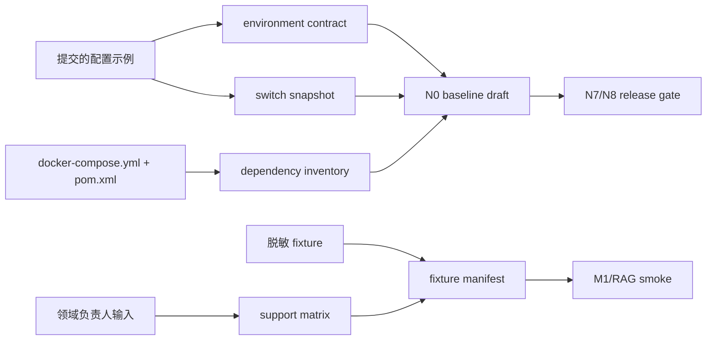

# v1.1 N0 producer 实施记录

## 范围

本次补齐并加固了五个 N0 基线 producer，并补充了离线契约测试：

- `tools/create-environment-contract.mjs`：登记非 Secret 环境变量的格式、阶段、owner 与 Secret 存在性；Secret 值不进入产物。
- `tools/create-support-matrix.mjs`：生成宝可梦朱/紫首发支持矩阵及可复算 hash。
- `tools/export-switch-snapshot.mjs`：从已提交的配置示例导出 13 个开关的默认值、前置条件和回退动作；不读取本地 Secret 配置。
- `tools/export-dependency-inventory.mjs`：从 `docker-compose.yml`/`pom.xml` 导出依赖版本候选、网络边界和探针；不访问 Registry、Docker 或外网，缺 digest 保持 `environment-pending`。
- `tools/create-fixture-manifest.mjs`：对隔离 fixture 生成逐文件/整体 SHA-256、来源/许可审计与记录数；禁止 `.env`、本地配置和证书密钥文件进入 hash。
- `tools/n0-producers.test.mjs`：语法、no-clobber、仓库边界、Secret 脱敏、pending/blocked 语义测试。

公共路径解析和原子写入辅助位于 `tools/lib/io.mjs`。producer 输出只能写入仓库内普通文件，符号链接和父目录越界会被拒绝；`--no-clobber` 在首次写入前预检，避免半套产物。

## 数据流



## 验证结果

在仓库根目录执行：

```powershell
node --test tools/n0-producers.test.mjs
```

结果：`N0 producer tests: 6 passed`。

当前数据的真实环境边界仍保持 fail-closed：

1. 支持矩阵需要领域负责人提供正式补丁号和 owner；缺失时状态为 `pending`。
2. Compose 镜像目前只有 tag，未通过 Registry digest、签名、SBOM 和现场探针，依赖清单不得标记 `ready`。
3. fixture 来源/许可仍是待审核状态，只能作为隔离 smoke candidate，不能进入 active/production release。
4. producer 是离线元数据生成器，不等价于 PostgreSQL、Redis、OIDC、模型、MCP 或监控服务已可用。

执行 producer 时建议使用独立输出目录和 `--no-clobber`；真实 Secret 继续通过环境变量或 Secret Store 注入，禁止复制到 `artifacts/`、镜像层或日志。
