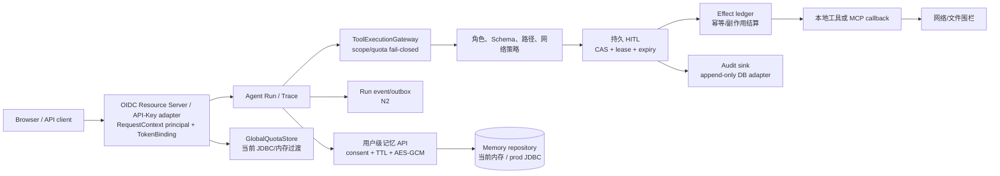

# N3 实施记录：分布式工具治理、HITL、MCP 与隐私

> **记录日期：** 2026-09-03  
> **阶段状态：** `candidate / partial`  
> **发布状态：** `BLOCKED`（本记录不等同于 N3 通过或 GA）  
> **证据范围：** 当前工作树源码、迁移脚本、配置模板和单元测试的静态核对；未读取任何本地真实密钥，也未把本机端口可达、代码存在或单元测试通过解释为真实 staging/生产验收。

本文逐项对照《正式版 v1.1 开发步骤手册》第 7 节 N3，记录当前已经写入代码的能力、可重复验证的边界以及仍然阻塞企业级发布的工作。状态采用以下约定：

| 状态 | 含义 |
| --- | --- |
| `implemented-local` | 源码已有实现，可用本地/单元测试验证；不代表跨进程耐久 |
| `implemented-prod-adapter` | 有 `prod` profile 的适配器或迁移，但尚未完成真实基础设施验收 |
| `partial` | 只覆盖手册要求的一部分，或仍有安全边界缺口 |
| `environment-pending` | 需要 PostgreSQL/Redis/OIDC/MCP/备份或 staging 现场证据 |
| `not-implemented` | 当前源码/工具树中未发现对应实现 |

## 1. N3 在系统中的位置



N3 的安全边界应当是“认证主体 → 资源/工具授权 → 风险审批 → 副作用幂等 → 脱敏审计”。当前代码已经把主体策略和若干端口接入 N2 Run；真实的跨实例组件、身份服务和浏览器协议仍待现场验收。

## 2. 源码与迁移清单（截至记录日期）

### 2.1 已发现的 N3 相关文件

- 数据库迁移：
  - `src/main/resources/db/migration/V15__hitl_approval_lease.sql`
  - `src/main/resources/db/migration/V16__tool_effect_ledger_hardening.sql`
  - `src/main/resources/db/migration/V17__audit_event_append_only.sql`
  - `src/main/resources/db/migration/V18__global_quota_counters.sql`
- HITL 与审计：`HitlApproval`、`HitlApprovalRepository`、`JdbcHitlApprovalRepository`、`InMemoryHitlApprovalRepository`、`HitlManager`、`HitlAuditEvent`、`JdbcHitlAuditSink`、`InMemoryHitlAuditSink`。
- 配额与令牌：`GlobalQuotaStore`、`InMemoryGlobalQuotaStore`、`JdbcGlobalQuotaStore`、`TokenStore`、`SecurityConfig`。
- 工具治理：`ToolCapabilityCard`、`ToolCapabilityCatalog`、`ToolCatalogValidator`、`ToolExecutionGateway`、`PathGuard`、`ResourceDownloadTool`。
- OIDC 边界：`OidcProperties`、`OidcSecurityConfiguration`、`OidcOriginFilter`、
  `ApiKeyAuthInterceptor`、`OidcPrincipalPolicyAdapter`、
  `OidcPrincipalPolicyProperties`、`PrincipalPolicyDecision`。
- 用户级记忆：`UserMemoryEntry`、`UserMemoryRepository`、`JdbcUserMemoryRepository`、`InMemoryUserMemoryRepository`、`UserMemoryService`、`UserMemoryController`、`MemoryCipher`、`AesGcmMemoryCipher`、`MemoryConfig`。
- 测试：`PersistentHitlManagerTest`、`GlobalQuotaStoreTest`、`UserMemoryServiceTest`、`ToolCatalogValidatorTest`、`ToolExecutionGatewayTest`（含 OIDC 缺失绑定拒绝回归），以及既有 `SecurityIntegrationTest`、`CorsConfigTest`、`OidcPropertiesTest` 等。

### 2.2 当前配置事实

- `application.yml` 和 `application-prod.yml` 均默认关闭 `VIO_MCP_ENABLED`、`VIO_HIGH_RISK_TOOLS_ENABLED`、`VIO_MEMORY_ENABLED`；全局配额通过 `VIO_GLOBAL_QUOTA_ENABLED` 显式开关。
- 旧版本地 `SimpleVectorStore` 的异常降级已单独受 `vio.rag.legacy-memory.enabled`（环境变量 `VIO_RAG_LEGACY_MEMORY_ENABLED`）控制，默认 `false`。关闭时 Embedding/ETL 初始化失败会抛出带 `RAG_LEGACY_MEMORY_INIT_FAILED`、阶段和失败类型的安全异常；只有显式 opt-in 的 local/test 兼容运行才返回空库，并记录 `degraded=true`。该路径不代表生产索引，也不能作为 RAG 可用性证据。
- `application-prod.yml` 的数据库、模型、搜索和 API Key 通过环境变量占位符注入；本记录不读取 `application-local.yml` 或 `mcp-servers.json`。
- `SecurityConfig` 已把 `/memory/**` 纳入认证拦截路径，并保留健康检查、Swagger/OpenAPI 的排除规则。
- `pom.xml` 已加入 Spring Boot Redis starter 和 Resource Server 所需 Spring Security 依赖；Redis 适配器仍只在 `prod + VIO_GLOBAL_QUOTA_ENABLED=true + VIO_GLOBAL_QUOTA_BACKEND=redis` 时装配。`OidcSecurityConfiguration` 已提供条件化 JWT Resource Server、issuer/JWKS/audience 校验和角色 claim 转换，并在启动阶段校验非 Secret OIDC 契约；这仍不是完整的 OIDC Authorization Code + PKCE/Session 或企业级主体策略上线证据。

## 3. Step 1：持久化审批、幂等和审计

### 3.1 已实现内容

| 手册要求 | 当前实现 | 状态 |
| --- | --- | --- |
| 审批记录包含主体、Run、工具版本、参数摘要、风险和决定 | `HitlApproval` record；`V15` 建立 `hitl_approval` 表及约束 | `implemented-prod-adapter` |
| 审批创建幂等 | `createOrGet` 按 `user_id/run_id/tool_name/tool_version/parameter_digest` 查询；数据库有 PENDING 唯一索引 | `partial` |
| 第一个合法决定获胜 | JDBC `FOR UPDATE` + `version` CAS；内存实现使用同步块；终态不会被反向覆盖 | `implemented-local` / `implemented-prod-adapter` |
| 租约和过期 | `claim`、`lease_owner`、`lease_expires_at`、`expireDue`；到期映射为 `EXPIRED` | `implemented-prod-adapter` |
| 审批与用户/Run 绑定 | `HitlManager.decide` 和 `HitlController` 对 user/run 做一致性校验，错误时不泄露其他审批存在性 | `implemented-local` |
| 工具调用前阻断缺失审批 | `ToolExecutionGateway` 先做策略和 HITL，再执行 callback；未知工具/角色默认拒绝 | `implemented-local` |
| 副作用账本加固 | `V16` 为 N2 的 `agent_effect_ledger` 增加 trace、attempt、retention 字段及终态更新触发器 | `implemented-prod-adapter` |
| 审计 append-only | `JdbcHitlAuditSink` 与 `JdbcToolAuditSink` 只 INSERT；`V17` 通过触发器拒绝 UPDATE/DELETE，并撤销 PUBLIC 权限 | `implemented-prod-adapter` |
| 审计参数脱敏/幂等 | `ToolAuditSink`/`JdbcToolAuditSink` 先脱敏再做 SHA-256 参数摘要，以摘要作为稳定 eventId；重复 eventId 内容不一致会失败 | `implemented-local / implemented-prod-adapter` |

### 3.2 已有可验证证据

- `PersistentHitlManagerTest` 验证持久仓储路径、同一审批的重复决策、已批准调用重放和跨 Run 决策拒绝。
- `ToolExecutionGatewayTest` 验证未知工具拒绝、角色边界、HITL 等待、参数 Schema 拒绝、并发幂等和网络地址拒绝。
- `ToolExecutionGatewayTest.durableAuditFailureNeverReturnsExecuted` 验证持久审计失败时，外部回调虽已发生，网关会返回稳定 `FAILED` 并将副作用标为 `UNKNOWN`，避免误报成功或自动重放；`JdbcToolAuditSinkTest` 覆盖脱敏、摘要和重复 eventId 冲突。
- `V15`/`V16`/`V17` 仅完成源码级迁移定义；当前未在真实 PostgreSQL 16 上执行 `flyway migrate/validate`，也没有两实例现场抢占、审计篡改告警和按 trace/run/approval 查询的 HTTP 证据。

### 3.3 尚未完成或需修正的边界

1. `HitlAuditSink.noop()` 和旧版 `HitlManager` 程序化构造器仍然存在，虽然 Spring `prod` profile 会优先装配 JDBC sink，但尚未有启动断言证明生产绝不会落到 noop；需要增加 `prod` context test。
2. 本地兼容构造器仍可使用 `AuditLogger` 写入 `logs/audit/*.jsonl`；正式 Spring `prod` 路径优先装配 `JdbcToolAuditSink`，普通工具与 HITL 共用 `audit_event` append-only 表。若生产 typed sink 缺失，`FailClosedToolAuditSink` 会拒绝写入，网关不会把工具结果返回为 `EXECUTED`。
3. 尚无受限 cleanup job、retention owner、删除/密钥轮换/备份恢复操作审计；手册要求的 365 天安全审计等策略还没有冻结为合规 ADR。
4. 尚无审计查询 API、hash 回读/断链告警的可执行 producer；`event_hash` 目前是事件内容摘要，不等于完整 hash-chain/WORM 证明。
5. `V16` 的触发器和约束需要在目标 PostgreSQL 版本执行验证；不能仅凭 SQL 文件存在宣称迁移成功。

## 4. Step 2：全局配额与 TokenBinding

### 4.1 已实现内容

- `GlobalQuotaStore` 抽象统一了配额调用契约。
- `InMemoryGlobalQuotaStore` 提供本地/测试原子窗口桶。
- `JdbcGlobalQuotaStore` + `V18__global_quota_counters.sql` 提供 PostgreSQL UPSERT 条件更新过渡实现。
- `RedisGlobalQuotaStore` 使用单次 Lua `EVAL` 原子完成 GET/限额判断/INCR/PEXPIRE，键格式为 `vio:quota:v1:<sha256(scope)>:<sha256(subject)>:<bucket>`；拒绝请求不再递增，Redis TTL 自动清理。
- `RedisGlobalQuotaConfiguration` 仅在生产 Redis backend 显式开启时装配；Redis Template 缺失或脚本返回值异常时使用 fail-closed 适配器，`TokenStore` 不会降级到 JVM 窗口。`JdbcGlobalQuotaStore` 与内存实现通过 backend 条件互斥。
- `application-prod.yml` 提供 `VIO_REDIS_HOST/PORT/USERNAME/PASSWORD/*TIMEOUT/SSL` 脱敏占位；真实连接信息只能通过环境或 Secret Store 注入，默认仍关闭配额。
- `TokenStore.consumeRate` 在有共享 store 时使用 token subject 的 SHA-256 摘要；共享 store 异常时 fail-closed，429 文案只包含可重试秒数和额度，不返回 token。
- `TokenStore.authorizeTool` 每次副作用前回查当前注册表，使撤销/过期不会被旧绑定快照静默绕过。
- `GlobalQuotaStoreTest` 覆盖窗口耗尽、下一桶恢复、拒绝文案不含 token。

### 4.2 与手册的差距

| 要求 | 现状 | 状态 |
| --- | --- | --- |
| Redis/Lua 跨实例原子桶 | `RedisGlobalQuotaStore` + Spring Boot Redis starter + Lua 脚本已落地；尚未接入真实 Redis 双实例 | `implemented-prod-adapter / environment-pending` |
| userId/runId/tool/IP 多维配额 | 当前 `TokenStore` 主要按 token-minute | `partial` |
| 请求、模型 Token、高危工具分别计量 | 尚未有模型 Token/高危工具独立预算接口 | `not-implemented` |
| token 撤销/轮换跨实例立即生效 | 当前注册表为 JVM 内存 | `partial` |
| Redis key schema、TTL、脚本、故障演练 | key schema、TTL 和 fail-closed 代码/单测已具备；真实故障与跨实例演练未执行 | `implemented-local / environment-pending` |

在 Redis 连接、key schema、时钟/TTL、故障时 fail-closed 和两实例测试未冻结前，`VIO_GLOBAL_QUOTA_ENABLED` 应保持关闭；当前代码落地不等于 V18 或 Redis GA 验收。

## 5. Step 3：统一身份、Session、CSRF 与 Origin

### 5.1 当前可用路径

- `ApiKeyAuthInterceptor` 支持 `X-API-Key`/Bearer，成功后写入 `RequestContext.principalId`、兼容 `userId` 和短期 `TokenBinding`；日志只输出脱敏前缀。
- `OidcSecurityConfiguration` 在 `vio.security.oidc.enabled=true` 时装配 JWT Resource Server，校验 issuer/JWKS/audience，并将配置的 subject/role claim 转为 Spring authorities；当前解码器固定使用 RS256，`OidcProperties` 同步只接受精确的 `[RS256]`，ES256、`none`、空列表、混合列表和大小写变体都会在启动校验阶段 fail-fast，避免“配置声称允许但运行时未实现”的算法漂移。OIDC 分支由 `ApiKeyAuthInterceptor` 复用已认证主体，不再要求第二个 API Key。
- `SecurityConfig` 将业务主链、HITL、知识、Pokemon、管理、诊断和 memory 路径纳入拦截器；安全开关关闭时保持本地开发兼容。
- `CorsConfig` 使用显式 origin 白名单、允许 credentials、暴露 `Retry-After`/trace 头；`CorsConfigTest` 覆盖通配符和非法 origin 拒绝。
- `RequestContext.clear()` 在认证失败和请求完成时调用，避免 ThreadLocal 泄漏。
- `ToolExecutionGateway` 已增加 OIDC 缺失绑定的 fail-closed 门禁：当当前线程存在已认证主体，或 Spring 装配阶段 OIDC 开关已启用（覆盖异步 Run worker 丢失 `SecurityContext` 的情况）时，缺少 `TokenBinding` 会在工具 scope/quota 阶段拒绝，不能进入 callback。

### 5.2 未实现项（发布阻塞）

- 尚未完成 OIDC Authorization Code + PKCE、HttpOnly/Secure/SameSite Session、登录/退出和 JWKS 轮换的端到端现场证据；当前 Resource Server 只覆盖 JWT API 入口和配置级启动校验。
- `OidcProperties` 已有 idle/absolute Session TTL 的范围校验，但尚无真实 Session 生命周期、登录/退出和 JWKS 轮换证据。
- Resource Server 配置了 CSRF cookie/header 与 `OidcOriginFilter` 的代码路径；尚无完整的 CSRF token、Origin/Referer 失败 HTTP 契约和浏览器端到端证据（现有 CORS 不是 CSRF 防护的替代品）。
- `OidcPrincipalPolicyAdapter` 已把经过 Resource Server 验证的主体、tenant claim、角色
  与显式 `tenantRoles/roleTools` 配置映射为 `PrincipalPolicy`；未知 tenant/角色/工具
  默认拒绝，`ApiKeyAuthInterceptor` 将短期 OIDC `TokenBinding` 写入 `RequestContext`。
  `PokemonAgentRunService` 会在创建 Run 时捕获该非 Secret policy 快照，并传给异步
  `ToolExecutionContext`，不再依赖 ThreadLocal 或硬编码 trainer 角色。以上为
  `implemented-local` 代码/单测事实，不等于生产身份服务已接通。
- 仍未闭合的是短期 binding 的跨实例撤销/轮换、持久化 policy snapshot 的重启恢复、
  user/Run/tool 多维配额与审计关联，以及真实 OIDC/JWKS/Session/CSRF 现场证据；
  缺失绑定时网关继续 fail-closed，不会隐式套用 trainer 或绕过 TokenStore。

因此当前 API-Key 仅可作为隔离本地或临时 staging 验收方案；N3/GA 不能宣称 OIDC 已完成。

### 5.3 本次安全修复证据与后续 adapter 边界

**已落地的最小修复（implemented-local）：**

1. `ToolExecutionGateway` 从 `OidcProperties` 锁定 OIDC 开关；授权 scope 和频率 quota 两个入口共享同一缺失绑定门禁。
2. 当前线程的已认证 `SecurityContext` 也会触发门禁，避免 OIDC 请求在 MVC 线程上绕过；全局开关覆盖切换到异步 worker 后的 `SecurityContext` 丢失。
3. `ApiKeyAuthInterceptor` 的 OIDC 分支会清除可能残留的旧 API-Key binding；`TokenBinding` 非空时仍沿用原 `TokenStore.authorizeTool/consumeRate`，API-Key 路径不改变；程序化构造器默认关闭门禁，旧单测/嵌入式调用保持兼容。
4. `ToolExecutionGatewayTest` 定向回归覆盖：OIDC 已认证且无绑定拒绝、worker 无 `SecurityContext` 时仍拒绝、OIDC 门禁开启时 API-Key 绑定正常通过；`ApiKeyAuthInterceptorTest` 覆盖 stale binding 清理。本地 Maven 联合结果为 24 tests、0 failures、0 errors。

**principal→policy adapter 的实现状态与剩余边界（implemented-local / environment-pending）：**

- `OidcPrincipalPolicyAdapter` 已完成主体→租户→角色→工具映射、显式策略版本和
  未知主体拒绝；`OidcPrincipalPolicyAdapterTest`、`OidcPolicyInterceptorTest` 覆盖
  正常、角色交集和拒绝路径。
- 创建 Run 时已捕获 `PrincipalPolicy`/短期 binding 的安全快照并传给异步 worker；事件
  只记录 tenant、角色、policy version/fingerprint/过期时间，JWT/Secret 不落库。
- OIDC 主体已可生成短期 OIDC `TokenBinding`，并沿用 Gateway 的 scope/quota/审计
  入口；跨实例撤销/轮换、Redis 全局配额联动和持久 policy snapshot 仍需补齐。
- 完成跨实例、角色越权、配额耗尽、撤销即时生效和 OIDC/JWKS 轮换的 staging 证据后，才可打开 OIDC 工具能力或将 N3 标记为通过。

## 6. Step 4：网络、文件与内容策略

### 已有防护

- `PathGuard` 在 normalize 前拒绝 `..`，限制绝对/相对路径白名单，并检查已存在祖先的真实路径和符号链接逃逸。
- `ToolExecutionGateway` 递归检查嵌套对象/数组中的 command/path/url 字段，避免只检查顶层参数。
- `ResourceDownloadTool` 仅接受 HTTP(S)、禁止 URL userinfo、关闭自动重定向、连接/读取超时 10 秒，并以 `BoundedInputStream` 限制单文件 20 MiB；通过 `ResourceDownloadProperties` 固定 MIME allowlist、单进程总额 100 MiB、同目录临时文件+原子 no-overwrite 写入和 SHA-256 artifact 回执。
- `ToolCapabilityCatalog` 将 `readFile` 限定为 operator/admin；玩家目录只包含低风险、无写副作用工具，启动时由 `ToolCatalogValidator` 校验。

### 仍缺少的生产级控制

- DNS 解析、建立连接和响应前后均有本地地址拒绝与无重定向校验，但尚未接入独立出口代理/DNS pinning resolver，不能据此宣称已完成生产级 rebinding 防护。
- MIME allowlist、单文件/本地总额配额、目录配置校验和结构化 artifact 回执已有源码/单测；仍需 staging 的真实磁盘、内容嗅探、租户级配额和策略扫描证据。
- 目标目录由 `ResourceDownloadProperties` 固定并以同目录临时文件原子写入；与生产 `PathGuard`/对象存储边界的联合契约和多实例配额仍待验收。
- 截断/恶意内容的端到端回放、内容策略扫描和 artifact 消费方拒绝未签名内容仍需现场证据。

## 7. Step 5：唯一生产 MCP 路径

### 当前事实

- `pom.xml` 引入 `spring-ai-starter-mcp-client`；`application*.yml` 通过 `VIO_MCP_ENABLED` 控制客户端开关，默认关闭。
- `ToolCallAgent` 在取得 `ToolCallbackProvider` 后可调用 `ToolExecutionGateway.wrap`；显式 `wrapMcp` 可以为 MCP callback 绑定能力卡。
- 自研协议、transport、session 和 bridge 位于 `src/main/java/com/vio/vioaiagent/mcp/`；
  `McpEndpointPolicy` 已对 base/session endpoint 做 HTTPS/loopback、同源、userinfo、
  query/fragment 边界校验，SSE/STDIO 日志只记录主机/路径摘要和字节数，不输出完整 JSON-RPC。
- `application-mcp-lab.yml` 与 `config/mcp-production-boundary.json` 将自研链明确标记为
  实验 profile；`production` Maven profile 的 jar 排除规则和静态 validator 会拒绝把该包
  作为生产构件/默认 provider。该隔离是源码/构建门禁，不等于真实 provider 已验收。
- `mcp-servers.example.json` 仅是无真实密钥的模板；没有把它当成 provider 认证或现场握手证据。

### 未完成项

1. 已有 `mcp-lab` profile/production jar 排除和静态边界校验；仍需在 CI 运行真实构件扫描，
   证明生产镜像不会携带自研实验包或实验配置。
2. 没有唯一生产 provider 的版本、认证 audience、TLS、超时、断开和工具版本登记。
3. 没有 server/user 凭据隔离、真实 MCP handshake、断开 fail-closed、远程 MCP 经同一 Gateway
   的 staging 证据；当前 endpoint 策略只解决 URL/日志边界，不替代 DNS pinning 或 provider 认证。
4. 未发现 `VIO_REMOTE_MCP_ENABLED` 的完整配置/测试闭环；远程 MCP 必须保持关闭，不能因本地配置文件存在就自动启用。

## 8. Step 6：用户级长期记忆

### 已实现内容

- `UserMemoryEntry` 以 `userId`、`contentDigest`、`ciphertext`、`keyVersion`、`consentId`、有效期和删除时间为核心字段；正文不以明文存储。
- `UserMemoryService.remember` 要求显式 consent，限制内容大小和 TTL（默认 30 天，最长 3650 天），按认证主体保存。
- `AesGcmMemoryCipher` 使用 AES-GCM、随机 IV 和 `userId:keyVersion` AAD；配置值为空或模板占位符时拒绝启动/构造。
- `InMemoryUserMemoryRepository` 用于 local/test；`JdbcUserMemoryRepository` 预留 `prod` 适配器，所有查询带 `user_id`。
- `UserMemoryController` 提供保存、查询、导出和删除 API；不信任请求体的 userId，也不允许通过 `X-User-Id` 覆盖认证主体。`/memory/**` 已纳入认证拦截路径。
- `UserMemoryServiceTest` 覆盖 consent 必填、用户隔离、删除后不可召回、AAD 用户绑定和占位密钥拒绝。

### 当前阻塞与风险

- `V19__user_memory.sql` 已加入迁移目录并通过静态 SQL 检查；真实 prod 数据库的 Flyway validate、索引/权限检查和回读仍待目标环境执行，不能仅凭文件存在声明数据库已升级。
- 当前加密实现是应用内 AES-GCM 适配器，不是 KMS envelope encryption；没有密钥轮换、旧版本解密窗口、KMS 权限审计和密钥销毁流程。
- 没有 consent 撤回实体/审计事件，删除是软删除；尚无删除后缓存失效、备份恢复和导出权限的现场证据。
- `recall` 会在应用进程内解密后做文本过滤，尚未建立按租户的检索索引、敏感字段策略和大规模分页/速率限制。
- 尚无前端记忆授权、撤回、导出、删除入口，也没有 `n3-memory-export-restore.jsonl` 等原始证据。
- 记忆开关默认关闭；没有授权时应继续只使用窗口记忆，不能从其他用户召回偏好。

## 9. Step 7：红队测试与证据状态

### 9.1 手册要求的 N3 原始证据

手册规定每次 N3 run 使用新目录 `artifacts/v1.1/test/<n3RunId>/n3-raw/`，由显式文件清单、manifest producer 和当前 run 指针生成不可变输入。要求覆盖：

```text
n3-security-ssrf.jsonl
n3-security-rbac.jsonl
n3-security-hitl.jsonl
n3-security-mcp.jsonl
n3-security-memory-delete.jsonl
n3-oidc-session-csrf.jsonl
n3-redis-quota-lease.jsonl
n3-audit-append-only.jsonl
n3-mcp-handshake.jsonl
n3-player-tool-catalog.json
n3-operator-tool-catalog.json
n3-memory-export-restore.jsonl
n3-network-content-policy.jsonl
n3-evidence-manifest.json
```

已补齐四个 fail-closed producer：`create-n3-evidence-file-list.mjs`、`validate-n3-evidence-file-list.mjs`、`create-n3-evidence-manifest.mjs`、`export-n3-evidence-index.mjs`，并补充 `aggregate-security-report.mjs`。它们只接受显式 root-relative 文件、拒绝 glob/越界/符号链接/重复路径，使用 SHA-256 和 `--no-clobber` 生成不可变输入；`n3-security-summary.json` 仍由 N6a 聚合器产生，N3 不直接覆盖。当前仓库没有真实 N3 raw 红队输出，因此 producer 单测只能证明路径、hash、schema 和失败语义，不能替代现场安全证据。

### 9.2 当前证据与解释边界

| 证据 | 可支持的结论 | 不能支持的结论 |
| --- | --- | --- |
| `PersistentHitlManagerTest` | 单 JVM 持久端口/绑定/CAS 语义 | 两实例 PostgreSQL 抢占、重启恢复 |
| `GlobalQuotaStoreTest`、`RedisGlobalQuotaStoreTest` | 内存接口、Lua 输入/TTL/哈希键和故障 fail-closed 语义 | Redis/Lua 跨实例实际限流 |
| `UserMemoryServiceTest` | consent、AAD、用户隔离、删除逻辑 | prod schema、KMS、备份恢复 |
| `ToolExecutionGatewayTest` | 网关顺序、角色/Schema/基本 SSRF 拒绝 | DNS rebinding、MIME/磁盘配额、真实 MCP |
| `V15`–`V18` SQL 文件 | 迁移意图和约束草案 | Flyway/PG 实际可执行与权限配置 |
| `manifest.draft.json`、dependency smoke | N0 仍处于草稿/环境待验收 | N3 或 GA 已通过 |

## 10. N3 完成顺序（下一轮开发手册）

按以下顺序推进，任何一步失败都保持相关开关关闭：

1. **冻结 ADR 与环境契约**：确定唯一 Redis 实现、MCP provider、OIDC provider、审计 retention、KMS 边界和 owner；把 Redis/OIDC/MCP/备份列入 dependency inventory。
2. **补齐数据库 schema**：新增并评审 `memory_entry` 迁移（建议使用下一未占用版本号），为 `hitl_approval`、`audit_event`、effect ledger 执行 `flyway validate`；确认 DB 角色只能 INSERT 审计。
3. **加固生产 HITL**：加入 `prod` context test，禁止 noop audit；补审计查询、过期 worker、cleanup/retention 和 operator 操作记录；运行双实例并发和重启回放。
4. **落地 Redis/Lua**：锁定 key schema、窗口/租约 TTL、脚本 hash、故障 fail-closed；覆盖 user/run/tool/IP、模型 Token、高危工具配额与撤销轮换。
5. **完成 OIDC/Session/CSRF 现场闭环**：保留当前 Resource Server、主体策略 adapter
   与网关缺失 `TokenBinding` 的 fail-closed 门禁；再选择 Spring Security Resource
   Server/Client 或已审计网关，完成 PKCE、HttpOnly Session、CSRF/Origin 负例、JWKS
   轮换、跨实例撤销/轮换和主体策略持久化恢复的 staging 证据。主体→tenant→role→tool
   的本地映射及异步 Run 快照已落地，不再重复实现；仍需补齐其生产证据。
6. **完成网络/内容围栏**：使用连接前后均可验证的 DNS pinning resolver，加入 MIME/响应/磁盘总量配额、artifact schema 和 report-root 只读边界。
7. **隔离 MCP**：将自研实现移至 `mcp-lab` 或显式 experimental profile；生产只装配一个 Spring AI provider，所有远程 callback 强制进入 Gateway，保存 handshake/断开/认证证据。
8. **完成记忆正式化**：接入迁移后的 JDBC/KMS、consent 撤回、删除缓存失效、导出/恢复审计及最小 UI；先在隔离环境开启 `VIO_MEMORY_ENABLED`。
9. **生成 N3 evidence manifest**：每次运行使用唯一 `VIO_N3_RUN_ID`，先 raw 再显式文件清单/哈希/manifest，N6a 只读 manifest；禁止手工覆盖 summary。
10. **执行退出门槛**：越权、未审批写操作、跨用户串用、密钥泄漏为 0；双实例审批/配额/幂等、SSRF/DNS rebinding、MCP 断开、记忆删除/恢复和审计不可篡改均有现场证据后，才允许在后续 N6/N7 评审开启开关。

## 11. 开关与回滚矩阵

| 开关 | 当前默认 | N3 开启前置条件 | 回滚动作 |
| --- | --- | --- | --- |
| `VIO_HIGH_RISK_TOOLS_ENABLED` | `false` | 持久 HITL、审计和红队通过 | 立即关闭，拒绝高危工具 |
| `VIO_GLOBAL_QUOTA_ENABLED` | `false` | Redis（或经批准过渡实现）双实例/故障证据 | 关闭共享配额，保持 fail-closed 或限流只读路径 |
| `VIO_MCP_ENABLED` | `false` | 唯一 provider、认证/断开/Gateway 证据 | 关闭 MCP，仅保留本地只读工具 |
| `VIO_REMOTE_MCP_ENABLED` | 未形成完整闭环 | 远程认证、TLS、audience、超时、审计和断开证据 | 保持关闭，不回退到旁路 |
| `VIO_MEMORY_ENABLED` | `false` | schema、KMS/密钥策略、授权/删除/恢复证据 | 关闭长期记忆，保留窗口记忆 |

回滚不得删除历史审计、DLQ 或审批记录，不得把系统回退到自动批准、公开默认密钥或无 Gateway 的 MCP 旁路。

## 12. N3 退出清单（当前勾选状态）

- [x] 代码层持久 HITL 端口、CAS、租约和过期模型已建立。
- [x] 工具能力卡、玩家/运营角色边界和基础网关拒绝路径已有单元测试。
- [x] 用户级记忆 API、consent、TTL、删除/导出和 AES-GCM 最小实现已建立。
- [ ] 真实 PostgreSQL/Flyway 迁移、两实例审批和审计篡改证据。
- [x] Redis/Lua 全局配额适配器、key schema、TTL 与故障 fail-closed 代码和脱敏单测。
- [ ] Redis/Lua 双实例、网络故障、时钟偏差、租约/撤销和恢复现场证据。
- [x] OIDC 已认证但缺少 `TokenBinding` 时，网关在工具 scope/quota 阶段 fail-closed；无 Spring Security 的程序化构造器和 API-Key 绑定路径回归通过。
- [x] `OidcPrincipalPolicyAdapter` 的主体→tenant→role→tool 映射、短期 OIDC `TokenBinding`、Run 异步快照和未知主体拒绝已有代码/单测。
- [ ] OIDC/PKCE、HttpOnly Session、CSRF/Origin 和 JWKS 轮换证据。
- [ ] principal policy 的跨实例撤销/轮换、持久化重启恢复、多维配额与生产审计关联证据。
- [ ] DNS pinning、MIME/磁盘配额、artifact schema 与 fuzz 证据。
- [ ] 生产 MCP 单一路径、凭据隔离、认证和断开证据。
- [ ] `memory_entry` 生产迁移、KMS/轮换、删除缓存失效和备份恢复证据。
- [x] N3 raw/evidence file-list、manifest、index producer 与不可变失败语义已有本地单测；真实 raw/双实例汇总仍待环境执行。
- [ ] 所有 N3 P0 证据汇总后解除 `releaseStatus=BLOCKED`。

**结论：** 当前 N3 已完成一组可审计的代码骨架和本地安全回归，但仍是“可继续开发的 candidate”，不是可对外承诺的成熟企业级智能体安全基线。下一阶段应优先补齐真实依赖、身份协议、MCP 隔离和证据 producer，再考虑打开高危工具、远程 MCP 或长期记忆。

## 13. 会话删除与不可变证据的生命周期修正

审计发现，原生产实现对 `conversation` 使用物理 `DELETE`，与下游外键/触发器存在冲突：

- `agent_run` 删除会级联到 `answer_projection`，但 V21 的 append-only 触发器会拒绝该级联 `DELETE`；
- V15 的 `hitl_approval.run_id` 和 V17 的 `audit_event.approval_id` 使用 `ON DELETE RESTRICT`，存在审批/审计时物理删除会直接失败；
- 物理删除即使偶尔成功，也会破坏反馈所需的 answerId→run→trace→release 证据链。

最小修复已落地：`JdbcConversationRepository.deleteForUser` 改为按用户条件设置 `deleted_at` 的软删除，并将同 ID `save` 的 upsert 限制为未删除会话，防止删除后复活旧 Run。面向用户的会话、Run、消息和答案投影查询均已有 `deleted_at IS NULL`/可见性过滤，因此外部仍得到删除后的 404/空列表；答案投影本体仍保留供后台审计和血缘回放，不能通过用户 API 或反馈入口绕过会话门禁。`PokemonAgentRunService` 仍先停止本地 worker，避免软删除后异步写入。

当前边界：会话消息正文仍由服务层按用户删除，答案投影/审计保留策略、脱敏和定期受限清理需要单独的 retention/KMS 方案；不得把软删除误写成“已完成物理擦除”。`JdbcConversationRepositoryLifecycleTest` 覆盖生产仓储不会发出物理 DELETE。
