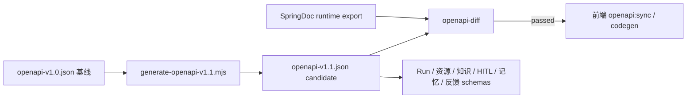

# N4 OpenAPI 单源契约实施记录

## 目标与边界

本次实现把 Spring Controller 的公开 HTTP 语义固化为可审查、可版本化的
`contracts/openapi-v1.1.json`。它从冻结的
`contracts/openapi-v1.0.json` 复制并扩展，因此 v1.0 的路径、方法和原有
`required` 字段会被保留；新增字段/接口以加法方式进入候选契约。

运行时 SpringDoc 导出仍是 staging 的现场输入，不能被本地快照替代。生产
认证、数据库、模型、MCP 和实时 broker 不在本地契约生成器中执行，也不会从
本地配置读取密钥。

## 代码落点

- `contracts/openapi-v1.0.json`：v1.0 兼容基线。
- `contracts/openapi-v1.1.json`：审阅中的 v1.1 candidate（**57 个路径、71 个 schema**）。
- `tools/generate-openapi-v1.1.mjs`：纯本地、无依赖的确定性生成器；默认从 v1.0 基线生成。
- `tools/openapi-diff.mjs`：默认比较 v1.0 → v1.1；可用 `--candidate` 指定 staging 导出。
- `tools/sync-openapi-contract.mjs`：将 candidate 离线同步到前端忽略目录
  `vio-ai-agent-frontend/src/api/openapi.json`。
- `vio-ai-agent-frontend/package.json`：新增 `openapi:sync`、`openapi:from-contract`，
  `openapi:diff` 改为比较仓库 candidate；原 `openapi` 仍保留 runtime fetch 流程。

## 契约覆盖



候选契约包含：

1. 可恢复 Run、JSON 事件回放、snapshot SSE、取消和游标/幂等错误语义；取消请求统一使用
   `CancelRequest`（可选、经清洗的 `reason`），并保留 v1.0 幂等 hash 的兼容回放；
2. 会话、队伍、收藏的用户隔离、分页游标和兼容 `/pokemon/*` 入口；
3. 版本化事实、确定性计算（属性克制、速度、伤害、队伍合法性）、活动 freshness、答案血缘和结构化 `FactCard`、
   `CalculationCard`、`TeamMatrixCard`、`RetrievalCitationCard`、
   `ToolTimeline`、`ApprovalCard`、`FeedbackCard`、`ErrorCard`；
4. 摄取 Job/Attempt/DLQ、文档审核、知识/索引发布与 N1b promotion；
5. Run 绑定 HITL、用户记忆、健康/就绪/诊断和已标记 deprecated 的历史 AI 入口。
6. canonical `AgentEvent` 信封（`schemaVersion/eventId/type/sessionId/runId/traceId/timestamp/payload`）和
   `/chat/conversations/{conversationId}/messages` 消息入口；旧 `eventType` 形状不再作为 v1.1 canonical 输出。

线上 canonical 字段统一使用 camelCase。数据库或评测中的 snake_case 不写入
该 response；必要的兼容形状用 `oneOf` 或 `x-item-schema` 标记，不删除 v1.0
客户端仍能消费的形状。

## 可重复命令

在仓库根目录：

```powershell
node tools/generate-openapi-v1.1.mjs --output contracts/openapi-v1.1.json
node tools/openapi-diff.mjs --base contracts/openapi-v1.0.json `
  --candidate contracts/openapi-v1.1.json `
  --fail-on-breaking --report artifacts/v1.1/test/openapi-diff.json
```

在前端目录进行离线 codegen：

```powershell
npm run openapi:sync
npm run openapi:gen
npm run openapi:postgen
```

需要验证实际 SpringDoc 输出时，先在隔离 staging 实例导出
`/api/v3/api-docs/default`，再将该文件通过 `--candidate` 传给 diff；不要把
运行中导出覆盖仓库 candidate，也不要把探针结果当作生产验收。

## 当前验证结果（2026-09-04）

- `node --check tools/generate-openapi-v1.1.mjs`：通过。
- `node --test tools/openapi-diff.test.mjs`：5/5 通过。
- v1.0 → v1.1 diff：`passed=true`、`breaking=[]`（**0 breaking**）；新增路径和结构化 schema
  会列在 `additions` 中。当前 candidate 统计为 **57 paths / 71 schemas**。
- `openapi:sync`：离线同步 v1.1，未访问网络、未读取敏感配置。
- 前端 `openapi:diff` 与后端 candidate 均通过；运行时 SpringDoc 导出仍须在隔离 staging 对照。

## 未宣称完成的现场门禁

候选契约通过只证明静态兼容性。真实运行时导出、SpringDoc 与 candidate 的
一致性、OIDC/API-Key、PostgreSQL/PGVector、MCP/broker、浏览器 E2E 和生产
发布仍需 staging/GA 环境的独立证据；任何 breaking diff 或 schema 语义变化
都必须升级 `schemaVersion` 并重新评审。
