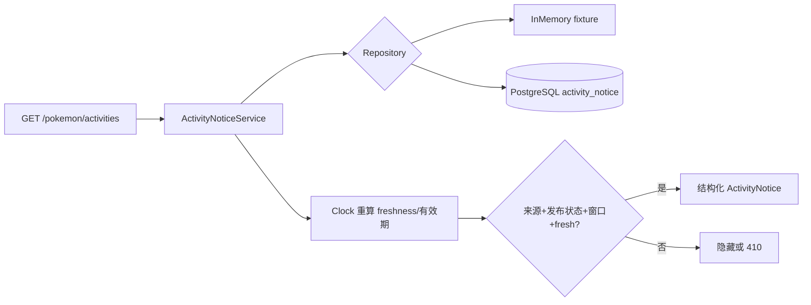

# N4 活动资讯 API 实施记录

> 本记录只描述本次代码增量，不代表 v1.1 GA 已发布。真实来源、许可证、PostgreSQL 迁移和 staging 业务演示仍需按发布门禁复核。

## 已实现

- `ActivityNotice`：不可变活动版本快照，包含 `noticeKey/versionNo`、`gameReleaseId/dlcId/language`、来源与许可证、抓取时间、半开有效窗口、状态、checksum、schema/content version。
- `ActivityNoticeService`：统一以 UTC `Clock` 重算 freshness；仅展示来源可靠、`REVIEWED/PUBLISHED/ACTIVE` 且处于有效窗口并在 freshness 窗口内的记录。候选、无来源、未来生效、陈旧或过期记录 fail-closed。
- `InMemoryActivityNoticeRepository`：本地/单测仓储，默认空库；同一版本 ID 不允许静默覆盖。
- `JdbcActivityNoticeRepository`：`prod` profile PostgreSQL 适配器，按游戏/DLC/语言/地区和有效窗口过滤；V20 触发器阻止版本键、checksum、content version 被更新。
- `ActivityNoticeController`：只读接口：
  - `GET /api/pokemon/activities`
  - `GET /api/pokemon/activities/{noticeId}`
  - 必填 canonical `gameReleaseId`、`language`；可选 `dlcId`、`region` 和 `limit`。不开放客户端 `at`，避免用历史时间绕过当前过期门禁。
  - 不可展示的单条记录返回 410；不存在返回 404；不会回传候选正文。
- `ActivityNoticeFixtureInitializer`：非 prod 且显式 `VIO_ACTIVITY_FIXTURE_ENABLED=true` 时加载脱敏 fixture。
- `V20__activity_notice.sql`：活动表、窗口/版本约束、索引和不可变触发器。

## 请求链

## 配置与 fixture

- `vio.pokemon.activity.max-freshness-days`（默认 7）控制抓取时间窗口。
- `vio.pokemon.activity.fixture.enabled` 默认 `false`，生产 profile 强制关闭。
- 脱敏示例：`data/v1.1-fixture/activity-notices.json`；PostgreSQL 导入示例：`data/v1.1-fixture/activity-notices.sql`。

## 验证与未完成项

已补充并通过源码级单元测试覆盖：有效窗口半开边界、freshness 重算、过期/未来/候选隐藏、来源 URL 校验、版本不可覆盖、canonical 过滤和 fixture 解析。完整 Maven 构建仍受当前环境父 POM/依赖解析条件影响，V20 需在目标 PostgreSQL 上执行 `flyway validate` 与迁移 smoke。

以下能力不在本增量中宣称完成：官方数据源抓取与许可证审核、来源 allowlist、Redis/队列刷新、活动卡片事件与前端 reducer、真实 staging E2E、GA 评测门禁。

## 回滚

关闭 `VIO_ACTIVITY_FIXTURE_ENABLED` 并隐藏 `/pokemon/activities` 新路由即可回退；V20 为新增表，不修改既有图鉴/队伍表。
