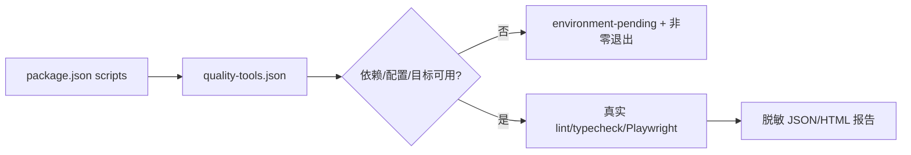
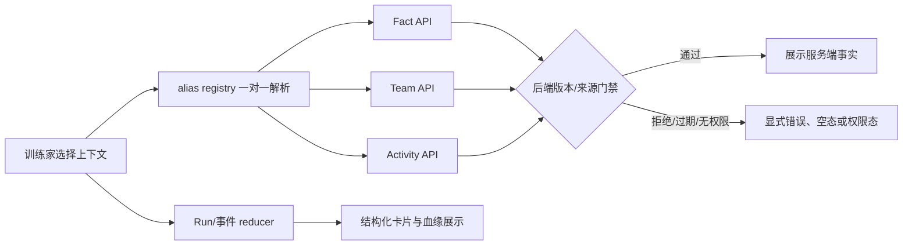

# N5 前端工作台与版本化上下文实施记录

> **快照日期：2026-09-04。** 本记录只描述当前代码增量和本地验证，不代表 v1.1 GA 或 staging E2E 已发布。前端开发依赖已补齐并完成本地构建/fixture 验证；真实后端认证、跨实例事件和 staging 联调仍需在目标环境复核。

## 1. 本次实现范围

- 新增 `vio-ai-agent-frontend/src/views/PokemonWorkbench.vue`：以场景化表单固定游戏、DLC、语言、赛制、规则和 data release；提供图鉴事实查询、用户队伍 CRUD、活动资讯和会话/Run 历史四个工作区。
- 新增统一 API 适配：事实、队伍、活动、会话和消息请求统一携带同源 Cookie/CSRF，兼容后端 `Result<T>` 与 raw DTO 响应；HTTP 401/403 映射为明确的权限态，空列表不转成示例数据。
- 新增结构化事件消费：`run-contract.js` 将已登记的 `context.card`、`fact.card`、`calculation.card`、`team.matrix`、`activity.card`、`retrieval.citation.card`、`feedback.card` 和 `error.card` 放入独立集合；`RunTimeline.vue` 按字段展示来源、证据和版本键。
- 新增 `/pokemon-workbench` 路由和首页入口，保留原 `/game-master`、`/super-agent` 页面行为。
- 工作台新增收藏面板：按当前用户分页读取、创建和删除收藏，所有写请求携带 CSRF 与幂等键；加载、空态、权限错误和取消请求均有显式状态，不以内置样例冒充服务端数据。
- Run 时间线新增反馈历史：按当前答案/Run 读取反馈，区分 loading、空结果、权限/过期和可重试错误；切换 Run 或组件卸载时取消旧请求，避免迟到响应污染当前视图。
- 工作台补齐 `CalculationCard` 最小产品闭环：属性克制输入固定绑定当前
  `dataReleaseId`，通过 `POST /pokemon/calculations/type-effectiveness` 读取
  服务端确定性结果并展示 `calculationVersion`；前端不复制属性表、不自行推导
  倍率，缺失版本/非法属性进入明确错误态。

## 1.1 前端质量入口（fail-closed）

`vio-ai-agent-frontend/package.json` 现在提供以下固定入口：

```text
npm run lint
npm run typecheck
npm run test:contract
npm run test:e2e
npm run quality:frontend
```

`scripts/run-quality-check.mjs` 不会调用 npm/npx 安装依赖。它根据
`quality-tools.json` 检查 ESLint、Vue TypeScript Checker 和配置文件；依赖或
配置缺失时写入 `artifacts/v1.1/test/frontend-{lint,typecheck}-report.json`，将
`status` 置为 `environment-pending`、`passed=false`、退出码置为 `2`，因此不能
被误读为 lint/typecheck 通过。依赖全部就绪后才会执行真实工具；工具非零退出
则报告 `failed`。

`scripts/run-e2e.mjs` 同样是显式目标、显式依赖的门禁：默认只允许本机
`127.0.0.1/localhost`，staging 必须同时提供 `N5_E2E_TARGET=staging` 与
`N5_E2E_ALLOW_STAGING=true`（或命令行 `--allow-staging`）；生产样式域名、URL
凭据和敏感查询参数直接拒绝。Playwright 或浏览器缺失时生成
`artifacts/v1.1/test/n5-frontend-e2e-report.{json,html}` 的
`environment-pending` 报告，不访问网络、不自动下载浏览器。

E2E 场景文件 `e2e/pokemon-workbench.spec.js` 使用无凭据的 API fixture，覆盖
上下文/事实卡片、队伍重复校验与幂等保存、历史消息、权限态、危险来源协议、
收藏创建/读取/删除和空结果不伪造等 **8 条关键路径**。fixture 不是 staging 证据；真实创建/恢复、断线
重连、审批、429/410、跨会话隔离和资源释放仍须在获准 staging 中执行并保存
trace/video/screenshot 后，才能把 N5 标记为通过。

质量链路：



## 2. 版本 alias registry

`contracts/version-registry-v1.1.json` 与 `src/api/version-registry.js` 显式登记一对一映射：

| UI alias | canonical battleFormatId | 状态 |
| --- | --- | --- |
| `casual-singles` / `singles` | `casual-singles` | 沿用 v1.0 冻结 ID |
| `casual-doubles` / `doubles` | `casual-doubles` | 沿用 v1.0 冻结 ID |

未登记的 `ranked-singles`、`ranked-doubles` 不会被静默映射；`resolveBattleFormat` 返回 `UNREGISTERED_BATTLE_FORMAT_ALIAS`。`serializeVersionedContext` 同时保留 `battleFormatAlias`、写入 canonical `battleFormat`/`battleFormatId`，兼容尚未声明新增字段的旧后端。`version:check` 还验证 `data/v1.1-fixture/fixture.json` 已直接写入 canonical `battleFormatId`，不会把 alias 带入评测/发布血缘。

## 3. 请求链



## 4. 可验证证据（2026-09-04）

在 `vio-ai-agent-frontend` 目录执行：

```text
npm run version:check       # passed：运行时映射与 contracts 一致，未知 alias fail-closed
npm run security:contract   # passed：无 API key URL/localStorage 路径
npm run test:contract       # 75/75 passed：API/事件/恢复/血缘/卡片/版本 registry/收藏反馈契约
node --check src/api/index.js
node --check src/api/run-contract.js
npm run lint                 # passed
npm run typecheck            # passed
npm run openapi:diff         # passed，v1.0→v1.1 0 breaking
npm run test:e2e             # 本地 fixture 8/8 passed；staging 未验证
npm run build                # passed，Vite 61 modules
```

本次已安装并锁定前端质量工具（ESLint、vue-tsc/TypeScript、Playwright 等），上述
lint/typecheck/build 和本地 fixture E2E 均通过。通过只证明当前源码和无凭据 fixture
的离线/本地链路；真实后端认证、候选 data release 审核、浏览器跨实例断线重连和
staging 网络仍尚未验证。

CI 已将版本映射、OpenAPI diff、lint、typecheck、contract、Chromium 安装、local
fixture E2E 与 build 设为合并门禁，发布工作流也会重复执行除本地 fixture E2E 外的
静态/构建检查。本轮验收结束后已
删除项目内可再生成的 `.playwright-browsers` 缓存；本地再次执行 E2E 前需按项目锁定
版本安装 Chromium，不能把“浏览器未安装”的 `environment-pending` 当作测试通过。

`scripts/calculation-contract.test.mjs` 额外检查计算 API、OpenAPI
`TypeEffectivenessCalculationRequest` 与工作台 CalculationCard 的字段和安全
边界；该离线检查不替代真实 staging 计算链路。

## 5. 明确边界与回滚

- 图鉴/活动内容全部来自 API；前端不生成事实、证据摘录、来源 URL 或历史答案。当前 fixture 的 `FIXTURE_CANDIDATE`/未审核状态由后端拒绝时，界面显示错误或空态。
- URL 仅在协议为 HTTP(S) 时可点击；API Key 不进入 URL、Web Storage 或日志。
- N5 的收藏和反馈历史仅展示当前用户/当前 Run 可见的数据；前端状态机不会把 401/403/410 或空响应降级为成功数据。
- 回滚可移除首页入口并隐藏 `/pokemon-workbench` 路由；Run 后端和既有聊天页面不依赖该工作台。
