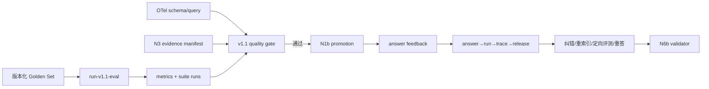

# N6a/N6b 评测、追踪与反馈闭环实施记录

> 状态：`BLOCKED` / `candidate`。本记录只描述当前工作树中已经落地、可重复验证的代码和 producer；没有把小样例、脚本存在或静态契约误写成真实 Golden Set、OTel 现场或生产反馈闭环。

## 1. 目标与边界

N6a 负责候选版本的评测、指标契约和质量 gate；N1b 才能依据不可变评测报告切换 active；N6b 消费已经发布的 answer，完成反馈、纠错、定向评测、重答和回读。两条链不能互相伪造前置条件。



## 2. 已落地的 N6a 能力

### 2.1 评测执行器

`evaluation/run-v1.1-eval.mjs` 只读取 manifest 明确列出的七类数据集和调用方显式提供的 `--case-results`/`--metric-results`。它会：

- 为每个 suite 和 aggregate 写入同一 `evaluationRunId` 的不可变 JSON；
- 记录 dataset/dictionary SHA-256、代码/模型/Prompt/数据/知识/索引版本和环境摘要；
- 计算可由程序直接得到的 suite rate、RAG 指标、P50/P95、Token 和成本观测值；
- 缺少 case result、样本不足、版本占位符或未知 case 时返回 `pending/blocked` 和非零退出码；
- 不生成合成通过值，也不实现 LLM-as-Judge 替代程序断言。

契约文件为 `evaluation/contracts/evaluation-case-result-v1.1.schema.json`；测试 `evaluation/run-v1.1-eval.test.mjs` 覆盖缺输入、未知 case 和部分血缘三条失败/边界路径。

### 2.2 指标与 OTel 契约

已有 `tools/validate-metric-dictionary.mjs`、`tools/export-metric-queries.mjs`、`tools/export-otel-contract.mjs` 和 `tools/validate-otel-trace-sample.mjs`。它们只生成/校验 schema、query、采样和脱敏规则，不访问实时 Prometheus、Alertmanager 或 Grafana；现场探针仍属于 N7/N8。

本轮将机器契约补成可执行 producer：

- `contracts/metric-dictionary-v1.1.schema.json`、`metric-schema-v1.1.schema.json`、`metric-queries-v1.1.schema.json` 固定指标字典、归一化结果和查询字段；每个 query 同时带 `owner/queryOwner`、阈值版本、分母和窗口。
- `contracts/otel-schema-v1.1.schema.json`、`otel-queries-v1.1.schema.json`、`otel-trace-sample-v1.1.schema.json` 固定 span、必需 attributes、采样、trace→run→evaluationRun 关联和脱敏策略。
- 三个 exporter/validator 均拒绝未知参数、越界输出和敏感值，默认 `no-clobber`，通过 `tools/lib/io.mjs` 原子写入；draft 字典只产生 `pending-review`，不会被误标为 release-ready。
- `export-otel-contract.mjs` 支持手册中的 `--output-dir/--schema-version` CLI；Trace validator 接受 JSON、JSONL 和 envelope 形式，但只输出计数、哈希和错误代码，不输出原始 span 属性。
- `tools/n6-contracts.test.mjs` 覆盖 pending、哈希、no-clobber、owner/commit、合法 Trace 及敏感属性拒绝路径。

质量 gate `tools/v1.1-quality-gate.mjs` 已分离：

- `--mode=ci`：结构、路径、schema 和样本短缺提示；
- `--mode=release`：要求 ready manifest、七套真实结果、指标/OTel/安全/契约证据、哈希和版本血缘，任何缺失均非零；
- correction 指标在 N6a 只能 `not_applicable`，避免与 N6b 形成循环依赖；
- `--mode=negative`/invalid fixture 验证错误血缘会被拒绝。

在当前仓库运行 CI gate 只能得到结构性通过并伴随样本不足警告；release gate 因 ready manifest、真实结果和现场证据缺失而保持阻断，这是预期行为。

## 3. 已落地的 N6b 可追溯性能力

- `AnswerProjection`、`GET /answers/{answerId}` 和 `FeedbackService` 已建立 answer→run→trace→data/knowledge/index release 回读链；缺失/占位血缘会返回不可追溯错误，不再使用 `unknown` 默认值。
- `tools/validate-feedback-lineage.mjs` 严格校验 feedback closure、answer registry、re-answer verification 三份输入的 answer/run/trace/evaluation/旧新 release/operator/status 一致性。
- `ops/feedback/run-n6b-feedback-closure.ps1` 是 fail-closed 输入投影器：只接受授权 runner 已捕获的 JSON bundle，拒绝缺字段、跨发布、`unknown`/`UNTRACEABLE`、重复 answer 和已有输出；通过后以 `--no-clobber` 原子生成三个 canonical 文件。默认不调用生产 API、不执行 reindex/publish，不会把脚本成功描述为线上闭环完成。

## 4. 可重复验证

```powershell
node --check evaluation/run-v1.1-eval.mjs
node --check tools/validate-feedback-lineage.mjs
node --test evaluation/run-v1.1-eval.test.mjs tools/validate-feedback-lineage.test.mjs
node --test tools/n3-evidence-producers.test.mjs
node tools/v1.1-quality-gate.mjs --mode=ci `
  --manifest evaluation/v1.1/manifest.json `
  --dictionary evaluation/v1.1/metric-dictionary.json `
  --report artifacts/v1.1/eval/ci-gate-local.json
```

上述命令验证的是脚本和本地样例的结构边界。真实 N6a 退出还必须由审核后的 `manifest.ready.json`、达到最低规模的 Golden Set、实际模型/检索运行、OTel 采样和 N3 安全报告共同证明。

## 5. 尚未完成 / 环境阻塞

| 能力 | 当前状态 | 不能据此宣称 |
| --- | --- | --- |
| 七套 Golden Set 达标 | 当前样例规模不足，manifest 仍 draft | Recall、引用正确率、拒答率达到发布门槛 |
| 首 delta TTFT | 现有执行器仍以完整答案返回时间近似 | 真实首 token P50/P95 |
| OTel 现场链路 | 只有契约/校验器，无 staging Trace | trace-to-run 现场完整性 |
| N1b promotion | 需审核后的 evaluation report/approval | active index 已发布 |
| N6b 真实闭环 | producer 只投影显式输入，未调用线上 API | 至少一条生产反馈已重索引、重答并通知 |

Docker、真实 PostgreSQL/PGVector、Redis/OIDC、外部模型/MCP 和监控端点未在当前环境完成现场验证，相关状态保持 `environment-pending/BLOCKED`。

## 6. 回滚

评测失败只保留 candidate/quarantine 和原始样本，不切换 active；反馈血缘失败停止自动发布并保留失败记录。任何重试都使用新的 evaluationRunId/feedbackRunId 和新目录，禁止覆盖旧证据。
