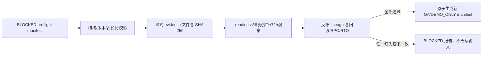

# N8：GA 观察期、发布单元与签收门禁实施记录

> 状态：`代码已实现 / candidate`。本次增量落地的是**显式证据的静态 preflight/final gate**，不会把本地脚本通过写成生产 GA。真实 72 小时观察、生产探针、镜像 registry/SBOM/签名、灾备演练和责任人签收仍必须在目标环境采集。

## 1. 本次落地范围

| 交付物 | 作用 | 当前边界 |
|---|---|---|
| `tools/lib/release-manifest.mjs` | 路径越界、占位符、镜像 digest、证据 hash、脱敏扫描等共享校验 | 只读本地显式输入，不访问外部系统 |
| `tools/validate-release-manifest.mjs` | 校验 v1.1 manifest 结构、releaseClass/environment、证据路径和 SHA-256 | 不验证 registry 中 digest 是否真实存在 |
| `tools/v1.1-release-gate.mjs` | 消费 `status=BLOCKED` preflight，检查 readiness/探针/观察/反馈/回滚/RPO/RTO 后原子生成新 manifest | 不能代替生产 collector、签名验签或人工签收 |
| `tools/lib/observation-contract.mjs` | 共享观察窗口结构门禁：真实时间戳序列、连续性、最小窗口数和独立 telemetry source | 只验证证据结构，不把 JSONL 自报值当作外部事实 |
| `contracts/release-manifest-v1.1.schema.json` | 发布单元的机器可读结构基线 | 业务规则由脚本补充校验 |
| `tools/n8-release-gate.test.mjs` | 通过、篡改拒绝、pending 拒绝、单行自报 72h/500 拒绝、preflight 五条最小路径 | fixture 不代表真实业务样本 |

## 2. 门禁链路



### 全局 → 业务 → 模块 → 代码

- **全局发布控制**：manifest 的 `releaseId/releaseClass/environment/status` 绑定一次候选发布。
- **业务证据**：观察窗口按 release/environment 绑定，业务探针全部通过，反馈记录必须可回到 answer/run/trace/release。
- **模块门禁**：N8 gate 只编排显式输入；manifest validator 负责结构和 hash；共享库负责路径与脱敏。
- **代码入口**：`tools/v1.1-release-gate.mjs` 是唯一允许把 `BLOCKED` 复制成新 `GA`/`DEMO_ONLY` 文件的脚本；没有 `--output-manifest` 或证据不全时返回非零。

## 3. 使用方式

### 3.1 预检（不产生发布 manifest）

```powershell
node tools\v1.1-release-gate.mjs `
  --repo-root . `
  --baseline-manifest artifacts/v1.1/baseline/manifest.json `
  --manifest artifacts/v1.1/release/release-manifest-preflight.json `
  --release-class GA `
  --environment prod `
  --preflight-only `
  --report artifacts/v1.1/release/n8-preflight-report.json `
  --no-clobber
```

`--preflight-only` 只检查不可变结构和 N0 基线绑定，不宣称观察期或 GA 通过。

### 3.2 最终 gate（GA 示例）

```powershell
node tools\v1.1-release-gate.mjs `
  --repo-root . `
  --baseline-manifest artifacts/v1.1/baseline/manifest.json `
  --manifest artifacts/v1.1/release/release-manifest-preflight.json `
  --release-class GA --environment prod --promote-status GA `
  --readiness artifacts/v1.1/prod/<releaseId>/readiness.json `
  --observability-dir artifacts/v1.1/prod/<releaseId>/observability `
  --business-probes artifacts/v1.1/prod/<releaseId>/business-probes.jsonl `
  --observation artifacts/v1.1/prod/<releaseId>/observation-72h.jsonl `
  --observation-validation artifacts/v1.1/prod/<releaseId>/observation-validation.json `
  --feedback artifacts/v1.1/test/<feedbackRunId>/n6b-reanswer-verification.jsonl `
  --feedback-registry artifacts/v1.1/test/<feedbackRunId>/n6-answer-release-registry.json `
  --feedback-lineage-validation artifacts/v1.1/test/<feedbackRunId>/n6b-feedback-lineage-validation-final.json `
  --feedback-hashes artifacts/v1.1/test/<feedbackRunId>/n6b-feedback-evidence-hashes.json `
  --rollback artifacts/v1.1/prod/<releaseId>/rollback-drill.jsonl `
  --rpo-report artifacts/v1.1/recovery/drill-rpo.json `
  --rto-report artifacts/v1.1/recovery/drill-rto.json `
  --previous-manifest artifacts/v1.1/release/previous-manifest-final.json `
  --previous-resolution artifacts/v1.1/release/previous-release-resolution-final.json `
  --active-release artifacts/v1.1/prod/<releaseId>/active-prod-release-resolution.json `
  --config-snapshot artifacts/v1.1/prod/<releaseId>/promote-config-snapshot.json `
  --compose-config artifacts/v1.1/prod/<releaseId>/release-compose-config-effective.txt `
  --min-observation-hours 72 --min-observation-requests 500 --min-requests-per-window 20 `
  --output-manifest artifacts/v1.1/release/release-manifest.json `
  --report artifacts/v1.1/release/ga-gate-report.json `
  --no-clobber
```

DEMO_ONLY 必须单独使用 `releaseClass=DEMO_ONLY`、`environment=staging`、24 小时/100 请求和独立 staging evidence root；不能把 staging 文件复制到 `prod/` 冒充 GA。`--allow-unmeasured-rpo-rto` 只允许 DEMO_ONLY。

### 3.3 发布单元独立校验

```powershell
node tools\validate-release-manifest.mjs `
  --repo-root . `
  --manifest artifacts/v1.1/release/release-manifest.json `
  --schema contracts/release-manifest-v1.1.schema.json `
  --allow-status GA --require-status GA `
  --require-release-class GA --require-environment prod `
  --min-observation-hours 72 --min-observation-requests 500 `
  --report artifacts/v1.1/release/release-manifest-validation.json `
  --no-clobber
```

校验器会拒绝：占位 digest、`..`/绝对/越界路径、缺文件、SHA-256 不匹配、GA 引用 staging、DEMO_ONLY 引用 prod、未脱敏密钥和 v1.0 evaluation manifest 混用。

## 4. 验证证据

```powershell
node --check tools/lib/release-manifest.mjs
node --check tools/validate-release-manifest.mjs
node --check tools/v1.1-release-gate.mjs
node --test tools/n8-release-gate.test.mjs
```

当前本地 fixture 测试覆盖：

1. 完整 hash-bound 证据可生成新的 `GA` manifest，输入 `BLOCKED` 文件保持不变；
2. 观察文件被篡改时 gate 非零退出且不生成 promoted manifest；
3. `--preflight-only` 只输出报告，不生成 GA 文件。
4. 单条携带 `observationHours=72`、`requestCount=500` 的摘要没有两个时间窗口，gate 非零退出且不生成 promoted manifest；窗口间大间隙或单一 source 同样被拒绝。

### 4.1 观察窗口反伪造规则（N8 增量）

`observationHours`、`durationHours`、`windowHours` 和汇总 `requestCount` 只能作为记录字段，不能单独证明观察期。`validate-observation.mjs`、`aggregate-observation.mjs` 和最终 gate 现在共同执行以下规则：

1. 至少提供两个带唯一 `windowId` 的窗口；GA 仍按 72 小时/500 请求验收，DEMO_ONLY 仍按 staging 的 24 小时/100 请求验收，两个发布类别只共享“不能由单行摘要代替”的结构规则。
2. 时长只由 `windowStart` → `windowEnd` 的真实时间戳计算；窗口必须按时间排序、无重叠，且首尾连续。采集器按 5 分钟调度时允许最多 60 秒的边界抖动，但 `coveredDurationHours` 仍按实际窗口覆盖累加，较大间隙或覆盖不足均返回非零；只有一条 72 小时自报记录，或声明时长大于实际区间，也会保持 `BLOCKED`。
3. 每个通过窗口必须声明至少两个独立 telemetry channel（当前 collector 的兼容标签为 `live-http-and-prometheus`，也可用 `sourceChannels: ["http-readiness", "prometheus-metrics"]`）；若提供 `sourceEvidence`，每个 channel 还必须带有效 `observedAt`，并可将 metrics 的 `requestCount` 与窗口分母交叉校验（可选 `sha256` 必须为 64 位摘要）。`not-executed`、`staging`→`prod` 复制和单一 `manual/http` 来源全部拒绝。

这些规则是本地可执行的结构/血缘门禁，不等同于生产真实性证明。生产验收仍必须由 `collect-observation.ps1` 直接从目标环境采集，并保存 Prometheus/HTTP 原始证据、SHA-256、采集时间和人工签收；不能手工把 `observationHours: 72` 或 `requestCount: 500` 写入 JSONL 来替代现场数据。

## 5. 尚待目标环境验收

- `ops/release/collect-prod-evidence.ps1`、`collect-observation.ps1`、`aggregate-observation.mjs` 和 `validate-observation.mjs` 尚需接入真实生产 URL；本 gate 不会从 staging 复制证据，也不会自行制造请求分母。
- registry digest 回读、SBOM、Trivy/供应商扫描、Cosign signature/attestation 验签、双镜像 provenance 仍是 N7/N8 现场证据。
- PostgreSQL/Redis/OIDC/MCP/Prometheus/Alertmanager/Grafana、72 小时/500 请求观察、RPO/RTO 故障演练尚未在当前环境完成。
- 责任人签收（领域、后端、前端、安全/运维、发布负责人）必须另存为脱敏 `signoff` 记录；脚本通过不等于人工签收。

## 6. 回滚与安全边界

- gate 失败：保留脱敏 report，不覆盖输入 preflight；发布状态保持 `BLOCKED`。
- 发布后回滚：由外部 runbook 将 canary 关闭并切回上一份 digest/active index；本脚本不直接操作 registry 或生产 pointer。
- 输出仅包含路径、hash、状态和 reason code；不会读取 `application-local.yml`、`mcp-servers.json` 或打印 Token/密码。
