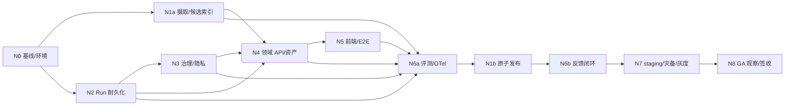

# VIO 正式版 v1.1 分阶段开发计划

## 1. 计划原则

v1.1 是 v1.0 候选构建的生产化收口，不重复搭建已经存在的 M2～M7 骨架。每个阶段都按“输入快照 → ADR/迁移 → 代码 → 测试 → 真实环境验证 → 证据归档 → 退出门槛”执行。阶段状态以证据为准，不能用口头结论或文档文件名代替。

主手册：[正式版v1.1开发步骤手册.md](./正式版v1.1开发步骤手册.md)；规格：[v1.1需求规格与完成定义_spec.md](./v1.1需求规格与完成定义_spec.md)。

## 2. 依赖图

## 3. 里程碑表

| 阶段 | 重点任务 | 主要输出 | 阻断条件 | 回滚点 |
|---|---|---|---|---|
| N0 | 支持矩阵、canonical ID、依赖、Secret、fixture、评测 schema 和基线 hash | baseline manifest、toolchain、fixture/source audit、evaluation migration | dirty 基线未审计、Secret 扫描/配置负例缺失、依赖未锁定 | 关闭新开关，回 v1.0 candidate |
| N1a | Job/Attempt/Outbox/DLQ、reservation、重试、PGVector candidate | ingestion/DLQ/rebuild、structural gate、候选 index | 无真实 PG/维度不一致、毒数据未隔离 | 保持旧 active index |
| N2 | Run 状态、事件、Outbox、checkpoint、lease、effect ledger、资源 API | restart/replay/cancel/retention、HTTP contract | 重启丢状态、重复副作用、越权资源 | 安全失败并停止新 Run |
| N3 | 持久 HITL、审计、OIDC/Redis、SSRF、MCP、记忆 | red-team JSONL、catalog、删除/导出/恢复 | 任一跨用户/高危绕过/密钥泄漏 | 关闭远程 MCP/高危工具/记忆 |
| N4 | 事实/计算/队伍/收藏/活动 API、answer projection、OpenAPI | domain E2E、SQL/隔离、OpenAPI diff、lineage | unknown 血缘、版本猜测、breaking diff | 隐藏新路由，保留只读事实 |
| N5 | 表单、结构化卡片、历史 Run、重连、429/410、可访问性 | Playwright、contract、build、无泄漏报告 | stuck、资源泄漏、API key 暴露 | 回 v1.0 页面/polling |
| N6a | Golden Set、首 delta TTFT、Token/成本、OTel、指标和质量 gate | evaluation runs、metrics、不可变候选 report | 样本不足、阈值失败、血缘不完整 | 停止 promotion，保留 candidate |
| N1b | 读取 N6a 报告并原子切换 active | candidate-release-manifest、promotion audit | 无 N6a hash/验签、并发切换失败 | 上一 active release |
| N6b | 反馈→纠错→重索引→定向评测→重答通知 | feedback closure、registry、re-answer verification | UNTRACEABLE 进入队列、通知/审计缺失 | 停止自动发布，回上一 release |
| N7 | 双镜像和依赖 digest/SBOM/签名、staging、探针、迁移兼容、恢复、灰度 | candidate manifest、readiness、observability、RPO/RTO、rollback | 无 registry digest、探针/恢复未现场执行 | 上一 digest/配置/index |
| N8 | 72h/500 请求、最终 manifest、GA gate、演示和签收 | preflight/final manifest、ga-gate-report、demo evidence | P0、RPO/RTO 超标、观察期不足 | 保持 BLOCKED/DEMO_ONLY |

## 4. 建议周计划

| 周次 | 任务 | 交付检查 |
|---:|---|---|
| 1 | N0 基线、M1 fixture、依赖和 Secret | baseline manifest、schema migration、环境状态 |
| 2 | N1a 摄取 Job/PGVector | 两实例、DLQ、重建和查询证据 |
| 3 | N2 Run/事件/恢复 | restart、replay、cancel、资源隔离 |
| 4 | N3 安全治理 | HITL、OIDC/Redis、红队和删除 |
| 5 | N4 领域 API、lineage、OpenAPI | staging 用户故事和 contract diff |
| 6 | N5 前端/E2E | 7 条关键浏览器场景 |
| 7 | N6a 评测/OTel → N1b → N6b | 候选报告、原子发布、反馈闭环 |
| 8 | N7/N8 交付、恢复、观察和演示 | GA gate、manifest、签收 |

时间可压缩，但不能跳过 N0、N1a、N2、N3、N6a/N1b/N6b 的 P0 门禁。

## 5. 每阶段执行模板

1. 在 `artifacts/v1.1/<stage>/` 建立输入快照，记录 commit、环境、负责人和风险。
2. 写 ADR、迁移和失败路径；明确 owner、超时、重试、幂等、回滚和数据保留。
3. 先补测试，再实施代码；外部依赖用真实 staging 或明确标 `environment-pending`。
4. 保存原始命令、状态码、样本量、时间和 hash；公共证据脱敏。
5. 更新阶段日志和 manifest；只有退出门槛全通过才把状态改为 completed。

## 6. P0/P1/P2 排序

### P0（必须先完成）

- 真实 PostgreSQL/PGVector 与版本化索引；
- Run/事件/Outbox/checkpoint/副作用幂等；
- 持久 HITL、RBAC/OIDC、Redis 全局配额和审计；
- answer→release 血缘、真实 Golden Set、不可变 release report；
- 镜像/依赖供应链、备份恢复、readiness、灰度回滚。

### P1（可在安全开关下并行）

- 完整前端卡片、历史资源和可访问性；
- broker/WebSocket（只有 SSE/polling 数据证明需要时）；
- 纠错体验、成本 dashboard 和演示自动化。

### P2（可进入 v1.2）

- 第二世代、GraphRAG、多 Agent、Kafka/Kubernetes/ES；
- 非核心视觉优化和更多语言。

## 7. 证据门禁清单

- [ ] N0 baseline hash、支持矩阵、依赖 inventory、Secret 负例和 evaluation schema 有 producer。
- [ ] N1a candidate 与 active 分离，PGVector/重试/DLQ/冲突有现场数据。
- [ ] N2 重启、游标、终态、cancel、资源授权和副作用 ledger 有原始输出。
- [ ] N3 所有高危/跨用户/SSRF/MCP/记忆负例为 0，审计不可静默修改。
- [ ] N4 API、OpenAPI、事实/计算/队伍和 lineage 可复查。
- [ ] N5 浏览器关键流、429/410、重连和资源清理通过。
- [ ] N6a 真实套件、metrics、OTel schema/query、security/contract report hash 齐全。
- [ ] N1b/N6b 有发布后 answer registry、反馈闭环和重答验证。
- [ ] N7 双镜像/依赖 digest、SBOM、签名/attestation、staging/readiness、业务探针、迁移矩阵、恢复和回滚齐全。
- [ ] N8 观察期、最终 GA gate、manifest hash、演示和责任人签收齐全。

任何一项 P0 缺失都保持 `BLOCKED`；简历只能使用真实报告中的数字。

## 8. 待决策项

在 N0 由负责人签字：canonical registry ID、RPO/RTO、数据保留、队列/transport、Redis key schema、OIDC provider、MCP allowlist、签名身份、指标阈值和 DEMO_ONLY 是否允许。决策改变时必须新增 ADR 和 schemaVersion。
