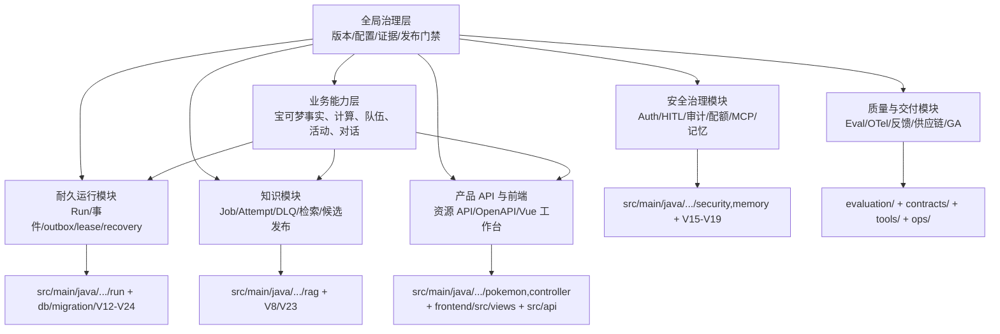
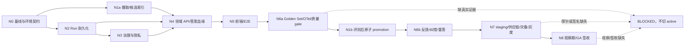

# VIO 成熟宝可梦智能体 v1.1 当前实现进度与验收边界

> **快照日期：2026-09-04**　**候选状态：`candidate / BLOCKED`**
>
> 本文是当前工作树的实现快照，不是 GA 签收。`已实现`表示源码/迁移/测试骨架已经写入仓库；`静态可验证`表示可以用离线脚本、契约或合成 fixture 复查；`环境待验收`表示必须接入真实 PostgreSQL/PGVector、Redis、OIDC、模型、MCP、消息中间件、Docker/Registry、监控或目标环境后才能成立。任何脚本通过都不能替代现场证据。

## 1. 一句话结论

v1.1 已从 v1.0 的功能骨架推进到一套可审计的候选实现：版本化宝可梦事实与确定性计算、耐久 Run/事件/outbox、知识摄取与候选发布、HITL/审计/配额/用户记忆、领域资源 API、Vue 工作台、评测/反馈血缘、供应链和发布/恢复门禁均有代码或离线 producer。当前仍不是可宣称的企业生产 GA：N0 基线和真实依赖尚未完全 ready，N6 release gate、N7 staging、N8 72 小时观察和责任人签收必须保持阻断。

## 2. 全局 → 业务 → 模块 → 代码



### 2.1 运行时主链

现代主链是：

```text
Vue 工作台 → AgentRunController → PokemonAgentRunService
→ DefaultRunExecutor → 版本化事实/检索/确定性计算/受控工具
→ agent_run + agent_event + outbox → AnswerProjection/结构化卡片
```

`AiController`、`GameApp`、`VioManus` 和旧 `/ai/**` 接口仍作为兼容/迁移链存在；它们不能被当作 v1.1 的唯一生产主链。高危工具必须经过 `ToolExecutionGateway → HITL → effect ledger → audit`，MCP 关闭或认证失败时应拒绝而不是绕过治理。

### 2.2 版本与证据主链



## 3. N0～N8 状态总表

| 阶段 | 当前已写入的能力 | 代码/证据入口 | 当前状态与边界 |
|---|---|---|---|
| **N0** 基线 | 环境契约、支持矩阵、开关快照、依赖清单、fixture/快照/hash、回退点和负例 gate producer | `tools/create-environment-contract.mjs`、`create-support-matrix.mjs`、`export-switch-snapshot.mjs`、`export-dependency-inventory.mjs`、`create-fixture-manifest.mjs` | **静态可验证 / 环境待验收**。`manifest.draft.json`、依赖 digest、领域 owner、真实 Secret 缺口仍使 final baseline pending。 |
| **N1a** 知识摄取 | Job/Attempt、checksum reservation、lease、有限重试/jitter、DLQ/replay、at-least-once outbox、bounded worker、JDBC `SKIP LOCKED` 适配器 | `rag/ingestion/KnowledgeIngestionJobService.java`、`KnowledgeIngestionWorker.java`、`V8__durable_knowledge_ingestion_jobs.sql` | **已实现 candidate**。真实 PostgreSQL/PGVector、双实例抢占、broker、Embedding 构建和冲突审核未验收。 |
| **N1b** 候选发布 | 评测报告 hash/血缘/阈值校验、追加式 approval、候选到 active 的 fail-closed promotion | `rag/promotion/KnowledgePromotionService.java`、`ReleaseQualityGate.java`、`V23__knowledge_release_approval.sql` | **已实现 / 静态可验证**。没有可信生产评测报告仓储、真实 Golden Set 和 PG 原子切换时，promotion 仍会拒绝。 |
| **N2** Run 耐久化 | Run 状态、事件、checkpoint、lease、effect ledger、outbox、DLQ、重试、终态保护、事件保留清理、严格事件游标、资源删除生命周期统一；`RunRecoveryPolicy` 保护 checkpoint 重启路径；WAITING_APPROVAL 的 durable `PENDING` 安全恢复 | `run/`、`RunRecoveryPolicy.java`、`DurableRunConfiguration.java`、`AgentRunController.java`、`ResourceController.java`、`HitlManager.java`、`V12/V13/V24/V25`、`RunOutboxDispatcher.java`、`EventRetentionService.java` | **已实现 candidate / 恢复仍受限**。`Last-Event-ID/afterEventId` 非法输入→结构化 400，过期游标→结构化 410（保留起点 + Run 快照入口）；仅允许安全的 dispatch checkpoint 或匹配 durable `PENDING` 审批恢复，已进入模型/工具阶段、审批已决定/过期或上下文/执行器版本不一致时以 `RECOVERY_UNSAFE` fail-closed，避免重复副作用。取消原因支持 v1.0 hash 兼容回放；JDBC soft-delete 与终态竞态已在锁内收敛。真实 broker/live fan-out、跨实例 lease、checkpoint-aware replay、PostgreSQL 重启、备份和 RPO/RTO 尚未现场验收。 |
| **N3** 治理与隐私 | API-Key 过渡认证、OIDC JWT Resource Server 配置级校验、固定 RS256、OIDC 主体→tenant→role→tool policy adapter、短期 `TokenBinding`、异步 Run policy 快照、OIDC 缺失绑定的网关 fail-closed、RBAC/Schema/路径围栏、持久 HITL/CAS/lease、普通工具与 HITL append-only 审计适配器、JDBC/Redis 配额适配器、AES-GCM 用户记忆；旧本地 RAG 空库降级显式开关且默认 fail-closed | `security/`、`config/Oidc*`、`config/LegacyMemoryRagProperties.java`、`rag/GameAppVectorStoreConfig.java`、`rag/LegacyMemoryVectorStoreInitializationException.java`、`security/ToolAuditSink.java`、`security/JdbcToolAuditSink.java`、`tools/governance/ToolExecutionGateway.java`、`memory/`、`V15-V19`、`RedisGlobalQuotaStore.java`、N3 evidence producers | **部分已实现 / 环境待验收**。OIDC Authorization Code + PKCE/Session、持久化 policy snapshot 重启恢复、跨实例撤销/轮换、多维配额，以及真实 CSRF/JWKS/Redis/KMS/DNS pinning/内容配额/MCP/红队现场证据仍缺失；生产审计 sink/数据库触发器需在 staging 运行；本地 RAG fallback 仅可在显式 `VIO_RAG_LEGACY_MEMORY_ENABLED=true` 的兼容演示中使用。 |
| **N4** 领域产品 | 版本化图鉴事实、属性/速度/伤害/合法性计算、队伍/收藏/活动 API、答案投影与 release lineage、canonical AgentEvent、messages endpoint、`CancelRequest` 和 OpenAPI candidate | `pokemon/`、`PokemonResourceController.java`、`AgentRunController.java`、`AnswerProjectionController.java`、`contracts/agent-event-v1.1.json`、`contracts/openapi-v1.1.json` | **已实现 / 静态可验证**。OpenAPI candidate 为 **57 paths / 71 schemas**，v1.0→v1.1 兼容 diff **0 breaking**；运行时 SpringDoc 导出、真实数据和认证隔离仍需 staging。 |
| **N5** 前端工作台 | `PokemonWorkbench.vue`、事实/队伍/活动/历史工作区、收藏 UI、反馈历史、游标和结构化卡片 reducer、API/CSRF 适配、质量与 E2E fail-closed wrapper | `vio-ai-agent-frontend/src/views/PokemonWorkbench.vue`、`src/components/RunTimeline.vue`、`src/api/index.js`、`src/api/run-contract.js`、`scripts/`、`e2e/` | **本地 fixture 已验证 / staging 待验收**。contract **75/75**、lint/typecheck/security/version/openapi/build 全通过；Vite 构建 **61 modules**，本地 Playwright fixture E2E **8/8**。真实后端认证、跨实例事件、审批、429/410、资源释放和 staging 联调仍未验证。 |
| **N6a/N6b** 质量与反馈 | 七类数据集 manifest、评测执行器、指标/OTel schema/query、质量 gate、answer→run→trace→release 反馈校验和 closure producer | `evaluation/run-v1.1-eval.mjs`、`tools/v1.1-quality-gate.mjs`、`tools/validate-feedback-lineage.mjs`、`ops/feedback/` | **代码/契约已实现，发布阻断**。仓库样例仍是 scaffold/样本不足；没有真实 Golden Set、首 delta TTFT、OTel trace 和线上反馈重答证据。 |
| **N7** 供应链/交付/恢复 | digest/Compose/SBOM/漏洞例外契约、provenance 输入、镜像 secret-scan 契约、staging/prod 只读采集、灰度/回滚 plan、故障计划、恢复 runbook/SLO producer | `tools/*dependency*`、`tools/create-provenance.mjs`、`tools/scan-image-secrets.mjs`、`ops/release/`、`ops/recovery/` | **静态可验证 / 环境待验收**。脚本默认不访问 Docker/Registry/Trivy/Cosign，不执行生产 mutation；真实 digest、SBOM、签名/attestation、staging readiness 和恢复演练缺失。 |
| **N8** GA 门禁 | release manifest validator、preflight/final gate、active/previous pointer 离线解析、观察窗口 producer/aggregator、不可变 hash/no-clobber；观察证据按真实 timestamp 序列、连续性容差、最小窗口数和双 telemetry source fail-closed | `tools/v1.1-release-gate.mjs`、`tools/lib/observation-contract.mjs`、`validate-observation.mjs`、`aggregate-observation.mjs`、`validate-release-manifest.mjs`、`register/resolve/verify-release-pointer.mjs`、`ops/release/collect-observation.ps1` | **candidate / BLOCKED**。真实 72 小时/请求分母、生产观测、N6b feedback、RPO/RTO、人工 signoff 未齐，不生成 GA；单行自报 `observationHours/requestCount`、大间隙或单一 source 不得过门。 |

## 4. 本轮重新执行并核对的验收证据

以下记录 2026-09-04 本轮重新执行或重新生成的脱敏报告；外部环境仍为 pending 的条目只说明已核对状态，不能手工改写成通过。

| 证据 | 读取到的结论 |
|---|---|
| `artifacts/v1.1/test/openapi-diff-v11.json`、`openapi-diff.json` | `status=passed`、`passed=true`；支持 v1.0→v1.1 的非破坏性 diff。 |
| `artifacts/v1.1/test/frontend-lint-report.json`、`frontend-typecheck-report.json` | 当前依赖已补齐；`npm run lint`、`npm run typecheck` 均通过。 |
| `artifacts/v1.1/test/n5-frontend-e2e-report.json` | 本地无凭据 fixture Playwright E2E **8/8 通过**；这不是 staging/生产证据，staging 仍未验证。 |
| `artifacts/v1.1/staging/dependency-smoke.json`、`fixture-pg-smoke.json` | P0 依赖和 PostgreSQL smoke 保持 `environment-pending`。 |
| `artifacts/v1.1/baseline/manifest.draft.json`、`environment-contract.json`、`dependency-inventory.json` | 基线/契约/依赖仍是 draft 或 pending，不能作为 ready manifest。 |
| `target/surefire-reports/*.xml`（2026-09-04 clean run） | 最新 `mvnw -B -ntp -q clean test` 逐项合计 **130 XML、495 tests、0 failures、0 errors、2 skipped**，命令 exit 0；输出含已知 Surefire 关闭警告，不影响测试结果。 |
| `RunRecoveryPolicyTest`、`PokemonAgentRunServiceRecoveryTest` 及 N2 新增回归（2026-09-04 快照） | 定向测试覆盖 `dispatch` 检查点单次恢复、匹配 durable `PENDING` 审批恢复、审批 404/410、取消原因兼容和 JDBC soft-delete/终态锁竞态；均纳入上方 clean test 统计。 |
| `src/test/java/.../McpClientSseTest.java` | 最小协议测试上下文显式提供 permit-all 安全链，避免默认 Spring Security 将 `/mcp/sse` 重定向为 302；仅影响测试上下文，不改变生产认证策略。 |
| `artifacts/v1.1/test/baseline-test-summary-v11.latest.json`（2026-09-04） | `aggregate-test-report` 按本次 clean run 捕获 **130 XML / 495 tests / 0 failures / 0 errors / 2 skipped**，状态 `captured`；Surefire 关闭警告已记录为非阻断噪音。 |
| `tools/*.test.mjs`、`evaluation/*.test.mjs`（2026-09-04 当前工作树） | 离线 Node tools + evaluation 套件 **68/68 通过**；包含 Surefire 汇总器 `errors` 数值字段与 `validationErrors` 分离的回归测试。 |
| `contracts/openapi-v1.1.json`、`artifacts/v1.1/test/openapi-diff-v11.latest.json` | candidate **57 paths / 71 schemas**；v1.0→v1.1 兼容 diff **0 breaking**。 |
| `vio-ai-agent-frontend`（2026-09-04 当前工作树） | contract **75/75**；`lint`、`typecheck`、`security:contract`、`version:check`、`openapi:diff`、`build` 全通过；Vite 构建 **61 modules**；本地 fixture Playwright E2E **8/8**，staging 未验证。 |

## 5. 推荐的复核命令（占位，以命令输出为准）

命令只用于复核，不自动安装依赖、不读取或打印本地敏感配置。生产/真实依赖命令应在获准 staging 执行。

```powershell
# 后端单元/上下文测试（生成新的 target/surefire-reports）
.\mvnw.cmd -B -ntp clean test

# 离线工具与评测契约
node --test tools/*.test.mjs evaluation/*.test.mjs

# OpenAPI 非破坏性 diff
node tools\openapi-diff.mjs --base contracts\openapi-v1.0.json `
  --candidate contracts\openapi-v1.1.json `
  --fail-on-breaking --report artifacts\v1.1\test\openapi-diff-v11.latest.json

# 前端（本地 fixture 已有通过证据；staging 仍需显式目标与独立证据）
Push-Location vio-ai-agent-frontend
npm run test:contract
npm run lint
npm run typecheck
npm run test:e2e
npm run build
Pop-Location
```

## 6. 仍未完成且不能写成“已上线”的事项

### P0：真实运行与身份边界

- PostgreSQL 16 + PGVector 的 Flyway、索引/维度、EXPLAIN、双实例 lease/reservation 和真实数据回读。
- Redis Lua 跨实例配额/故障演练；消息 broker 的 outbox 投递、背压、游标和重启恢复。
- OIDC Resource Server 的 issuer/JWKS/audience 配置级校验、固定 RS256 算法、主体→租户→角色→工具策略 adapter、短期 `TokenBinding` 和已认证但缺失绑定的网关 fail-closed 已写入源码；仍缺 Authorization Code + PKCE、HttpOnly Session、完整 CSRF/Origin/JWKS 轮换、跨实例撤销/轮换和策略持久化恢复证据。当前 API-Key 仍只能作为隔离验收过渡，OIDC 工具能力在真实身份/配额/审计现场证据完成前保持关闭。
- 唯一生产 MCP provider 的认证 audience、TLS、超时、断开和同一 `ToolExecutionGateway` 路径；自研 MCP 必须继续隔离在实验模块/profile。

### P0：质量、观测与发布证据

- 真实七类 Golden Set、审核后的 `evaluation/v1.1/manifest.ready.json`、可回放 case result 和 N6a release report。
- 真实首 delta TTFT/Run duration、Token/成本、OTel trace-to-run 样本，以及 Prometheus/Alertmanager/Grafana 现场探针。
- Docker/Compose 实际构建、Registry immutable digest、SBOM、漏洞扫描/例外审批、Cosign 签名/attestation/provenance 和镜像层 secret scan。
- N7/N8 仍必须补齐真实 registry immutable digest、SBOM/漏洞扫描、签名与 attestation、staging readiness、业务探针、canary 灰度/自动回滚、灾备（DR）恢复演练，以及至少 **72 小时 + 500 请求**的生产观察窗口和多角色人工 signoff；缺任一项保持 `BLOCKED`。

### P1：隐私与灾备完善

- KMS envelope encryption、密钥轮换/销毁、consent 撤回、记忆删除后的缓存/备份语义和最小前端授权入口。
- DNS rebinding 防护、MIME/总下载量/磁盘配额、artifact schema 和内容策略现场测试。
- 真实备份校验、PostgreSQL/发布指针恢复演练，测量并证明 N0 冻结的 RPO ≤ 15 分钟、RTO ≤ 30 分钟（或有签署 ADR 的替代值）。

## 7. 下一步建议（按门禁顺序）

1. **先完成 staging 基线**：补齐环境 contract 的 owner/地址和 Secret 存在性，准备 PostgreSQL/PGVector、Redis、broker、OIDC、监控、对象/备份存储，逐项运行 dependency smoke 和 Flyway/恢复 smoke。
2. **再完成可信质量链**：提交真实 Golden Set 与 reviewer 签收，运行 N6a 评测、OTel/成本采集和 N1b candidate promotion；随后执行一条真实 N6b feedback closure。
3. **最后执行发布签收**：构建并签名 immutable 镜像，完成 staging readiness、灰度/回滚、72 小时观察、RPO/RTO 和多角色 signoff，再由 N8 gate 生成 GA manifest。

## 8. 安全与修改边界

- 输出和 artifacts 未包含任何密钥值；此前一次内部诊断意外读取过本地搜索 API key，建议在配置提供方完成轮换，并继续避免在命令行、日志、文档或 artifacts 中暴露 Secret。本文不读取也不记录该文件内容。
- 所有 producer/gate 默认采用显式输入、仓库边界、脱敏、`--no-clobber` 和原子写入；WhatIf/静态通过只表示计划或契约安全，不表示外部系统已执行。
- 当前工作树包含大量 v1.1 代码和文档改动；本文件只新增进度说明，不回滚、不覆盖其他用户修改。
