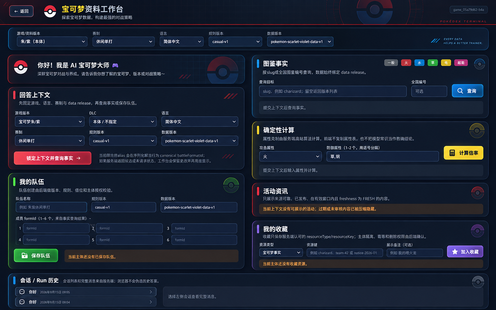
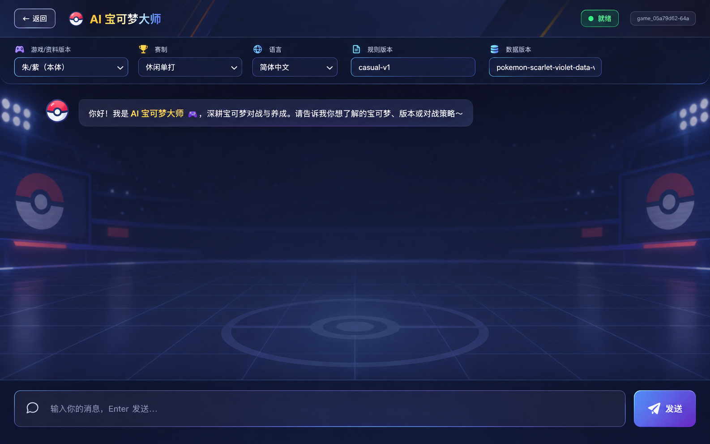
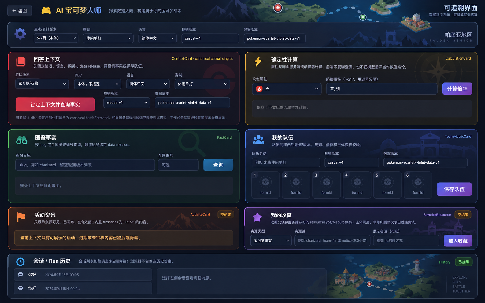

# AI-Agent 宝可梦特色前端界面方案

> 本文只讨论视觉与交互方案，不修改前端代码。所有方案都保留 Run、版本血缘、事件时间线和反馈闭环等企业级信息。

## 设计目标

- 一眼体现 Pokémon 主题，但不做成纯游戏装饰页。
- 保留企业级智能体需要的状态、版本、证据和风险提示。
- 让用户能快速完成“提问 → 查看答案 → 查看事件 → 提交反馈”的主流程。
- 支持后续加入图鉴、队伍分析、对战建议和知识版本管理。

## 方案一：Pokédex 图鉴工作台（推荐）

### 定位

把当前智能体设计成“企业版宝可梦图鉴 + AI 研究工作台”。图鉴是视觉隐喻，工作台负责承载真实业务状态。

### 页面结构

```text
顶部：VIO AI Agent 标识 / 当前赛制 / 语言 / 用户菜单
左侧：新建 Run、历史 Run、宝可梦图鉴、知识版本、反馈中心
中间：问题输入区 + AI 回答卡片 + 引用证据
右侧：版本上下文、血缘状态、Run 状态、工具调用时间线
底部：游标连接状态、Trace ID、系统版本
```

### 视觉语言

- 主色：Pokémon 红 `#E3350D`。
- 辅色：电光黄 `#FFCB05`、深蓝 `#2A75BB`。
- 背景：浅灰蓝，不使用大面积纯红，避免影响阅读。
- 卡片使用“图鉴条目”风格：编号、属性标签、状态徽章。
- 状态颜色保持语义固定：绿色=完成，黄色=等待，红色=失败，蓝色=进行中。

### 特色组件

- `PokédexAnswerCard`：答案、结论、依据和置信度。
- `VersionBadge`：游戏、规则、数据、知识、索引版本。
- `RunTimeline`：将工具调用显示为“训练记录”。
- `EvidencePanel`：显示引用文档、数据版本和 Trace ID。

### 优点

- 与当前前端 Run 工作台最容易衔接。
- 企业信息密度高，适合秋招项目展示。
- 后续扩展图鉴和队伍分析成本较低。

### 风险

- 需要严格控制装饰元素，否则会从“企业工作台”变成游戏主页。

## 方案二：Pokémon 对战指挥中心

### 定位

突出智能体的“分析、决策、工具调用和风险控制”，适合展示复杂 Agent 编排能力。

### 页面结构

```text
顶部：当前对战规则 / 赛制 / Run 状态
左栏：我的队伍、对手队伍、属性克制摘要
中栏：AI 指挥台、对战问题、策略建议、行动步骤
右栏：工具调用、检索证据、版本血缘、审批状态
底部：事件流、游标、Trace、反馈
```

### 视觉语言

- 深蓝和紫色为主，红色只用于高危动作或失败状态。
- 使用“战斗回合”表达 Agent 步骤，但底层仍显示真实事件名。
- 高危工具采用红色警告区域和二次确认。
- 使用属性图标表达类型信息，但所有关键字段同时保留文字。

### 特色组件

- `BattleStrategyBoard`：展示候选策略与选择理由。
- `AgentTurnCard`：展示每个 Agent 步骤的输入、工具、输出和耗时。
- `RiskApprovalDialog`：高危工具审批。
- `CounterMatchupGrid`：属性克制和数据来源。

### 优点

- 最能展示 Agent 编排、工具调用和决策过程。
- 适合面试时演示复杂链路。

### 风险

- 对非宝可梦用户理解成本较高。
- 需要避免把推理过程误解为暴露模型内部思维，应只展示结构化摘要和工具证据。

## 方案三：宝可梦研究实验室

### 定位

强调知识版本、RAG、评测和反馈闭环，适合突出企业级 AI 工程能力。

### 页面结构

```text
顶部：项目/环境/发布版本
左侧：知识源、文档版本、知识发布、索引发布
中间：对话与答案验证工作区
右侧：检索命中、引用证据、血缘链、评测结果
底部：反馈、审计事件、运行日志
```

### 视觉语言

- 白色和浅灰为主，使用 Pokédex 红/蓝作为强调色。
- 文档版本使用“卡片 + 时间轴”展示。
- active index 使用明显的“当前使用”徽章。
- 对缺失血缘使用明确的黄色门禁提示，而不是只显示空字段。

### 特色组件

- `KnowledgeReleaseTimeline`：知识版本生命周期。
- `IndexPromotionCard`：候选索引、评测、审批、active 状态。
- `RetrievalEvidenceTable`：命中文档、相似度、版本、来源。
- `FeedbackTracePanel`：反馈如何回溯到答案、Run、Trace 和知识版本。

### 优点

- 最适合证明“版本化知识 + 可追溯反馈”的企业级能力。
- 对技术面试官的信息最友好。

### 风险

- 游戏特色相对弱，需要通过图鉴编号、属性图标和训练家风格文案补足主题感。

## 方案四：训练家任务大厅

### 定位

面向普通用户，把智能体包装为“训练家助手”，突出易用性和任务导向。

### 页面结构

```text
顶部：训练家身份 / 当前赛制 / 通知
主区域：新任务、最近任务、收藏答案
任务详情：问题、AI 答案、推荐动作、引用来源
抽屉面板：高级版本、事件和反馈信息
```

### 视觉语言

- 明亮背景、圆角卡片、徽章和任务进度条。
- 使用“任务完成”“待审核”“需要补充证据”等用户友好文案。
- 高级技术字段默认折叠，避免普通用户被 Trace/索引版本干扰。

### 优点

- 最容易做出好看的产品演示。
- 适合后续面向非技术用户扩展。

### 风险

- 企业级可观测性和版本血缘默认隐藏，面试演示时需要切换到高级模式。

## 统一交互底线

无论选择哪套方案，都必须保留：

1. Run 状态和取消/终止入口。
2. 游标重连状态和事件快照。
3. 游戏、赛制、语言、规则、数据、知识、索引版本。
4. `lineageStatus` 和缺失字段提示。
5. 答案、引用证据、Trace ID 和反馈入口。
6. 高危工具的权限、审批和失败状态。
7. 加载、空数据、错误、无权限和连接中断状态。

## 推荐落地顺序

建议采用“方案一为主、方案三增强”的组合：

1. 主页面采用 Pokédex 图鉴工作台，保留当前 Run 工作台结构。
2. 增加研究实验室中的知识版本和索引发布页面。
3. 将对战指挥中心的 `AgentTurnCard` 作为 Run 时间线的视觉升级。
4. 暂不采用全屏游戏化动画，先保证信息密度和可访问性。

## 推荐首页线框

```text
┌──────────────────────────────────────────────────────────────┐
│ POKÉDEX AI  | Scarlet/Violet | casual-singles | zh-CN        │
├───────────────┬──────────────────────────┬───────────────────┤
│ 新建 Run       │ 训练家问题                │ 版本上下文         │
│ 历史 Run       │ ┌──────────────────────┐ │ Game release      │
│ 宝可梦图鉴     │ │ 输入你的对战问题     │ │ Ruleset           │
│ 知识版本       │ └──────────────────────┘ │ Data release      │
│ 反馈中心       │ AI 答案 / 引用证据       │ Knowledge release  │
│               │ 推荐策略 / 结构化结果    │ Index release      │
│               │                          │ Lineage status     │
├───────────────┴──────────────────────────┴───────────────────┤
│ Run Timeline | Tool events | Cursor reconnect | Trace ID      │
└──────────────────────────────────────────────────────────────┘
```

## 结论

首选“Pokédex 图鉴工作台”，并吸收“宝可梦研究实验室”的版本与证据面板。这样既能体现宝可梦特色，又能完整展示企业级 Agent 的可信运行、版本化知识、可观测性和反馈闭环。

## 图片示例

以下图片为视觉概念稿，用于评审布局、色彩和信息层级，不代表最终实现效果。

### 方案一：Pokédex 图鉴工作台


### 方案二：Pokémon 对战指挥中心


### 方案三：宝可梦研究实验室


### 方案四：训练家任务大厅


## 基于当前项目界面的润色参考

以下 3 张图以当前项目截图为参考，只调整现有模块的布局、视觉层级和宝可梦主题表现，不新增业务功能。

### 现有资料工作台润色版

保留回答上下文、图鉴事实、确定性计算、队伍、活动、收藏和 Run 历史，采用更清晰的双栏卡片布局。



### 现有 AI 对话页润色版

保留版本选择、欢迎语、消息输入框和发送按钮，通过属性色、Poké Ball 风格头像和轻量背景纹理强化识别度。



### 现有功能总览润色版

保留当前入口和功能范围，用 Pokémon 红/黄/蓝作为局部强调色，改善首页导航和功能分组。


