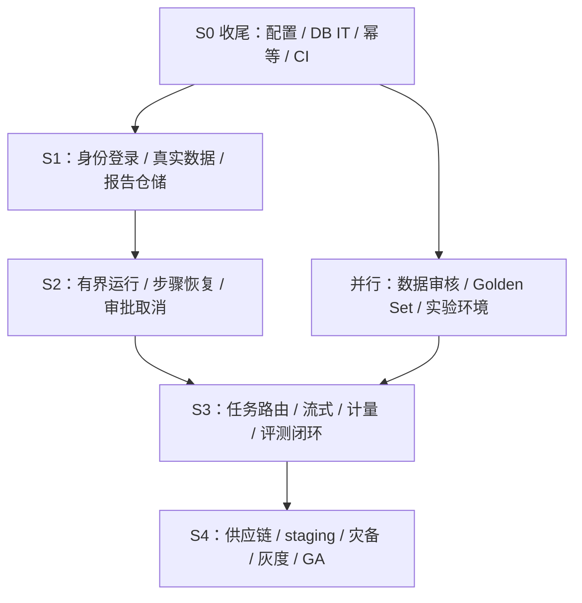

# 当前开发进度与剩余开发计划

> **后续进度（2026-10-14）：** 本文保留 10 月 9 日核查时的历史状态；S0/R03 后续实现见[10 月 10 日记录](./S1身份主链与评测报告仓储实施记录_2026-10-10.md)，浏览器会话见[S1 会话记录](./S1浏览器会话闭环实施记录_2026-10-12.md)，R06 单实例准入与有界执行见[S2 Run 记录](./S2Run准入与有界执行实施记录_2026-10-12.md)，R09 租约提交隔离见[S2 租约记录](./S2租约提交隔离实施记录_2026-10-12.md)，R07 步骤输出持久化见[S3 R07 记录](./S3R07步骤输出持久化实施记录_2026-10-14.md)。R07 artifact 接入和定向/全量离线回归已完成；授权快照、恢复放行和真实 PostgreSQL 仍待开发/验收；任务编号和依赖继续适用。

> **后续进度（2026-10-16）：** R07 服务层已补齐随机 nonce 下的 canonical artifact 幂等复用、历史 key 解密、`runId/stepNo/executorVersion/keyVersion` 元数据 fail-closed、递归冲突隔离，以及取消/超时 execution lease 撤销；新增 `RunStepOutputRetentionService`，按批次清理过期 artifact，默认关闭。授权快照主线已新增 `AuthorizationSnapshot`、内存/JDBC 仓储、V28/V29 迁移、当前策略漂移校验和独立撤销事实；恢复扫描仅对通过校验且未撤销的 dispatch 检查点恢复，execute/commit 仍 fail-closed。外部副作用 ledger 已补充“同一幂等键绑定不同参数”检测、JDBC 终态重复结算幂等处理，并新增 UNKNOWN→SUCCEEDED/FAILED 的显式人工核对、持久化审计出口要求和 `/admin/effects/reconcile` OPERATOR-only 接口，补充了空体、缺字段和非法状态校验，避免自动重放不确定写入。已将新接口加入 OpenAPI 生成器、v1.1 契约和前端同步契约；OpenAPI 相关测试 9/9、控制器测试 4/4、恢复测试 4/4 通过；显式 Mockito agent 已加入 Maven，应用上下文冒烟测试 1/1 通过。全量回归曾执行 762 个测试，但旧构建中包含两个未标注 Spring 注入构造器导致的上下文错误，现已修复；OIDC/MCP loopback 测试仍受当前环境 socket 权限限制。PostgreSQL IT 已加入 V28/V29 表存在性、授权快照不可覆盖和撤销回读用例，当前仅待 Docker 环境执行。

> 核查日期：2026-10-09。基线：`3f74b87` 加当前工作树。  
> 本文更新的是当前进度；9 月的进度表和评审报告继续保留为历史依据。  
> 核查范围：最新提交、未提交变更、生产与 demo 配置、运行时、身份、知识、工具、前端、评测、CI，以及本地验收报告。

## 1. 当前处于什么阶段

**项目处于“v1.1 候选实现 + S0 基线修复收尾”，可以开始 S1 的独立开发，但还不能认定 S0 完整验收通过，也不能认定企业生产 GA 已完成。**

最新提交 `3f74b87` 已修复/补充 F01、F02、F14 的主要代码：部署变量映射、资源 API 身份接线、IT 测试发现。当前工作树还新增了 OAuth2 Client 依赖，表示 S1 身份开发开始准备；没有检索到 `oauth2Login`、登录回调和 Session 实现，不能把依赖引入算作登录完成。

本次额外核查发现 S0 的配置与测试仍有缺口，见第 4 节。后续应先让 demo/数据库/CI 基线真实成立，再推进登录与可靠运行时。领域代码、已有治理模块和门禁脚本无需从头重建。

### 1.1 状态定义

| 状态 | 含义 |
|---|---|
| 已实现且本地验证 | 有调用证据和相应本地测试；不自动代表生产通过 |
| 已实现待实证 | 有实现，但真实数据库、多实例、供应商或部署场景未通过 |
| 部分实现 | 具备基础，但核心主链/协议/适配器仍缺失 |
| 待开发 | 当前检索不到完整实现，需新增实际行为 |
| 后续拓展 | 首发可不做，满足业务触发条件后安排 |

不按类数、脚本数或测试数推算完成百分比。当前缺少真实质量、负载和发布证据，百分比会掩盖关键阻断项。

## 2. 相比上次审查，哪些已经推进

| 项目 | 9 月审查状态 | 当前状态 | 下一步 |
|---|---|---|---|
| 开发机 JDK | 无可用 JDK，后端无法复跑 | 工作区已有 Temurin 21，Maven 可执行 | 用统一命令记录环境，保留本机配置与仓库配置边界 |
| F01 部署契约 | prod/Compose 变量不匹配 | 新增 demo、启动校验器、变量映射、部署契约测试 | 修复实际 profile 激活，再跑真实容器 smoke |
| F02 根资源身份 | conversations/teams/favorites 未进入身份拦截器 | 已补齐路径及真实 HTTP 隔离测试 | 扩大到答案、反馈、审批、记忆和真实 OIDC |
| 跨用户资源响应 | 部分无权资源路径可返回 500 | ResourceController 增加 404 处理 | 保持不存在/无权访问的一致行为 |
| F14 集成发现 | 没有可发现的数据库 IT | 新增 PostgreSQL IT，模型测试改为 IT 命名 | 修复 IT 数据准备/断言和 CI 门禁，证明实际执行 |
| 后端测试基线 | 历史 495 条 | 核查前报告 525 条，0 failure/error，2 skipped | 审批到期偶发用例仍需稳定化 |
| 前端契约 | 75 条 | 本次复跑 75/75 | 补真实后端与真实身份 E2E |
| OAuth2 Client | 未接入 | 当前 pom 有未提交依赖改动 | 开发登录、会话、退出和权限同步 |

未提交的 `pom.xml`、`.mvn/jvm.config`、`Home.vue` 和 S0 实施记录视为当前工作树输入。本次没有覆盖这些变更，没有修改业务代码。

## 3. 按 N0～N8 核查当前进度

| 阶段 | 已有实现 | 当前状态 | 剩余主要事项 |
|---|---|---|---|
| N0 基线 | 环境契约、支持矩阵、fixture、依赖和开关 producer；新增 S0 启动约束 | 部分实现/待环境验收 | 修复 demo 激活，关闭数据库与 CI 缺口，重新生成真实环境基线 |
| N1a 摄取 | Job/Attempt、lease、重试、DLQ、worker、JDBC、Embedding/索引流程 | 已实现待实证 | 真实 PGVector 构建与回读、两 worker 争抢、DLQ 重放、来源审核 |
| N1b 发布 | release gate、审批记录、候选→active promotion | 部分实现 | 生产评测报告仓储、候选索引评测接线、真实原子切换 |
| N2 Run | JDBC/CAS、事件、幂等、checkpoint、effect ledger、outbox、取消、保留期 | 部分实现 | JDBC 首次 claim 契约、有界调度、步骤续跑、跨实例通知、事务收敛、恢复实证 |
| N3 治理 | API Key/JWT、角色工具策略、HITL、审计、JDBC/Redis 配额、用户记忆 | 部分实现 | 浏览器登录与 Session、撤销、权限矩阵、Redis/KMS/工具边界实测 |
| N4 领域 API | 事实、计算器、队伍、收藏、活动、答案投影、版本字段、OpenAPI | 已实现待主链完善 | 对话任务路由、全部计算工具接线、release bundle 冻结、真实数据覆盖 |
| N5 前端 | 工作台、事件 reducer、历史/收藏/队伍、重连、卡片、API wrapper | 已实现待联调 | 登录状态、真实流式、真实后端 E2E、错误状态、可访问性；严格类型后续推进 |
| N6a 质量 | 七类套件、runner、质量 gate、观测契约 | 部分实现 | 真实 Golden Set、首 token 与 usage/cost、可信报告、完整 trace |
| N6b 反馈 | 反馈血缘校验、纠错/闭环脚本与相关仓储 | 已实现待实证 | 一条真实反馈→修订→重建→评测→重答闭环及通知 |
| N7 交付 | Docker/Compose、发布/恢复脚本、供应链契约 | 部分实现 | Registry digest、扫描/签名验证、staging、备份恢复、灰度回滚 |
| N8 GA | manifest、观察窗口、最终 gate、发布指针 producer | 已实现待证据 | 72h/500 请求、独立观测来源、真实恢复与责任人签收 |

“已有代码待验证”与“仍需开发”必须分别跟踪。例如 Redis 配额已有适配器，主要缺现场联调；RunOutboxSink 尚无真实实现，属于待开发。

## 4. S0 必须先收尾的具体问题

### B01 · P0：demo 没有实际继承 prod

**证据：** `spring.profiles.group.demo` 写在 `application-prod.yml:14`；基础 `application.yml` 没有该 group。单独激活 demo 时，prod 文件还没有被选中，无法用其中的 group 激活自身。

本次使用项目实际 Spring Boot 类路径执行 ConfigData 加载，显式选择仓库基础配置，不启动业务 Bean，不调用外部模型。实际输出：

```text
AUDIT_ACTIVE_PROFILES=[demo]
AUDIT_DATASOURCE_CONFIGURED=false
```

**影响：** Compose 默认 demo 无法满足其“继承 prod”的设计声明，可能选择 `!prod` 内存仓储。静态 YAML 测试当前只是验证字段存在，没有验证 Spring 的实际激活行为。

**开发任务：** 将 profile group 移到非 profile 专属的基础配置，明确 prod 与 demo 覆盖顺序；或显式激活 prod,demo，并统一文档与测试。新增真实 ConfigData/上下文断言，确认 prod 仓储、数据源及安全覆盖。

**完成定义：** active profiles 包含 prod 与 demo；确实使用 JDBC 仓储；重启后 Run/资源仍存在；缺必需项明确拒绝；生产 profile 保持 OIDC 要求。

### B02 · P0：CI 的 IT 报告校验不准确

**证据：** `ci.yml:87` 搜索 `name="PostgresRunPersistenceIT"`，实际 XML 是 `name="com.vio.vioaiagent.run.PostgresRunPersistenceIT"`。本次直接对当前 XML 检查，前者不匹配。`:79` 累计 `tests`，没有扣除 skipped。

**影响：** 合法报告可能被错误拒绝；即使修正名称，全部 skipped 仍可能被统计为已执行。不能据新增 CI 步骤认定 F14 已关闭。

**开发任务：** 使用 XML 解析器识别完整类名；对数据库类单独检查实际执行数、failure、error、skipped。确定性 DB IT 必须执行；需要模型凭据的 live IT 可以在单独任务中跳过。

**完成定义：** 数据库缺失/全部跳过/空报告/失败报告使 CI 红灯；至少 4 个预期 DB 用例实际成功；上传原始 Surefire/Failsafe 日志和报告。

### B03 · P0：新增数据库 IT 还有数据与断言缺陷

**证据：** `PostgresRunPersistenceIT.java:86` 期望 `agent_run_event`、`agent_run_outbox`，迁移实际创建 `agent_event`、`agent_event_outbox`。`:137` 的 SQL 使用旧表名和 `event_type`，实际列是 `type`。`sampleRun()` 仅创建 Run，没有先写入其外键要求的 conversation；仓储也不代建 conversation。

终态测试还捕获所有 `RuntimeException`，可能把 SQL 写错当成预期保护，削弱测试可信度。这些是源码确定的缺口，数据库断言本次因镜像网络失败未实际执行。

**开发任务：** 修正表/列名，补完整父记录 fixture，按真实事务方式装配仓储；精确验证终态约束或规定的重复事件行为，禁止用宽泛异常掩盖失败。

**完成定义：** 空库跑完当前 26 个迁移（含 V28/V29 授权快照与撤销事实）；DB IT 实际通过，且故意破坏终态/归属/幂等/授权快照契约时测试会失败。

### B04 · P0：JDBC 首次幂等 claim 与调用方契约冲突

**证据：** `JdbcIdempotencyStore.claim()` 首次 INSERT 占位成功后仍返回 `replay`；`InMemoryIdempotencyStore` 首次返回 `acceptedClaim`。`PokemonAgentRunService.createRun()` 将 replay 且没有对应 Run 解释为 `IDEMPOTENCY_IN_PROGRESS`。资源创建也依赖相同 claim 语义。

**影响：** 从代码可推断，使用 JDBC 且带新幂等键的首次创建可能被拒绝为进行中。现有 DB IT 反而断言首次必须 replay，未覆盖 Run 首次创建端到端契约。此项是静态推断，尚未在真实 DB 复现。

**开发任务：** 首次获得占位所有权返回 accepted，未获得所有权才 replay/conflict；以数据库 INSERT 结果或等效原子操作判断。补“首次成功→重复复用→异参冲突→双实例竞争”主链测试，并覆盖取消/资源创建。

**完成定义：** 带新幂等键首次请求返回正常创建结果，两个实例同时请求只创建一个资源；旧结果可回放，无永久 IN_PROGRESS 孤儿。

### B05 · P1：测试稳定性、前端验收和文档同步

- S0 记录指出审批到期恢复测试仍有偶发等待超时；应使用可控时钟/调度测试，验证到期逻辑，避免依赖 180ms 的现实调度窗口。
- 最新 `n5-frontend-e2e-report.json` 为 `environment-pending`，原因是浏览器未安装。本次未运行浏览器 E2E；旧的 8/8 记录不能当成当前复跑结果。
- 9 月进度表、S0 环境说明与 CI 注释存在过时内容。例如“Docker 完全不可用”已不符合本次检查。
- `.mvn/jvm.config` 当前是未提交的本机代理设置。它是环境配置，不代表 S1 功能完成，也不宜变为其他机器必须具备的固定依赖。

## 5. 本次验证结果与限制

| 项目 | 核查结果 | 解释 |
|---|---|---|
| S0 四组后端定向测试 | 30/30，0 failure/error/skipped | 启动字段、YAML 契约、路由覆盖和真实资源 HTTP 回归通过 |
| S0 Node 部署契约 | 7/7 | 静态映射通过，但不能证明 profile 实际继承 |
| 前端契约 | 75/75 | 当前请求/事件契约通过 |
| ConfigData probe | 只激活 demo，未配置 datasource | B01 已有实际配置加载证据 |
| Docker 连接 | Server 29.7.2 可连接 | 环境已变化，不再是 daemon 不运行 |
| PostgreSQL IT | 本次选中 4 条，4 条全部 skipped | 拉取 `testcontainers/ryuk:0.11.0` 时 Docker Hub TLS 握手超时，未执行数据库断言 |
| 核查前全量单测报告 | 525 tests、0 failure/error、2 skipped，最新 2026-10-09 | 既有报告回读，本次只复跑上方 30 条 |
| 核查前 IT 报告 | 3 类/21 tests，21 skipped | 测试发现已实现，数据库现场验证未完成 |
| 最新前端 E2E 报告 | environment-pending，浏览器缺失 | 待补运行环境和实测 |
| staging 依赖 smoke | environment-pending，报告仍为 9 月 | 需更新真实环境基线 |

本次 Maven 定向 verify 包含 30 条单测和 PostgreSQL IT；命令最终退出 0、显示 `BUILD SUCCESS`，但镜像拉取失败使 4 条 DB IT 全部 skipped，因此不能认定数据库门禁通过。这直接说明“构建成功”与“现场验证成功”必须分别统计。首次核查的 525 条报告来自已有文件；后续定向运行会刷新其中部分 XML，不能混合这些文件冒充本次完整套件。

本次日志：`artifacts/progress-2026-10-09/s0-integration.log`、`deployment-contract.log`、`frontend-contract.log`。未调用真实模型、修改生产数据或触发部署。

## 6. 剩余开发任务清单

下表列出实际工作，不按“再搭一个框架”估算。C=代码开发，E=环境/证据，D=数据/业务标注。

| ID | 工作项 | 类型 | 优先级 | 已有基础 | 核心交付/完成定义 |
|---|---|---|---|---|---|
| R00 | S0 配置/IT/幂等收尾 | C+E | P0 | S0 新提交 | B01～B04 修复；真实 DB 和 demo 持久化通过 |
| R01 | OIDC 浏览器登录 | C+E | P0 | JWT/策略适配器、Client 依赖准备 | Code+PKCE、回调、HttpOnly Session、退出、过期、CSRF 初始化 |
| R02 | 用户/组织身份边界 | C+E | P0 | user 归属检查、tenant 策略 | 内部主体键、单/多租户首发范围、跨用户与角色矩阵 |
| R03 | 生产评测报告仓储 | C+E | P0 | Report 接口与 gate | 不可变报告持久化，来源/hash/版本校验，prod 可读取 |
| R04 | 真实知识数据与索引 | D+E | P0 | 摄取 worker、PGVector catalog | 已审核数据→Embedding→候选索引→检索回读与来源 |
| R05 | Golden Set | D+E | P0 | 七类 scaffold/runner | 来源审核、冻结留出集、达到数量和覆盖要求 |
| R06 | Run 准入与容量限制 | C+E | P0 | Run/工具线程池 | 用户/全局限额、有界排队、TTL、明确拒绝、取消释放 |
| R07 | 步骤执行与恢复 | C+E | P0* | checkpoint/cache/effect ledger、RunStepOutput 仓储与 V27 迁移 | 持久 step、canonical 加密 artifact、写操作核对、授权快照重新校验；当前 execute/commit 恢复继续 fail-closed |
| R08 | 跨实例事件通知 | C+E | P0* | outbox/游标/replay | 一个真实 sink/消费者或经验证的 DB 通知方案；DB 仍是重放依据 |
| R09 | 审批/取消/事务一致性 | C+E | P0 | HITL/CAS/终态保护 | 抢占、到期、审批后重启、失租约停止提交、终态与投影收敛 |
| R10 | 事实/计算/RAG 路由 | C+E | P0 | 领域 API、计算器、知识门面 | 计算不依赖知识命中；缺参数澄清；复杂任务受预算约束 |
| R11 | 发布版本冻结与引用质量 | C+E | P0 | release 字段与 AnswerLineage | 服务端冻结 bundle，在途切换不串版本；结论支持关系可评测 |
| R12 | 真正流式答案 | C+E | P0** | 事件 API、前端 reducer | 模型首 delta、真实 TTFT、批量持久化、断流恢复 |
| R13 | 真实 usage/cost 与预算 | C+E | P0 | metrics/usage 事件骨架 | 每个模型调用计量、费用版本、重试计费、单 Run 预算 |
| R14 | OTel/指标/告警 | C+E | P0 | Micrometer、观测 schema | API→Run→模型/工具可串联；告警演练与正文脱敏 |
| R15 | 前端登录与关键 E2E | C+E | P0 | 工作台、75 条契约 | 登录/过期、审批、取消、410/429、跨用户、真实后端测试 |
| R16 | 真实反馈闭环 | E+少量C | P0 | 血缘/反馈/producer | answer→反馈→修订→索引→评测→重答→通知 |
| R17 | Redis 配额与策略撤销 | E+C | P0* | JDBC/Redis 适配器 | 双实例一致、故障策略、撤销/轮换后不继续越权 |
| R18 | 工具隔离/MCP 边界 | C+E | P0* | 默认禁用、工具网关、下载限制 | 开启前有沙箱、出口/凭据/超时控制、MCP 验收 |
| R19 | 记忆密钥与删除生命周期 | C+E | P0* | AES-GCM、TTL、用户记忆 | 启用前 KMS/轮换/撤回/派生数据与备份语义验证 |
| R20 | 真实供应链流水线 | C+E | P0 | Docker、静态供应链脚本 | Registry digest、SBOM、漏洞处理、签名/来源证明和部署验证 |
| R21 | staging/灰度/灾备 | E+C | P0 | release/recovery 脚本 | 同 digest 部署、业务探针、备份恢复、灰度和回退实证 |
| R22 | 观察与最终 GA gate | E | P0 | N8 gate、观察 producer | 72h/500 请求、独立来源、RPO/RTO、多角色签收 |
| R23 | 类型与维护性 | C | P1 | JS wrapper、大 Run 服务 | 先迁移事件/DTO/身份到严格 TS，按职责拆运行时，保留行为 |

\* 长任务、多实例、多租户、高风险工具、MCP、记忆等能力以冻结的首发范围为准。当前 v1.1 spec 包含多项此类要求；若正式缩小范围，需要同步 spec、支持矩阵、开关、评测与 gate，不能只删除待办。多租户、高风险工具和记忆仍关闭的限制版，可以把对应拓展后移。

\** 若沿用当前 v1.1 的首 delta TTFT 指标，R12 是必需项；如果产品明确只承诺异步任务结果，需要正式修订指标与用户体验契约，而非用完整答案耗时代替 TTFT。

### 6.1 当前评测数据缺口

| 套件 | 实际条数 | 现有最低要求 | 还需至少补充 |
|---|---:|---:|---:|
| fact | 2 | 200 | 198 |
| calculation | 4 | 324 | 320 |
| legality | 2 | 100 | 98 |
| rag | 2 | 100 | 98 |
| no-answer | 2 | 50 | 48 |
| agent-tool | 2 | 50 | 48 |
| security-redteam | 3 | 100 | 97 |
| 合计 | 17 | 924 | 907 |

这些是数量下限，不能通过重复样例凑数。应覆盖游戏/赛制/语言、边界计算、错误版本、无答案、工具越权和间接提示注入。业务标注与运行时开发可以并行，是必须尽早开始的工作。

## 7. 建议实施顺序

沿用升级方案的 S0～S4，与既有 N0～N8 对齐，避免再增加一套互相冲突的里程碑。



### S0 收尾：让开发基线可信

**任务：** R00、B05 的不稳定测试与文档；本机代理/工具链独立配置。

**顺序：** 先修 profile 与 DB fixture，再修首次 claim 和 CI XML 门禁；在可访问镜像仓库的环境跑真实 DB IT，最后验证 demo 持久化。静态测试应验证实际行为，避免锁定错误 YAML 结构。

**退出条件：** 新幂等键首次创建成功；重复请求不会重复执行；DB IT 确实执行；demo 重启数据仍在；完整离线套件可稳定通过。

### S1：完成真实身份与数据基础

**任务：** R01～R05，R02 先明确单租户/多租户首发边界。

**顺序：** 完成真实登录和身份映射；接 PostgreSQL/PGVector；建立可信报告仓储；打通一条有来源和版本的知识回答。数据标注持续进行，先拿代表性场景验证主链，再扩到发布数量。

**退出条件：** 两个用户的数据互不可见；过期/退出/权限不足行为正确；prod 能读取可信评测报告；真实候选知识可检索；回答可追到 run/trace/data/knowledge/index。

### S2：建立可靠、容量有界的运行时

**任务：** R06～R09、R17；按范围处理 R18/R19。

**顺序：** 先限制准入与费用资源，再定义步骤输入输出、恢复与写操作核对，之后接跨实例事件通知。复用现有 outbox、checkpoint、effect ledger，重点完成它们和执行器之间的连接。

**退出条件：** 超载时明确拒绝；取消释放资源；实例 A 接收请求、实例 B 执行能收敛；模型/工具/审批的多个故障点恢复有记录；外部写结果不确定时进入核对，不盲目重试。

### S3：证明回答质量与用户流程

**任务：** R10～R16、R05 收尾；R23 只做支撑主链的部分。

**顺序：** 事实/计算/攻略分流，冻结版本与证据；接真正 streaming 和计量；补登录、错误和审批前端；跑七类评测、真实 E2E 与反馈重答闭环。

**退出条件：** 确定性计算准确率 100%；事实/规则 ≥98%；Recall@5 ≥90%；引用正确率 ≥95%；无答案处理 ≥90%；工具选择/参数 ≥95%。延迟使用真实首 delta 和完整 Run 指标，沿用 spec 并记录模型/并发/样本分母。安全越权/泄漏出现则阻断，不由平均分抵消。

### S4：形成可运营的正式发布

**任务：** R20～R22。

**顺序：** 同一提交构建并签名不可变镜像→真实 staging→数据库迁移/恢复→灰度/回滚→观察→最终 GA gate。

**退出条件：** 从 Registry digest 可拉取同一镜像；签名与来源校验通过；真实业务探针通过；三次独立恢复演练测量 RPO≤15min、RTO≤30min 或正式冻结的替代目标；至少 72h/500 请求满足现有 N8 连续性、分母与独立来源要求；值守人与签收齐全。

## 8. 工作量与前五个工作日安排

以下是**规划估算，不是承诺日期**：假设一名熟悉本项目的全职开发者，环境/数据审核资源能及时提供；标注、真实身份服务和运行环境等待另计。不同任务可并行时由同一项目负责人协调。

| 阶段 | 开发/验证估算 | 主要不确定项 |
|---|---|---|
| S0 收尾 | 2～4 工作日 | 真库首次运行可能暴露迁移或仓储缺陷 |
| S1 身份与数据 | 5～8 工作日 | OIDC provider、组织模型、来源审核 |
| S2 可靠运行时 | 10～15 工作日 | 步骤恢复/写操作语义、跨实例故障 |
| S3 质量与用户闭环 | 10～15 工作日 | Golden Set、流式协议和前端真实联调 |
| S4 发布验收 | 5～10 工作日 + 至少72h观察 | 镜像网络、Registry、灾备和现场证据 |

累计约 32～52 个工作日的开发验证工作；加入数据标注、现场等待和观察期后，可按 8～12 周规划首个完整周期，环境不足时顺延。缩小正式首发范围可减少工作量，仍需保持所承诺能力的验收完整。

### 前五个工作日

| 工作日 | 主要目标 | 当日输出 |
|---|---|---|
| 1 | 修 B01 profile 与 B03 测试 fixture，准备镜像网络 | 配置加载测试、修正 DB IT、环境检查记录 |
| 2 | 修 B04 首次 claim、B02 CI，跑真实数据库 | 新建/重放/冲突/并发原始报告 |
| 3 | demo 持久化 smoke、稳定审批测试、建立 S1 身份设计 | S0 验收记录、会话/角色/租户边界设计 |
| 4 | OIDC 登录最小闭环 | 登录→身份映射→本人资源→退出，含负例 |
| 5 | 真实知识与报告仓储的最小闭环 | 一个有版本/来源的答案与可信报告读取 |

每日并行推进：审核 Golden Set 第一批来源、确认 staging 资源、定义支持矩阵与质量分母。第 4/5 日是目标而非保证；S0 真库失败时先关闭已暴露的阻断，不用绕过失败赶里程碑。

## 9. 暂不优先安排的拓展

- 多 Agent 集群、GraphRAG、第二世代/更多游戏：先保证单 Run 的领域正确性与恢复。
- Kafka、Elasticsearch、Kubernetes、微服务拆分：由吞吐、独立扩缩容和运维能力触发，不作为企业级资格条件。
- 大面积 UI 视觉改版：先补真实登录、错误、审批和恢复流程；当前 `Home.vue` 改动属于独立工作。
- 微调：只有数据、检索、路由与 Prompt 修复后仍有稳定误差，且高质量训练样本充足时评估。

可以保留的下一版本方向：队伍诊断、版本差异比较、活动时效问答、可控长期工作区、受控报告导出。它们建立在 S1～S3 的真实闭环上。

## 10. 后续如何记录“完成”

每条 R 任务记录：代码提交、默认开关、测试环境、命令退出码、实际执行/跳过数量、业务样本分母、日志路径、失败与回退方式。完成的口径是其定义达到，而不是 PR 合并或脚本存在。

优先查看本文和最新验收记录；9 月的 `v1.1当前实现进度.md` 保留历史日期。已有 S0 记录中与本次探针不一致的结论，应在下一次 S0 修复验收后明确修订，不把旧“已实施”直接提升为“已通过”。

关联材料：[升级方案](../项目全面审查与企业级升级方案_2026-09-17.md)、[S0 实施记录](./S0基线修复实施与验收记录_2026-10-08.md)、[需求与完成定义](./v1.1需求规格与完成定义_spec.md)、[阶段依赖计划](./v1.1分阶段开发计划_plan.md)。
