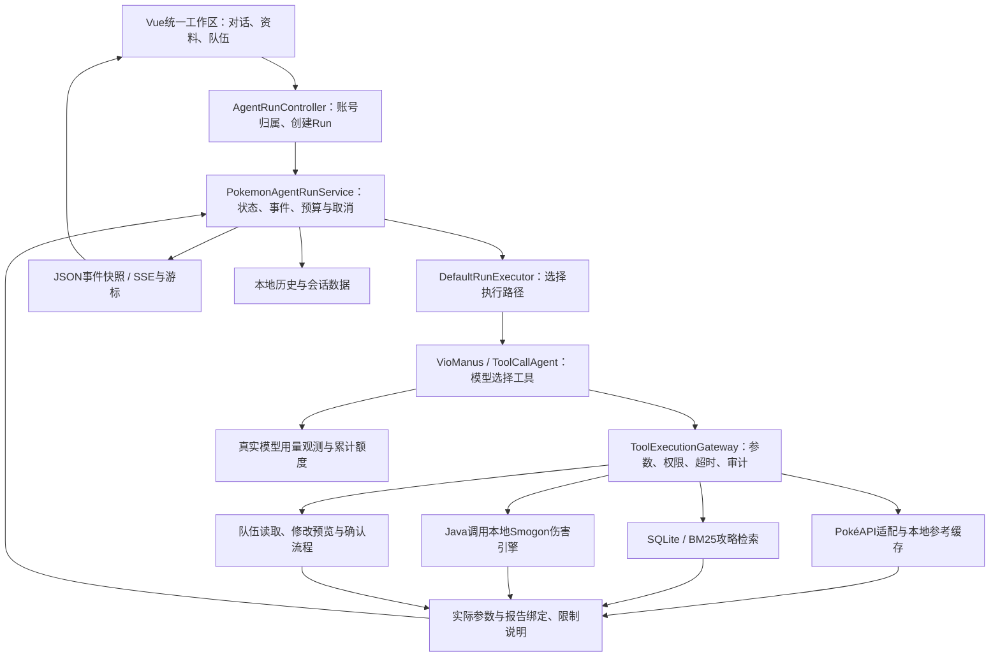

# 架构与设计取舍

讲解范围是本地Vue＋Spring Boot主链。生产数据库、多实例、任意步骤重启续跑及实验多智能体不作为本地已验收能力展示。

## 模型与程序如何分工

模型解释用户需求、选择开放工具、形成参数和条件性建议。程序负责身份与版本、队伍并发边界、确定性计算、工具实际输入输出、引用原文和最终结果展示约束。有限固定JSON草稿可走程序执行路径；普通自然语言三题仍是模型路径，不混算调用成绩。

明确空白草稿会缩小本次模型可见的保存队伍读取工具；遇到同时读取旧队伍或推荐配置的混合请求，则退出该纯草稿限制。它是有限规则，不能宣传成通用意图分类或所有提示注入防护。

## 四个设计取舍

1. **保留任务事件而非只存最终文字。** 工具失败、预算终止与成功答案分别记录，便于重连和复盘。模型规划文字不直接作为用户回答发布。
2. **先做本地可复现。** SQLite和本地参考缓存降低演示基础设施成本；真实模型服务仍需网络与个人Key。缓存数据不是实时赛事规则。
3. **结果绑定而非相信模型自述。** 核对原参数、报告及版本；缺失或错误时保守展示。逐项参考匹配不等于四招联合可得、队伍协同或赛制合法。
4. **保存必须有用户确认。** 修改预览与实际保存分开，冲突或过期预览拒绝覆盖；工具重试、幂等和耐久恢复是不同问题。

## 面试时可打开的代码

- [Run入口](../../../src/main/java/com/vio/vioaiagent/controller/AgentRunController.java)
- [Run生命周期](../../../src/main/java/com/vio/vioaiagent/run/PokemonAgentRunService.java)
- [工具调用循环](../../../src/main/java/com/vio/vioaiagent/agent/ToolCallAgent.java)
- [治理网关](../../../src/main/java/com/vio/vioaiagent/tools/governance/ToolExecutionGateway.java)
- [结果展示约束](../../../src/main/java/com/vio/vioaiagent/agent/TeamBuildAnswerEvidence.java)
- [队伍确认与保存](../../../src/main/java/com/vio/vioaiagent/pokemon/team/TeamWorkflowService.java)

链接对应仓库实际类文件；演示时仍须说明具体配置和执行路径，不能将类存在当成所有能力均已启用。
