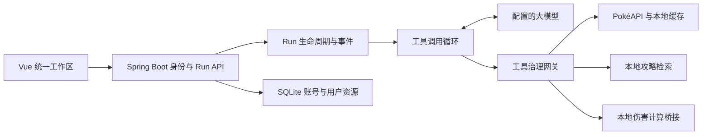

# VIO 宝可梦智能体

> 这是2026-10-30本轮整理前的历史README快照，内容与指标不是最新验收结论。原有根目录相对链接保留为历史文本，需从仓库根目录解析；最新入口见[根README](../../../README.md)和[最终验收报告](回答质量验收报告.md)。其中演示/新机器待办及许可证旧说法已由最新README更正。

基于 **Java 21、Spring Boot、Spring AI 与 Vue** 的宝可梦知识问答和队伍分析应用。接入真实图鉴资料与确定性伤害计算，支持工具调用、正文流式输出、本地账号和数据持久化。

项目面向 AI 应用开发与智能体工程实践，默认支持在个人电脑运行，无需购买服务器。本仓库也保留版本化知识、工具治理、MCP 和生产适配代码；这些扩展的实现、启用和实测状态需要分别确认。

> **秋招升级路线：** [完整升级方案](document/秋招智能体项目完整升级方案_2026-10-22.md)。S0保留真实错误基线；[S0.1](document/秋招升级/S01/README.md)增加事实约束；[S1](document/秋招升级/S1/README.md)实现队伍修改确认闭环；[S2](document/秋招升级/S2/README.md)建立36条种子题与重复评测；[S3第二批](document/秋招升级/S3/来源与语料扩充_2026-10-23.md)扩充到12篇笔记，接通持久检索与片段证据回归；[S4](document/秋招升级/S4/README.md)接通真实用量、预算、历史裁剪、参考费用、分段计时和[对话偏好快照](document/秋招升级/S4/对话偏好与长期约束快照_2026-10-25.md)。已完成首批Token误差观测；扩大覆盖、独立策略/质量验收、保留集对照及账单核对仍待推进。

最新补充[整队多成员与失败边界](document/秋招升级/S3/整队核对多成员与失败边界_2026-10-27.md)：拒绝歧义的重复JSON字段，统一16000字符边界；新增13项开发测试，覆盖1至6成员、资料不足、权限/版本拒绝、执行异常和取消。后端完整1280项（0失败、0错误、3跳过）、定向26项通过。属于确定性网关验证，不计为真实模型或人工质量成绩。

此前补充[整队草稿原参数执行路径](document/秋招升级/S3/整队草稿原参数执行路径_2026-10-27.md)：固定草稿经原网关直接核对，保留完整成员与空字段。程序路径1/1（0次模型调用），已保存队伍模型路径1/1（3次调用），均未改队伍；两种结果分别统计，不作为模型准确率提升。后端1267项（0失败、0错误、3跳过）、前端契约181项、工具168项通过，普通自然语言规划、联合规则和人工验收仍待完成。

最新质量状态：三条v3整队开发回答已获用户在聊天中总体人工确认（3/3），确认绑定具体审核包与答案；未补造逐项评语，不代表全部策略质量或正式题集验收。见[确认记录与混合意图回归](document/秋招升级/S2/用户总体确认与混合意图回归_2026-10-29.md)。

S5已进入[秋招展示准备](document/秋招升级/S5/README.md)：架构讲解、本地演示脚本、简历与失败复盘草稿已交付；新增离线证据身份检查。实际视频、干净环境与最终展示验收仍待完成。

## 能做什么

本地攻略默认使用[14篇资料与主题筛选](document/秋招升级/S3/物种培养资料与主题检索_2026-10-26.md)，包含杰尼龟、雪妖女的条件培养起点与搭配取舍。模型遗漏物种词时，通过现有网关补一次明确标记的定向检索；机制读取失败保留缺失说明。8条检索探针及4次真实问答工程检查通过，完整策略、独立相关性和人工审核仍待推进。

- **知识问答**：围绕朱／紫资料和队伍配置进行多轮问答，增量展示回答。
- **图鉴查询**：通过 PokéAPI 适配器获取资料，保存本地缓存、来源、抓取时间与摘要。
- **队伍配置**：保存成员、招式、特性、道具、性格、等级、努力值和个体值。
- **确认修改**：助手读取当前账号的保存队伍，展示培养配置差异，用户确认后保存；旧预览与并发编辑冲突时拒绝覆盖。
- **确认状态核对**：已提交决定与实际保存分别显示；取消或失效预览不能继续确认，连接暂不可用时保留重试。见[确认保存与异常回归](document/秋招升级/S2/队伍确认保存与异常回归_2026-10-26.md)。
- **多成员差异**：预览与保存回执显示队伍位置，支持培养字段修改及清空道具；[专项验证](document/秋招升级/S2/多成员配置与真实浏览器闭环_2026-10-26.md)分别核对受控HTTP与真实浏览器流程。
- **伤害分析**：Java 调用本地固定版本 `@smogon/calc`，程序展示核对后的数值与条件，模型补充条件性建议。
- **计算条件核对**：默认本地计算入口核对实际攻防、等级、EV/IV、招式与场地，提示引擎默认特性，并关联输入和结果证据。
- **攻略检索**：SQLite持久倒排索引与BM25排序，先按声明的物种和主题筛选，再返回原创笔记原文、作者、日期与可回读定位。
- **机制参考**：内置12项特性、招式和性格投影，按实际调用展示参考字段、朱紫短文的待复核中文释义及来源；空值、候选与已选配置分别表示。
- **学习途径**：按成员和招式查询朱／紫快照中的学习方式、记录等级与来源；未记录明确保留缺失，不推断TM编号、获取地点或赛事合法性。
- **第二来源机制**：另查固定Pokémon Showdown文本，补充6项常用特性/招式的门槛、倍率或概率；来源可定位，中文整理标为待人工复核。
- **配招逐项核对**：队伍编辑区可检查当前配置，Agent可核对缺项、重复招式、特性候选和逐招学习记录；修改配置即清除旧结果，不自动保存，逐项匹配不代表组合合法。
- **整队配置核对**：按当前表单汇总1至6位成员的逐项状态、缺项和重复形态位置；不保存队伍，联合可得性与正式赛制合法性仍未验证。
- **Agent整队只读核对**：可从原配置发起聊天核对，支持先读取当前账号已保存队伍；明确原队伍时，子集报告不能用于展示整队结果。真实草稿规划仍有分拆调用缺口，保留严格失败记录。
- **学习条件提示**：逐招展示学习方式、记录等级及与配置等级的比较；多种途径分别保留，学习器和蛋招式不虚构取得步骤，等级不足提示另查依据。
- **学习器编号与资料参考**：核对4项常用招式的朱紫编号，匹配后可展开配方、有限获取区域线索及官方通用制作说明；来源差异和缺失分别提示。精确位置、解锁条件与游戏内验证仍待完成。
- **本地账户**：注册、登录、预设头像、昵称、修改密码、恢复码、切换账户及退出。
- **统一工作区**：对话、图鉴、队伍和计算集中使用，支持历史消息、编辑/复制、取消与重连。

图鉴中存在某个物种或招式，不代表其符合当前比赛规则；资料缓存也不代表实时环境强度排名。伤害结果依赖输入条件，不等于胜率或完整对战模拟。

[机制资料与问答证据](document/秋招升级/S3/机制资料投影与问答证据_2026-10-26.md)已验证12项HTTP投影和4次真实问答，雪妖女两次均实际读取并展示雪隐参考；完整招式读取、详细机制及人工质量验收仍待补。后端1128项无失败/错误、3跳过，工具125项、前端契约139项通过。

后续[特性/招式逐类覆盖](document/秋招升级/S3/特性招式逐类覆盖与补读_2026-10-26.md)修复“只读到特性就结束”的遗漏：明确请求的缺失类别通过已有受治理工具补一个候选参考。两次雪妖女问答均实际读取并展示雪隐和冰冻光束，4项类别检查全过；失败分类说明缺口，不代选完整配招。最终后端1138项（0失败、0错误、3跳过）、工具129项及前端契约139项通过，完整机制与人工验收继续待办。

最新[招式学习途径与回答核验](document/秋招升级/S3/招式学习途径与回答核验_2026-10-26.md)接入只读工具、HTTP及实际输入/输出证明，避免把招式候选当成学习方式。3题各重复2次，6/6工程检查通过，运行前后8次HTTP核对一致。最终后端1157项（0失败、0错误、3跳过）、工具135项及前端契约139项通过；独立机制、完整学习操作与人工质量验收继续待办。

2026-10-27补充[第二来源机制说明](document/秋招升级/S3/第二来源机制说明与核验_2026-10-27.md)：固定Showdown第九世代文本，接通6条机制说明及受治理查询，中文整理待人工复核。修复未收录资源误报500后，新8次真实问答工程检查通过，前后12次HTTP核对一致；首轮预检失败和未运行记录保留。该批后端1174项（0失败、0错误、3跳过）、工具142项、前端契约139项通过。

随后完成[配招逐项核对与草稿检查](document/秋招升级/S3/配招逐项核对与草稿检查_2026-10-27.md)：前端“检查当前配招”和只读工具使用同一原配置报告，缺项保持缺项，不自动补填；旧结果随配置变化失效。最终后端1188项（0失败、0错误、3跳过）、工具147项、前端契约145项通过，桌面/手机两条浏览器回归通过；三种场景各两次真实问答均通过工程检查，保存队伍回读一致。完整组合约束、学习操作、人工质量与保留集验收继续待办。

此前[学习记录与配置等级提示](document/秋招升级/S3/学习记录与配置等级提示_2026-10-27.md)展示逐招途径和等级，缺等级保持缺项；明确的单成员JSON核对可经过治理直接完成。修复无效工具参数污染后续请求的问题，同时保留自然语言模型两轮1/4、3/4工程通过及预算失败记录；程序直接检查另列4/4、零模型推理调用，不冒充模型准确率。该批后端1212项（3跳过、无失败）、工具151项、前端契约156项及桌面/手机回归通过。

此前[学习器编号与成员记录核对](document/秋招升级/S3/学习器编号与成员记录核对_2026-10-27.md)提供4项固定编号、界面按需查询及Agent只读工具，关联原始成员记录和move/machine/item三方来源。16次本地真实HTTP检查、桌面/手机回归通过；后端1225项（3跳过、无失败）、工具156项、前端162项通过。本轮未请求真实模型，不作为工具选择准确率；获取操作、联合合法性和人工验收继续待办。

此前补充[学习器通用制作说明](document/秋招升级/S3/学习器通用制作说明_2026-10-27.md)：固定官方简体中文来源、四条项目整理要点和核对日期，在编号面板按需展开，并附于已匹配编号的Agent回答。通用说明与成员学习证明分开；具体配方、解锁条件、四招联合约束和人工质量验收仍待完成。

此前接入[学习器配方参考与来源差异](document/秋招升级/S3/学习器配方参考与来源差异_2026-10-27.md)：两份社区资料逐项比较后，守住、冰冻光束、水炮可查询LP与材料数量，水之波动保留拼写差异且不出数量。界面支持按需查询，Agent在核对编号后补同一参考；具体配方仍待人工及游戏内验证，未扩充正式题集或宣称赛制合法。

此前补充[学习器获取区域与解锁边界](document/秋招升级/S3/学习器获取区域与解锁边界_2026-10-27.md)：守住、水之波动、水炮可查询两份资料共同列出的大区域，冰冻光束保留来源不足提示。原地点列表并不完全一致，不发布精确坐标或单一来源的剧情条件，配方与区域状态分别判断。独立人工/游戏内核验和联合配招约束仍待推进。

此前增加[整队配置核对](document/秋招升级/S3/整队配置核对与联合边界_2026-10-27.md)：按当前表单汇总1至6位成员的独立检查、缺项及重复形态观察，配置变化后旧报告失效。完整回归1254项（3跳过、无失败），最后JSON往返比较调整另经8项定向验证；前端契约180项、桌面/手机2条受控接口回归通过。未增加Agent工具或自动保存，联合取得、整队策略与赛制合法性继续待验。

此前接通[整队Agent只读核对](document/秋招升级/S3/整队Agent只读核对与原配置保护_2026-10-27.md)，带原配置进入聊天，工具按Run归属/版本核对并展示实际结果。1262项后端（0失败、3跳过）、181项前端契约及两条浏览器回归通过；真实两题两轮共13次模型调用，最后报告均完整且未改队伍，但草稿中间有分拆调用，严格检查每轮仍1/2。原队伍对子集展示已加保护，规划稳定性、联合规则与人工质量继续待验。

[S4第八批](document/秋招升级/S4/当前请求边界与输出遵守回归_2026-10-25.md)独立处理当前问题、偏好和输出格式，避免条件性偏好误触发队伍任务；有限的中文能力介绍依据注册工具在本地生成，记录真实零模型调用。开发回归分别统计本地与模型回答，格式检查通过不等于人工语义验收。

[工具条件核对](document/秋招升级/S2/工具输入证据与条件核对_2026-10-26.md)补充只读工具的有限参数证据，可检查攻防属性、等级、EV/IV等实际输入；自由文本按摘要比较，未知/缺失证据不会计作验证通过。它与工具执行成功、计算结果和回答质量分别验收。

[伤害条件与结果绑定](document/秋招升级/S2/伤害条件与结果绑定_2026-10-26.md)进一步核对本次实际计算条件、HP与百分比，记录缺失/null/默认特性的区别；独立适配层保留原始桥接源码身份。同引擎结果对照不能替代独立算法和回答语义审核。

[工具配置对照](document/秋招升级/S2/三种工具配置与问答对照_2026-10-26.md)支持本地隔离的纯模型、攻略检索、只读工具三组，固定问题采集回答、来源、用量和耗时，生成待人工审核模板，评测开关默认OFF。[项目流程来源修复](document/秋招升级/S2/项目流程来源检索修复_2026-10-26.md)为有限的中文项目说明请求补上程序触发的受治理检索；原两题重新执行六条工程检查通过，原文出现与人工语义、保留集验收分别统计。

[回答审核与问题收集](document/秋招升级/S2/回答审核台与问题收集_2026-10-26.md)提供离线逐条核对、原文并排阅读、草稿恢复和审核导入。原六条工程通过的回答在质量视图中有1条原文未匹配、5条待审核；尚无真实人工通过。另收录2条用户反馈候选，正式题集仍36条，候选不直接计入100题目标。

AI初筛后已做[项目说明完整性修复](document/秋招升级/S2/项目说明完整性修复_2026-10-26.md)，补齐默认参数、取消/冲突/回读等遗漏段落，并减少这类回答的无关引用。原两题三组共6条新任务工程核对通过，检索组4条均完整引用目标文档；新版六条仍待独立语义审核。后端1094项无失败/错误、3跳过，工具102项、前端契约139项通过。

[用户反馈开发回归](document/秋招升级/S2/用户反馈重放与事实保留修复_2026-10-26.md)将杰尼龟、雪妖女两条反馈关联到实际公开快照，修复无关查询失败抹掉有效事实、资料齐备后重复规划耗尽预算的问题。同目标或未知目标读取失败仍保持失效保护。固定四次最终工程检查4/4；实际人工通过仍0，个性化培养与引用相关性继续待补。后端1103项无失败/错误、3跳过，工具111项、前端契约139项通过；正式题集仍36条。

## 核心设计



1. **模型与程序分工**：模型组织语言和选择工具；结构化事实、参数校验和伤害数值交给相应工具。
2. **执行有边界**：工具调用经过白名单、参数、权限与超时等约束，运行过程以事件记录；高风险工具默认不向训练家开放。
3. **数据按账号隔离**：认证上下文确定当前主体，历史、队伍和收藏按归属读取。本地密码及恢复码使用哈希存储。
4. **回答与过程分开**：正文以增量事件展示，工具过程可展开。任务阶段与工具结果不等于模型内部推理内容。

队伍分析与伤害计算流程先展示实际工具证据，再发布通过有限检查的模型建议；建议部分在检查完成后成段展示。已知错误模式会被拦截，但这不能证明任意自然语言解释都正确。登录后可通过本地 `GET /api/chat/runtime` 核对配置模型 ID 和加载代码摘要；该接口不证明供应商实际返回的模型身份。

本地攻略回答改为展示实际检索原文、作者与日期，避免把模型添加的配招或机制包装成原文引用。已保存队伍的性格、等级与种族值由快照投影展示；缺条件时按实际空缺追问，完整配置后的建议也不能随意重写这些字段。详见 [来源与配置回答修复](document/秋招升级/S2/来源与配置回答修复_2026-10-23.md)。

## 当前能力与边界

| 模块 | 当前状态 | 说明 |
|---|---|---|
| DeepSeek 对话与工具循环 | 已实现，有本地验证记录 | 实际输出效果仍受模型、网络和资料影响 |
| 图鉴、队伍、伤害计算 | 已实现，有功能测试 | 本地计算依赖 Node.js 与引擎包 |
| 本地账号与资源持久化 | 已实现，有隔离/恢复/浏览器测试 | 不提供跨设备同步；重启后重新登录 |
| 默认攻略知识库 | S3 第二批已实现 | 12篇项目原创说明、来源登记、SQLite/BM25与分段引用；独立人工审核、规模扩充及保留集对比未完成 |
| 模型用量与耗时 | S4 首批已实现 | 单次调用计数、供应商原始Token、流式末段去重、终态快照及完成回答的本地历史 |
| 上下文与输出控制 | S4 第二批已实现 | 默认VioManus主链逐次预检、整轮历史裁剪、输出上限及遗漏提示；代理估算未校准，长期记忆待补 |
| 任务累计模型额度 | S4 第三批已实现 | 每Run默认16次调用、131072 Token准入额度，审批不重置、缺失用量不退预留；属于应用准入限制，不能当作账单上限 |
| 版本化参考费用 | S4 第四批已实现 | 本地价格目录、缓存/推理明细、定点金额、来源与历史快照；默认关闭，必要价格或明细缺失时未知，不能作为账单 |
| 工具与回答计时 | S4 第五批已实现 | 拆分排队、执行前校验和回调；区分SDK文字、服务端回答就绪及本机接收，历史缺失或停止前未观测到的阶段保持未知 |
| 会话级长期偏好 | S4 第六批已实现 | 用户主动保存回答详略、培养成本等条件，按账号/会话隔离；历史裁剪仍回填，每次任务固定快照，旧修订不能覆盖新设置 |
| Token估算误差观测 | S4 第七批已实现 | 每次调用配对基础/预算估算与原生输入，生成固定计划报告；缺失时未知，当前125%策略不自动降低 |
| 混合检索、PGVector、版本化知识门面 | 有实现，按配置启用 | 不能据此认定当前本地链已完成真实向量检索与质量验收 |
| 多智能体与自研 MCP 协议栈 | 实验/兼容能力 | 不作为已验收的生产多 Agent 集群宣传 |
| Run 恢复、租约、生产持久适配 | 有实现与测试，存在启用边界 | 不承诺本地重启后自动续跑任意模型或有副作用步骤 |
| 秋招任务评测 | S2 首批工具与种子集已实现 | 独立 36 题/20 组、14 开发/22 保留；人工质量验收、100 题扩充及对照仍待完成，不替代原 v1.1 草案门禁 |
| 生产部署与多实例 | 独立验收范围 | 本机功能测试不替代 PostgreSQL、多实例和发布现场证据 |

当前主链默认回填同一账号、同一会话最近8个完整问答轮次，历史受4096代理Token和12000字符上限约束；每次模型请求计入系统提示、工具定义与结果、当前问题和输出预留，必要时继续移除旧历史整轮。裁剪不会删除聊天记录，界面会提示遗漏。估算与供应商真实用量分别记录，不能等同于完整长期记忆或计费系统。

## 本地快速启动

上轮自动trace导致显式幂等重试冲突的问题已[兼容修复](document/秋招升级/S2/自动trace变化的幂等重放兼容修复_2026-10-30.md)：不改旧摘要写入，核对归属Run后允许trace差异；定向8项和真实HTTP重放通过，改变正文仍拒绝。不代表整体模型质量验收完成。

最近完成[安全拒绝真实HTTP检查及缺省幂等键修复](document/秋招升级/S2/安全拒绝HTTP验证与缺省幂等键修复_2026-10-30.md)：连续未传幂等键的请求不再误冲突，定向8项及新JAR两条安全流程通过。显式键重试在自动trace变化时仍有兼容问题，记录为下一修复项，不算整体质量完成。

针对历史安全回答的无关配招风险，新增[有限跨账号请求直接拒绝](document/秋招升级/S2/明确跨账号请求的直接拒绝回复_2026-10-30.md)，明确中文整句可在模型调用前返回固定说明。定向4项通过，权限校验保持，其他意图走原流程；不将程序拒绝当作模型质量成绩。

首轮历史质量辅助复核已覆盖[12次观测](document/秋招升级/S2/伤害追问安全题辅助复核与首轮汇总_2026-10-30.md)，明确保留来源、机制表述及证据缺口；人工验收0、待审12。下一步为固定当前版本复测与真实人工审核，不把辅助覆盖当作回答准确率。

质量复核继续覆盖[攻略引用与队伍预览](document/秋招升级/S2/攻略与预览题AI辅助复核_2026-10-30.md)：累计6/12次历史观测已有AI辅助意见，人工仍为0；增加双轮历史错误回归，工具390项通过，当前模型和保留集未新增验收。

已开始[历史图鉴题逐条AI辅助核对](document/秋招升级/S2/图鉴事实题首批AI辅助复核_2026-10-30.md)：核对2次回答的数值、来源及事件，登记1项未支持的开场表述风险。辅助意见不计人工通过，当前模型质量仍待正式验收。

质量验收最新进度：[S2审核绑定修复与历史复算](document/秋招升级/S2/审核记录绑定与时间校验修复_2026-10-30.md)，工具389项通过；历史12次观测仍有12次待人工复核，没有将结构通过当作质量通过。

当前核心功能与基础交付链已具备，剩余重点为正式题集质量、完整演示、干净环境安装及最终版本整理，见[剩余任务与最终验收计划](document/秋招升级/剩余任务与最终验收计划_2026-10-30.md)。最新交接构建桌面/手机视口浏览器基础流程2/2通过，不代表模型质量或全阶段完成。

### 环境

- JDK 21，并正确设置 `JAVA_HOME`；可先运行 `java -version` 检查。
- Node.js 20.x（至少20.19）或22.12及以上与npm；21.x及22.0～22.11不支持（本地验证使用Node.js 24.19.0）。
- Git；Maven 可使用仓库提供的 Wrapper。
- 个人模型 API Key。下面以现有 DeepSeek profile 为例；模型服务需要网络访问。

默认本地模式使用 SQLite，不需要安装 PostgreSQL、Redis、Docker 或云服务器。首次安装 Maven/npm 依赖，以及首次拉取图鉴资料时仍需要相应网络。

安装检查可使用[公开资料与预检手册](document/秋招升级/S5/公开资料准备与演示复现手册_2026-10-30.md)。预检v2会依据项目及锁定Vite的engines判断Node，缺少JDK或依赖时给出逐项修复提示；不会自动安装或读取模型Key。预检通过不代表应用已构建或启动。

需要将基础复现输入交给另一台电脑时，可按[独立本地交接目录说明](document/秋招升级/S5/独立本地交接目录准备与验证_2026-10-30.md)生成公开源码、必要工具和固定资料包；不包含个人Key、数据库、依赖或构建产物，安装与启动仍需实际验证。

新生成的交接目录采用v2格式。发送前可在目录内执行`node tools/campus/verify-local-handoff.mjs`，检查摘要、未登记文件及已知运行数据；不自动删除文件、不代表来源可信或安装成功。详见[交付前检查](document/秋招升级/S5/交付前完整性与运行数据检查_2026-10-30.md)，本轮工具387项通过。

已完成[本机交接目录实际安装、构建及启动验证](document/秋招升级/S5/交接目录实际安装构建与启动验证_2026-10-30.md)，并修复PowerShell的Maven参数引用问题；后端9项及前端入口/代理HTTP检查通过，工具383项通过。实际执行复用本机运行时与缓存，后端测试显式跳过、未调用模型，不代替全新机器验收。

### 1. 获取项目并安装 Node 依赖

以下命令在 PowerShell 中运行：

```powershell
git clone https://github.com/vioabio/AI-Agent.git
cd AI-Agent
npm --prefix tools/pokemon-engine ci
npm --prefix vio-ai-agent-frontend ci
if (!(Test-Path src/main/resources/application-local.yml)) {
  Copy-Item src/main/resources/application-local.example.yml src/main/resources/application-local.yml
}
```

已有项目时直接进入项目根目录，不需要再次克隆。上面的模板复制不会覆盖已有本地配置。Maven Wrapper 必须在项目根目录执行。

S0 固定演示配置、三条演示脚本与验证记录见 [S0 基线交付](document/秋招升级/S0/README.md)。可复查的运行记录不等同于模型质量评测成绩。

### 2. 启动后端

在当前 PowerShell 中设置个人 Key，再启动：

```powershell
$env:DEEPSEEK_API_KEY = '替换为你的个人 API Key'
.\mvnw.cmd spring-boot:run "-Dspring-boot.run.profiles=local,deepseek"
```

Key 仅应存于本机环境或受忽略的本地配置，不要提交到 Git。IDEA 运行时，Active profiles 设为 `local,deepseek`，并在该运行配置中设置 `DEEPSEEK_API_KEY`。

DeepSeek profile 使用 OpenAI 兼容客户端并关闭 DashScope 自动装配，不需要同时填写百炼 Key。模型默认值以 [application-deepseek.yml](src/main/resources/application-deepseek.yml) 为准；如账号支持的模型不同，可设置 `DEEPSEEK_MODEL`。

后端默认地址：`http://localhost:8123/api`。如果提示端口被占用，先检查是否已有后端运行，避免同时启动多个实例。

Linux/macOS 可使用 `./mvnw spring-boot:run -Dspring-boot.run.profiles=local,deepseek`，环境变量使用当前 shell 对应的设置方式。

### 3. 启动前端

在另一个终端进入项目根目录：

```powershell
npm --prefix vio-ai-agent-frontend run dev
```

访问 `http://localhost:3000`，根路径会转到 `/game-master`。创建本地账号、保存恢复码并登录后，直接进入助手，无需经过中间首页。

### 4. 完成一次演示

1. 查询“杰尼龟”，查看图鉴和来源。
2. 加入队伍，填写招式与培养配置并保存。
3. 对已保存队伍点击“让 AI 分析”，助手先从当前账号读取配置。
4. 在计算区填写完整攻防条件，执行伤害计算并讨论结果。
5. 点击“AI 修改预览”，补充目标或明确改动；阅读差异后确认保存或取消。
6. 从左下角账户菜单修改资料；如有旧匿名数据，首次创建的账号可确认认领自己的旧会话和队伍。

本地模式已接入队伍修改闭环，只修改现有成员的培养配置。确认复用既有 Run/HITL 生命周期，保存前比较 SQLite 修订号；存在未保存草稿时保留草稿。候选预览不跨重启恢复，不向模型提供直接保存工具。该扩展仅在本地、关闭 durable-resume 与版本化知识门面时启用，见 [S1 范围与验证](document/秋招升级/S1/README.md)。

## 本地数据与配置

| 数据 | 默认位置 |
|---|---|
| 账号、密码/恢复码哈希 | `.local-data/accounts.sqlite` |
| 会话与完整历史消息 | `.local-data/history.sqlite` |
| 队伍配置 | `.local-data/teams.sqlite` |
| 收藏 | `.local-data/favorites.sqlite` |
| PokéAPI 缓存 | `.local-data/pokeapi/` |
| 默认攻略原文 | `src/main/resources/pokemon-guides/expanded-v1.json`（12篇、schema2） |
| 原4篇攻略基线 | `src/main/resources/pokemon-guides/index.json`（保留原评测身份） |
| 本地攻略持久索引 | `.local-data/guides.sqlite`（启动核对并复用，来源变动后事务重建） |

`.local-data/` 已被 Git 忽略。SQLite 文件中还有个人聊天和配置内容，备份时应按个人数据处理。恢复码仅在生成时显示，重设或修改密码后会轮换。

本地账号只允许在 `local` 且非 `prod/demo` 环境启用，与 OIDC 互斥。需要使用企业 OIDC 时，先设置 `VIO_LOCAL_ACCOUNTS_ENABLED=false`，再按对应身份配置和验收流程接入。

可选配置：

- `DEEPSEEK_MODEL`：覆盖本地模型配置。
- `VIO_LOCAL_HISTORY_PATH`：覆盖历史数据库位置。
- `vio.local-accounts.path` / `vio.local-teams.path` / `vio.local-favorites.path`：覆盖对应存储位置。
- `VIO_POKEMON_REFERENCE_ENABLED`：本地图鉴资料模块开关。
- `vio.pokemon.reference.path`：图鉴缓存目录，可指向已校验的导入目录。
- `VIO_DAMAGE_ENGINE_ENABLED`：本地伤害引擎开关。
- `VIO_LOCAL_GUIDES_ENABLED`：本地攻略模块开关。
- `VIO_LOCAL_GUIDES_LOCATION` / `VIO_LOCAL_GUIDES_PATH`：受审查的攻略JSON文件与SQLite索引位置；无需额外数据库服务器或embedding Key。

联网搜索需要单独配置有效的 `search-api.api-key` 并启用 `vio.tools.search.enabled`。模型 Key 不等于搜索服务 Key；未配置时不提供搜索工具。

### 常见问题

- **找不到 Maven Wrapper**：先进入包含 `mvnw.cmd` 的项目根目录，不要在 `C:\WINDOWS\system32` 执行。
- **JAVA_HOME 无效**：指向 JDK 安装目录，不能指向 `bin` 或 `java.exe`；先更新 `JAVA_HOME`，再把它的 `bin` 加入当前终端的 `Path`。
- **图鉴上游不可达**：可设置 `VIO_POKEAPI_PROXY=http://127.0.0.1:你的代理端口`，或在 `.local-data/pokeapi-network.properties` 配置 `proxy=http://127.0.0.1:端口` 后重启后端。此处不填写模型 Key，不使用带账号密码的代理 URL；已有校验通过的缓存可继续复用。
- **需要预热图鉴缓存**：运行 `./tools/warm-pokemon-reference.ps1 -Query squirtle`；支持`-Proxy direct`或无认证HTTP代理，未指定时读取缓存同级的网络配置，再使用系统网络。完整缓存不重复下载。
- **演示环境需要复用资料**：使用`node tools/reference-cache.mjs inspect --cache .local-data/pokeapi --pokemon squirtle`预检；支持公开Pokemon/species快照导出、导入新目录，保留原始来源和日期。命令见[资料预热与离线包](document/秋招升级/S2/资料预热与离线包_2026-10-26.md)。资料包不包含模型服务、所有资源详情或图片；未缓存资料仍需可用网络。

## 测试与评测

在项目根目录运行后端测试和引擎测试：

```powershell
.\mvnw.cmd test
node --test tools/reference-cache.test.mjs tools/campus/*.test.mjs
npm --prefix tools/pokemon-engine test
```

前端检查：

```powershell
cd vio-ai-agent-frontend
npm run lint
npm run typecheck
npm run test:contract
npm run build
npm run test:e2e
```

浏览器测试需要 Playwright 浏览器运行环境；本项目的已有 Windows 验证记录使用本机 Edge。PostgreSQL 集成测试还需要可用的对应测试环境，不能把跳过视为通过。

已有验证记录（2026-10-21，属于历史证据，不是本次文档修改重新执行的结果）：

| 范围 | 记录 |
|---|---|
| 后端完整离线 Maven 回归 | 847 项，0 失败、0 错误、3 跳过 |
| 最终账号/安全/持久化定向验证 | 16 项通过 |
| 前端契约 | 100 项通过 |
| 浏览器完整回归 | 55 项通过 |
| 后续登录布局、紧凑聊天专项 | 有单独验证记录，与完整回归存在重叠，不累加总数 |

上述记录支持工程行为验证，不能转换为模型回答准确率、真实任务成功率或生产吞吐量。运行证据目录 `artifacts/` 被忽略，记录并不随克隆自动提供；请按命令复现。

评测入口与规则见 [evaluation/README.md](evaluation/README.md)。CI 模式验证契约和样例；发布模式要求真实数据、实测报告和门禁证据。当前样例不能充当完整黄金集，新增秋招评测也不应降低既有发布标准。

秋招种子集及真实任务采集见 [S2 操作说明](evaluation/campus/s2/README.md)。本地可先执行：

```powershell
node tools/campus/s2-evaluate.mjs validate
node --test tools/campus/evaluation.test.mjs tools/campus/s2-quality-regression.test.mjs
```

2026-10-23 首轮 S2 验证：后端全量904项（0失败、0错误、3跳过），评测工具25项通过；六类真实任务各重复两次，12次结构检查通过，尚未完成人工质量验收。发现的攻略引用外扩、性格与种族值标签错误随后已做[专项修复](document/秋招升级/S2/来源与配置回答修复_2026-10-23.md)，并修复流式模式待确认被误判为空回答的问题。最终后端921项（0失败、0错误、3跳过）、Node评测工具29项通过；首轮原始错误仍保留在 [S2 验证记录](document/秋招升级/S2/验证记录_2026-10-23.md)。

后续S3首批验证：后端932项（0失败、0错误、3跳过）、Node评测工具33项通过；13条本地检索开发回归与独立进程重启复用通过，3条固定Agent开发回归通过，来源和流式正文一致。当前语料仅4篇，不将小库成绩作为通用准确率或保留集提升。命令及记录见 [S3 验证](document/秋招升级/S3/验证记录_2026-10-23.md)。

S3第二批：默认12篇/20片段，最终后端937项（0失败、0错误、3跳过）、Node工具39项通过；24条固定检索开发题、3条Agent回归和重启复用通过，保留泛词误召回的原始失败与修复前后结果。来源和相关性标注仍待独立人工审核，详见[扩充验证记录](document/秋招升级/S3/语料扩充验证记录_2026-10-23.md)。

S4首批：后端955项（0失败、0错误、3跳过）、前端契约115项、Node工具43项及5项浏览器检查通过；4条真实模型开发用例的调用和用量快照一致。费用仍为未知，已有Surefire退出等待告警保留。同期攻略质量检查有1条因重复检索被拒绝而回退到资料不足提示，仍未通过引用验收；详见[S4验证与已知缺口](document/秋招升级/S4/验证记录_2026-10-23.md)。

2026-10-24[根因更正与修复](document/秋招升级/S4/工具缓存隔离与执行记录修复_2026-10-24.md)：上条攻略失败实际为“换参数后误用首次空结果”，去重事件又被误标为拒绝。现已隔离读取缓存参数与版本、拒绝写幂等键换参数，并完善执行记录；后端961项（0失败、0错误、3跳过）、前端契约116项及5项浏览器检查通过。三条固定真实模型开发回归各两轮，来源/快照和用量核对均6/6通过；人工评审与Token预算仍待完成。

2026-10-24后续[上下文预算与历史裁剪](document/秋招升级/S4/上下文预算与历史裁剪_2026-10-24.md)：默认VioManus逐次估算完整输入并限制输出，按完整问答轮次移除旧历史，界面提示遗漏；修复百炼SDK设置max_tokens的兼容问题。后端978项（0失败、0错误、3跳过）、前端契约118项、工具45项和浏览器5项通过；真实三轮对话、超限零调用拦截和三条既有开发回归完成相应功能核对。SDK前两版六条失败与最终回答冗长问题均保留，不代表质量全面通过；任务累计额度和计费仍待开发。

2026-10-24第三批[任务累计模型额度](document/秋招升级/S4/任务累计模型额度控制_2026-10-24.md)：按Run原子预留模型调用与Token，审批不重置，未知用量/失败不退预留，恢复快照不可核实时拒绝新增模型调用。后端992项（0失败、0错误、3跳过）、前端契约121项、工具47项及浏览器5项通过；真实正常流、次数耗尽、Token不足与三条既有开发回归完成对应核对。累计占用与供应商usage分别显示，费用、独立质量评审及长期约束仍待补齐，既有测试退出等待告警保留。

2026-10-24第四批[价格版本与参考费用](document/秋招升级/S4/价格版本与参考费用估算_2026-10-24.md)：增加本地价格目录、缓存/推理明细、定点费用计算、来源及历史快照，修复DeepSeek SSE丢失缓存字段。后端1004项（0失败、0错误、3跳过）、前端契约127项、工具49项和浏览器7项通过；三条真实开发回归完成来源、usage、预算与费用状态核对。真实配置未启用报价，费用继续未知；估算金额由HTTP/SSE、SQLite和浏览器fixture验证，不冒充真实账单或独立质量验收。

2026-10-25第五批[工具耗时与首段回答观测](document/秋招升级/S4/工具耗时与首段回答观测_2026-10-25.md)：工具排队、执行前校验与回调分段记录；SDK首段、服务端公开回答就绪、本机接收分别显示，历史缺失或超时未结束时不补造数字。后端1014项（0失败、0错误、3跳过）、前端契约131项、工具52项及浏览器10项通过；三条真实开发回归的五类快照核对各3/3，另有一条原生流式验证。详情默认折叠；S4仍待长期约束、估算校准与账单核对，独立质量验收继续进行。

## 下一阶段升级

2026-10-25第七批[Token估算误差观测](document/秋招升级/S4/Token估算误差观测与校准报告_2026-10-25.md)：新增逐次配对、历史/界面展示及固定开发/验证计划。后端1026项（0失败、0错误、3跳过）、前端契约137项、工具55项和浏览器14项通过。6条真实请求得到13条可比较调用，本批预算均覆盖原生输入；样本仅覆盖单一模型和较短上下文，保留125%策略及PROXY_UNCALIBRATED标记，未宣称普遍安全或质量提升。

2026-10-25第六批[对话偏好与长期约束快照](document/秋招升级/S4/对话偏好与长期约束快照_2026-10-25.md)：顶部“对话偏好”可保存当前会话要求，后端采用修订校验，每次Run固定输入快照。后端1023项（0失败、0错误、3跳过）、前端契约134项、工具52项和浏览器12项通过；两条真实问答完成设置更新、快照、409/404及删除检查。该功能保证保存与回填，不代表模型每次完全遵守；Token估算校准、独立质量和账单验收仍待完成。

| 顺序 | 优先级 | 目标 |
|---|---|---|
| S0 | P0 | 冻结演示范围与模型/数据/工具基线 |
| S1 | P0 | 读取队伍 → 追问 → 查询/计算 → 变更预览 → 确认保存 |
| S2 | P0 | 构建真实任务评测集，形成基线与失败分析 |
| S3 | P1 | 扩充资料，完成可引用、可评测的检索链路 |
| S4 | P1 | 完善 Token 预算、上下文和任务耗时/费用记录 |
| S5 | P1 | 交付架构图、演示视频、效果报告与面试材料 |

详细开发步骤、建议验收目标、测试设计和完成定义见 [完整升级方案](document/秋招智能体项目完整升级方案_2026-10-22.md)。目标值均为规划，不是当前成绩。

## 代码入口

| 目录/文件 | 职责 |
|---|---|
| `src/main/java/com/vio/vioaiagent/run/` | Run 生命周期、事件、历史与持久化适配 |
| `src/main/java/com/vio/vioaiagent/agent/` | Agent 执行与工具调用循环 |
| `src/main/java/com/vio/vioaiagent/tools/governance/` | 工具参数、权限、执行边界与审计 |
| `src/main/java/com/vio/vioaiagent/pokemon/` | 事实、队伍、资料、攻略和伤害引擎 |
| `src/main/java/com/vio/vioaiagent/rag/` | 检索、知识生命周期与相关扩展 |
| `src/main/java/com/vio/vioaiagent/security/` | 身份、账号、授权和安全基础 |
| `vio-ai-agent-frontend/src/views/GameMaster.vue` | 统一工作区 |
| `tools/pokemon-engine/` | 固定版本的本地计算桥接与测试 |
| `evaluation/` | 评测数据、契约、运行和门禁 |

## API、路由与扩展文档

Swagger 默认入口：`http://localhost:8123/api/swagger-ui.html`。本地账号模式下，受保护接口需要已登录会话；程序客户端也需要遵守对应认证与 CSRF 约束。接口快照见 [OpenAPI 契约](contracts/openapi-v1.1.json)。

| 前端路由 | 行为 |
|---|---|
| `/` | 重定向到助手 |
| `/game-master` | 登录后使用的统一助手工作区 |
| `/pokemon-workbench` | 兼容入口，转到助手并打开资料面板 |
| `/super-agent` | 兼容入口，转到统一助手工作区 |

生产适配、OIDC、MCP、PostgreSQL/pgvector、容器化和监控属于独立配置与验收范围。CI 工作流存在不代表最近远程流水线已通过，也不代表完成真实生产部署。

- [秋招完整升级方案](document/秋招智能体项目完整升级方案_2026-10-22.md)
- [本地账号实施与使用说明](document/正式版v1.1开发计划/本地账号与登录界面实施_2026-10-21.md)
- [PokéAPI、队伍、伤害与攻略落地记录](document/正式版v1.1开发计划/PokéAPI与队伍伤害攻略四阶段落地_2026-10-20.md)
- [网页端响应式适配](document/正式版v1.1开发计划/网页端响应式适配_2026-10-21.md)
- [历史 v1.0 开发计划](document/正式版v1.0开发计划/README.md)
- [历史企业级实现与待验收边界](document/正式版v1.0开发计划/M2-M7实施完成记录.md)
- [第三方计算引擎说明](tools/pokemon-engine/THIRD_PARTY_NOTICES.md)
- [图鉴插图来源](vio-ai-agent-frontend/public/pokemon/SOURCES.md)

历史计划用于追溯，不替代当前代码和指定运行配置的验证结果。

## 许可证与第三方来源

项目源代码沿用原有的 Apache 2.0 许可声明。第三方依赖与宝可梦名称、插图等资源分别遵循其对应许可与使用范围，不能将项目源码许可视为这些资源的授权。

计算引擎许可说明和图鉴插图来源见上方链接；对外发布前应同时核对完整许可文件、依赖声明与资源来源记录。

2026-10-29新增[自然语言整队规划评测基础](document/秋招升级/S3/自然语言整队规划评测基础_2026-10-29.md)：逐调用核对完整参数、结果绑定与先读后查，程序/模型来源分别统计；新增9项测试，工具完整177项通过。三条自然语言开发样本尚未实际运行，正式36题及人工验收状态不变。

随后完成[自然语言整队真实基线](document/秋招升级/S3/自然语言整队真实基线_2026-10-29.md)：三题共11次模型调用，完整参数/报告绑定2/3；严格三工具走廊0/3（额外图鉴读取），不等于有写入或语义错误。稀疏成员顺序重排仍待修复，原失败保留；177项工具回归通过，人工与整阶段验收不变。

继续补充[自然语言成员顺序保护](document/秋招升级/S3/自然语言成员顺序保护_2026-10-29.md)：明确顺序约束进入模型指令与结果展示校验；后端1283项（0失败、0错误、3跳过）、工具177项通过。隔离服务启动被自动审批拒绝，新版真实三题重测待完成，不宣称模型规划成绩提升。

新增[受约束图鉴读取第二版协议](document/秋招升级/S3/受约束图鉴读取评测协议_2026-10-29.md)：队内别名、原数据版本、完整参数与终态绑定均须核对；历史三题旧版0/3与事后第二版2/3并列保留，不作为模型提升。工具188项通过；顺序保护新版真实重测仍待完成，本批无新增模型调用。

完善[自然语言重测启动与双协议采集](document/秋招升级/S3/自然语言重测启动与双协议采集_2026-10-29.md)：固定题目/协议摘要、有限只读就绪探针、运行版本校验与双协议并列记录；新增7项测试，工具195项通过。本批不启动服务，顺序保护新版真实重测仍待完成，未新增模型或人工验收成绩。

已补齐[顺序保护v2真实重测](document/秋招升级/S3/成员顺序保护真实重测_2026-10-29.md)：前台隔离服务执行原三题共11次模型调用，原严格0/3、第二版2/3；稀疏顺序本轮保留，但缺显式build字段、报告摘要差异与额外队伍列表读取仍未解决。工具195项通过，服务已退出；不宣称整项或人工验收完成。

最新完成[未填写草稿字段与工具范围修复](document/秋招升级/S3/未填写草稿字段与工具范围修复_2026-10-29.md)：有限草稿请求显式null保留、规划时排除保存队伍读取工具，仍由模型生成参数。相同三题v3真实重测10次调用，原严格1/3、第二版3/3；后端1286项（0失败、0错误、3跳过）、工具196项通过。旧失败和原标准不变，单轮工程通过不替代人工语义、通用规划或联合规则验收。

新增[整队真实回答质量审核](document/秋招升级/S2/整队真实回答质量审核_2026-10-29.md)：三条v3真实回答已生成原文/参考并排的可读材料、待填写模板与绑定导入报告；原事件和工程状态重新核对。新增10项测试，工具206项通过；人工提交仍0、三条待审核，不把工程通过计为语义验收。

本批总体确认及混合意图回归验证：用户总体确认3/3；后端1292项（0失败、0错误、3跳过）、Node211项通过。混合场景新增6个确定性实例，未新增模型实验；原始证据与正式36题保留。

S5第二批完成[公开源码工作区构建与基础启动](document/秋招升级/S5/公开源码工作区构建与启动验证_2026-10-29.md)：排除私有配置、旧数据库和构建产物，672个公开文件在新目录离线打包、前端构建及本地认证/独立引擎冒烟通过，Node224项通过。使用本机工具与依赖缓存，不等于空机器安装、模型/浏览器全链路或视频交付；S5不提前标完成。

S5第三批完成[公开构建真实桌面/手机联调](document/秋招升级/S5/公开构建桌面与手机浏览器联调_2026-10-29.md)：页面登录、缓存图鉴、直接保存、API及刷新后可见队伍卡片回读最终2/2通过，前端lint通过，双端无页面脚本错误或横向溢出。中间手机浮层测试失败保留；无模型、审批预览或完整视频验收，两个隔离服务已关闭。

S5第四批取得[真实模型原始录屏与失败复盘](document/秋招升级/S5/真实模型录屏与编号失败复盘_2026-10-29.md)：只读核对因首次物种编号错误未通过逐次检查，独立单字段预览确认保存成功，两阶段6次模型调用；失败不被成功阶段覆盖。Node229项及前端lint通过，约35秒/9秒无声素材不等于完整成片。下一步先补成员编号来源绑定，再完成连续演示。

2026-10-30补充[自然语言成员编号来源绑定](document/秋招升级/S3/自然语言成员编号来源绑定_2026-10-30.md)：明确未填写草稿先查询原成员名称，再允许整队核对；网关在真实回调前拒绝成员编号、位置、版本或未填写配置不一致的调用。历史编号失败保留；本次实现与自动化验证不替代原题真实模型重测，S5仍未完成。

该批最终验证：后端1301项（0失败、0错误、3跳过），Node229项通过。全量运行发现的旧公网抓取测试超时已改为本地HTTP夹具并加强正文/截断断言，初次失败保留；既有Surefire退出等待告警仍保留。

随后完成[编号修复真实复测与连续演示](document/秋招升级/S5/编号修复真实复测与连续演示_2026-10-30.md)：原题先查询名称再正确核对，后续在同一账号/对话预览等级50→51、确认保存及刷新回读，共5次实际模型调用。新增11项离线审计测试，Node240项及前端lint通过；65.40秒无声原始素材不替代完整秋招成片，预览原始参数的逐字段证据仍未认证，S5继续进行。

继续补齐[预览参数证据](document/秋招升级/S5/预览参数证据与确认保存验证_2026-10-30.md)：新增版本化白名单与144字段专属上限，记录数字/null和字符串摘要，保留确认保存流程；一次真实任务2次模型调用完成完整输入审计、确认前不写及保存回读。后端1306项（0失败、0错误、3跳过）、Node246项及前端lint通过；旧记录仍维持OMITTED，S5完整演示交付继续进行。

新增[公开资料准备与演示复现手册](document/秋招升级/S5/公开资料准备与演示复现手册_2026-10-30.md)：固定资料准备与不读取密钥的只读预检工具、`dev:demo`/`preview:demo`独立入口已实现。Node260项、前端构建与lint通过；直连资料下载本次失败，显式既有缓存导入及本机预检通过，未启动应用或调用模型，空机器安装和完整成片仍待验收。

继续完成[空npm缓存与公开构建复现](document/秋招升级/S5/空npm缓存安装与公开构建复现_2026-10-30.md)：新目录674个公开输入，两个组件分别用初始空npm缓存安装，前端构建和后端公开JAR启动通过；9项HTTP基础检查、桌面/390视口2项检查、Node271项与前端lint通过。后端复用Maven缓存且跳过测试，使用无效模型Key，无模型调用；S5仍不算空机器或完整成片验收。

后续完成[空Maven依赖缓存构建与启动](document/秋招升级/S5/空Maven缓存构建与启动验证_2026-10-30.md)：初始空依赖仓库、公开Central一次在线打包通过，新JAR的9项HTTP检查和104个运行类摘要核对通过；工具回归362项通过。新增可复用冷构建准备工具，后端测试显式跳过、模型调用0。运行时与旧公开资料仍复用，空机器、首次资料联网下载和完整成片继续待验收。

随后修复[参数校验依赖与错误状态](document/秋招升级/S5/请求参数校验依赖与错误状态修复_2026-10-30.md)：补齐校验实现，修正校验异常HTTP状态，三组定向测试15项通过；公开JAR启动不再提示缺少provider，真实非法注册5项检查和基础HTTP回归9项通过。未批量改动业务DTO、未重跑全量后端或前端测试、未调用模型，S5继续进行。

最新补充[公开资料下载诊断与串行模式](document/秋招升级/S5/公开资料下载诊断与串行验证_2026-10-30.md)：工具回归367项通过；两次真实网络实验仍有连接/等待超时，未生成不完整缓存，也未将旧缓存算作新下载。首次联网准备尚未验收，详细失败与后续操作均已保留。

该固定资料缺口随后已通过[显式本机代理下载与离线链路](document/秋招升级/S5/公开资料代理下载与离线链路验证_2026-10-30.md)：4个真实公开响应生成6文件包，导入新缓存后，在资料网络不可用的隔离应用中9项HTTP检查通过；工具374项通过。新增代理入口、有界预算及安全诊断，保留直连失败，复用已有公开JAR，无模型调用。验收仅限固定两只宝可梦及本次代理环境，全新机器和完整成片仍待完成。

最新修复[启动日志冲突及环境输出](document/秋招升级/S5/启动日志冲突与环境输出修复_2026-10-30.md)：清除第二个SLF4J实现，仅prod创建JSON文件输出器，生产JSON/MDC保持有效，日志目录可用`vio.logging.path`配置（默认logs）。定向8项及新JAR的9项HTTP检查通过，两条已登记启动提示消失；未重跑全量后端或工具测试，未调用模型，S5继续进行。

后续修正[首次安装Node版本预检](document/秋招升级/S5/首次安装Node版本预检修复_2026-10-30.md)：不再误放行22.0或拒绝声明支持的20.19，使用项目与锁文件要求、补充缺项操作提示。工具380项通过；新目录缺依赖被正确拦截，已有公开依赖目录预检通过。本轮没有安装其他Node版本、启动应用或调用模型，S5仍待全新环境与完整成片验收。

最新完成[DeepSeek工具结构兼容修复与真实复测](document/秋招升级/S2/DeepSeek工具结构兼容修复与真实复测_2026-10-30.md)：修复工具Schema悬空引用导致普通问答HTTP 400的问题，后端定向32项及采集脚本10项通过。固定6道开发题各2次，最终工程检查12/12；原失败保留，人工逐项审核仍待完成。伤害策略段仍出现证据不足而被拦截，工程通过不代表策略质量达标。Key和本机运行配置不入库。

后续补充[伤害解释替代路径](document/秋招升级/S2/伤害解释替代路径与真实复测_2026-10-30.md)：原校验不放宽，纯伤害建议被拒绝时展示程序核对的区间解释与下一步验证。后端定向49项通过，4道开发题各2次工程检查8/8；3次程序替代、1次模型建议保留，不当作模型策略准确率。人工逐项审核和条件断言核实继续进行。

继续补充[条件断言校验与复测记录](document/秋招升级/S2/条件断言校验与复测失败记录_2026-10-30.md)：历史候选回归及最终定向56项通过。真实任务两轮分别1/8、7/8工程通过，失败均保留；第二轮4个伤害任务完成，仍有追问生成失败，具体HTTP状态尚未知。新规则是有限内容边界，不能代替真实对照计算、人工语义审核或调用稳定性验收。

最新完成[模型失败脱敏诊断](document/秋招升级/S2/模型失败脱敏诊断与验证_2026-10-30.md)：调用记录增加固定错误类别、可读取的HTTP状态及来源，不保留原始错误内容，不增加重试。最终后端定向37项、用量兼容12项通过；单轮真实工程检查8/8、用量快照8/8。故障路径由本地HTTP与终态测试验证，本轮未复现真实失败，不能回填历史原因或宣称稳定性已验收。

继续完成[开发题基线补齐与零调用记账修正](document/秋招升级/S2/开发题基线补齐与零调用记账修正_2026-10-30.md)：跨3个同构建批次覆盖14道开发题、28条工程检查通过，人工逐项仍待审，保留集未执行。随后修正明确安全拒绝路径的零调用声明，定向24项与2次无真实模型Key的HTTP核验通过；原两个UNKNOWN记录保留。计量修正构建仅做定向回归，不把旧28条改算为新版全量通过。
