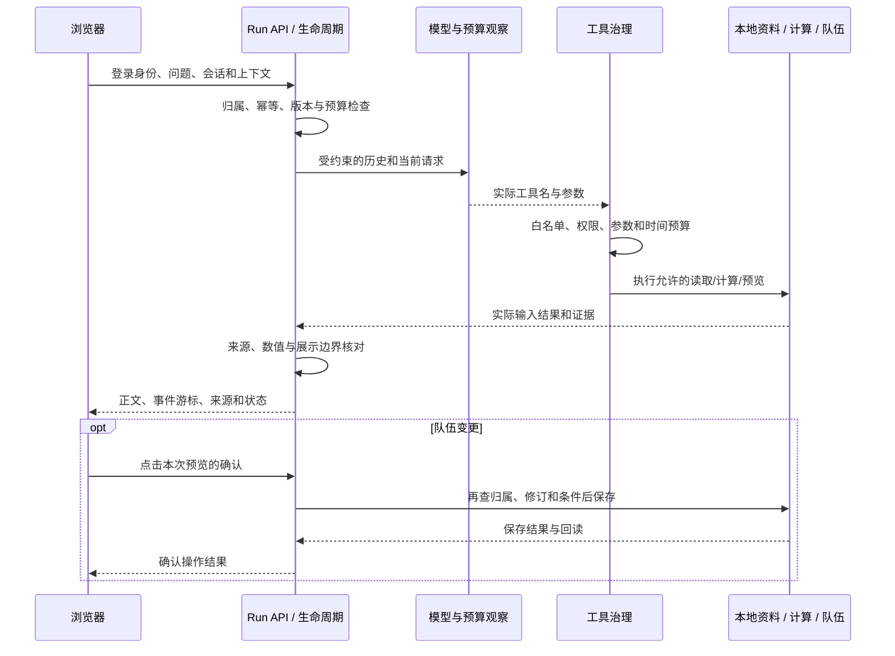

# 架构与设计取舍

## 范围

面向本机运行的网页应用，默认链路为 Vue → Spring Boot → DeepSeek/本地工具。SQLite 保存本机账号、历史、队伍与攻略索引；模型推理仍使用网络 API。本文不把可选生产适配、多实例或实验多智能体视为当前已部署能力。

## 一次请求的数据流

模型规划内容不会直接当作最终答案发布。正文模型流、程序来源节选、确定性计算卡片和固定拒绝回复按来源区分，后两者不是模型准确率样本。

## 关键边界

| 设计 | 选择及原因 | 限制 |
| --- | --- | --- |
| 图鉴数据 | Java 适配 PokéAPI，缓存来源与摘要，已缓存时可复用 | 不是赛事规则库，缓存不代表最新赛季 |
| 检索 | SQLite 倒排索引与 BM25，展示实际片段与出处 | 当前不是默认向量检索；引用相关性要独立评价 |
| 计算 | Java 启动本地 Node 引擎，解释实际条件与范围 | 不是完整对战模拟，不证明胜率或合法性 |
| 明确计算入参 | 对有限的完整JSON计算请求保留原配置，绑定到模型选择的计算调用；事件注明程序来源 | 不声称模型转写正确，不处理任意自然语言或来源文本；网关权限与参数检查仍执行 |
| 修改 | 预览和实际保存分离，绑定身份与原修订 | 聊天里说“同意”不等于点击确认，冲突应拒绝 |
| 上下文 | 完整轮次回填、显式偏好、代理 Token 预算 | 不是无限记忆，估算与供应商用量不同 |
| 失败 | 调用条目记录有限类别、可读取状态与来源 | 不保存原错误正文，不从暂时性异常猜HTTP码 |
| 恢复 | 幂等、取消、超时与租约有独立边界 | 不自动重放任意模型或副作用步骤 |

## 为什么不只让模型生成最终结论

同一段流畅文字可能混入错误数值、条件效果或引用。项目把工具执行成功、实际参数匹配、结果一致、内容评价分别记录。来源回答尽量引用原文，计算值由程序保留；简单基础数值查询直接按本次图鉴生成表格和合计，避免模型重新加总。该路径限于明确的基础查询，培养、配招、比较等混合任务不会由此替代。有限内容校验失败后可发布程序核对的解释，但不能把替代解释当成模型策略生成正确。

安全拒绝仅在有限明确意图上直接返回，并显式声明零模型调用。普通未知用量仍未知；固定回复规则不是身份校验的替代，真正数据读取与保存继续由后端归属和审批边界控制。

## 可观测性与隐私

Run 事件用于重连、任务状态与工具追溯；调用账本区分规划、最终生成、缺失usage和取消。HTTP状态只从指定客户端类型或Spring AI固定前缀读取，类别是线索，不是已独立证明的根因。失败用量附在终态中，不追加终态之后的普通usage事件。

失败诊断字段不保存请求、响应正文、Header、端点或任意异常文本。质量评测事件另有隔离测试问题和公开资料，不包含个人会话。Key保留在本机环境/私有运行配置；本地数据库、Key及私有配置不进入证据归档。Token与费用的代理/参考值不能冒充供应商账单。

## 不作为本轮必做项

按用户确认，演示视频、另一台机器安装、云部署、多实例与完整企业运维不作为本轮收尾门槛。保留启动步骤与本机验证记录，不宣称已经验证这些排除项。
