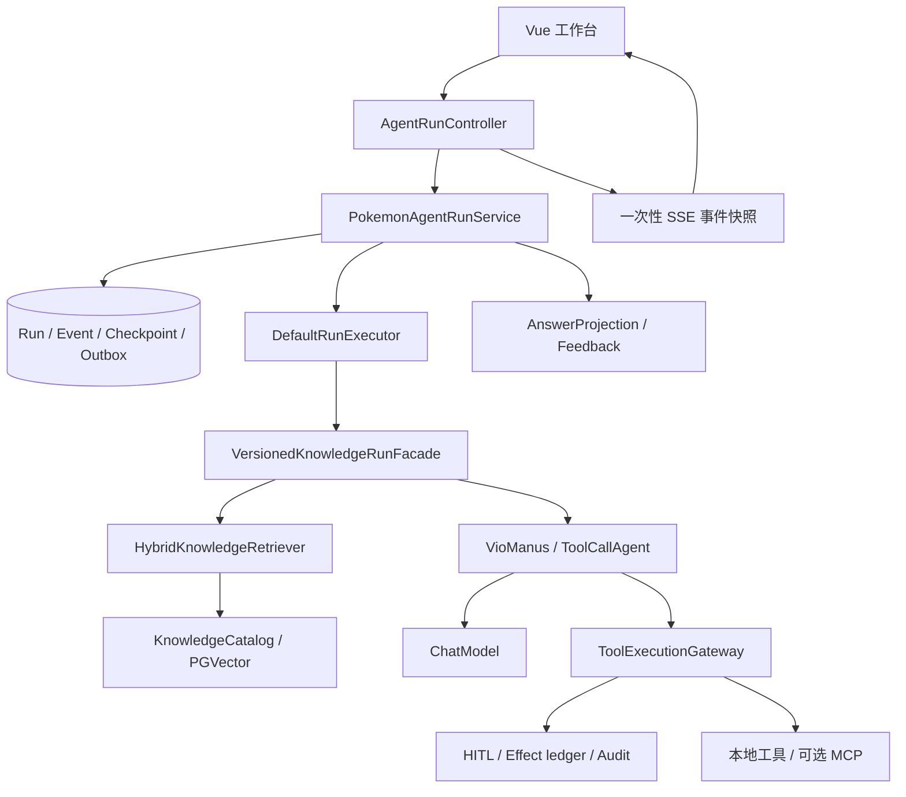
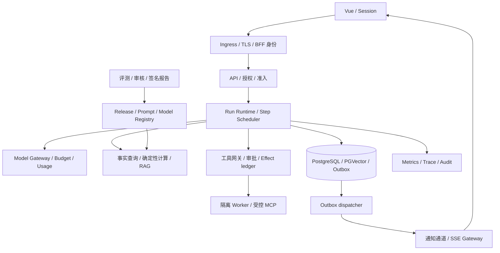

# VIO AI Agent 项目全面审查与企业级升级方案

> 审查日期：2026-09-17。代码基线：`044d7ed08bfef48e202e64f54a35daff6e13291c` 加当前工作树。  
> 范围：源码、配置、数据库迁移、前端、测试、评测、CI/CD、恢复与发布脚本。  
> 本文是代码审查与实施建议，不是生产认证、渗透测试报告或 GA 签收。  
> 配套阅读：[项目学习方案](./项目学习方案_2026-09-17.md)。旧文档中的历史判断不覆盖本文的当前源码证据。

## 1. 核心判断

当前项目已超过“调用大模型的聊天 Demo”，具备**垂直智能体产品的较完整候选实现**：版本化知识、确定性计算、持久 Run、事件与 outbox、工具治理、人工审批、用户记忆、反馈与质量门禁均有实质代码。

距离可持续运行的企业级系统，主要差距在于：**身份与业务入口尚未完全接通、运行时仍依赖本机执行状态、真实质量数据不足、生产交付证据链未闭合**。继续增加工具数量或多 Agent 角色并不是当前优先项。

建议分两层目标推进：

1. **近期：生产级宝可梦垂直智能体。** 在受控范围内实现真实登录、可靠任务、可信答案、成本控制、可观察和可回滚。
2. **后续：企业智能体平台。** 在多组织接入需求出现后，建设租户工作区、业务连接器、策略控制台、配额计费及多流程运行能力。

企业级没有一份适用于所有公司的中间件清单。单企业私有部署未必需要复杂多租户；公网服务、多企业 SaaS、涉及外部写操作的 Agent，安全与恢复门槛则更高。以下优先级以“提供给真实用户、多人使用、存在模型成本与持久数据”的场景为基础。

### 1.1 成熟度如何理解

| 层级 | 判断标准 | 当前情况 |
|---|---|---|
| 工程原型 | 模型、工具、RAG 和界面能组成工作流 | 已超过 |
| 垂直产品候选 | 有领域模型、持久化、契约、错误处理与测试 | 已具备较多基础，但有主链接线缺口 |
| 生产级产品 | 真实身份、容量边界、可靠恢复、业务质量、值守和交付证据 | 尚未证明，部分能力也尚未实现 |
| 企业平台 | 多组织隔离、统一治理、业务连接器、规模化运营 | 应作为需求驱动的后续建设 |

不提供“完成了 80%”之类评分：当前没有可支持百分比的生产样本、负载基线和完整验收记录。

## 2. 审查依据与验证边界

### 2.1 本次实际验证

| 检查 | 本次结果 | 能证明什么 |
|---|---|---|
| `node --test tools/*.test.mjs evaluation/*.test.mjs` | 68/68 通过 | producer、契约与离线 gate 回归通过 |
| 前端 `npm run test:contract` | 75/75 通过 | 事件解析、请求和状态契约的离线回归通过 |
| 前端 `npm run lint` | 通过 | 当前规则下的静态检查通过 |
| 前端 `npm run typecheck` | 通过 | 当前较宽松的类型配置下检查通过 |
| 前端 `npm run build` | 通过，61 modules | 当前前端可以构建 |
| 后端 Maven 环境检查 | 未能运行测试：`JAVA_HOME` 不正确/Java 不可用 | 本次不能声明后端测试通过 |
| 历史 Surefire XML 回读 | 130 文件，495 tests，0 failures，0 errors，2 skipped；最新文件时间 2026-09-14 | 只作为历史结果，不等同于本次执行 |
| 七类 JSONL 实际计数 | 合计 17 条，manifest 最少要求合计 924 条 | 当前评测样本显著不足 |

本次未运行真实模型、OIDC、Redis、PostgreSQL/PGVector、多实例恢复、镜像扫描、生产部署、负载或浏览器 E2E。没有用代码存在或旧日志推断这些现场能力已通过。

测试日志位于 `artifacts/review-2026-09-17/`。Node 测试改写了一份仓库根目录的故障测试输出，本次仅恢复了该测试造成的改动；原有 `Home.vue` 和用户文档改动保留。没有修改业务实现。

### 2.2 证据等级

- **代码确定**：从当前方法、配置或调用关系能直接确认。
- **静态推断**：沿代码可推断特定条件下的行为，但本次未在真实后端复现。
- **环境待证**：代码存在，仍需要真实依赖、多实例、压测或运维证据。
- **建议目标**：本方案提出的设计或阈值，不代表已有能力。

## 3. 当前真实架构



需要避免三个架构误读：

1. 现代入口确实是 Run，但默认执行器内部仍创建 `VioManus`。它还没有变为逐步骤持久化执行引擎。
2. `multiagent/` 的 Planner、Worker、Reviewer 是另一组兼容/实验实现；没有证据表明现代 Run 主链使用它作为生产集群编排器。
3. 工具治理、知识管理、用户记忆、前端卡片各自存在，不代表所有业务场景已贯通。必须用完整用户请求验证连接关系。

### 3.1 已有能力与企业级差距

| 维度 | 应保留的基础 | 下一步缺口 |
|---|---|---|
| 领域建模 | 游戏/规则/数据版本、事实、队伍、活动、计算器 | 扩大经过审核的数据覆盖，明确计算公式支持边界 |
| Run | JDBC、CAS、幂等键、检查点、取消、事件保留 | 有界调度、步骤恢复、取消传播、跨实例状态协调 |
| 事件 | 单调游标、终态保护、outbox、410 处理 | 真实 fan-out、长连接、慢消费者控制、真正首 token |
| RAG | 双路检索、RRF、版本过滤、引用、候选发布 | 中文召回、事实路由、断言与证据校验、可信报告仓储 |
| 身份 | API Key、JWT 验签、角色工具策略、Origin/CSRF 分支 | 浏览器登录闭环、所有路由身份接线、租户数据隔离 |
| 工具 | 能力卡、Schema、HITL、审计、副作用账本 | 沙箱、出口控制、外部操作确认、供应商凭据隔离 |
| 记忆 | 用户仓储、AES-GCM、TTL、同意与删除用例 | KMS、轮换、撤回传播、备份保留语义与主链验收 |
| 可观测性 | Micrometer、结构化日志、观测契约和采集脚本 | 真实模型 usage/cost、跨线程 trace、SLO 与告警演练 |
| 前端 | Run reducer、恢复游标、结构化卡片、契约测试 | 真实登录联调、错误流程、可访问性、严格类型 |
| 交付 | Docker、CI、门禁脚本、恢复 runbook | 环境接线、不可变镜像来源、签名验证、真实恢复证据 |

## 4. 优先问题清单

P0：受影响场景上线前必须处理。P1：首个生产加固周期完成。P2：扩大规模前或业务触发后实施。以下行号是本次快照位置，后续改动后以类名/方法定位。

### F01 · P0：Compose 与生产配置不一致，默认部署存在启动阻断

**证据：** `src/main/resources/application-prod.yml:128` 默认 `OIDC_ENABLED=false`、`:129` 默认 `OIDC_REQUIRED=true`；`OidcProperties.validationErrors()` 在此组合下返回错误。`:173` 要求 `VIO_RESOURCE_CURSOR_SECRET`。`docker-compose.yml:36` 使用 prod，但没有将这些 OIDC/游标变量传入后端容器。

**影响：** 仅按当前 Compose 必填变量运行，生产 Bean 初始化将遇到配置阻断；主机 `.env` 中存在变量也不会自动成为容器环境。当前 CI 的 Compose smoke 同样受到影响。结论为代码确定的配置冲突，未在本机启动 Docker 实测。

**改造：** 建立单独的演示与 staging 配置契约。演示可以显式选择隔离的 API Key 模式；生产接入真实 OIDC，禁止为了启动把 required 全局设为 false。补齐游标签名密钥、OIDC、配额、事件通道等显式环境映射。

**验收：** 干净环境按文档启动；缺生产必需项时给出字段级错误；staging 的 readiness 和业务探针通过；演示 profile 不得用于生产发布。

> **状态更新（S0 已实施，待真实环境验收）**
>
> 已落地：新增 `application-demo.yml`，作为 prod 的受限覆盖层并通过
> `spring.profiles.group.demo=prod,demo` 自动叠加 prod；`docker-compose.yml` 改用 demo 并补齐
> `VIO_RESOURCE_CURSOR_SECRET`、OIDC、配额、事件通道等此前完全缺失的环境映射；
> 新增 `StartupContractValidator`，缺失必需项时一次性给出**字段级**清单（只报变量名与用途，不回显值）；
> `application-prod.yml` 的游标签名密钥保持无默认值。
>
> 已加回归：`StartupContractValidatorTest`（缺项/空白值/profile 语义/不回显密钥）、
> `DeploymentProfileContractTest`（prod 保持 fail-closed、demo 成对放开、profile group 存在、demo 不放宽 MCP 与高危工具）、
> `tools/s0-deployment-contract.test.mjs`（把 compose 的 backend 环境映射与启动契约必需项清单**交叉校验**，
> 并锁定 demo/prod profile 契约与 CI 的 compose smoke 输入）。
>
> 逐项对应 F01 的三条验收：①“干净环境按文档启动”仍需 Docker/CI 实测；
> ②“缺生产必需项时给出字段级错误”已由 `StartupContractValidator` 实现并有单测；
> ③“演示 profile 不得用于生产发布”已由 demo/prod 契约测试与文档声明共同约束。
>
> 尚未完成：本机 Docker 被环境硬限制（WSL `E_ACCESSDENIED`，Docker Desktop 启动即退出），
> **未实测** `docker compose up` 的干净环境启动与 readiness 探针；staging 真实 OIDC 接入仍未验收。
> 容器类验收必须在 CI 或具备 Docker 的机器上执行。

### F02 · P0：部分资源 API 没有进入身份上下文拦截器

**证据：** `config/SecurityConfig.java:82` 的路径列表未覆盖 `/conversations/**`、`/teams/**`、`/favorites/**`。`controller/ResourceController.java:313` 的 `owner()` 依赖 `RequestContext`，安全开启且无身份时抛出 401。OIDC filter 的认证并不自动填充这个自定义 ThreadLocal。

**影响：** 在没有额外部署拦截器的当前代码下，即使 API Key/JWT 有效，这些根资源端点仍可能因上下文缺失返回 401。现有业务 smoke 只创建 `/chat/runs`，覆盖不到这些入口。此处是可用性缺陷的静态推断，不是已确认的数据越权漏洞。

**改造：** 统一身份转换层，优先放入覆盖所有业务请求的过滤器/参数解析器；过渡修复补齐路径。按路由清单逐项检查身份与权限，避免靠手写路径不断补洞。

**验收：** 使用真实过滤链的 HTTP 测试，验证匿名 401、本人可用、他人资源不可见、角色不足 403；覆盖会话、队伍、收藏、答案、反馈、审批和记忆。不能只在测试中手工写入 `RequestContext`。

> **状态更新（S0 已实施并验证）**
>
> 已落地：`SecurityConfig` 的路径列表抽为 `AUTHENTICATED_PATH_PATTERNS` / `PUBLIC_PATH_PATTERNS`
> 两个公开常量（身份接线的唯一事实来源），补齐 `/conversations/**`、`/teams/**`、`/favorites/**`，
> 并补上此前遗漏的 `/ready` 公开探针。
>
> 已加回归（三层，互补）：
> 1. `SecurityRouteCoverageTest` — 从控制器源码枚举**全部 59 条映射**，逐条要求
>    “明确受保护”或“明确公开”；新增控制器忘记接线会直接红灯，取代手工维护路径清单。
> 2. `ResourceIdentityHttpTest` — `RANDOM_PORT` 真实 HTTP，请求真正穿过过滤链、
>    DispatcherServlet 与 MVC 拦截器；覆盖匿名 401、无效 Key 401、合法凭据 200、
>    跨主体 404、`X-User-Id` 伪造无效、`/chat/runs` 不退化。**未**手工写入 `RequestContext`。
> 3. `DeploymentProfileContractTest` — 锁定公开白名单最小化与父子路径（`/ready` vs `/ready/details`）。
>
> 顺带修复：`ResourceController` 缺少 `RunNotFoundException` 处理器，跨主体访问此前返回
> **500** 而非 404（映射只写在 `AgentRunController` 上，`@ExceptionHandler` 不跨控制器生效）。
> 现统一返回 404，且刻意不区分“不存在/无权”，避免用状态码差异探测他人资源。
>
> 尚未完成：OIDC 模式下的角色不足 403 矩阵、以及答案/反馈/审批/记忆端点的逐一真实 HTTP 覆盖
> 仍待补（当前集中在会话/队伍/收藏三组根资源）。

### F03 · P0：共享代理 API Key 不构成独立用户身份

**证据：** `vio-ai-agent-frontend/nginx.conf.template:21` 为所有 `/api/` 请求注入同一个密钥；`security/ApiKeyAuthInterceptor` 由该 binding 派生主体。`OidcSecurityConfiguration` 目前是 JWT Resource Server、`STATELESS`；未形成浏览器 Code + PKCE 登录与服务端 Session 流程。

**影响：** 在 API Key 演示模式且没有外部用户认证层时，多个浏览器会共享一个后端身份。loopback 绑定限制了默认暴露面，但不能把该拓扑直接用作多人公网部署。

**改造：** 选定 BFF/服务端 Session 登录方式，完成 OIDC Code + PKCE、登出、过期、CSRF 初始化、Origin 校验及角色同步；API Key 留给服务账号。JWT API 客户端与浏览器 Cookie 流量采用清楚的安全链边界。

**验收：** 两个浏览器用户的会话/收藏/队伍隔离；撤销登录跨实例生效；JWT audience 错误拒绝；没有用户凭据的代理请求不能创建 Run。

### F04 · P0：现代 Run 与工具线程池没有明确容量边界

**证据：** `run/PokemonAgentRunService.java:1512` 和 `tools/governance/ToolExecutionGateway.java:99` 使用 `newCachedThreadPool`。源码搜索到的 `AgentConcurrencyGuard` 使用点在旧 `AiController`，不是现代 Run 入口。

**影响：** `max-concurrent-agents: 10` 不能视为现代请求的实际并发保证。慢模型、慢工具与突发请求可能造成线程、连接或费用增长。已有工具配额也不等于 Run admission control。

**改造：** 增加用户/租户/全局三层准入、有限排队、模型与工具独立并发池、排队 TTL、拒绝码及 `Retry-After`。必要时改为持久队列；虚拟线程仍需并发和费用上限。

**验收：** 对配置容量的 2 倍并发注入慢依赖，线程和排队不持续增长；超额请求明确拒绝；重启后配额不被重置绕过；取消后释放占用。

### F05 · P0（长任务/写工具场景）：耐久 Run 尚不具备完整续跑语义

**证据：** `run/RunRecoveryPolicy.java:21` 对非 dispatch 检查点拒绝恢复；`PokemonAgentRunService` 对匹配的持久 PENDING 审批有单独恢复处理，但授权快照仍包含进程内映射。`DefaultRunExecutor` 每次新建 `VioManus`，内部消息/工具调用进度没有统一步骤快照。

**影响：** 持久化了 Run 不等于恢复了执行过程。模型/工具执行中重启会安全失败；这比重复执行副作用安全，但尚不满足可靠长任务要求。模型缓存也仅允许 `ReplayableAnswerGenerator`；默认 lambda 不会自动享有缓存重放。

**改造：** 定义 `RunStep`、步骤输入输出引用、执行器/Prompt 版本、租约 fencing token、外部操作 ID。只读步骤可重放；写操作必须查证外部结果、复用幂等键或进入人工核对。恢复时重新校验有效授权，不能持久化 Bearer Token 后直接重用。

**验收：** 在模型响应前后、工具提交前后、审批前后、答案提交前后分别杀进程。结果必须是明确恢复、明确失败或待核对；不能静默重复写入。限制版首发可继续 fail-closed，但须明确产品边界。

### F06 · P1：SSE 与 TTFT 当前语义不相符

**证据：** `controller/AgentRunController.java:125` 明确是 SSE 快照，`:142` 发完立即 `complete()`；`PokemonAgentRunService.java:602` 等完整答案返回，`:608` 才记录 TTFT，随后整段发送 `answer.delta`。

**影响：** 事件重连能用，但不是模型 token streaming；当前 TTFT 更接近首次完整答案可用时间。用它验证 2.5 秒首 token 门槛会误导决策。

**改造：** 分开“步骤事件实时更新”和“答案 token 流”。执行器增加流式协议，首次真实文本 delta 记录 TTFT，完整结束另记 duration；持久化时合并小片段以控制事件写入量。断流仅结束订阅，取消必须有明确命令。

**验收：** 真实模型的首文本到达时间与观测一致；重连无重复文字；完成后无 delta；慢客户端有缓冲上限；410 能回到快照恢复。

### F07 · P1：outbox 有实现，但跨实例事件通道没有接入

**证据：** `run/RunOutboxSink.java` 只有接口且注释说明未内置真实 broker 客户端；`RunOutboxDispatcher.java:49` 无 sink 时返回。Compose 没有消息服务。

**影响：** 不能将 outbox 表的存在解释为已实现多实例实时推送。只打开 `event-broker-enabled` 也不会自动产生消息通道。

**改造：** 先实现一个经验证的 sink/consumer（小规模可选 Redis Streams，或者经容量验证的数据库轮询）。数据库事件仍为重放依据，通知层只负责唤醒；以 outbox ID 去重并监控积压/DLQ。启用但缺 sink 必须阻断就绪检查。

**验收：** 用户连接实例 A、执行落在 B 仍收到事件；重复投递不重复展示；broker 故障后可以从 DB 重放；监控有投递延迟、重试和积压。

### F08 · P0：评测样本与生产报告仓储未闭合

**证据：** `evaluation/v1.1/manifest.json` 为 draft/scaffold；实际 JSONL 共 17 条。`rag/promotion/InMemoryEvaluationReportRepository.java:14` 仅 `!prod`；`KnowledgePromotionConfiguration.java:16` 无实现时使用 unavailable。当前源码未找到生产 `EvaluationReportRepository` 实现。

| 数据集 | 当前条数 | 现有最低要求 |
|---|---:|---:|
| fact | 2 | 200 |
| calculation | 4 | 324 |
| legality | 2 | 100 |
| rag | 2 | 100 |
| no-answer | 2 | 50 |
| agent-tool | 2 | 50 |
| security-redteam | 3 | 100 |
| 合计 | 17 | 924 |

**影响：** 68 条 Node 测试通过证明 gate 行为，不证明业务正确率；即使离线生成报告，生产 promotion 也需要可信仓储接入。当前拒绝发布是正确的保护行为。

**改造：** 先补真实来源和独立标注；建立校准集与冻结留出集；实现不可变报告存储、签名/来源验证、版本血缘与审核角色。不能通过复制题目凑数或直接把 draft 改成 ready。

**验收：** 最低样本数、覆盖类别、双人抽检、模型/Prompt/data/index 版本一致；可回放每条失败；无效报告不能 promotion；真实一次 feedback→修订→评测→重答闭环通过。

### F09 · P1：引用存在不等于每个结论有依据

**证据：** `rag/contract/EvidenceAssembler.java:44` 将召回片段加入 citations，`:51` 返回 answered；没有逐断言验证。`VersionedKnowledgeRunFacade` 先要求召回知识才调用生成器；`ToolRegistration.createPokemonTools()` 只注册属性工具、搜索与终止，伤害/速度/合法性服务没有通过此工具集合统一暴露。

**影响：** 可能出现带真实引用但结论不被引用支持；纯计算问题也可能因知识未召回而拒答。领域 API 的确定性计算能力和对话入口的工具能力需要进一步统一。

**改造：** 增加任务路由：事实→结构化数据，计算→确定性服务，攻略→RAG，复合任务→有预算的编排。答案返回断言、证据 ID、计算输入输出和适用范围；关键结论无依据时澄清或拒答。

**验收：** 已知计算问题不依赖 RAG 召回即可得到正确结果；构造“引用正确、结论错误”的样例必须被评测识别；非法输入不由模型猜补。

### F10 · P1：检索效果与发布版本稳定性需要实证

**证据：** `rag/catalog/JdbcKnowledgeCatalog.searchLexical()` 使用 PostgreSQL `simple` FTS 加整句 LIKE；语义检索故障会退回词法。查询依赖 active index，`VersionedKnowledgeRunFacade.answerLineage()` 也再次核对 active 指针。

**影响：** 中文别名、长问句召回能力待测；语义故障后的两路 RRF 可能只是同一词法结果。发布指针切换时，已冻结旧版本的 Run 可能拒答或无法形成完整血缘，不能直接宣称历史版本任意回放。

**改造：** 先建设中文别名/实体归一化和真实召回评测，再决定分词、reranker 或额外搜索引擎。Run 创建时解析并冻结 release bundle；检索基于该 bundle，旧 release 在在途 Run 完成前可读；候选评测也应明确选择候选索引。

**验收：** 同题跨版本答案正确区分；发布切换不改变在途 Run 的证据；语义降级有指标和产品标识；真实 SQL `EXPLAIN`、过滤选择率和 topK 召回有报告。

### F11 · P1（多组织上线前为 P0）：租户策略尚未贯穿数据层

**证据：** OIDC policy 含 tenant，但 `AgentRun` 和 `V3__agent_run_events_and_conversations.sql` 以 `user_id` 隔离；迁移搜索到的 `tenant_id` 在用户记忆表，未见全面租户键或 RLS 策略。

**影响：** 当前有用户归属检查，不能据此宣称完整多租户隔离；组织共享、跨租户同一主体、缓存/搜索/审批边界都需要设计。单租户部署可显式限定范围。

**改造：** 使用内部 principal ID，外部身份按 issuer+subject 映射；tenant+workspace+principal 明确入库并进入授权、索引、缓存、幂等和审计键。逐表迁移，可评估 RLS 作为额外保护；共享知识与租户私有知识分开授权。

**验收：** 同用户在不同租户、不同用户同资源 ID、同幂等键、检索结果、备份恢复与管理员访问的隔离矩阵全部通过。

### F12 · P1：高风险工具仍运行于应用进程权限边界

**证据：** `tools/TerminalOperationTool.java:19` 执行 `cmd.exe /c`，没有独立沙箱；Docker 运行环境为 Linux。高风险工具默认关闭是已有保护。下载工具已有大小、MIME、目录和 DNS 检查，不能写成“完全没有下载治理”。

**影响：** 打开高风险能力后有平台不兼容、子进程取消、资源耗尽及宿主权限风险；命令黑名单/HITL 不能替代运行隔离。

**改造：** 业务侧优先专用参数化工具；必须执行代码时使用独立短生命周期 worker、只读根文件系统、无默认网络、最小挂载与 CPU/内存/时间/输出上限。对 HTTP 出口统一做 DNS/重定向/私网阻断，工具凭据按能力短期授予。

**验收：** 取消可停止实际子进程；超时无遗留进程；不能读取宿主配置；下载与工具输出总量有限；默认玩家不能注册或调用任意远端工具。

### F13 · P1：指标、成本与日志脱敏还有主链接线缺口

**证据：** `AgentMetrics.recordTokens()` 在本次主源码搜索中没有调用点；Run usage 事件当前只记录 executor。`agent/ToolCallAgent.java:233` 在 INFO 输出工具结果文本。已有 ParameterMasker 不自动保证所有应用日志都脱敏。

**影响：** Token 指标存在但不能证明真实计费；工具输出可能包含业务信息。OTel JSON schema 和采集脚本不等于完整跨线程 trace 已打通。

**改造：** 从供应商 usage 汇总每次模型调用与重试；缺 usage 标 unknown 而非 0；版本化价格表估算成本并同账单抽样核对。跨线程传递 trace context，日志默认只写摘要、字节数与 artifact ID。

**验收：** 一个 Run 可串到所有模型/工具 span；用量与供应商样本对账；秘密 canary 不出现在日志、事件、trace 和 artifact；成本超预算停止后续步骤。

### F14 · P0：集成测试门禁存在“配置了但可能没运行”的空档

**证据：** `pom.xml:32` 默认跳过 IT，Surefire 排除 integration，Failsafe 按 integration tag；本次没有检索到 `*IT.java`/`PostgreSQLContainer` 实际用例。真实模型用例叫 `GameAppTest`、`VioManusTest`，不符合 Failsafe 默认文件名。CI 只执行 `mvnw test`，未执行 integration profile 的 verify。

**影响：** 单元测试绿灯不能证明 JDBC 锁、Flyway、PGVector、Redis Lua、真实认证可用；只加 `-Pintegration-tests` 也不能保证发现预期测试。[Failsafe 默认发现规则](https://maven.apache.org/surefire/maven-failsafe-plugin/examples/inclusion-exclusion.html)应和项目命名一起核对。

**改造：** 新建明确命名的数据库/身份/配额 IT，调整 includes 与 tags，设置零用例失败，并核对 Failsafe XML。将昂贵真实模型评测和确定性的基础设施测试分开。

**验收：** CI 显示实际 IT 数量和报告；移除数据库、破坏 CAS 或迁移时门禁确实失败；不会出现“0 tests，build success”被当作通过。

> **状态更新（S0 已实施，Docker 环境待实测）**
>
> 已落地：
> 1. 新增 `PostgresRunPersistenceIT`（`@Testcontainers(disabledWithoutDocker = true)`，
>    `@Tag("integration")`，镜像 `pgvector/pgvector:pg16`）——在真实 PostgreSQL 上验证
>    22 个 Flyway 迁移完整执行且关键表存在、**终态事件唯一约束**（同一 Run 不允许两个终态事件）、
>    Run 按用户隔离读取、幂等 claim 的复用/冲突语义。仓库此前声明 Testcontainers 却零用例。
> 2. `GameAppTest` → `GameAppIT`、`VioManusTest` → `VioManusIT`：原命名不符合 Failsafe 的
>    `*IT`/`IT*`/`*ITCase` 规则，**即使启用 profile 也永远不会执行**。现两者均被真实选中。
> 3. `pom.xml` Failsafe 段补充装配说明；`-Pintegration-tests verify` 与 `-DrunIntegration verify` 均可用
>    （注意：`skipITs` 默认 true，只加 `-DskipITs=false` 亦可但推荐用 profile）。
> 4. CI 新增 `Backend integration tests` 步骤，并新增断言：Failsafe 报告数必须 > 0、
>    执行用例总数必须 > 0、必须存在 `PostgresRunPersistenceIT` 报告——
>    从机制上杜绝“0 tests, build success”冒充通过。
>
> 实测（JDK 21，本机）：`-Pintegration-tests verify` 下 Failsafe 发现 3 个 IT 类共 21 个用例
> （`VioManusIT` 7 + `GameAppIT` 10 + `PostgresRunPersistenceIT` 4），报告正常生成。
> 本机 Docker daemon 未运行，故 21 个用例全部为 skipped（`disabledWithoutDocker` 与
> `VIO_RUN_LIVE_TESTS` 守卫），**数据库断言尚未在本机真实执行**。
>
> 尚未完成：在 Docker/CI 环境实跑一次真实数据库 IT 并留存原始输出；
> Redis Lua、真实 OIDC、PGVector 维度与 EXPLAIN 的集成用例仍缺。

### F15 · P0（正式发布）：发布流水线尚未执行完整供应链与 GA 门禁

**证据：** `.github/workflows/deploy.yml:83` 获取的是本地 Docker image ID；流程未包含真实 Registry push/digest、SBOM、漏洞扫描、签名验证和 `v1.1-release-gate.mjs` 的完整现场闭环。文件名虽叫 deploy，但 workflow 自称 Release candidate。Dockerfile 构建也没有使用 POM 的 `production` 打包 profile，自研 MCP 包不能据该 profile 被认定为已从镜像剔除。

**影响：** 候选构建和元数据上传不能视为生产部署。镜像 ID 与可从 Registry 拉取的 manifest digest 不能混用。供应链脚本存在不等于流水线执行过。

**改造：** 在已通过评测的同一提交构建一次镜像，推送受控 Registry，记录可拉取 digest，生成 SBOM/来源证明，扫描并验证签名；staging 与生产使用同一 digest。把既有 N7/N8 脚本接入实际控制面；明确旧 MCP 的构建与运行时隔离。

**验收：** 可以从空白节点按 digest 重建运行实例；篡改签名拒绝部署；灰度失败回到 previous；真实恢复达到已冻结 RPO/RTO；GA 门禁依据真实观察和签收。

### F16 · P1/P2：前端与维护结构的工程债

**证据：** `vio-ai-agent-frontend/tsconfig.json` 为 `checkJs:false`、`strict:false`，排除 generated；主 API wrapper 为 JS。`PokemonAgentRunService` 已超过 1500 行，兼容链和新主链共存。部分 README 描述落后于 v1.1 实现。

**影响：** typecheck 通过不等于严格类型覆盖；大服务类增加状态、授权、投影和恢复修改的耦合。用户看到的功能说明可能与当前默认开关不一致。

**改造：** 先把事件、DTO、reducer 和身份模型迁到严格 TS，再处理 UI；OpenAPI candidate 与运行时导出自动比较。按职责提取 Run 调度、恢复、提交、授权与订阅组件，保留契约测试。历史入口标出支持期限和迁移方向。

**验收：** 错误事件字段能被构建发现；真实后端 401/403/409/410/429/审批流程 E2E 通过；核心服务职责可单独说明与测试；文档指向唯一当前状态页。

## 5. 目标架构与关键决策

建议先保持**模块化单体 + 独立工具 worker**，复用 Spring Boot、PostgreSQL/PGVector、Vue 和现有契约。拆服务应由独立扩缩容、安全边界和团队所有权推动。



### 5.1 运行时协议

以下为建议字段，属于新设计，不是已有 schema：

```text
Run: tenantId, principalId, workflowVersion, releaseBundleId,
     policyVersion, deadlineAt, maxSteps, maxTokens, maxCost, status
RunStep: runId, stepId, stepType, inputDigest, outputArtifactId,
         attempt, status, leaseOwner, fencingToken, externalOperationId
ToolEffect: runId, stepId, idempotencyKey, requestDigest,
            remoteStatus, resultArtifactId, confirmedAt
```

步骤建议分为 `MODEL_READ`、`RETRIEVAL_READ`、`DETERMINISTIC_CALC`、`EXTERNAL_WRITE`、`APPROVAL_WAIT`。每类分别声明超时、重试、补偿与恢复方式。外部服务不提供幂等/查询结果时，不能承诺 exactly-once；使用至少一次投递、去重及不确定结果核对。

答案提交要明确事务边界：Run 终态、答案投影、事件/outbox、会话消息应在适当的本地事务中一致提交，或由可重试投影保证收敛。不能仅依赖 JVM 的 synchronized 证明跨实例一致性。

### 5.2 模型与 Prompt 治理

- 一个 Model Gateway 统一处理模型版本、超时、usage、配额、熔断和审计；先接通当前供应商，再评估第二供应商。
- Prompt 使用版本化模板与 hash；每个 Run 记录实际模型和模板版本。Prompt 修改必须跑针对性回归和冻结留出集。
- 简单事实和计算尽量不消耗模型；复杂生成按任务选择模型。降级不能绕过授权，也不能换到未经数据驻留评估的供应商。
- 预算包含重写、Embedding、主回答、Reviewer、重试和工具调用；按用户/租户设单次及时间窗口额度。
- 使用真实质量与成本对比决定模型或框架迁移，本方案不指定未经验证的“最新版本”。

### 5.3 数据、记忆与权限

- 业务事实、知识来源、用户会话、长期记忆、工具 artifact 分别定义归属、保留期、导出和删除规则。
- 审计不可变并不意味着可以无限保留原文；审计保存最小必要元数据，敏感正文放受控存储。
- 会话软删除只是产品可见性操作。需要另有数据清除流程、派生缓存/向量删除和备份到期策略。
- KMS envelope encryption、密钥版本和轮换演练用于用户记忆及敏感 artifact；不要把一个环境变量密钥当成完整密钥生命周期管理。
- 将用户明确授权与模型推断偏好区分；长期记忆可查看、修正、撤回，不自动写入未经确认的敏感推断。

### 5.4 工具与 MCP

保留 `ToolExecutionGateway` 为统一入口。工具注册需有名称、版本、输入输出 Schema、读写属性、所需权限、预算、超时、幂等策略和责任人。新工具进入候选态，通过契约/隔离/负例测试后再启用。

生产 MCP 需要服务端 audience 校验、作用域最小化、受控发现地址、TLS 和凭据隔离；不要把用户访问当前应用的 Token 原样透传给无关下游。[MCP 官方安全实践](https://modelcontextprotocol.io/docs/2025-11-25/tutorials/security/security_best_practices)支持这些边界要求。项目自研 JSON-RPC/STDIO/SSE 实现保留为学习材料，生产优先维护一条经过验收的协议链。

### 5.5 可观测与运行责任

观测覆盖 API→Run→检索→模型→工具→审批→答案。runId、traceId 用于日志和链路关联，不作为 Prometheus 高基数标签。默认不上传原始 Prompt、凭据或完整业务文档。

OTel GenAI 约定仍需按具体约定版本管理，不能把所有字段视为永久稳定；参考[官方语义约定目录](https://opentelemetry.io/docs/specs/semconv/)和[GenAI 属性注册表](https://opentelemetry.io/docs/specs/semconv/registry/attributes/gen-ai/)。采样策略应保证失败和审计必需记录可追踪，并控制正文采集权限。

明确值守人、告警处置手册、事故等级、恢复流程与变更审批责任。企业级的差距也包括“谁在凌晨处理故障”，不能只由代码弥补。

## 6. 分阶段实施路线

排期是规划估算：假设 2 名后端、1 名前端、共享测试/运维资源，真实环境可以及时提供。阶段之间有依赖，单人推进不能直接照搬团队工期；独立开发建议先取每阶段最小闭环，累计可能需要 4～6 个月或更长。

| 阶段 | 建议时长 | 主要交付 | 退出门槛 | 对应旧计划 |
|---|---|---|---|---|
| S0 基线修复 | 3～5 工作日 | 环境契约、认证路由修复、实际 IT 发现、当前文档 | 干净环境启动 + 全资源身份回归 | N0/N4 |
| S1 可用身份与数据 | 1～2 周 | OIDC 登录、租户范围声明、staging 数据与可信评测报告仓储 | 两用户隔离、真实知识发布和答案血缘 | N1/N3/N4 |
| S2 可靠运行时 | 2～3 周 | 有界准入、step 状态、恢复边界、审批/取消/副作用收敛 | 多故障点重启、无重复写、资源有界 | N2/N3 |
| S3 可信回答与观测 | 2～3 周 | 任务路由、真实流式、usage/cost、Golden Set、反馈闭环 | 业务阈值通过且每项可追溯 | N5/N6/N1b |
| S4 生产交付 | 1～2 周 + 至少 72h 观察 | 镜像供应链、staging、灰度、回滚、灾备和值守 | N7/N8 全部真实证据通过 | N7/N8 |
| S5 企业拓展 | 需求驱动 | 工作区、连接器、控制台、选择性多 Agent | 真实业务 KPI 改善且无质量退化 | 新版本 |

### 6.1 前两周可以直接建立的任务

| ID | 工作项 | 主要文件/模块 | 责任角色 | 建议工作量 | 完成定义 |
|---|---|---|---|---|---|
| U01 | Compose/env 启动契约修复 | compose、prod.yml、OIDC/游标配置 | 后端+运维 | 1～2 人日 | 缺项必失败、隔离演示与 staging 均可解释 |
| U02 | 根资源身份接线 | SecurityConfig、ResourceController | 后端 | 1～2 人日 | 真实过滤链覆盖所有资源端点 |
| U03 | IT 发现与实际数据库测试 | pom、CI、src/test | 后端/测试 | 2～3 人日 | verify 非零 IT，坏迁移使 CI 红灯 |
| U04 | OIDC 浏览器闭环 | OIDC 配置、前端 API、登录页 | 前后端 | 4～7 人日 | 登录/退出/过期/跨用户全部验证 |
| U05 | Run 准入与有界池 | RunService、Gateway | 后端 | 2～4 人日 | 超负载返回明确错误且资源稳定 |
| U06 | 可信评测报告仓储 | rag/promotion、迁移、报告适配器 | 后端 | 2～4 人日 | 生产 promotion 能读取并验证真实报告 |
| U07 | Golden Set 第一批 | evaluation/v1.1 | 领域+测试 | 持续任务 | 先审核高价值场景，不以样本不足结果发布 |
| U08 | 一条真实业务证据链 | staging、Run、feedback、observability | 全组 | 2～3 人日 | 登录→知识→回答→反馈→重答均有证据 |

工作量不含等待基础设施、数据授权、模型额度及审批的时间。优先执行 U01/U02/U03，避免后续功能建立在无法运行的部署链上。

### 6.2 每个 PR 的要求

每个 PR 只完成一个可验证闭环：问题、受影响入口、迁移/开关、负例、回退条件、实际结果。新增 schema 使用增量迁移，不改已执行 Flyway 历史。对已有数据采用扩展字段→回填验证→切换读取→后续清理的步骤。

保留现有生产安全默认值，未验收功能继续关闭。回滚应用版本前先确认数据库和事件协议兼容；不能把“回滚镜像”当作已经撤销外部写操作。

## 7. 质量、性能与发布验收

### 7.1 已有质量阈值应复用

以下来自当前 `evaluation/v1.1/manifest.json`，是项目目标，尚无本次现场达标证明：

| 指标 | 现有门槛 | 补充要求 |
|---|---:|---|
| 事实/规则任务成功率 | ≥98% | 按游戏/赛制/语言切片，列出失败样例 |
| 确定性计算准确率 | 100% | 属性矩阵之外覆盖伤害/速度/合法性边界 |
| RAG Recall@5 | ≥90% | 人工相关性标注，查询集与调参集分开 |
| 引用正确率 | ≥95% | 检查结论支持关系，不只检查 URL 存在 |
| 无答案处理率 | ≥90% | 同时量化过度拒答 |
| 工具选择/参数准确率 | ≥95% | 错工具与越权工具单列 |
| TTFT P95 | ≤2500ms | 先修正首 token 采集；写明模型/区域/并发 |
| Run 耗时 P95 | ≤30000ms | 按任务复杂度切片，不混入人工等待 |
| 取消生效 P95 | ≤2000ms | 校验实际工作停止和费用尾部，不只 HTTP 返回 |

安全红线另外设门禁：越权读取/写入、未批准副作用、秘密泄漏样例出现即阻断，不通过平均准确率抵消。红队按[OWASP GenAI 风险分类](https://genai.owasp.org/llm-top-10/)覆盖提示注入、敏感信息泄漏、过度授权与资源消耗；这只是测试设计依据，不是安全认证。

### 7.2 容量基线

先以可承担的真实负载测量，再冻结承诺。推荐初始试验阶梯为 1/5/10/20 并发 Run，每档记录任务类型、模型配置、样本数、成功率、排队延迟、P95、费用和资源峰值。该阶梯是测试建议，不是已支持容量。

可把 99.9% 月度服务可用性作为讨论起点，但需明确统计窗口、失败定义和业务范围。72 小时观察无法证明月度 SLA；仓库现有“至少 72 小时 + 500 请求”是发布观察门槛，不是可靠性保证。

成本计算建议：单 Run 成本 = 各模型输入/输出 usage×对应版本价格 + Embedding + 外部工具收费 + 分摊基础设施成本。预算阈值由实际数据冻结，不在文档里虚构单次价格。

### 7.3 必须执行的故障矩阵

| 故障 | 期望结果 | 需留证据 |
|---|---|---|
| 模型 429/超时 | 有预算的退避或明确失败 | 重试次数、成本、终态 |
| 模型返回后进程退出 | 纯模型步骤可复用或明确不可恢复 | 输出 hash、调用次数 |
| 写工具成功但响应丢失 | 通过操作 ID 核对，禁止盲目重试 | effect ledger 与下游记录 |
| Worker 租约过期/网络分区 | 旧 owner 不再提交结果 | fencing/CAS 冲突记录 |
| 审批后重启 | 保留决策并重新检查权限 | 审批事件、唯一外部效果 |
| SSE 丢包/重复/游标过期 | 页面与最终快照一致 | 游标、事件和终态 |
| Redis/broker 故障 | 配额策略明确，事件可重放 | 降级、积压和恢复耗时 |
| DB 恢复/发布回退 | 数据与发布版本可追溯 | 已冻结 RPO≤15min、RTO≤30min 的实测，或正式修订目标 |

### 7.4 发布检查表

- [ ] F01/F02/F03/F04/F08/F14/F15 的上线阻断项已关闭。
- [ ] 首发范围、支持矩阵、授权边界、禁用能力清楚。
- [ ] Golden Set 达到样本/质量阈值，原始报告可回放。
- [ ] 真实登录、RAG/模型、工具和反馈 E2E 通过。
- [ ] 数据库迁移、恢复、取消、审批、并发和故障矩阵通过。
- [ ] 镜像 digest、SBOM、漏洞处理、签名与来源证明绑定同一提交。
- [ ] staging 与正式部署使用同一候选镜像；实际灰度回滚成功。
- [ ] 告警可触达责任人，值守和 runbook 演练过。
- [ ] 满足已有 N8 观察窗口、请求分母、独立来源及人工签收。

## 8. 如何进一步拓展

### 8.1 优先拓展宝可梦产品价值

| 方向 | 最小闭环 | 必要前置 | 衡量价值 |
|---|---|---|---|
| 队伍诊断 | 输入队伍→规则校验→弱点/速度分析→可解释建议 | 完整领域参数、确定性工具接线 | 有效建议采纳率、计算正确率 |
| 版本差异问答 | 同题跨游戏/赛制比较，并展示来源 | release bundle、版本化数据覆盖 | 跨版本错误率 |
| 活动情报助手 | 已审核来源更新→时效判定→个性化阅读 | 摄取调度、来源与时区管理 | 过期信息率、更新延迟 |
| 训练家长期工作区 | 会话、队伍、收藏、可控记忆联动 | 独立身份、同意/删除生命周期 | 完成任务率、重复输入减少 |
| 报告导出 | 结构化分析→受控模板→可下载 artifact | 沙箱/对象存储/权限/有效期 | 报告准确率、生成成功率 |

这些功能可以先使用单 Agent 与显式工作流。多 Agent 仅在任务可独立分解且有客观收益时加入。

### 8.2 企业通用能力拓展

第二阶段可以抽出 `agent-runtime`、`tool-governance`、`knowledge-service`、`identity-policy`、`evaluation-release`，保留 `pokemon-domain` 为业务适配层。先在同仓库建立模块边界和依赖规则，再决定是否独立部署。

推荐试点顺序：企业知识问答→受控数据查询/报告→工单或流程草稿→经过确认的业务写入。每个连接器增加独立凭据、最小权限、测试租户、审计、配额及回退能力；连接 CRM/ERP 不是简单添加一个 HTTP Tool。

### 8.3 有条件引入的技术

| 技术 | 引入条件 | 当前建议 |
|---|---|---|
| 多 Agent | 独立子任务可并行，评测证明收益超过成本 | 主 Run 稳定后试点，共享预算/权限/步骤账本 |
| 工作流引擎 | 跨日任务、复杂补偿、大量人工等待使自研难维护 | 先定义执行契约，再对比购买/自研成本 |
| Kafka 等消息平台 | 吞吐、分区消费、长保留和多消费者确有需求 | 先实现一种符合负载的通知通道 |
| Elasticsearch/专用检索 | PG 方案经优化仍达不到中文检索/容量目标 | 先拿召回与 EXPLAIN 证据 |
| GraphRAG/知识图谱 | 关系型多跳问题占比高且普通检索不足 | 先整理领域关系与任务集 |
| Kubernetes/微服务 | 多服务独立伸缩、团队与运维能力匹配 | 不作为企业级资格前提 |
| 微调 | 提示词/检索/数据修复后仍有稳定误差，且有高质量训练集 | 先闭合评测与数据授权 |

## 9. 建议保留的工程纪律

已有 fail-closed、默认禁用高风险工具、append-only 审计、版本契约与 BLOCKED 发布状态值得保留。下一阶段应把精力从“再生成一份门禁文件”转到“让一个真实请求穿过全部边界，并能在故障后被解释和恢复”。

代码 review 与后续学习请从 F01/F02/F04 入手，它们改动相对聚焦、验收明确；随后推进身份、运行时和真实数据质量。学习路径、断点位置和练习见[项目学习方案](./项目学习方案_2026-09-17.md)。
