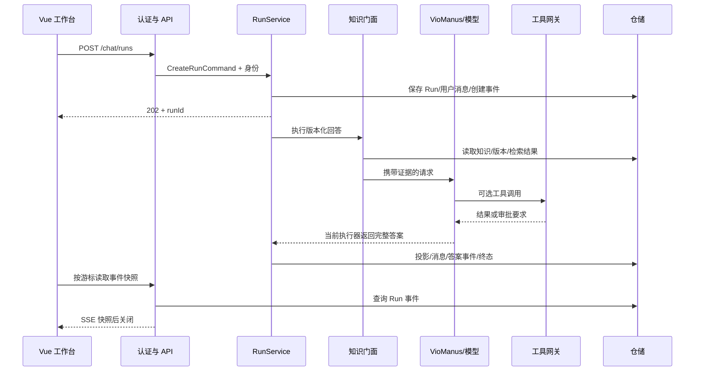

# VIO AI Agent 项目学习方案

> 基线：2026-09-17，`044d7ed08bfef48e202e64f54a35daff6e13291c` 加当前工作树。  
> 面向希望读懂、维护并继续升级本项目的开发者。默认具备基础 Java 与 HTTP 知识；基础薄弱可先完成第 3 节。  
> 配套：[项目全面审查与企业级升级方案](./项目全面审查与企业级升级方案_2026-09-17.md)。

## 1. 学习结束时应该能做到什么

1. 从浏览器请求追踪到 Run、检索、模型、工具、答案与事件，解释每个边界。
2. 区分聊天、RAG、工具调用、ReAct、多 Agent、持久工作流，不把它们混成一个概念。
3. 解释一次任务如何鉴权、幂等、取消、等待审批、失败与恢复。
4. 说明回答用了哪个版本的数据、证据是否支持结论，以及如何评估质量。
5. 为一个真实问题完成小范围改动、有效测试和验收记录。
6. 清楚说明已实现、默认关闭、现场未验收和真正缺失的能力。

学习顺序建议是“业务请求→主调用链→领域与知识→安全与可靠性→质量与交付”，不要按源码目录字母顺序从头读完。

## 2. 先建立项目地图

### 2.1 必须先读的五份材料

| 顺序 | 材料 | 阅读目的 | 注意事项 |
|---|---|---|---|
| 1 | [README](../README.md) | 认识宝可梦场景、技术栈、目录和启动方式 | 部分描述滞后，不把所有亮点当成已验收事实 |
| 2 | [v1.1 需求规格](./正式版v1.1开发计划/v1.1需求规格与完成定义_spec.md) | 知道要交付什么 | spec 是目标，不是实现证明 |
| 3 | [v1.1 当前实现进度](./正式版v1.1开发计划/v1.1当前实现进度.md) | 理解 candidate/BLOCKED 与 N0～N8 | 其中测试数字是历史快照 |
| 4 | [本次全面审查](./项目全面审查与企业级升级方案_2026-09-17.md) | 认识当前主链接线与环境缺口 | 优先理解 F01/F02/F04/F06/F08 |
| 5 | [AgentEvent 契约](../contracts/agent-event-v1.1.json) | 建立前后端共同语言 | 关注事件字段、顺序、游标和终态 |

### 2.2 模块地图

Java 根目录：`src/main/java/com/vio/vioaiagent/`。下表中的 Java 路径以此为根。

| 模块 | 核心入口 | 负责什么 | 优先级 |
|---|---|---|---|
| HTTP/API | `controller/AgentRunController.java` | 创建 Run、读取事件/快照、取消 | 必读 |
| 运行时 | `run/PokemonAgentRunService.java` | 生命周期、仓储、调度、审批恢复、答案提交 | 必读，但按方法分段 |
| 执行适配 | `run/DefaultRunExecutor.java` | 版本化知识与旧 Agent 的连接 | 必读 |
| Agent 循环 | `agent/BaseAgent.java`、`ReActAgent.java`、`ToolCallAgent.java`、`VioManus.java` | 思考、工具调用、停止与上下文 | 必读 |
| 领域 | `pokemon/domain`、`calculator`、`service`、`repository` | 事实、队伍、版本、确定性计算 | 必读 |
| 知识 | `rag/ingestion`、`catalog`、`retrieval`、`contract`、`promotion` | 摄取→检索→引用→候选发布 | 必读 |
| 工具 | `tools/ToolRegistration.java`、`tools/governance` | 能力暴露、Schema、策略、超时 | 必读 |
| 安全 | `security`、`config/Oidc*`、`config/SecurityConfig.java` | 身份、角色、审批、审计、配额 | 必读 |
| 记忆 | `memory`、`chatmemory` | 新用户记忆与旧层级/文件记忆 | 第二轮 |
| 观测 | `observability` | 指标、日志上下文、请求观测 | 第二轮 |
| 旧多 Agent | `multiagent`、`orchestration` | DAG、Planner/Worker/Reviewer 示例 | 主链读懂后 |
| 自研 MCP | `mcp` | JSON-RPC、协议、会话、传输 | 协议专题 |
| 独立 MCP 服务 | `vio-image-search-mcp-server/` | 图片搜索服务子项目 | 协议专题 |
| 前端 | `vio-ai-agent-frontend/src` | 工作台、API wrapper、Run reducer、恢复 | 与事件模块一起学 |
| 数据库 | `src/main/resources/db/migration` | 持久化模型、约束、演进 | 与运行时一起学 |
| 工程脚本 | `tools`、`evaluation`、`ops`、`.github/workflows` | 评测、生产证据与交付 | 最后一轮串联 |

### 2.3 一次请求的顺序图



这张图强调当前实现：不是所有请求必然调用工具；缺版本/无证据时可能提前澄清或拒答；SSE 快照不代表真正逐 token 生成。

## 3. 前置知识与环境准备

### 3.1 需要掌握的最小基础

| 基础 | 学到什么程度即可开始 | 项目对应点 |
|---|---|---|
| Java 21 | record、接口、多态、异常、泛型、集合、并发可见性 | AgentRun、DTO、Repository、FutureTask |
| Spring Boot | 构造器注入、Bean、Profile、条件装配、配置绑定、事务 | prod 与 test 使用不同仓储 |
| HTTP | 状态码、Header、Cookie、认证、幂等、SSE | 202/401/403/409/410/429 的区别 |
| SQL/PostgreSQL | 主外键、唯一约束、索引、事务、行锁、EXPLAIN | CAS、lease、outbox、Flyway |
| Vue 3/JS | reactive/ref/computed、组件生命周期、Promise、AbortController | useRunStream 与事件 reducer |
| LLM | Token、上下文窗口、工具 Schema、Embedding、结构化输出 | 模型输出不能当作可靠业务事实 |
| 分布式基础 | 超时不等于失败、至少一次、幂等、租约、最终一致 | 工具副作用与跨实例恢复 |

建议预备时间：已有 Java/Spring 经验者 2～3 天；Java 初学者 2～3 周。遇到不懂的术语先写一句项目例子，再补理论，避免陷入无限刷课程。

### 3.2 环境分三档

| 档位 | 依赖 | 能学习/验证什么 |
|---|---|---|
| A 离线源码与测试 | Git、JDK 21、Maven Wrapper、Node/npm、已安装依赖 | Java 单元、Node 契约、前端构建 |
| B 本地产品演示 | 上述 + 本地配置，按需接入模型 | 页面与受限主链；不得当成生产验证 |
| C staging 实验 | PostgreSQL/PGVector、OIDC、真实模型，按功能接 Redis/消息/观测 | JDBC、多用户、多实例、成本、恢复与发布 |

本次机器已能执行 Node 和前端测试，但 Maven 提示 `JAVA_HOME` 不正确。先安装/定位 JDK 21，令 `JAVA_HOME` 指向 JDK 根目录，验证 `java -version` 与 `mvnw -v`，不要把学习阻塞误认为项目代码编译错误。

公司设备不具备 Docker/WSL 时，可先完成 A 档并阅读[现有环境准备说明](./正式版v1.1开发计划/公司电脑跳过WSL与Docker环境准备.md)，C 档使用受控远程实验环境。

### 3.3 首次基线命令

以下命令在项目根目录运行，除明确的前端 `--prefix` 外均以根目录为准。只用于开发/实验环境。

```powershell
git status --short
java -version
.\mvnw.cmd -v
node --version
npm.cmd --version

# Maven 默认排除真实 integration 组；首次可能需要下载依赖。
.\mvnw.cmd -B -ntp test

# 工程脚本与评测契约，不需要真实模型。
node --test tools/*.test.mjs evaluation/*.test.mjs

# 如前端依赖尚未安装，先执行 npm.cmd --prefix vio-ai-agent-frontend ci。
npm.cmd --prefix vio-ai-agent-frontend run test:contract
npm.cmd --prefix vio-ai-agent-frontend run lint
npm.cmd --prefix vio-ai-agent-frontend run typecheck
npm.cmd --prefix vio-ai-agent-frontend run build
```

每条命令分别记录退出码，不因后续命令通过而忽略前面失败。测试可能生成报告或 fixture 输出，执行前后比较 Git 状态，避免将生成物变化混入功能提交。

> **S0 更新（F14 已修复）**：真实集成测试的发现缺口已闭合。新增
> `PostgresRunPersistenceIT` 用 Testcontainers 在真实 PostgreSQL 上验证
> Flyway 迁移链、终态事件唯一约束与幂等 claim 语义；原先名为 `*Test` 的
> `GameAppIT`、`VioManusIT` 已按 Failsafe 命名规则重命名，现在确实会被
> `integration` 组选中。
>
> 运行方式：
>
> ```powershell
> .\mvnw.cmd -B -ntp -Pintegration-tests verify   # 或等价的 -DrunIntegration
> ```
>
> Docker 不可用时数据库 IT 会跳过；CI 另有断言检查 Failsafe 报告中的实际用例数，
> 因此“报告存在但 0 用例”会被判为失败，不再能冒充通过。

### 3.4 学习时的配置原则

- 只从 example 配置理解字段，不把本地密钥复制到笔记、截图或 Git。
- 先学无外部写入的路径，高风险工具、MCP、持久记忆和恢复开关按专题开启。
- 单独区分 Maven `production` 打包 profile 与 Spring `prod` 运行 profile，二者不是同一个开关。
- 当前 Compose 有 OIDC/游标配置冲突，按升级方案 F01 修正后再做端到端实验，不用关闭所有校验绕过问题。
- 遇到 refused/BLOCKED，先查版本、证据和配置边界，不马上改成 answered/ready。

## 4. 八周学习与实践计划

默认每周 8～12 小时。每天建议：20% 阅读与画图、50% 断点或实验、20% 测试验证、10% 笔记。以下练习均为学习任务，本文没有替你修改实现。

### 第 1 周：从业务请求读懂 Spring 主链

**目标：** 能在 10 分钟内讲清用户提交问题后发生了什么。

**阅读顺序：** `AgentRunController`→`CreateRunCommand`→`PokemonAgentRunService.createRun()`→`DefaultRunExecutor.executeContract()`→前端 `api/index.js`。

**要理解：** context-path `/api`；Controller DTO 与领域命令的区别；`ObjectProvider` 与可选依赖；`@Profile("prod")` 为什么决定数据落在哪里；202 为什么不是任务成功。

**实验：** 用离线 executor 创建一个 Run，记录 runId、conversationId、traceId、idempotencyKey。相同幂等键同参数再请求一次；再用同键改变 Prompt，比较行为。对缺少版本、缺少身份的输入分别追踪异常路径。

**交付物：** 一张请求时序图，一份输入字段表，一份“Run 成功创建但任务尚未完成”的解释。

**自测问题：** 为什么不用用户提交的 body.userId 作为生产身份？为什么模型缺失仍可能允许应用启动？哪个 profile 使用内存仓储？

### 第 2 周：状态机、数据库与一致性

**阅读顺序：** `AgentRun`、`AgentRunStatus`→`JdbcRunRepository`→`JdbcIdempotencyStore`→`JdbcEventRepository`/`JdbcRunEventOutboxAppender`→`RunRecoveryPolicy`。

数据库重点阅读 V3、V5、V12、V13、V16、V21、V22、V25；按版本数字顺序理解，文件名跳号本身不等于迁移失败。

**实验：** 在离线测试中构造完成与取消竞争；解释为何终态事件唯一约束必要。在 staging 同时发两个幂等请求，检查只产生一个 Run。对 dispatch 与 execute-answer 检查点分别做恢复实验，记录恢复或安全失败的原因。

**交付物：** Run 状态迁移表、关键表 ER 草图、一个故障时间线。表中写出每个字段的所有者和不变量。

**自测问题：** synchronized 为什么不能跨实例？CAS 失败后能否继续追加答案？outbox 解决了什么问题，没解决什么？为何“远端超时”不能直接判定远端写入失败？

### 第 3 周：Agent 循环与工具治理

**阅读顺序：** `BaseAgent.run()`→`ReActAgent`→`ToolCallAgent.think()/act()`→`VioManus`→`ToolRegistration`→`ToolExecutionGateway`→`HitlManager`。

**要理解：** 大模型决定调用意图，应用决定允许哪些工具；Schema 校验与业务授权不同；工具结果属于不可信外部输入；terminate、步数上限、超时与取消各解决不同问题。

**实验：** 增加一个没有网络和副作用的纯函数学习工具，先不登记能力卡，观察拒绝；补齐 Schema 与允许角色后观察执行。使用模拟写工具记录调用次数，测试未审批、重复审批、过期审批与重复请求。

**交付物：** 工具能力卡、工具调用链图、一次审批事件时间线、一份失败场景记录。

**自测问题：** 为什么审批通过后仍要重新检查权限？为什么一个字符串错误不能等同工具执行成功？取消 Future 是否必然终止 OS 子进程？当前终端工具为什么不能直接在 Linux 镜像里工作？

### 第 4 周：领域数据与可信 RAG

**阅读顺序：** `PokemonFactRepository`、`BattleCalculationService`→四个 calculator→`KnowledgeLifecycleService`→`HybridKnowledgeRetriever`→`VersionedKnowledgeRunFacade`→`EvidenceAssembler`。

**要理解：** 游戏版本、规则版本、数据发布、知识发布、索引发布是不同维度；Embedding 相似不等于事实正确；RRF 合并的是排名；“有引用”不等于结论由引用推出。

**实验：** 准备同一个问题在两个游戏/赛制下的样例；缺版本时检查澄清；无证据检查拒答。再设计一个无需 RAG 的属性计算问题，追踪它是否被知识门面提前拦住。关闭向量能力，观察词法降级与结果变化。

**交付物：** 20 个经过来源检查的小型学习集、一份召回失败分类、一个“事实/计算/攻略”路由设计。20 条只用于学习，不能替代发布最低样本数。

**自测问题：** 候选索引为何不能直接覆盖 active？中文长问句为何可能整句 LIKE 不命中？已经运行的任务在索引切换后应读取哪个版本？如何避免引用与生成答案来源脱节？

### 第 5 周：身份、权限、租户与隐私

**阅读顺序：** `SecurityConfig`→`ApiKeyAuthInterceptor`→`OidcSecurityConfiguration`→`OidcPrincipalPolicyAdapter`→`ToolExecutionContext`→`ResourceController.owner()`→`MemoryConfig/UserMemoryService`。

**要理解：** 认证与授权；API Key 与用户身份；JWT Resource Server 与浏览器登录；tenant 与 user；请求线程上下文与异步执行上下文；逻辑删除与真正的数据清除。

**实验：** 首先复现升级方案 F02：打开安全的真实 HTTP 测试链，调用 `/conversations`，验证缺少上下文的行为；补齐接线后覆盖本人/他人/匿名。再在 staging 使用两个真实用户、两个租户，测试会话/队伍/收藏/工具权限矩阵。

**交付物：** 信任边界图、路由×身份×角色的测试矩阵、用户数据生命周期表。

**自测问题：** Nginx 隐藏 API Key 是否同时解决了用户隔离？为什么 CORS 不是完整授权？过期 JWT、过期审批与被撤销角色分别在哪层拒绝？记忆加密后为什么仍需访问控制？

### 第 6 周：前端事件协议与可恢复体验

**阅读顺序：** `src/api/run-contract.js`→`src/composables/useRunStream.js`→`runPersistence.js`→`RunTimeline.vue`→`PokemonWorkbench.vue`→`src/api/index.js`。

**要理解：** reducer 与 UI 的职责；事件去重；游标比较；组件卸载后的异步回调；AbortController；同会话 single-flight；网络断线和用户取消不同。

**实验：** 给 reducer 输入重复、乱序、未知和终态后事件；模拟创建请求返回前组件销毁；模拟 401、403、409、410、429；断网后恢复同一 Run，确认不创建第二个任务。再比较当前快照 SSE 与计划中的真正 token streaming。

**交付物：** 前端状态图、一份失败状态展示规范、一个基于真实后端的 E2E 场景，而不只模拟响应。

**自测问题：** 为什么页面停止订阅不能直接取消后台任务？当前 `typecheck` 为什么不能证明 JS 全部类型安全？游标过期为什么要先获取快照？终态到达后哪些按钮仍应可操作？

### 第 7 周：评测、可观测性与成本

**阅读顺序：** `evaluation/v1.1/manifest.json`→JSONL 数据集→`evaluation/run-v1.1-eval.mjs`→`tools/v1.1-quality-gate.mjs`→`rag/promotion/ReleaseQualityGate`→`observability/AgentMetrics`。

**要理解：** 单元测试与业务评测；Recall 与正确率；模型裁判偏差；数据泄漏与留出集；指标分母；P95；用量与估算费用；trace 与审计各自作用。

**实验：** 人工审核第 4 周样本并增加无答案/错误版本/注入负例。运行离线 gate，解释为什么样本不足必须 BLOCKED。捕获一个真实 Run 的模型 usage，与当前 usage 事件对照。测量答案完整返回时间与真实首 token 时间的差别。

**交付物：** 带版本与样本分母的评测报告、一张成本分解表、一份失败 case 分析、一个 trace 样本。

**自测问题：** 100% 单元测试通过为什么不能推出回答准确率？为什么不能只用一个 LLM 给另一个 LLM 打分？错误请求排除出分母会造成什么？缺失 usage 为什么不能记录为 0？

### 第 8 周：发布、恢复与综合改造

**阅读顺序：** `Dockerfile`、`.dockerignore`、`docker-compose.yml`→`.github/workflows/ci.yml/deploy.yml`→`ops/release`→`ops/recovery`→`tools/v1.1-release-gate.mjs`。

**要理解：** build/test/staging/release/GA；镜像 tag、image ID 与 registry digest；SBOM、扫描、签名与验证；备份与恢复；RPO/RTO；灰度和回滚；应用与数据库兼容。

**实验：** 选择第 7 节的一项毕业任务，完成小 PR；在独立实验数据库执行备份与恢复，比较数据和版本指针；准备一份从已知故障恢复的操作记录。不要对真实生产库练习删除或回滚。

**交付物：** 可审查 PR、实际测试结果、运行手册、架构说明、限制列表和一次 15 分钟演示。

**自测问题：** 为什么镜像可构建不代表服务能启动？为什么部署旧镜像不能回滚已发生的外部写入？72 小时观察为什么不能证明全年可用性？灾备时哪些版本必须一起恢复？

## 5. 四条建议深挖的代码链

### 5.1 Run 主链：定位问题最常用

```text
AgentRunController.create
  → RequestContext 身份与 CreateRunCommand
  → PokemonAgentRunService.createRun
  → claimIdempotency / ensureConversation / saveCheckpoint / emit / submit
  → execute / executeAnswer
  → DefaultRunExecutor.executeContract
  → AnswerProjection + ANSWER_DELTA + RUN_COMPLETED
```

建议断点：身份读取后、幂等 claim 后、worker 开始处、工具上下文设置处、答案投影写入前、Run CAS 保存前。每个断点记录线程名、runId、status、version、deadline 和事件游标；不要记录原始凭据。

### 5.2 知识链：定位“答错/拒答/无引用”

```text
KnowledgeIngestionJobService / Worker
  → KnowledgeIndexingService / Catalog
  → candidate release / index
  → EvaluationReportRepository / ReleaseQualityGate
  → KnowledgePromotionService
  → VersionedKnowledgeRunFacade
  → HybridKnowledgeRetriever / JdbcKnowledgeCatalog
  → EvidenceAssembler / AnswerLineage
```

按顺序问：来源经过审核吗？chunk 是 READY 吗？版本过滤正确吗？active/candidate 指针是谁？召回是否为空？引用字段完整吗？答案中的具体断言是否有证据？不要只改 Prompt。

### 5.3 工具链：定位“为什么没执行/重复执行”

```text
ToolCallAgent
  → ToolCallback（由 ToolRegistration 注册与包装）
  → ToolExecutionGateway
  → capability / schema / role / quota / path / command 检查
  → HITL / EffectLedger / Timeout / Audit
  → 外部工具
  → 工具结果 / 审批事件回到 Run
```

阅读时确认每个校验实际所在的分支和执行顺序，不把这张职责示意当成固定方法调用顺序。工具超时后要确认副作用状态，不能只看 Java 异常。

### 5.4 前端链：定位“后端完成但页面卡住”

```text
PokemonWorkbench
  → useRunStream.startRun
  → api.createRun
  → subscribeRunEvents / fetchRunSnapshot
  → reduceRunEvent
  → RunTimeline / structured cards
  → runPersistence 保存恢复指针
```

依次检查 runId、游标、HTTP 状态、终态事件、组件是否卸载、AbortController 是否取消、持久化指针是否属于当前会话。当前 SSE 发完快照会关闭，不能把正常关闭直接当故障。

## 6. 建议建立的学习记录

可以在自己的学习分支中新建以下目录；它们是建议产物，不是本文已创建的文件：

```text
document/learning/
  00-business-and-scope.md
  01-request-sequence.md
  02-run-state-and-data.md
  03-tool-and-approval.md
  04-rag-and-evidence.md
  05-security-boundaries.md
  06-frontend-events.md
  07-evaluation-and-cost.md
  08-release-and-recovery.md
```

每篇只使用一个固定模板，避免抄源码：

```markdown
# 本次专题

## 要解决的业务问题
## 入口与关键调用路径
## 输入、输出、持久数据和不变量
## 做了什么实验
## 预期与实际结果（命令、退出码、证据路径）
## 已知限制、未验证项与下一步
```

每周选一个问题做“从现象追到根因”的完整记录。例如页面 401→资源端点→RequestContext 为空→拦截器路径遗漏→真实过滤链回归。这样的记录比罗列框架名更能证明掌握项目。

## 7. 毕业改造任务：按难度选择

### 任务 A：修复资源 API 的身份接线

**范围：** 升级方案 F02。补齐统一身份处理，保持既有 controller 契约。

**必须交付：** 真实过滤链测试；匿名/合法/跨用户/过期凭据覆盖；原 `/chat/runs` 行为不退化；无测试直接伪造上下文来代替身份链。

**掌握能力：** Spring MVC/Security、请求上下文、集成测试与接口边界。

### 任务 B：把现代 Run 变成有容量限制的服务

**范围：** F04。加入可配置的有限执行池、有限队列、排队超时与明确拒绝。

**必须交付：** 慢 executor 压力实验、线程/队列指标、429 或规定的容量拒绝契约、取消后名额释放。配置中的 `max-concurrent-agents` 必须实际约束现代主链。

**掌握能力：** 并发、背压、资源管理与性能验证。

### 任务 C：打通纯计算问题的确定性路径

**范围：** F09。选择速度或属性场景，明确参数与版本，调用现有计算器并返回结构化卡片。

**必须交付：** 缺参数澄清、非法值拒绝、已知值精确结果、无知识召回仍可正确计算、答案中的计算结果不能被模型改写。

**掌握能力：** 领域建模、工具契约、任务路由、前端结构化输出。

### 任务 D：实现真正的流式答案

**范围：** F06。在现有 AgentEvent 协议上扩展执行器输出。

**必须交付：** 首 token 测量、顺序/去重、断线恢复、完成后无增量、慢消费者上限；模型 usage 与 Run 关联。不能把完整字符串切成字逐个发来伪装模型 streaming。

**掌握能力：** 流式协议、异步控制、持久事件与观测。

### 任务 E：实现可证明的恢复步骤

**范围：** F05，先支持一个纯模型或只读步骤，再处理模拟外部写操作。

**必须交付：** step 输入输出摘要、执行版本、故障注入、已完成步骤不重复计费的证据；不确定写入明确转人工核对；权限撤销后恢复被拒绝。

**掌握能力：** 持久工作流、幂等、副作用与分布式故障模型。

## 8. 学习验收与项目表达

### 8.1 完成度自检

- [ ] 能指出现代与兼容链各自入口，而不只会背架构图。
- [ ] 能画出 Run 状态图，并解释取消/完成竞争。
- [ ] 能列出用户身份从 HTTP 到异步工具的传递路径。
- [ ] 能解释全局配额、工具配额、线程上限与费用预算的区别。
- [ ] 能展示两个版本同题结果，以及一个无依据拒答样例。
- [ ] 能解释 citations 为什么可能不支持答案中的结论。
- [ ] 能说明 SSE 快照、真正 token streaming、事件重放的区别。
- [ ] 能指出 Testcontainers 依赖存在但实际集成用例未执行的证据。
- [ ] 能完成一个有实际测试证据的小 PR。
- [ ] 能如实区分本地测试通过、staging 通过和生产运行结果。

### 8.2 15 分钟项目讲解结构

| 时间 | 讲什么 | 展示什么 |
|---|---|---|
| 0～2 分钟 | 为谁解决哪个宝可梦问题，为什么需要版本边界 | 一个具体用户场景 |
| 2～5 分钟 | 从 HTTP 到 Run 再到知识/工具/答案 | 自己画的时序图 |
| 5～8 分钟 | 一个关键设计：幂等、审批、引用或恢复 | 源码入口与测试 |
| 8～11 分钟 | 一次真实发现的问题和修复 | 前后行为与负例结果 |
| 11～13 分钟 | 如何判断质量、成本和可靠性 | 带分母的报告 |
| 13～15 分钟 | 当前限制与下一阶段 | 有依赖和验收条件的计划 |

表达时避免宣称“企业级全部完成”“多 Agent 集群已上线”“495 测试等于高准确率”。可以准确地说：“项目已有持久 Run 和治理基线，我完成了某条业务链的接线与验证；生产恢复/真实评测仍有明确边界。”

## 9. 遇到问题时如何查

| 现象 | 首先检查 | 避免的误区 |
|---|---|---|
| Maven 启动不了 | JDK 21、JAVA_HOME、Wrapper 缓存和网络 | 先改业务依赖 |
| prod 启动失败 | OIDC required/enabled、游标签名密钥、数据源、Bean profile | 一律关闭安全 |
| 有 Key 仍 401 | 路由是否进入身份适配、RequestContext 是否填充 | 相信所有 `/api` 都自动被保护 |
| Run 创建成功但无答案 | 后台状态、版本、知识/模型依赖、终态事件 | 把 202 当完成 |
| 答案拒绝 | 版本/证据/模型可用性、release bundle | 强迫模型总是回答 |
| 有引用但答错 | 结论与片段支持关系、工具输入、领域规则 | 只增加 topK |
| 页面不断重连 | 快照关闭、游标、状态码、终态恢复 | 断线后重新创建 Run |
| 工具超时 | 下游是否实际执行、账本、进程是否停止 | 立即重试写操作 |
| 测试绿但生产失败 | profile、mock、IT 实际发现数量、配置映射 | 再增加同类型单元测试 |
| 发布 BLOCKED | 缺失报告/真实样本/签名/观察/签收 | 手改状态为 ready |

## 10. 官方资料与阅读方法

官方资料用于补充机制，项目版本以 `pom.xml` 和锁文件为准；不要直接把网站当前版本的 API 复制到旧依赖。

- [Spring Security OAuth2 Login](https://docs.spring.io/spring-security/reference/servlet/oauth2/login/core.html)：理解浏览器登录与 Resource Server 的不同职责，配合第 5 周阅读。
- [Maven Failsafe 测试发现](https://maven.apache.org/surefire/maven-failsafe-plugin/examples/inclusion-exclusion.html)：理解文件命名、includes 与真实执行数量，配合第 2/8 周。
- [MCP 安全实践](https://modelcontextprotocol.io/docs/2025-11-25/tutorials/security/security_best_practices)：理解 audience、作用域和下游信任边界，配合第 3/5 周。
- [OWASP GenAI 风险分类](https://genai.owasp.org/llm-top-10/)：用于设计注入、过度授权与泄漏负例，配合第 7 周。
- [OpenTelemetry 语义约定](https://opentelemetry.io/docs/specs/semconv/)：了解 trace/metrics 的结构与版本，配合第 7 周。

每看一份资料，都回答“本项目哪一段代码已经实现了它、哪一段仍然缺失、如何做实验验证”。掌握项目的标志是能解释并改好一个真实问题，而不是记住所有类名。
