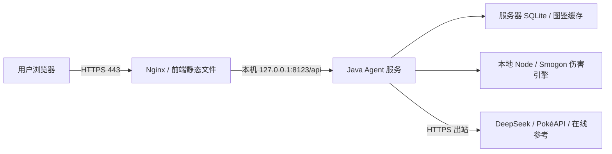

# 阿里云单机部署操作手册

适用项目：VIO 宝可梦智能体。编写日期：2026-11-05。

采用 **Windows 本地构建 + Ubuntu 24.04 x86_64 单台服务器运行**，使用 Nginx、Java 21、Node.js 24、SQLite 和 systemd。适合个人作品展示和少量用户试用；2 核 4 GB 是起步建议，未经过公网容量压测。模型仍调用 DeepSeek API，不需要 GPU。

本手册保留现有账号页面和功能。云端数据保存在服务器磁盘，浏览器可从不同设备访问同一账号；电脑上的旧数据不会自动上传。当前账号实现只在 `local & !prod & !demo` 生效，因此服务使用 `local,deepseek` 加本目录的外部安全配置，**不是切换到已完成验收的企业生产模式**。不要直接改用 `prod`，也不要照搬根目录旧 Docker Compose：其依赖、身份与当前 SQLite 账号链不同。

## 0. 先确认部署结构



| 路径 | 用途 |
| --- | --- |
| `/opt/vio-agent/releases/<版本号>/` | 不含凭据和个人数据的发布文件 |
| `/opt/vio-agent/current` | 指向正在使用的发布目录 |
| `/etc/vio-agent/agent.env` | 模型 Key 等服务器私密环境变量 |
| `/etc/vio-agent/application-public.yml` | 域名、持久化路径和安全配置 |
| `/var/lib/vio-agent/` | 账号、对话、队伍、收藏、攻略索引和图鉴缓存 |
| `/etc/nginx/sites-available/vio-agent` | Nginx 配置，申请证书后会被 Certbot 更新 |

以下命令明确区分 **本机 PowerShell** 和 **服务器 Bash**。每一小段成功后再继续；失败时先看文末排错表，不要整份一次粘贴。重连 SSH 后，Bash 变量需要重新设置。

## 1. 购买服务器和域名：阿里云控制台

1. 选择轻量应用服务器，或已经购买的 ECS。建议 **2 vCPU / 4 GB 内存 / 至少 40 GB SSD / 带公网 IPv4**。选择纯系统镜像 **Ubuntu 24.04 LTS、x86_64**；本手册不适用于 Windows Server、ARM 或已经运行其他站点的机器。
2. 地域优先选择你和面试官访问方便、且能访问模型与资料服务的区域。中国内地服务器对外提供网站服务应先完成所需备案；中国香港及境外地域不需要中国内地的 MIIT ICP 备案，但仍应遵守所在地和服务商要求。[阿里云备案与服务器要求](https://help.aliyun.com/zh/icp-filing/basic-icp-service/user-guide/icp-filing-server-access-information-check)
3. 设置 SSH 登录凭据，记下**公网 IP、SSH 用户名、登录方式**。以控制台显示的用户名为准，可能是 `root` 或 `ubuntu`；下文不假设所有实例都使用 root。
4. 准备自己控制的域名，例如 `example.com`，计划使用子域名 `agent.example.com`。这只是示例，所有命令都要替换成你的真实域名。
5. 开通预算或余额提醒。费用包括服务器、域名、可能的超额流量和模型调用；以实际购买页和模型账户为准，不将促销价格当作固定价格。

如果还没有域名，可以先完成打包、服务器安装和本机回环健康检查；本手册的公网登录验收依赖 **域名 + HTTPS**，不建议用裸 IP 的 HTTP 临时登录来替代。

## 2. 放行端口并添加域名解析：阿里云控制台

在轻量服务器“防火墙”或 ECS“安全组入方向”中检查规则：

| 协议 / 端口 | 来源 | 用途 |
| --- | --- | --- |
| TCP 22 | 你的管理公网 IP `/32`，或明确的管理网段 | SSH；修改前保留控制台登录救援方式 |
| TCP 80 | `0.0.0.0/0` | HTTP 跳转与证书验证 |
| TCP 443 | `0.0.0.0/0` | HTTPS 网站 |

不要向公网开放 8123、3000、数据库端口或全部端口。若额外启用了服务器 UFW，也要允许 SSH、80、443；本手册不会替你启用或重置 UFW。

在域名 DNS 管理中增加：类型 **A**、主机记录 **agent**、值为**服务器公网 IPv4**。若暂时没有可用 IPv6，不要为同一主机保留错误的 AAAA 记录。初次部署使用直接解析，不叠加 CDN。[阿里云域名解析操作](https://help.aliyun.com/zh/dns/beginner-s-guide)

**本机 PowerShell**，验证解析：

```powershell
Resolve-DnsName agent.example.com -Type A
```

**检查点：**返回你服务器的公网 IP。DNS 未正确生效之前，不进入证书申请步骤。

## 3. 本地生成干净的发布包：Windows PowerShell

本项目已经提供 `tools/package-aliyun.ps1`。它从指定 Git 提交导出公开源码到隔离目录后构建，避免把你平时运行时的私有 `application-local.yml` 打入 JAR，也不会复制 `.run/`、`.idea/`、`.local-data/`、`.env` 或本机的 `node_modules`。

默认构建 **HEAD 已提交版本**，不包含尚未提交的业务代码；本目录部署模板取自当前工作区。需要发布未提交业务改动时，先自行审阅并提交这些改动，再打包。无需将任何 Key 写入 Git。

```powershell
cd 'D:\ai-intern-cjt\ai-intern-folder\my\AI-Agent'
$env:JAVA_HOME='C:\Users\hello\.jdks\dragonwell-21.0.12'
$env:Path="$env:JAVA_HOME\bin;$env:Path"
java -version
node --version
git status --short

# 先检查工具链和打包范围。
powershell -NoProfile -ExecutionPolicy Bypass -File .\tools\package-aliyun.ps1 -ValidateOnly

# 选择一个从未使用过的版本号，后文统一使用它。
powershell -NoProfile -ExecutionPolicy Bypass -File .\tools\package-aliyun.ps1 -ReleaseId 20261105-03
```

`JAVA_HOME` 要指向实际存在的 **JDK 21 根目录**；上述路径是当前电脑已核对的安装位置。前端构建建议使用已安装的 Node.js 24。首次构建需要下载 Maven/npm 依赖，已有完整 Maven 缓存时可加 `-OfflineMaven`，npm 安装仍需要可用缓存或网络。

成功后得到：

```text
artifacts/aliyun/20261105-03/vio-agent-20261105-03.tar.gz
artifacts/aliyun/20261105-03/vio-agent-20261105-03.tar.gz.sha256
```

包内包括 `app.jar`、`frontend/`、`tools/pokemon-engine/`、`deploy/`、`release.json` 和 `SHA256SUMS`。构建使用 `-DskipTests`，**打包成功不等于已完成新的全量测试或公网验收**。不要直接从日常 `target/` 拿 JAR 代替，以免包含私有配置。

## 4. 上传并登录服务器：Windows PowerShell

填入实际 IP、用户名；首次连接时通过阿里云控制台核对 SSH 主机指纹，再确认连接。使用 SSH 私钥的用户，在 `scp` 和 `ssh` 中追加 `-i '私钥完整路径'`，不要把私钥上传到服务器。

```powershell
$vioServer='你的服务器公网IP'
$vioSshUser='root'
$vioRelease='20261105-03'
$vioPackage=".\artifacts\aliyun\$vioRelease\vio-agent-$vioRelease.tar.gz"
scp $vioPackage "${vioPackage}.sha256" "${vioSshUser}@${vioServer}:/tmp/"
ssh "${vioSshUser}@${vioServer}"
```

如果控制台用户名是 `ubuntu`，将 `root` 换成 `ubuntu`。若使用控制台 Workbench 登录，也可以在第 5 步开始执行 Bash 命令。

## 5. 安装运行环境：服务器 Bash

先设置后续命令共同使用的变量。**真实域名只写主机名，不带 `https://`、端口或路径。**

```bash
export VIO_DOMAIN='agent.example.com'
export VIO_RELEASE_ID='20261105-03'
export VIO_RELEASE_DIR="/opt/vio-agent/releases/$VIO_RELEASE_ID"
uname -m
cat /etc/os-release
```

期望 `x86_64`、Ubuntu 24.04。确认后安装：

```bash
sudo apt-get update
sudo apt-get install -y openjdk-21-jre-headless nginx curl xz-utils openssl snapd
java -version
sudo systemctl enable --now nginx
```

安装固定的 Node.js 24 LTS 二进制，并验证下载摘要。下面版本在编写手册时已核对官方发布文件；后续升级时重新核对官方发布页，不从非官方脚本直接安装。

```bash
export VIO_NODE_VERSION='v24.22.2'
mkdir -p "/tmp/vio-node-$VIO_NODE_VERSION"
cd "/tmp/vio-node-$VIO_NODE_VERSION"
curl -fSLO "https://nodejs.org/dist/$VIO_NODE_VERSION/node-$VIO_NODE_VERSION-linux-x64.tar.xz"
curl -fSLO "https://nodejs.org/dist/$VIO_NODE_VERSION/SHASUMS256.txt"
awk -v f="node-$VIO_NODE_VERSION-linux-x64.tar.xz" '$2 == f {print}' SHASUMS256.txt > node.sha256
test -s node.sha256 && sha256sum -c node.sha256
```

**只有摘要校验显示 OK 才继续：**

```bash
sudo tar -xJf "node-$VIO_NODE_VERSION-linux-x64.tar.xz" -C /opt
sudo ln -sfn "/opt/node-$VIO_NODE_VERSION-linux-x64/bin/node" /usr/local/bin/node
sudo ln -sfn "/opt/node-$VIO_NODE_VERSION-linux-x64/bin/npm" /usr/local/bin/npm
/usr/local/bin/node --version
/usr/local/bin/npm --version
```

**检查点：**Java 21、Node `v24.22.2`，Nginx 为 active。Node 只运行伤害计算子进程，不开设独立公网端口。[Node 官方发布文件](https://nodejs.org/dist/v24.22.2/)

## 6. 安装发布文件与伤害引擎：服务器 Bash

```bash
id vioagent >/dev/null 2>&1 || sudo useradd --system --home-dir /var/lib/vio-agent --shell /usr/sbin/nologin vioagent
sudo install -d -m 0755 /opt/vio-agent /opt/vio-agent/releases
sudo install -d -m 0750 -o root -g vioagent /etc/vio-agent
sudo install -d -m 0700 -o vioagent -g vioagent /var/lib/vio-agent
cd /tmp
sha256sum -c "vio-agent-$VIO_RELEASE_ID.tar.gz.sha256"
```

摘要通过后，使用新的目录解包，避免覆盖正在运行的版本：

```bash
if sudo test -e "$VIO_RELEASE_DIR"; then
  echo '版本目录已存在：请换新版本号，或先核对已解包的内容；不要覆盖。'
else
  sudo mkdir "$VIO_RELEASE_DIR"
  sudo tar -xzf "/tmp/vio-agent-$VIO_RELEASE_ID.tar.gz" -C "$VIO_RELEASE_DIR"
fi
cd "$VIO_RELEASE_DIR"
sudo sha256sum -c SHA256SUMS
cat release.json
```

**检查点：**所有包内摘要 OK，`sourceCommit` 为你要部署的提交。如果已有目录的校验失败，停止本次安装，使用新版本号重新打包上传。

安装 Linux 服务器侧伤害引擎依赖、运行引擎测试，然后固定文件权限：

```bash
sudo /usr/local/bin/npm --prefix "$VIO_RELEASE_DIR/tools/pokemon-engine" ci --omit=dev --ignore-scripts
sudo /usr/local/bin/node --test "$VIO_RELEASE_DIR/tools/pokemon-engine/calculate.test.cjs"
sudo chown -R root:root "$VIO_RELEASE_DIR"
sudo find "$VIO_RELEASE_DIR" -type d -exec chmod 0755 {} +
sudo find "$VIO_RELEASE_DIR" -type f -exec chmod 0644 {} +
```

`npm ci` 需要访问 npm 仓库。包内不含 Windows 的 `node_modules`，不要自行用 Windows 安装目录替换它。安装新依赖后 `node_modules` 不在原始 SHA 清单中，这是预期行为，原有发布文件仍应通过校验。

## 7. 配置模型 Key 和域名：服务器 Bash

首次安装复制私密环境模板；**更新版本时保留现有文件**：

```bash
if ! sudo test -f /etc/vio-agent/agent.env; then
  sudo install -m 0600 "$VIO_RELEASE_DIR/deploy/agent.env.example" /etc/vio-agent/agent.env
fi
sudoedit /etc/vio-agent/agent.env
```

在编辑器中把 `DEEPSEEK_API_KEY=REPLACE_ON_SERVER` 改为你的真实 Key，保存退出。Key 仅在服务器输入，不写入命令行、前端、Git 或聊天。`sudoedit` 默认编辑器可能是 nano（`Ctrl+O` 保存、回车确认、`Ctrl+X` 退出）或 vim（按 `i` 编辑，`Esc` 后输入 `:wq` 保存退出）。

如果该模型不可用，在同一文件增加 `DEEPSEEK_MODEL=你的账户可用模型名`；不要仅凭其他平台的命名猜测。首次部署只需要 DeepSeek Key。`SEARCH_API_KEY` 是独立、可选的 SearchAPI 服务凭据；没有它时一般搜索能力受限，但图鉴、本地攻略和默认在线月度使用率功能各自使用自己的数据源。

为分页游标生成稳定的随机签名密钥，已存在则不重置；命令不会输出密钥：

```bash
if ! sudo grep -q '^VIO_RESOURCE_CURSOR_SECRET=' /etc/vio-agent/agent.env; then
  printf 'VIO_RESOURCE_CURSOR_SECRET=%s\n' "$(openssl rand -hex 32)" | sudo tee -a /etc/vio-agent/agent.env >/dev/null
fi
sudo chmod 0600 /etc/vio-agent/agent.env
```

首次安装外部配置并替换域名：

```bash
if ! sudo test -f /etc/vio-agent/application-public.yml; then
  sed "s/__VIO_DOMAIN__/$VIO_DOMAIN/g" "$VIO_RELEASE_DIR/deploy/application-public.yml.example" | sudo tee /etc/vio-agent/application-public.yml >/dev/null
  sudo chown root:vioagent /etc/vio-agent/application-public.yml
  sudo chmod 0640 /etc/vio-agent/application-public.yml
fi
sudo grep -n 'https://' /etc/vio-agent/application-public.yml
```

**检查点：**输出是你的 `https://真实域名`。更新时若域名或配置有变化，通过 `sudoedit /etc/vio-agent/application-public.yml` 审阅后修改，不盲目覆盖旧文件。

模型环境文件保持 root 所有、0600，由 systemd 读取后注入；外部 YAML 由 Java 进程读取，所以使用 root:vioagent、0640，父目录为 0750。不要把 YAML 也改成仅 root 可读而导致服务无法启动。

模板已指定仅监听 `127.0.0.1`、精确来源白名单、安全 Session Cookie、关闭 Swagger、高风险工具和历史兼容入口，并限制初始 Agent 并发。不要为解决 403 改成允许所有来源或关闭 CSRF。CSRF Cookie 必须让浏览器脚本可读，和 HttpOnly 的登录 Session Cookie 用途不同。

## 8. 启动后端并设置开机自启：服务器 Bash

首次安装时创建 `current` 链接并安装 systemd 服务：

```bash
if sudo test -e /opt/vio-agent/current || sudo test -L /opt/vio-agent/current; then
  echo 'current 已存在：首次部署到此停止；更新请使用第 12 节。'
else
  sudo ln -s "$VIO_RELEASE_DIR" /opt/vio-agent/current
fi
sudo install -m 0644 "$VIO_RELEASE_DIR/deploy/vio-agent.service" /etc/systemd/system/vio-agent.service
sudo systemctl daemon-reload
sudo systemctl enable --now vio-agent
sudo systemctl status vio-agent --no-pager
```

如果退出或仍在启动，查看最近日志（检查和分享日志前先脱敏）：

```bash
sudo journalctl -u vio-agent -n 100 --no-pager
curl -fsS http://127.0.0.1:8123/api/health
sudo ss -lntp 'sport = :8123'
```

**检查点：**服务 active、健康接口 HTTP 200、8123 只监听 `127.0.0.1`。这里还没有发起模型请求，健康通过不代表 Key 和供应商网络已验收。`agent.env` 改动后用 `sudo systemctl restart vio-agent` 生效，单独 `export` 不会修改 systemd 服务的环境。

## 9. 配置 Nginx 同源代理：服务器 Bash

首次安装生成 HTTP 站点配置。后续 Certbot 会修改这个文件，更新应用时不要重新覆盖：

```bash
if ! sudo test -f /etc/nginx/sites-available/vio-agent; then
  sed "s/__VIO_DOMAIN__/$VIO_DOMAIN/g" "$VIO_RELEASE_DIR/deploy/nginx-http.conf.template" | sudo tee /etc/nginx/sites-available/vio-agent >/dev/null
fi
sudo ln -sfn /etc/nginx/sites-available/vio-agent /etc/nginx/sites-enabled/vio-agent
sudo nginx -t
sudo systemctl reload nginx
curl -fsS -H "Host: $VIO_DOMAIN" http://127.0.0.1/api/health
```

从本机浏览器打开 `http://你的域名`，此时只检查页面能否加载，**先不要注册或登录**。服务器配置已要求 Secure Session Cookie，登录应在下一步 HTTPS 完成后进行。

模板保持 `/api` 原路径代理到后端，并关闭流式代理缓冲；不需要改前端 API Base URL，不需要在浏览器配置模型 Key。`X-API-Key` 和用户身份头不会被公网请求透传成登录身份。不要把 `proxy_pass` 改成会剥离 `/api` 的形式。[Nginx 代理与缓冲配置](https://nginx.org/en/docs/http/ngx_http_proxy_module.html)

## 10. 申请 HTTPS 证书：服务器 Bash

前置条件：真实域名 A 记录已指向本机，80/443 已放通，HTTP 站点可以从公网访问；中国内地站点已满足备案等接入条件。

本手册使用 Certbot 官方推荐的 snap 安装方式，适用于前面的新 Ubuntu 服务器；如果机器原来装过 apt 版 Certbot，先按官方指引处理版本冲突，不要混装。

```bash
sudo snap install --classic certbot
sudo /snap/bin/certbot --nginx -d "$VIO_DOMAIN" --redirect
sudo nginx -t
sudo /snap/bin/certbot renew --dry-run
curl -fsS "https://$VIO_DOMAIN/api/health"
```

首次 Certbot 交互按提示填写自己的通知邮箱、阅读并同意相关条款。dry-run 成功说明续期流程可工作；保留端口 80 和对应定时任务，之后仍应关注续期失败告警。[Certbot 官方 Nginx 操作步骤](https://certbot.eff.org/instructions?ws=nginx&os=snap)

**检查点：**浏览器访问 `https://你的域名`，无证书警告；HTTP 跳转 HTTPS，`/api/health` 200。不要用忽略证书错误的方式代替验收。

## 11. 创建账号并逐项验收：浏览器 + 服务器

打开 HTTPS 登录页创建展示账号：用户名 3～32 位英文字母、数字或下划线，密码至少 10 个字符且不超过 72 个 UTF-8 字节。妥善保存页面只展示一次的恢复码。注册接口本身不等于登录，请按页面流程完成登录。

| 操作 | 预期 |
| --- | --- |
| 登录后发送“你好，请简短介绍你能做什么” | 有正常流式正文，没有供应商鉴权或网络错误 |
| 输入“杰尼龟的属性与种族值”，点击查看图鉴 | 资料查询成功，右侧打开杰尼龟；首次请求可能需要下载资料 |
| 直接用“烈咬陆鲨”名称搜索图鉴 | 能按名称索引查找，不限编号 |
| 检索本地养成攻略，打开来源 | 有片段与对应来源；不把无资料的内容说成已查证 |
| 填写队伍并保存，刷新后重新打开 | 队伍配置仍在，属于当前账号 |
| 在计算区选择双方、等级、招式和 EV/IV 后计算 | 返回实际伤害范围、条件和假设，无 Node 路径错误 |
| 让助手修改已保存队伍 | 先出预览；只有你确认后才保存 |
| 新建对话、刷新、退出重登 | 历史可查看；Session 过期时会要求重新登录 |
| 使用第二个测试账号登录 | 看不到第一个账号的私人队伍、收藏和对话 |
| 问“朱紫 OU 单打最新已发布月度使用率” | 网络可用时返回月份与来源；月度使用率不等于实时完整队伍榜 |

浏览器开发者工具中检查：`JSESSIONID` 有 Secure、HttpOnly；`CSRF-TOKEN` 有 Secure 且前端能读取；POST/PATCH 请求携带 `X-CSRF-TOKEN`。不要截图或分享 Cookie 值。

服务器侧也可检查匿名访问边界：

```bash
curl -sS -o /dev/null -w '%{http_code}\n' "https://$VIO_DOMAIN/api/auth/local/profile"
```

**预期 401**，不应匿名返回私人资料。需要检查配置时记录状态和错误类别即可，不输出完整 Cookie、恢复码、Key 或私人对话。

完成展示账号创建后，建议关闭公开注册，以免陌生人注册并消耗你的模型额度：

```bash
sudoedit /etc/nginx/sites-available/vio-agent
```

将模板中这一行的注释去掉（放在 `server` 内）：

```nginx
location = /api/auth/local/register { return 403; }
```

```bash
sudo nginx -t
sudo systemctl reload nginx
curl -sS -o /dev/null -w '%{http_code}\n' -X POST "https://$VIO_DOMAIN/api/auth/local/register"
```

**预期 403**，已有账号仍可正常登录。需要发放另一个演示账号时临时开放并重新关闭；不要长期公开共享高权限账号。服务商的用量监控和预算提醒仍要开启，入口限流和关闭注册不能替代金额硬限额。

## 12. 后续更新和回滚：先备份，再切版本

更新业务版本时，本地使用新的 ReleaseId 重复第 3～4 步；服务器使用新版本号重复第 6 步（解包、校验、安装引擎、测试）。**保留** `/etc/vio-agent/`、`/var/lib/vio-agent/`、现有 Nginx/证书文件，不重建账号数据库。

### 停服备份

先在无人运行任务时执行下面的冷备份，确保 SQLite 主文件与 WAL 一致；备份同时包含私密配置，目录与文件仅 root 可读。不要上传到公开仓库或网站目录。

```bash
sudo bash <<'BASH'
set -euo pipefail
install -d -m 0700 /var/backups/vio-agent
backup="/var/backups/vio-agent/vio-agent-$(date +%Y%m%d-%H%M%S).tar.gz"
systemctl stop vio-agent
trap 'systemctl start vio-agent' EXIT
umask 077
tar -czf "$backup" -C / var/lib/vio-agent etc/vio-agent
tar -tzf "$backup" >/dev/null
printf '备份完成：%s\n' "$backup"
BASH
```

另行保存 Nginx 站点配置和证书设置，或使用阿里云磁盘快照。定期将**受保护的备份**复制到独立位置，单块服务器磁盘内的备份不能覆盖整机丢失风险。恢复前应停止服务，先检查压缩包路径与内容，再由有权限的人恢复对应数据目录和所有权。

### 切换新版本

确认新版本第 6 步已通过、备份可读，再执行（变量中的版本号要换成**新版本**）：

```bash
export VIO_RELEASE_ID='你的新版本号'
export VIO_RELEASE_DIR="/opt/vio-agent/releases/$VIO_RELEASE_ID"
test -f "$VIO_RELEASE_DIR/app.jar"
readlink -f /opt/vio-agent/current
```

记下上一条输出的旧版本目录，检查新目录确实在 `/opt/vio-agent/releases/` 下且摘要和测试均通过，再逐条执行：

```bash
sudo systemctl stop vio-agent
sudo ln -sfn "$VIO_RELEASE_DIR" /opt/vio-agent/current
sudo systemctl start vio-agent
sudo systemctl status vio-agent --no-pager
curl -fsS "https://$VIO_DOMAIN/api/health"
```

停止后再切链接，避免旧 Java 进程在执行期间调用到新 Node 脚本。随后重做登录、问答、队伍和计算的关键操作。服务重启后需要重新登录；历史记录持久化，但执行中的 Run、事件、审批状态不承诺跨重启续跑，已有页面应刷新并重新发起请求。

如果新版本失败，停服务后把 `current` 改回刚才记录的**真实旧目录**再启动；不要把示例字符串直接作为回滚路径。若新版本修改过数据格式，回滚 JAR 不等于回滚数据库，需核对兼容性并按受控备份恢复，不能直接覆盖正在使用的 SQLite 文件。

## 13. 常用运维命令与排错

```bash
sudo systemctl status vio-agent --no-pager
sudo systemctl restart vio-agent
sudo journalctl -u vio-agent -n 100 --no-pager
sudo nginx -t
sudo systemctl status nginx --no-pager
df -h
free -h
```

| 现象 | 优先检查 |
| --- | --- |
| 网站超时或 Certbot 失败 | DNS A/AAAA、80/443 安全组/防火墙、实例公网 IP、备案接入条件；先确认公网 HTTP 可达 |
| Nginx 502 | `vio-agent` 状态和日志、127.0.0.1:8123 健康检查、`current` 是否指向完整发布目录 |
| 登录后反复退出 | 必须访问 HTTPS；域名一致；JSESSIONID Secure/HttpOnly；不要混用 IP、HTTP、不同子域名 |
| 登录或写入 403 | 精确来源白名单是否为真实 HTTPS 域名、CSRF Cookie/请求头、是否误把注册关闭规则加到所有 `/api/` |
| 所有 `/api` 404 | `proxy_pass` 是否保留 `/api`；后端 context path 是 `/api`；别把浏览器 API 指向 localhost |
| 回答迟迟整段才显示 | Nginx `proxy_buffering off`、是否又加了 CDN/代理缓冲；前端等待工具完成与网络故障也需分别排查 |
| 模型 401 / 余额不足 / 模型名错误 | 仅在服务器检查环境文件填写和供应商账户；修改后重启；健康接口不能替代真实模型调用 |
| 图鉴 500 / 网络错误 | 服务器访问 PokéAPI 的出站网络、缓存目录写权限、具体脱敏错误；更换模型 Key 不能修复资料网络 |
| 伤害计算找不到 Node/脚本 | `/usr/local/bin/node`、current 下 v2 脚本、服务器 npm ci 是否完成、引擎测试 |
| SQLite 无法打开或写入 | `/var/lib/vio-agent` 属主是否 vioagent、磁盘是否满、外部配置是否仍指向旧电脑路径 |
| Java 被系统杀掉 / 内存不足 | `free -h`、系统日志和并发；不要在 1 GB 主机上同时构建前后端；本方案 4 GB 起步并在本地构建 |
| 更新后历史消失 | 工作目录与配置路径是否仍是 `/var/lib/vio-agent`，不要复制空库覆盖；Run 运行态本身不保证重启保存 |

## 14. 完成标准与验证范围

- [ ] 真实域名 HTTPS 可访问，HTTP 正确跳转。
- [ ] 仅 22（受限）、80、443 对外需要开放；8123 绑定回环。
- [ ] 模型 Key 只在服务器环境文件，部署包与前端不含凭据。
- [ ] 登录、匿名阻断、账号数据隔离、流式问答、图鉴、队伍、计算、历史均实际操作通过。
- [ ] 已创建展示账号并关闭公开注册，配置模型预算提醒。
- [ ] 备份可读，明确旧版本目录与回滚方法。
- [ ] 明确这是单机展示部署，尚未承诺高可用、横向扩容、运行任务跨重启恢复或公网压力容量。

本仓库提供模板和本地打包工具；**服务器真实执行、DNS/证书签发、真实模型联通及浏览器验收仍需由部署者完成**。构建日志不能代替这些检查。平台操作参考阿里云[轻量服务器产品](https://www.aliyun.com/product/swas)、[防火墙规则说明](https://help.aliyun.com/zh/simple-application-server/developer-reference/api-swas-open-2020-06-01-createfirewallrule)。
