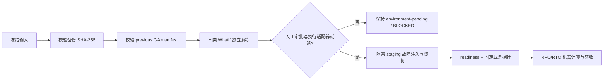

# VIO v1.1 恢复演练 Runbook

> 状态：代码级门禁已落地，真实 PostgreSQL/容器/索引恢复仍是
> `environment-pending`。脚本存在不等于 RPO/RTO 已验收。

## 1. 目标与安全边界

- 候选目标：RPO 不超过 900 秒，RTO 不超过 1800 秒；正式目标以已签署
  ADR/环境契约为准。
- 只允许在独立 staging Compose project、独立 network/volume 中演练。
- 禁止读取 `COMPOSE_PROJECT_NAME` 作为默认值；项目名、Base URL、备份和
  previous manifest 必须逐项显式传入。
- API Key 仅由 Secret Store/CI 注入，不能写入命令行、JSONL 或 Markdown。
- `-WhatIf` 先生成计划证据；值班审批、checksum 和三次 dry-run 均通过后才可
  申请执行窗口。
- 当前仓库没有经审计的 Docker/PostgreSQL/pointer 执行适配器。因此
  `-ExecuteDestructive` 会 fail-closed，且不会调用 Docker、`pg_restore` 或线上
  API。接入目标平台适配器并通过代码审查前，不得绕过这一门禁。

## 2. 演练输入

每次演练冻结以下值：

| 输入 | 规则 |
|---|---|
| `DrillId` | 每次唯一，例如 `container-01`、`db-01`、`index-01` |
| `FailureType` | `container`、`database`、`index-or-dependency` |
| `ProjectName` | 独立 staging 项目；不得包含 `prod`/`production`/`default` |
| `BackupFile` | 仓库内受控路径，非空、非符号链接 |
| `BACKUP_SHA256` | 64 位 SHA-256，由备份系统提供 |
| `PreviousManifest` | `schemaVersion=v1.1`、`releaseClass/status=GA`、`environment=prod` |
| `ApprovalId` | 值班/变更单 ID；证据只记录“是否存在”，不记录审批正文 |
| `BaseUrl` | 本次 staging 地址；生产环境禁止 localhost/staging/test 地址 |

## 3. 固定执行顺序



先验证备份：

```powershell
.\ops\recovery\verify-backup.ps1 `
  -BackupFile .\backups\staging.dump `
  -ExpectedSha256 $env:BACKUP_SHA256 `
  -Output artifacts\v1.1\recovery\backup-verify.txt `
  -NoClobber
if ($LASTEXITCODE -ne 0) { throw 'backup verification failed' }
```

再生成 previous release pointer 恢复计划：

```powershell
.\ops\recovery\restore-release-pointer.ps1 `
  -Manifest artifacts\v1.1\release\previous-manifest.json `
  -Output artifacts\v1.1\recovery\release-pointer-restore-dry-run.json `
  -WhatIf -NoClobber
if ($LASTEXITCODE -ne 0) { throw 'pointer restore plan failed' }
```

最后对三种故障分别使用新的 project 和输出文件：

```powershell
.\ops\recovery\run-v1.1-recovery-drill.ps1 `
  -BaseUrl $env:VIO_BASE_URL `
  -ProjectName ($env:VIO_RELEASE_COMPOSE_PROJECT + '-container-01') `
  -BackupFile .\backups\staging.dump `
  -ExpectedSha256 $env:BACKUP_SHA256 `
  -FailureType container `
  -DrillId container-01 `
  -PreviousManifest artifacts\v1.1\release\previous-manifest.json `
  -ApprovalId $env:VIO_RECOVERY_APPROVAL_ID `
  -FreshIsolatedProject `
  -Output artifacts\v1.1\recovery\container-01-dry-run.jsonl `
  -WhatIf -NoClobber
if ($LASTEXITCODE -ne 0) { throw 'recovery dry-run failed' }
```

`database`/`index-or-dependency` 使用 `db-01`/`index-01` 和各自独立 project，
禁止复用前一次演练留下的 volume。

## 4. Execute 适配器接入门槛

只有全部满足时，才允许把当前 fail-closed 分支替换为目标平台适配器：

1. 适配器只接受已校验 backup checksum 和 GA previous manifest。
2. staging project、network、volume 与 dev/release/prod 均不同。
3. 必须显式提供 `-RestoreOutput`、`-ReleasePointerOutput` 和审批 ID。
4. 执行前保存故障声明时间；执行后保存 restore point、readiness 和固定业务探针。
5. 日志仅包含 release ID、digest、指针、状态码和耗时，不含连接串、Header 或响应正文。
6. 任何步骤失败即停止，保留现场，禁止继续切流或写 `passed=true`。

## 5. 机器证据与完成定义

每条执行证据至少包含：

`failureType`、`drillId`、`backupTimestamp`、`lastCommittedAt`、
`restorePointAt`、`readinessAt`、`actualRpoSeconds`、`actualRtoSeconds`、
`targetRpoSeconds`、`targetRtoSeconds`、`clockSource`、`passed`。

三次真实演练完成前，当前 JSONL 的 `actual*` 和恢复时间字段必须保持 `null`，
`status=environment-pending`、`passed=false`。最终门禁取三次演练的最坏值，
不能挑选最好的一次，也不能用 dry-run 代替实测。

## 6. 回滚和中止

- checksum 不一致、manifest 非 GA/prod、项目名不安全：立即中止，不创建成功证据。
- readiness 或固定探针未通过：保持隔离，不切流；保存脱敏失败记录。
- 数据库恢复失败：不覆盖原备份；创建新 drill/project 后重试。
- 知识/索引不合格：只恢复 previous manifest 中的
  `dataReleaseId/knowledgeReleaseId/indexReleaseId`，不删除仍被引用的版本。
- 发现 Secret 写入 evidence：撤销本次证据，轮换 Secret，并用新的 DrillId 重跑。
